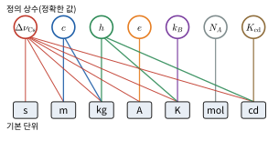

# 부록 A 물리 상수와 단위

> 값은 CODATA 2018 권장값이다. 2019년 SI 재정의 이후 **정의값**(오차 없음)인 상수는 "정확"으로 표시했다.

## A.1 SI 기본 단위 (2019년 재정의)
2019년 5월 20일부터 SI의 7개 기본 단위는 모두 **기본 상수의 값을 고정**하는 방식으로 정의된다.

| 물리량 | 단위 | 기호 | 정의에 쓰는 상수 |
|---|---|---|---|
| 시간 | 초 | s | 세슘-133 바닥상태 초미세 전이 진동수 $\Delta\nu_{\text{Cs}} = 9\,192\,631\,770\ \text{Hz}$ |
| 길이 | 미터 | m | 진공 속 빛의 속력 $c = 299\,792\,458\ \text{m/s}$ |
| 질량 | 킬로그램 | kg | 플랑크 상수 $h = 6.626\,070\,15\times10^{-34}\ \text{J·s}$ |
| 전류 | 암페어 | A | 기본전하 $e = 1.602\,176\,634\times10^{-19}\ \text{C}$ |
| 온도 | 켈빈 | K | 볼츠만 상수 $k_B = 1.380\,649\times10^{-23}\ \text{J/K}$ |
| 물질의 양 | 몰 | mol | 아보가드로 상수 $N_A = 6.022\,140\,76\times10^{23}\ \text{mol}^{-1}$ |
| 광도 | 칸델라 | cd | 발광 효율 $K_{\text{cd}} = 683\ \text{lm/W}$ (540 THz 빛) |

표의 오른쪽 열은 각 단위의 이름에 대응하는 대표 상수만 적은 것이다. 실제로는 여러 단위가 두세 개의 상수를 함께 써서 정의된다. 예를 들어 미터는 $c$와 초($\Delta\nu_{\text{Cs}}$)로, 킬로그램은 $h$와 미터·초로 정의되므로 $h$, $c$, $\Delta\nu_{\text{Cs}}$에 모두 의존한다(그림 A.1).

*그림 A.1* 일곱 정의 상수(위)와 일곱 기본 단위(아래)의 의존 관계. 선은 그 단위를 정의할 때 쓰이는 상수를 잇는다. 몰만 $N_A$ 하나로 정해지고, 나머지는 모두 초를 정하는 $\Delta\nu_{\text{Cs}}$를 거친다. 켈빈은 $k_B$, $h$, $\Delta\nu_{\text{Cs}}$로 정해진다($c$는 약분되어 빠진다).

## A.2 기본 물리 상수
| 상수 | 기호 | 값 | 비고 |
|---|---|---|---|
| 진공 속 빛의 속력 | $c$ | $2.997\,924\,58\times10^{8}\ \text{m/s}$ | 정확 |
| 플랑크 상수 | $h$ | $6.626\,070\,15\times10^{-34}\ \text{J·s}$ | 정확 |
| 환산 플랑크 상수 | $\hbar = h/2\pi$ | $1.054\,571\,817\times10^{-34}\ \text{J·s}$ | |
| 기본전하 | $e$ | $1.602\,176\,634\times10^{-19}\ \text{C}$ | 정확 |
| 볼츠만 상수 | $k_B$ | $1.380\,649\times10^{-23}\ \text{J/K}$ | 정확 |
| 아보가드로 상수 | $N_A$ | $6.022\,140\,76\times10^{23}\ \text{mol}^{-1}$ | 정확 |
| 기체 상수 | $R = N_Ak_B$ | $8.314\,462\,618\ \text{J/(mol·K)}$ | 정확 |
| 중력 상수 | $G$ | $6.674\,30\times10^{-11}\ \text{N·m}^2/\text{kg}^2$ | |
| 진공 유전율 | $\varepsilon_0$ | $8.854\,187\,8128\times10^{-12}\ \text{F/m}$ | |
| 쿨롱 상수 | $k = 1/4\pi\varepsilon_0$ | $8.987\,551\,79\times10^{9}\ \text{N·m}^2/\text{C}^2$ | |
| 진공 투자율 | $\mu_0$ | $1.256\,637\,062\,12\times10^{-6}\ \text{N/A}^2$ | $\approx 4\pi\times10^{-7}$ |
| 전자 질량 | $m_e$ | $9.109\,383\,7015\times10^{-31}\ \text{kg}$ | $= 0.510\,999\ \text{MeV}/c^2$ |
| 양성자 질량 | $m_p$ | $1.672\,621\,923\,69\times10^{-27}\ \text{kg}$ | $= 938.272\ \text{MeV}/c^2$ |
| 중성자 질량 | $m_n$ | $1.674\,927\,498\,04\times10^{-27}\ \text{kg}$ | $= 939.565\ \text{MeV}/c^2$ |
| 원자 질량 단위 | u | $1.660\,539\,066\,60\times10^{-27}\ \text{kg}$ | $= 931.494\ \text{MeV}/c^2$ |
| 슈테판–볼츠만 상수 | $\sigma$ | $5.670\,374\,419\times10^{-8}\ \text{W/(m}^2\text{·K}^4)$ | 정확 |
| 빈의 변위 상수 | $b$ | $2.897\,771\,955\times10^{-3}\ \text{m·K}$ | |
| 보어 반지름 | $a_0$ | $5.291\,772\,109\times10^{-11}\ \text{m}$ | |
| 뤼드베리 상수 | $R_\infty$ | $1.097\,373\,157\times10^{7}\ \text{m}^{-1}$ | |
| 미세구조 상수 | $\alpha$ | $7.297\,352\,569\times10^{-3}$ | $\approx 1/137.036$ |
| 전자볼트 | eV | $1.602\,176\,634\times10^{-19}\ \text{J}$ | 정확 |

## A.3 자주 쓰는 자료값
| 항목 | 값 |
|---|---|
| 표준 중력가속도 | $g_n = 9.806\,65\ \text{m/s}^2$ (정의값). 계산에서는 흔히 $9.8\ \text{m/s}^2$ |
| 표준 대기압 | $1\ \text{atm} = 101\,325\ \text{Pa}$ (정의값) |
| 지구 질량 / 평균 반지름 | $5.97\times10^{24}\ \text{kg}$ / $6.37\times10^{6}\ \text{m}$ |
| 달 질량 / 지구–달 평균 거리 | $7.35\times10^{22}\ \text{kg}$ / $3.84\times10^{8}\ \text{m}$ |
| 태양 질량 / 1 천문단위 | $1.99\times10^{30}\ \text{kg}$ / $1\ \text{au} = 1.495\,978\,707\times10^{11}\ \text{m}$ (정의값) |
| 물의 밀도 (4 °C) | $1.000\times10^{3}\ \text{kg/m}^3$ |
| 물의 비열 | $4186\ \text{J/(kg·K)}$ |
| 얼음의 융해열 / 물의 기화열 (100 °C) | $3.33\times10^{5}\ \text{J/kg}$ / $2.26\times10^{6}\ \text{J/kg}$ |
| 공기 중 음속 (20 °C) | $343\ \text{m/s}$ |
| 공기 밀도 (20 °C, 1 atm) | $1.20\ \text{kg/m}^3$ |

## A.4 SI 접두어
| 접두어 | 기호 | 배수 | 접두어 | 기호 | 배수 |
|---|---|---|---|---|---|
| 퀘타 | Q | $10^{30}$ | 데시 | d | $10^{-1}$ |
| 론나 | R | $10^{27}$ | 센티 | c | $10^{-2}$ |
| 요타 | Y | $10^{24}$ | 밀리 | m | $10^{-3}$ |
| 제타 | Z | $10^{21}$ | 마이크로 | μ | $10^{-6}$ |
| 엑사 | E | $10^{18}$ | 나노 | n | $10^{-9}$ |
| 페타 | P | $10^{15}$ | 피코 | p | $10^{-12}$ |
| 테라 | T | $10^{12}$ | 펨토 | f | $10^{-15}$ |
| 기가 | G | $10^{9}$ | 아토 | a | $10^{-18}$ |
| 메가 | M | $10^{6}$ | 젭토 | z | $10^{-21}$ |
| 킬로 | k | $10^{3}$ | 욕토 | y | $10^{-24}$ |
| 헥토 | h | $10^{2}$ | 론토 | r | $10^{-27}$ |
| 데카 | da | $10^{1}$ | 퀙토 | q | $10^{-30}$ |

퀘타·론나·론토·퀙토는 2022년 국제도량형총회에서 새로 추가된 접두어다.

## A.5 유도 단위
| 물리량 | 단위 | 기호 | 기본 단위로 |
|---|---|---|---|
| 힘 | 뉴턴 | N | $\text{kg·m/s}^2$ |
| 에너지, 일 | 줄 | J | $\text{N·m} = \text{kg·m}^2/\text{s}^2$ |
| 일률 | 와트 | W | $\text{J/s}$ |
| 압력 | 파스칼 | Pa | $\text{N/m}^2$ |
| 진동수 | 헤르츠 | Hz | $\text{s}^{-1}$ |
| 전하 | 쿨롱 | C | $\text{A·s}$ |
| 전위 | 볼트 | V | $\text{J/C} = \text{W/A}$ |
| 저항 | 옴 | Ω | $\text{V/A}$ |
| 전기용량 | 패럿 | F | $\text{C/V}$ |
| 자기장 | 테슬라 | T | $\text{N/(A·m)}$ |
| 자기 선속 | 웨버 | Wb | $\text{T·m}^2$ |
| 인덕턴스 | 헨리 | H | $\text{Wb/A}$ |
| 방사능 | 베크렐 | Bq | $\text{s}^{-1}$ |
| 흡수선량 | 그레이 | Gy | $\text{J/kg}$ |

## A.6 그리스 문자
| 대문자 | 소문자 | 이름 | 물리에서의 주된 쓰임 |
|---|---|---|---|
| Α | α | 알파 | 각가속도, 미세구조 상수 |
| Β | β | 베타 | $v/c$, 감쇠 계수 |
| Γ | γ | 감마 | 로런츠 인자, 비열비 |
| Δ | δ | 델타 | 변화량, 작은 양 |
| Ε | ε | 엡실론 | 유전율, 기전력 |
| Ζ | ζ | 제타 | 감쇠비 |
| Η | η | 에타 | 효율, 점성 계수 |
| Θ | θ | 세타 | 각도 |
| Κ | κ | 카파 | 유전 상수, 열전도도 |
| Λ | λ | 람다 | 파장, 선밀도, 붕괴 상수 |
| Μ | μ | 뮤 | 마찰 계수, 투자율, 쌍극자 모멘트 |
| Ν | ν | 뉴 | 진동수 |
| Π | π | 파이 | 원주율 |
| Ρ | ρ | 로 | 밀도, 비저항 |
| Σ | σ | 시그마 | 면밀도, 전도도, 합 |
| Τ | τ | 타우 | 토크, 시간 상수 |
| Φ | φ | 파이 | 선속, 위상 |
| Χ | χ | 카이 | 자화율 |
| Ψ | ψ | 프사이 | 파동함수 |
| Ω | ω | 오메가 | 각진동수, 옴 |
