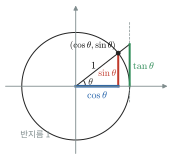
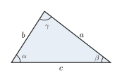
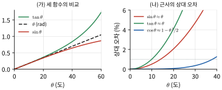
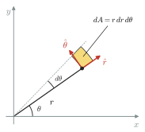
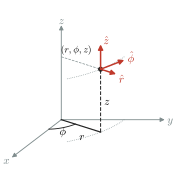
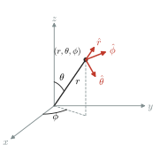
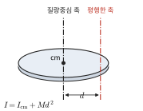

# 부록 B 수학 공식

## B.1 삼각함수
반지름 1인 원(단위원) 위에서 $+x$축과 각 $\theta$를 이루는 점의 좌표가 $(\cos\theta, \sin\theta)$이다(그림 B.1).

*그림 B.1* 단위원에서 본 삼각함수. 점의 $x$좌표가 $\cos\theta$, $y$좌표가 $\sin\theta$이고, $x = 1$인 접선 위의 높이가 $\tan\theta$이다. 피타고라스 정리에서 $\sin^2\theta + \cos^2\theta = 1$이 바로 나온다.

$$
\sin^2\theta + \cos^2\theta = 1, \qquad 1 + \tan^2\theta = \sec^2\theta
$$
$$
\sin(\alpha\pm\beta) = \sin\alpha\cos\beta \pm \cos\alpha\sin\beta, \qquad \cos(\alpha\pm\beta) = \cos\alpha\cos\beta \mp \sin\alpha\sin\beta
$$
$$
\sin2\theta = 2\sin\theta\cos\theta, \qquad \cos2\theta = \cos^2\theta - \sin^2\theta = 1 - 2\sin^2\theta
$$
$$
\sin\alpha + \sin\beta = 2\sin\frac{\alpha+\beta}{2}\cos\frac{\alpha-\beta}{2}, \qquad \cos\alpha + \cos\beta = 2\cos\frac{\alpha+\beta}{2}\cos\frac{\alpha-\beta}{2}
$$
합을 곱으로 바꾸는 마지막 두 식은 맥놀이(17장)와 정상파(16장)에서 쓴다.

**코사인 법칙**: $c^2 = a^2 + b^2 - 2ab\cos\gamma$ · **사인 법칙**: $\dfrac{a}{\sin\alpha} = \dfrac{b}{\sin\beta} = \dfrac{c}{\sin\gamma}$ (기호는 그림 B.2)

*그림 B.2* 코사인 법칙과 사인 법칙의 기호. 각 $\alpha$, $\beta$, $\gamma$의 맞은편 변이 각각 $a$, $b$, $c$이다.

## B.2 지수와 로그
$e^{a}e^{b} = e^{a+b}$, $\ln(ab) = \ln a + \ln b$, $\ln a^n = n\ln a$, $\log_{10}x = \ln x/\ln10$
오일러 공식: $e^{i\theta} = \cos\theta + i\sin\theta$, 따라서 $\cos\theta = \dfrac{e^{i\theta} + e^{-i\theta}}{2}$, $\sin\theta = \dfrac{e^{i\theta} - e^{-i\theta}}{2i}$

## B.3 급수 전개
| 함수 | 전개 | 수렴 범위 |
|---|---|---|
| $(1+x)^n$ | $1 + nx + \dfrac{n(n-1)}{2!}x^2 + \cdots$ | $\lvert x\rvert < 1$ |
| $e^x$ | $1 + x + \dfrac{x^2}{2!} + \dfrac{x^3}{3!} + \cdots$ | 모든 $x$ |
| $\ln(1+x)$ | $x - \dfrac{x^2}{2} + \dfrac{x^3}{3} - \cdots$ | $-1 < x \le 1$ |
| $\sin x$ | $x - \dfrac{x^3}{3!} + \dfrac{x^5}{5!} - \cdots$ | 모든 $x$ |
| $\cos x$ | $1 - \dfrac{x^2}{2!} + \dfrac{x^4}{4!} - \cdots$ | 모든 $x$ |
| $\tan x$ | $x + \dfrac{x^3}{3} + \cdots$ | $\lvert x\rvert < \pi/2$ |
| $\dfrac{1}{1-x}$ | $1 + x + x^2 + \cdots$ | $\lvert x\rvert < 1$ |

작은 각 근사 $\sin\theta \approx \theta$, $\tan\theta \approx \theta$, $\cos\theta \approx 1 - \theta^2/2$($\theta$는 라디안)가 어느 각까지 쓸 만한지는 그림 B.3과 같다.

*그림 B.3* (가) $\sin\theta$, $\theta$, $\tan\theta$의 비교. (나) 작은 각 근사의 상대 오차. 오차 1%(점선) 이내인 범위는 $\sin\theta \approx \theta$가 약 $14°$, $\tan\theta \approx \theta$가 약 $10°$까지이고, $\cos\theta \approx 1 - \theta^2/2$는 약 $38°$까지이다.

## B.4 미분
| $f(x)$ | $f'(x)$ | $f(x)$ | $f'(x)$ |
|---|---|---|---|
| $x^n$ | $nx^{n-1}$ | $\tan x$ | $\sec^2 x$ |
| $e^{ax}$ | $ae^{ax}$ | $\sin^{-1}x$ | $1/\sqrt{1-x^2}$ |
| $\ln x$ | $1/x$ | $\tan^{-1}x$ | $1/(1+x^2)$ |
| $\sin ax$ | $a\cos ax$ | $u v$ | $u'v + uv'$ |
| $\cos ax$ | $-a\sin ax$ | $u/v$ | $(u'v - uv')/v^2$ |

## B.5 적분 (적분상수 생략)
| 적분 | 결과 |
|---|---|
| $\int x^n\,dx$ | $\dfrac{x^{n+1}}{n+1}$ ($n\ne-1$) |
| $\int \dfrac{dx}{x}$ | $\ln\lvert x\rvert$ |
| $\int e^{ax}\,dx$ | $\dfrac{1}{a}e^{ax}$ |
| $\int \sin ax\,dx$, $\int\cos ax\,dx$ | $-\dfrac{1}{a}\cos ax$, $\dfrac{1}{a}\sin ax$ |
| $\int \sin^2 ax\,dx$ | $\dfrac{x}{2} - \dfrac{\sin2ax}{4a}$ |
| $\int \dfrac{dx}{a^2 + x^2}$ | $\dfrac{1}{a}\tan^{-1}\dfrac{x}{a}$ |
| $\int \dfrac{dx}{\sqrt{a^2 - x^2}}$ | $\sin^{-1}\dfrac{x}{a}$ |
| $\int \dfrac{dx}{\sqrt{x^2 + a^2}}$ | $\ln\left(x + \sqrt{x^2 + a^2}\right)$ |
| $\int \dfrac{x\,dx}{\sqrt{x^2 + a^2}}$ | $\sqrt{x^2 + a^2}$ |
| $\int \dfrac{dx}{(x^2 + a^2)^{3/2}}$ | $\dfrac{x}{a^2\sqrt{x^2 + a^2}}$ |
| $\int \dfrac{x\,dx}{(x^2 + a^2)^{3/2}}$ | $-\dfrac{1}{\sqrt{x^2 + a^2}}$ |
| $\int x e^{ax}\,dx$ | $\dfrac{e^{ax}}{a^2}(ax - 1)$ |

마지막 위쪽 세 줄은 대전된 막대·고리·원판의 전기장과 전위(21, 23장)를 구할 때 반복해서 나온다.

### 가우스 적분과 감마 함수 (19장 맥스웰–볼츠만 분포)
$$
\int_0^\infty e^{-ax^2}dx = \frac{1}{2}\sqrt{\frac{\pi}{a}}, \quad
\int_0^\infty x\,e^{-ax^2}dx = \frac{1}{2a}, \quad
\int_0^\infty x^2e^{-ax^2}dx = \frac{1}{4}\sqrt{\frac{\pi}{a^3}}
$$
$$
\int_0^\infty x^3e^{-ax^2}dx = \frac{1}{2a^2}, \quad
\int_0^\infty x^4e^{-ax^2}dx = \frac{3}{8}\sqrt{\frac{\pi}{a^5}}, \quad
\int_0^\infty x^n e^{-x}dx = n!
$$

## B.6 벡터
- 내적: $\vec{A}\cdot\vec{B} = AB\cos\phi = A_xB_x + A_yB_y + A_zB_z$
- 외적: $\vec{A}\times\vec{B} = (A_yB_z - A_zB_y)\hat{i} + (A_zB_x - A_xB_z)\hat{j} + (A_xB_y - A_yB_x)\hat{k}$, 크기 $AB\sin\phi$
- 스칼라 삼중곱: $\vec{A}\cdot(\vec{B}\times\vec{C}) = \vec{B}\cdot(\vec{C}\times\vec{A}) = \vec{C}\cdot(\vec{A}\times\vec{B})$
- 벡터 삼중곱: $\vec{A}\times(\vec{B}\times\vec{C}) = \vec{B}(\vec{A}\cdot\vec{C}) - \vec{C}(\vec{A}\cdot\vec{B})$
- 기울기·발산·회전 (직교 좌표):
$$
\nabla f = \frac{\partial f}{\partial x}\hat{i} + \frac{\partial f}{\partial y}\hat{j} + \frac{\partial f}{\partial z}\hat{k}, \qquad
\nabla\cdot\vec{F} = \frac{\partial F_x}{\partial x} + \frac{\partial F_y}{\partial y} + \frac{\partial F_z}{\partial z}
$$
$$
\nabla\times\vec{F} = \left(\frac{\partial F_z}{\partial y} - \frac{\partial F_y}{\partial z}\right)\hat{i} + \left(\frac{\partial F_x}{\partial z} - \frac{\partial F_z}{\partial x}\right)\hat{j} + \left(\frac{\partial F_y}{\partial x} - \frac{\partial F_x}{\partial y}\right)\hat{k}
$$
- 가우스(발산) 정리: $\oint_S \vec{F}\cdot d\vec{A} = \int_V \nabla\cdot\vec{F}\,dV$
- 스토크스 정리: $\oint_C \vec{F}\cdot d\vec{\ell} = \int_S (\nabla\times\vec{F})\cdot d\vec{A}$

## B.7 좌표계와 미소 요소
| 좌표계 | 변수 | 미소 길이 | 미소 넓이(예) | 미소 부피 |
|---|---|---|---|---|
| 직교 | $x, y, z$ | $d\vec{\ell} = dx\,\hat{i} + dy\,\hat{j} + dz\,\hat{k}$ | $dx\,dy$ | $dx\,dy\,dz$ |
| 평면 극 | $r, \theta$ | $dr\,\hat{r} + r\,d\theta\,\hat{\theta}$ | $r\,dr\,d\theta$ | — |
| 원통 | $r, \phi, z$ | $dr\,\hat{r} + r\,d\phi\,\hat{\phi} + dz\,\hat{z}$ | 옆면: $R\,d\phi\,dz$ | $r\,dr\,d\phi\,dz$ |
| 구면 | $r, \theta, \phi$ | $dr\,\hat{r} + r\,d\theta\,\hat{\theta} + r\sin\theta\,d\phi\,\hat{\phi}$ | 구면: $R^2\sin\theta\,d\theta\,d\phi$ | $r^2\sin\theta\,dr\,d\theta\,d\phi$ |

각 좌표계의 변수와 단위벡터는 그림 B.4(평면 극좌표), 그림 B.5(원통 좌표), 그림 B.6(구면 좌표)과 같다. 구면 좌표의 $\theta$는 $+z$축에서 잰 각이고, $\phi$는 $xy$ 평면에서 $+x$축으로부터 잰 각이다.

*그림 B.4* 평면 극좌표 $(r, \theta)$와 단위벡터 $\hat{r}$, $\hat{\theta}$. 미소 넓이 요소는 가로 $dr$, 세로 $r\,d\theta$인 작은 사각형이므로 $dA = r\,dr\,d\theta$이다. 단위벡터의 방향은 점마다 다르다.

*그림 B.5* 원통 좌표 $(r, \phi, z)$와 단위벡터 $\hat{r}$, $\hat{\phi}$, $\hat{z}$. $r$는 $z$축까지의 거리, $\phi$는 $xy$ 평면에서 $+x$축으로부터 잰 각이다.

*그림 B.6* 구면 좌표 $(r, \theta, \phi)$와 단위벡터 $\hat{r}$, $\hat{\theta}$, $\hat{\phi}$. $r$는 원점까지의 거리, $\theta$는 $+z$축과 이루는 각, $\phi$는 $xy$ 평면에 내린 그림자가 $+x$축과 이루는 각이다.

반지름 $R$인 구의 겉넓이 $4\pi R^2$, 부피 $\frac{4}{3}\pi R^3$ · 원통의 옆넓이 $2\pi RL$, 부피 $\pi R^2L$

## B.8 자주 쓰는 관성모멘트 (질량 $M$)
| 물체 | 회전축 | $I$ |
|---|---|---|
| 얇은 고리 (반지름 $R$) | 중심, 면에 수직 | $MR^2$ |
| 원판·원기둥 (반지름 $R$) | 중심축 | $\frac{1}{2}MR^2$ |
| 속이 찬 구 (반지름 $R$) | 지름 | $\frac{2}{5}MR^2$ |
| 얇은 구껍질 (반지름 $R$) | 지름 | $\frac{2}{3}MR^2$ |
| 가는 막대 (길이 $L$) | 중심, 막대에 수직 | $\frac{1}{12}ML^2$ |
| 가는 막대 (길이 $L$) | 한쪽 끝, 막대에 수직 | $\frac{1}{3}ML^2$ |
| 직사각형 판 ($a\times b$) | 중심, 면에 수직 | $\frac{1}{12}M(a^2 + b^2)$ |

평행축 정리: $I = I_{\text{cm}} + Md^2$ ($d$는 질량중심 축과 그에 평행한 축 사이의 거리, 그림 B.7)

*그림 B.7* 질량중심을 지나는 축(검정)과 거리 $d$만큼 떨어진 평행한 축(빨강). 평행한 축에 대한 관성모멘트는 $I_{\text{cm}}$보다 $Md^2$만큼 크다.
