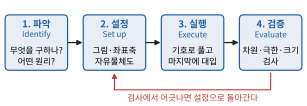
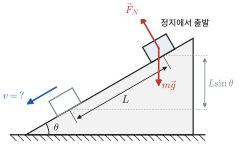

# 0장 대학 물리를 공부하는 법

> 이 장은 교재 내용을 시작하기 전에 읽는 안내 장이다. 대학 일반물리가 고등학교 물리와 어떻게 다른지, 입학 전 몇 달을 어떻게 쓰면 좋은지, 이 책을 어떻게 활용하는지를 다룬다.

## 학습 목표
- 대학 일반물리 수업의 구성(강의·연습반·실험·시험)을 이해한다.
- 고등학교 물리와 대학 물리의 차이를 수학적 도구와 사고방식의 측면에서 설명할 수 있다.
- 물리 문제를 푸는 표준 절차(모형화 → 풀이 → 검증)를 익힌다.
- 입학 전 자습 계획을 스스로 세울 수 있다.

---

## 0.1 대학 일반물리 수업은 어떻게 진행되는가

국내 주요 대학의 1학년 일반물리는 대체로 다음과 같이 구성된다(학교별 세부 내용은 `00_조사보고서.md` 참고).

| 구성 요소 | 내용 | 자습 시 대비 방법 |
|---|---|---|
| 강의 | 주 3시간 안팎. 1학기 역학·파동·열, 2학기 전자기·광학·현대물리가 일반적 | 이 책의 장 순서가 강의 순서와 거의 같다 |
| 연습반(recitation) / 퀴즈 | 조교가 문제풀이를 하거나 매주 퀴즈를 본다 | 각 장의 연습문제 "기본·응용" |
| 과제(problem set) | 매주 또는 격주. 온라인 과제 시스템을 쓰는 학교도 있다 | 각 장의 "응용" 문제를 풀이 과정까지 써 보기 |
| 실험 | 별도 과목(물리학실험, 일반물리학실험)으로 주 1회 | 측정·오차·그래프 해석은 2장에서 다룬다 |
| 시험 | 중간·기말 2회가 기본. 학교에 따라 퀴즈 비중이 크다 | "도전" 문제로 시간 압박 연습 |

> **💡 개념 확인: 영어 강의 대비**
> 상당수 대학에서 원서를 쓰고 영어로 강의한다. 이 책은 한국어로 쓰였지만, 모든 용어를 처음 나올 때 영어와 함께 적고, 장마다 "영어 용어 정리" 표를 둔다. 영어 용어만 익혀 두어도 첫 학기 수업의 부담이 크게 줄어든다.

---

## 0.2 고등학교 물리와 무엇이 다른가

### (1) 미적분이 "공식을 외우는 대신" 쓰인다
고등학교에서는 등가속도 운동 공식 $s = v_0 t + \frac{1}{2} a t^2$을 외워서 썼다. 대학에서는 가속도의 정의 $a = \dfrac{dv}{dt}$에서 출발해 적분으로 이 식을 **유도**하고, 가속도가 일정하지 않은 경우(예: 공기저항, 용수철)까지 같은 방법으로 다룬다.

$$
v(t) = v_0 + \int_0^t a(t')\,dt', \qquad x(t) = x_0 + \int_0^t v(t')\,dt'
$$

공식은 **결과**일 뿐이고, 대학 물리에서 중요한 것은 **정의와 기본 법칙에서 결과를 끌어내는 과정**이다.

### (2) 모든 양을 벡터로 다룬다
힘, 속도, 전기장, 자기장은 모두 벡터다. 대학에서는 성분 분해, 내적, 외적을 자유롭게 쓴다. 특히 토크 $\vec{\tau} = \vec{r} \times \vec{F}$와 로런츠 힘 $\vec{F} = q\vec{v} \times \vec{B}$는 외적 없이 이해할 수 없다(1장에서 정리).

### (3) 보존 법칙과 대칭이 중심에 있다
에너지, 운동량, 각운동량 보존은 단순한 "문제풀이 요령"이 아니라 물리학 전체를 꿰는 원리다. 대학 물리는 같은 문제를 힘(뉴턴 법칙)으로 풀 수도 있고 에너지로 풀 수도 있다는 것을 보여 주고, 어느 쪽이 효율적인지 판단하는 능력을 요구한다.

### (4) 근사와 모형화를 명시적으로 한다
"마찰을 무시한다", "작은 각도에서 $\sin\theta \approx \theta$" 같은 근사를 **언제, 왜** 쓰는지 설명할 수 있어야 한다. 대학 시험에서는 근사의 타당성을 묻는 문제가 자주 나온다.

### (5) 현대물리와 연결된다
상대성이론과 양자역학은 고등학교에서 소개 수준이었지만, 대학 일반물리 2학기 후반에는 슈뢰딩거 방정식, 원자 구조, 고체 물리까지 다룬다.

---

## 0.3 문제를 푸는 표준 절차

대학 물리 문제는 다음 4단계로 푸는 습관을 들이면 좋다(그림 0.1). 영어 교재에서는 흔히 **ISEE**(Identify, Set up, Execute, Evaluate)라고 부른다.

1. **파악(Identify)**: 무엇을 구하는가? 주어진 것은? 어떤 물리 원리(뉴턴 법칙, 에너지 보존, 가우스 법칙 …)가 적용되는가?
2. **설정(Set up)**: 그림을 그리고 좌표축을 정한다. 자유물체도(free-body diagram)를 그린다. 필요한 식을 **기호로** 적는다.
3. **실행(Execute)**: 숫자를 넣기 전에 **기호로 끝까지 풀고**, 마지막에 숫자를 대입한다.
4. **검증(Evaluate)**: 아래 세 가지를 확인한다.
   - **차원(단위) 검사**: 양변의 단위가 같은가?
   - **극한 검사**: 질량이 0이거나 각도가 90°인 극단적인 경우에 결과가 상식과 맞는가?
   - **크기 검사**: 답의 크기가 현실적인가? (자동차 속도가 $3\times10^8\ \text{m/s}$로 나오면 틀렸다.)



*그림 0.1* 문제 풀이의 4단계(ISEE). 검증에서 결과가 차원·극한·크기 검사를 통과하지 못하면 그림과 식을 세운 단계로 돌아가 다시 확인한다.

### 예제 0.1 차원 검사와 극한 검사
마찰이 없는 경사각 $\theta$의 빗면에서 정지 상태로 출발한 물체가 빗면을 따라 거리 $L$만큼 미끄러졌을 때의 속력이 $v = \sqrt{2gL\sin\theta}$라고 한다. 이 결과를 검증하라.



*그림 0.2* 예제 0.1의 상황을 "설정" 단계에서 그린 그림. 물체에는 중력 $m\vec{g}$와 수직항력 $\vec{F}_N$만 작용하고, 빗면을 따라 $L$만큼 내려오는 동안 높이는 $L\sin\theta$만큼 낮아진다.

**풀이** 상황을 그림으로 나타내면 그림 0.2와 같다.
- 차원: $g$는 $\text{m/s}^2$, $L$은 $\text{m}$이므로 $gL$은 $\text{m}^2/\text{s}^2$이고, 제곱근은 $\text{m/s}$이다. 속력의 단위와 같다. ✔
- 극한 1: $\theta = 0$(수평면)이면 $v = 0$. 수평면에 놓인 물체는 움직이지 않으므로 맞다. ✔
- 극한 2: $\theta = 90°$이면 $v = \sqrt{2gL}$. 높이 $L$에서 자유낙하한 속력과 같으므로 맞다. ✔

### 예제 0.2 페르미 추정
서울 시내를 달리는 모든 자동차의 운동에너지 합은 대략 얼마일까?

**풀이** 정확한 값이 아니라 **크기 정도**(order of magnitude)를 구한다.
- 동시에 도로를 달리는 자동차: 약 $10^6$대로 가정
- 자동차 1대의 질량: 약 $1.5\times10^3\ \text{kg}$
- 평균 속력: 약 $30\ \text{km/h} \approx 8\ \text{m/s}$

$$
E \approx 10^6 \times \frac{1}{2}(1.5\times10^3)(8)^2 \approx 5\times10^{10}\ \text{J}
$$

이는 대략 원자력 발전소 1기(약 $1\ \text{GW}$)가 1분 동안 생산하는 전기에너지($6\times10^{10}\ \text{J}$)와 비슷한 크기다. 이처럼 어림셈은 물리적 감각을 기르는 좋은 훈련이다.

---

## 0.4 입학 전 자습 계획 (권장안)

합격 발표 후 입학까지는 대략 12~14주다. 1학기 범위를 먼저 확실히 하고, 2학기 범위는 개념을 훑는 것을 목표로 한다.

| 주차 | 범위 | 목표 |
|---|---|---|
| 1 | 0장, 1장 수학 도구 | 벡터·미적분·미분방정식 기초 정비 |
| 2~3 | 2~6장 운동학·뉴턴 법칙 | 미적분으로 운동 다루기 |
| 4~5 | 7~9장 에너지·운동량 | 보존 법칙 |
| 6 | 10~12장 회전·평형 | 외적, 각운동량 |
| 7 | 13~14장 중력·유체 | |
| 8 | 15~17장 진동·파동 | 미분방정식 응용 |
| 9 | 18~20장 열역학 | 통계적 관점 |
| 10~11 | 21~31장 전자기 (개념 위주) | 2학기 대비 |
| 12 | 32~34장 광학, 35~40장 현대물리 훑어보기 | |
| 13~14 | 복습, 모의시험 | 각 장 도전 문제 |

> **💡 공부 요령**
> - 하루 2~3시간을 꾸준히 쓰는 것이 몰아서 하는 것보다 낫다.
> - 예제는 풀이를 가리고 먼저 풀어 본 뒤 비교한다.
> - "기본" 문제를 막힘없이 풀 수 있으면 다음 장으로 넘어가고, "도전" 문제는 나중에 다시 돌아와도 된다.

---

## 0.5 이 책의 구성과 박스 읽는 법

각 장은 **학습 목표 → 고등학교 물리와 무엇이 다른가 → 본문과 예제 → 핵심 정리 → 연습문제 → 답과 힌트 → 영어 용어 정리** 순서로 되어 있다. 본문 중간에는 다음 다섯 가지 박스가 있다.

| 표시 | 이름 | 읽는 법 |
|---|---|---|
| 💡 | 개념 확인 | 반드시 읽는다. 흔한 오개념을 바로잡는다 |
| ★ | 심화 | 고급물리학·아너스 과정 수준이다. 처음에는 건너뛰어도 된다 |
| 🔬 | 최신 연구 노트 | 이 장의 내용이 최근 연구와 어떻게 이어지는지 소개한다 |
| 🔗 | 전공 연결 | 기계공학·약학·수의학 전공 과목과의 연결을 보여 준다 |
| 🐍 | 파이썬 실습 | 직접 실행해 보는 짧은 코드다. 계산물리의 기초가 된다 |

### 파이썬 준비
이 책의 파이썬 실습은 `numpy`와 `matplotlib`만 쓴다. 설치가 번거로우면 웹 브라우저에서 바로 쓸 수 있는 Google Colab을 쓰면 된다.

```python
import numpy as np
import matplotlib.pyplot as plt

t = np.linspace(0, 4.08, 409)       # 0~4.08초(던졌다가 떨어질 때까지)를 0.01초 간격으로
y = 20*t - 0.5*9.8*t**2             # 위로 20 m/s로 던진 공의 높이
plt.plot(t, y); plt.xlabel("t (s)"); plt.ylabel("y (m)"); plt.show()
print("최고점 높이 ≈", y.max().round(2), "m")   # 이론값 v0^2/(2g) = 20.41 m
```

---

## 연습문제

**기본**
1. 진자의 주기가 $T = 2\pi\sqrt{L/g}$일 때, 이 식의 차원이 맞는지 확인하라.
2. 어떤 학생이 자유낙하 거리를 $d = g t^3/2$라고 썼다. 차원 검사로 틀렸음을 보여라.
3. 사람의 심장이 일생 동안 뛰는 횟수를 어림하라.

**응용**

4. 단면적 $A$인 물체가 밀도 $\rho$인 공기 속을 속력 $v$로 움직일 때 받는 공기저항력이 $F = C\rho^a A^b v^c$ 꼴이라고 하자($C$는 차원 없는 상수). 차원 분석으로 $a, b, c$를 구하라.
5. 지구 대기 전체의 질량을 대기압과 지구 반지름으로 어림하라. (대기압 $\approx 1.0\times10^5\ \text{Pa}$, 지구 반지름 $\approx 6.4\times10^6\ \text{m}$)

**도전**

6. 수소 원자의 크기(보어 반지름)는 플랑크 상수 $\hbar$, 전자 질량 $m_e$, 그리고 $e^2/(4\pi\varepsilon_0)$만으로 정해진다고 하자. 차원 분석으로 보어 반지름의 꼴을 구하고 수치를 어림하라.

## 연습문제 답과 힌트
1. $\sqrt{\text{m}/(\text{m/s}^2)} = \text{s}$이므로 맞다.
2. 우변의 단위가 $\text{m/s}^2\cdot\text{s}^3 = \text{m}\cdot\text{s}$로, 길이 단위가 아니다.
3. 분당 약 70회 × 60 × 24 × 365 × 80년 ≈ $3\times10^9$회.
4. $[\rho] = \text{kg/m}^3$, $[A] = \text{m}^2$, $[v] = \text{m/s}$를 $[F] = \text{kg·m/s}^2$와 비교하면 $a = 1,\ c = 2,\ b = 1$. 즉 $F = C\rho A v^2$.
5. 대기의 무게 = 대기압 × 지구 표면적이므로 $M = \dfrac{P\cdot 4\pi R^2}{g} \approx \dfrac{(10^5)(4\pi)(6.4\times10^6)^2}{9.8} \approx 5\times10^{18}\ \text{kg}$.
6. $a_0 = \dfrac{\hbar^2}{m_e\,(e^2/4\pi\varepsilon_0)} \approx 5.3\times10^{-11}\ \text{m}$. ($e^2/4\pi\varepsilon_0$의 단위는 $\text{J·m}$이다.)

## 영어 용어 정리
| 한글 | English |
|---|---|
| 연습반 | recitation |
| 과제 | problem set, homework |
| 차원 분석 | dimensional analysis |
| 크기 정도 | order of magnitude |
| 페르미 추정 | Fermi estimate |
| 자유물체도 | free-body diagram |
| 근사 | approximation |
| 극한 검사 | limiting-case check |
