# 5장 뉴턴의 운동 법칙

> 대응 교재: Halliday 12판 5장 · Young&Freedman 15판 4장
> 3장과 4장은 운동을 **기술**하는 방법(운동학, kinematics)을 다루었다. 이 장부터는 운동이 **왜** 그렇게 일어나는지(동역학, dynamics)를 다룬다. 뉴턴의 세 법칙은 고전역학 전체의 출발점이며, 이후 에너지(7~8장), 운동량(9장), 회전(10~11장)은 모두 이 세 법칙에서 유도된다.

## 학습 목표
- 힘을 두 물체 사이의 상호작용으로 이해하고, 벡터로 합성할 수 있다.
- 관성 기준틀을 정의하고, 뉴턴 제1법칙이 관성 기준틀의 존재를 주장하는 법칙임을 설명할 수 있다.
- 뉴턴 제2법칙 $\vec{F}_{\text{net}} = m\vec{a}$를 성분별 미분방정식으로 세우고 풀 수 있다.
- 뉴턴 제3법칙의 작용·반작용 쌍을 정확히 찾아내고, 흔한 오개념을 바로잡을 수 있다.
- 중력, 수직항력, 장력, 용수철 힘의 성질을 알고, 자유물체도를 그려 연결된 물체 문제를 체계적으로 풀 수 있다.

## 고등학교 물리와 무엇이 다른가
고등학교에서도 $F = ma$를 배웠고 도르래 문제를 풀었다. 대학에서 달라지는 점은 세 가지다. 첫째, $\vec{F}_{\text{net}} = m\vec{a}$는 **벡터 방정식**이며 성분마다 하나씩, 3차원에서는 세 개의 방정식이다. 둘째, $m\ddot{\vec{r}} = \vec{F}(\vec{r}, \vec{v}, t)$는 위치에 대한 **2계 미분방정식**이다. 힘이 일정하면 3장의 등가속도 운동이 되지만, 힘이 위치나 속도에 의존하면 1장과 3장의 미분방정식 기법이 필요하다. 셋째, **기준틀**을 의식한다. 뉴턴 법칙은 아무 기준틀에서나 성립하지 않으며, 성립하는 기준틀(관성 기준틀)이 무엇인지 묻는 것 자체가 물리학의 중요한 질문이다. 또 장력이나 수직항력처럼 "크기가 미리 정해지지 않은 힘"을 **구속 조건**으로 결정하는 방법을 익힌다.

---

## 5.1 힘과 관성

### 힘은 상호작용이다
**힘**(force)은 한 물체가 다른 물체에 가하는 밀거나 당기는 작용이다. 힘에는 항상 **주는 물체와 받는 물체**가 있다. "공에 작용하는 힘"이라고 하면 반드시 "무엇이" 공에 힘을 가하는지 말할 수 있어야 한다. 힘은 크게 두 가지로 나눈다.
- **접촉력(contact force)**: 수직항력, 마찰력, 장력, 용수철 힘, 공기저항
- **장거리력(long-range force)**: 중력, 전기력, 자기력. 떨어져 있어도 작용하며, 대학 물리에서는 이를 **장**(field)을 매개로 한 상호작용으로 이해한다(13장, 21장).

힘은 **벡터**다. 여러 힘이 한 물체에 작용하면 그 효과는 벡터 합 하나와 같다(**중첩 원리**, superposition).
$$
\vec{F}_{\text{net}} = \sum_i\vec{F}_i = \vec{F}_1 + \vec{F}_2 + \cdots
$$
힘의 SI 단위는 **뉴턴(newton)** $1\ \text{N} = 1\ \text{kg·m/s}^2$이다. 지표에서 질량 $102\ \text{g}$인 물체의 무게가 약 $1\ \text{N}$이다.

### 관성
아리스토텔레스 이래 오랫동안 "물체가 움직이려면 계속 힘이 필요하다"고 생각했다. 갈릴레이는 매끄러운 빗면에서 굴린 공이 반대편 빗면을 거의 같은 높이까지 올라간다는 관찰에서 출발해, 반대편 빗면을 점점 눕혀 수평으로 만들면 공이 **영원히** 굴러갈 것이라고 추론했다(그림 5.1). 공이 결국 멈추는 이유는 마찰이라는 **힘**이 작용하기 때문이지, 힘이 없어서가 아니다. 물체가 운동 상태(정지 또는 등속 직선 운동)를 유지하려는 성질을 **관성**(inertia)이라 한다.

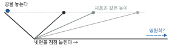

*그림 5.1* 갈릴레이의 사고 실험. 마찰이 없으면 공은 반대편 빗면을 처음과 같은 높이까지 올라간다. 반대편 빗면을 점점 눕히면 공은 더 멀리 가야 하고, 수평이 되면 영원히 굴러갈 것이다.


---

## 5.2 관성 기준틀과 뉴턴 제1법칙

### 제1법칙
> **뉴턴 제1법칙(관성의 법칙)**: 물체에 작용하는 알짜힘이 0이면, 물체의 속도는 변하지 않는다. 즉 정지한 물체는 계속 정지하고, 움직이는 물체는 등속 직선 운동을 계속한다.

$\vec{F}_{\text{net}} = 0$이면 $\vec{a} = 0$이라는 말이므로 제2법칙의 특수한 경우처럼 보인다. 그러나 제1법칙의 진짜 역할은 따로 있다. 가속도는 기준틀에 따라 다르다. 출발하는 버스 안에서는 바닥에 놓인 공이 아무 힘을 받지 않는데도 뒤쪽으로 가속된다. 따라서 제1법칙은 아무 기준틀에서나 성립하지 않는다.

### 관성 기준틀
제1법칙이 성립하는 기준틀을 **관성 기준틀**(inertial reference frame)이라 한다. 제1법칙은 "**관성 기준틀이 존재한다**"는 주장이고, 제2·제3법칙은 관성 기준틀에서 쓰는 법칙이다.

4장의 갈릴레이 변환에서 보았듯이, 관성 기준틀 $S$에 대해 일정한 속도로 움직이는 기준틀 $S'$에서는 가속도가 같다($\vec{a}' = \vec{a}$). 따라서 **관성 기준틀에 대해 등속으로 움직이는 기준틀은 모두 관성 기준틀**이다. 어느 관성 기준틀에서 실험해도 역학 법칙은 같은 꼴이다. 이를 **갈릴레이의 상대성 원리**라 하며, 아인슈타인은 이를 전자기학까지 넓혀 특수 상대성 이론을 세웠다(35장).

### 지구는 관성 기준틀인가?
엄밀히는 아니다. 지표의 한 점은 자전 때문에 최대 $0.034\ \text{m/s}^2$, 공전 때문에 약 $0.006\ \text{m/s}^2$의 구심가속도를 가진다(4장 예제 4.4). 둘 다 $g$의 1%도 안 되므로, 실험실 규모의 대부분 문제에서는 지면을 관성 기준틀로 보아도 된다. 대포의 탄도, 대기의 흐름(태풍의 회전 방향), 푸코 진자처럼 규모가 크거나 오래 지속되는 운동에서는 지구 자전의 효과가 드러난다(★ 6장 코리올리 힘).

> **💡 개념 확인: 급정거하는 버스**
> 버스가 급정거하면 승객이 앞으로 쏠린다. 승객을 앞으로 미는 힘이 있는가? 지면(관성 기준틀)에서 보면 **없다.** 승객은 관성에 따라 원래 속도로 계속 가려 하는데, 버스가 발밑에서 감속할 뿐이다. 승객이 버스와 함께 멈추려면 오히려 손잡이나 좌석이 승객을 **뒤로** 당겨야 한다. "앞으로 미는 힘"은 감속하는 버스라는 비관성 기준틀에서만 나타나는 겉보기 힘(관성력)이다(6장).

---

## 5.3 질량과 뉴턴 제2법칙

### 질량의 정의
같은 힘을 가해도 물체마다 가속도가 다르다. 같은 용수철을 같은 길이만큼 늘여 표준 질량 $m_0$(예: $1\ \text{kg}$)와 미지의 물체에 차례로 힘을 가했더니 가속도가 $a_0$, $a$였다면
$$
\frac{m}{m_0} = \frac{a_0}{a}
$$
로 질량을 정의한다. 질량(mass)은 **가속되기 어려운 정도**, 즉 관성의 정량적 척도다. 이렇게 정의한 질량을 **관성 질량**(inertial mass)이라 한다. 질량은 스칼라이고, 물체를 합치면 질량도 더해진다.

### 제2법칙
> **뉴턴 제2법칙**: 관성 기준틀에서 물체의 가속도는 알짜힘에 비례하고 질량에 반비례하며, 알짜힘의 방향을 향한다.
> $$ \vec{F}_{\text{net}} = m\vec{a} $$

성분으로 쓰면 세 개의 독립된 방정식이다.
$$
\sum F_x = ma_x, \qquad \sum F_y = ma_y, \qquad \sum F_z = ma_z
$$
몇 가지 주의할 점이 있다.
- 좌변은 **그 물체에 작용하는** 힘들만의 합이다. 그 물체가 다른 물체에 가하는 힘은 넣지 않는다.
- $m\vec{a}$는 힘이 아니다. 자유물체도에 "$m\vec{a}$"라는 힘을 그려 넣으면 안 된다.
- 운동량 $\vec{p} = m\vec{v}$를 쓰면 $\vec{F}_{\text{net}} = d\vec{p}/dt$이다. 뉴턴이 원래 쓴 형태에 가깝고, 상대론(35장)에서도 그대로 성립하는 형태다. 질량이 변하는 계(로켓)에서는 계를 어떻게 정의하는지 주의해야 한다(9장).

### 운동방정식으로서의 제2법칙
위치의 2계 미분으로 쓰면
$$
m\frac{d^2\vec{r}}{dt^2} = \vec{F}\left(\vec{r}, \frac{d\vec{r}}{dt}, t\right)
$$
이다. 이것이 **운동방정식**(equation of motion)이다. 힘의 법칙(중력, 용수철, 저항 …)을 알면, 처음 위치와 처음 속도라는 두 초기 조건으로 미래의 운동이 하나로 정해진다(1장 1.6절). 3장 3.6절의 "가속도가 변하는 운동"은 사실 이 운동방정식을 푸는 연습이었다.

### 예제 5.1 세 힘의 합성
질량 $2.0\ \text{kg}$인 물체가 마찰 없는 수평면 위에서 세 힘을 받는다. $\vec{F}_1$: 동쪽으로 $10\ \text{N}$, $\vec{F}_2$: 서쪽에서 북쪽으로 $60°$ 방향으로 $8.0\ \text{N}$, $\vec{F}_3$: 남쪽으로 $3.0\ \text{N}$. 물체의 가속도(크기와 방향)를 구하라.

**풀이** 동쪽을 $+x$, 북쪽을 $+y$로 한다(그림 5.2). $\vec{F}_2$는 $+x$축에서 $120°$ 방향이다.
$$
\vec{F}_1 = 10\hat{i}, \quad \vec{F}_2 = 8.0(\cos120°\,\hat{i} + \sin120°\,\hat{j}) = -4.0\hat{i} + 6.93\hat{j}, \quad \vec{F}_3 = -3.0\hat{j}\ \ (\text{N})
$$
$\vec{F}_{\text{net}} = 6.0\hat{i} + 3.93\hat{j}\ \text{N}$, 크기 $7.17\ \text{N}$.
$\vec{a} = \vec{F}_{\text{net}}/m = 3.0\hat{i} + 1.96\hat{j}\ \text{m/s}^2$, 크기 $3.6\ \text{m/s}^2$, 방향은 동쪽에서 북쪽으로 $\tan^{-1}(3.93/6.0) = 33°$.
가속도는 **알짜힘의 방향**을 향한다. 물체가 그 방향으로 움직인다는 뜻은 아니다. 처음 속도가 있었다면 운동 방향은 따로 정해진다.

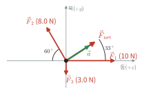

*그림 5.2* 예제 5.1의 세 힘과 알짜힘 $\vec F_{\text{net}}$. 가속도 $\vec a$(초록)는 알짜힘과 같은 방향(동쪽에서 북쪽으로 $33°$)을 향한다.


> **★ 심화: 관성 질량과 중력 질량은 왜 같은가?**
> 질량은 두 번 등장한다. 제2법칙의 $m_i$(관성 질량)는 "가속되기 어려운 정도"이고, 중력 $F = m_gg$의 $m_g$(**중력 질량**, gravitational mass)는 "중력을 받는 정도", 즉 중력에 대한 "전하"이다. 개념적으로 둘은 전혀 다른 양이다. 전기력에서는 실제로 다르다. 전기장 $\vec{E}$ 속 입자의 가속도는 $\vec{a} = (q/m_i)\vec{E}$로 전하와 질량의 비에 따라 달라진다.
> 중력장 속에서는 $\vec{a} = (m_g/m_i)\vec{g}$이다. 모든 물체가 같은 가속도로 떨어진다는 사실(3장의 자유낙하, 갈릴레이의 빗면 실험, 아폴로 15호의 망치·깃털 실험)은 $m_g/m_i$가 **모든 물질에서 같다**는 뜻이고, 단위를 적절히 고르면 $m_g = m_i$이다. 19세기 말~20세기 초 외트뵈시(Eötvös)의 비틀림 저울 실험 이래, 현대의 실험은 이 등식을 매우 높은 정밀도로 확인해 왔다. 뉴턴 역학에서 이것은 설명되지 않는 "우연의 일치"이다. 아인슈타인은 이를 원리로 격상해, **중력과 가속도는 국소적으로 구별할 수 없다**는 **등가 원리**(equivalence principle)를 세우고, 이로부터 일반 상대성 이론을 만들었다(13장). 자유낙하하는 엘리베이터 안에서 중력이 "사라지는" 것(예제 5.2)은 등가 원리의 가장 간단한 예다.

---

## 5.4 뉴턴 제3법칙

### 제3법칙
> **뉴턴 제3법칙(작용·반작용 법칙)**: 물체 $A$가 물체 $B$에 힘 $\vec{F}_{BA}$를 가하면, $B$도 $A$에 크기가 같고 방향이 반대인 힘 $\vec{F}_{AB}$를 가한다.
> $$ \vec{F}_{AB} = -\vec{F}_{BA} $$

(아래 첨자는 "받는 물체, 주는 물체" 순서로 썼다.) 작용·반작용 쌍은 다음 성질을 모두 가진다.
1. **서로 다른 두 물체**에 작용한다. 그래서 한 물체의 자유물체도에는 쌍 중 하나만 나타난다.
2. 크기가 같고 방향이 반대다. 언제나, 물체가 가속되고 있어도 성립한다.
3. **같은 종류의 힘**이다. 중력의 반작용은 중력이고, 수직항력의 반작용은 수직항력(접촉력)이다.

제3법칙은 **운동량 보존**의 근원이다. 두 물체만 상호작용하면 $d\vec{p}_A/dt + d\vec{p}_B/dt = \vec{F}_{AB} + \vec{F}_{BA} = 0$이므로 전체 운동량이 일정하다(9장). (움직이는 전하 사이의 자기력처럼, 장이 운동량을 운반하는 경우에는 두 입자 사이의 힘만으로는 제3법칙이 성립하지 않을 수 있다. 이때는 장의 운동량까지 포함해야 운동량이 보존된다. 전자기학의 고급 주제다.)

> **💡 개념 확인: 작용·반작용 오개념 세 가지**
> **(1) "말이 수레를 끄는 힘과 수레가 말을 끄는 힘이 같다면, 어떻게 앞으로 갈 수 있는가?"** 두 힘은 **다른 물체**에 작용하므로 상쇄되지 않는다. 수레가 움직이는지는 수레가 받는 힘(말이 끄는 힘과 지면의 마찰력)만으로 정해지고, 말이 움직이는지는 말이 받는 힘(수레가 끄는 힘과, 말의 발굽이 땅을 뒤로 밀 때 땅이 말을 **앞으로** 미는 마찰력)으로 정해진다. 계 전체를 앞으로 가속하는 외력은 땅이 말의 발굽에 주는 마찰력이다(그림 5.3).
> **(2) "책상 위 책의 무게와 수직항력은 작용·반작용 쌍이다."** 아니다. 둘 다 **책**에 작용하므로 쌍이 될 수 없다. 둘의 크기가 같은 것은 책의 가속도가 0이라는 제2법칙의 결과다. 엘리베이터가 가속하면 둘의 크기가 달라진다(예제 5.2). 무게(지구가 책을 당기는 중력)의 반작용은 **책이 지구를 당기는 중력**이고, 수직항력(책상이 책을 미는 힘)의 반작용은 **책이 책상을 누르는 힘**이다(그림 5.4).
> **(3) "트럭과 승용차가 충돌하면 트럭이 더 큰 힘을 가한다."** 힘의 크기는 같다. 승용차의 질량이 작으므로 가속도($F/m$)가 훨씬 클 뿐이다. 승용차 탑승자가 더 위험한 이유다(🔗 9장 자동차 충돌 안전 설계).
>
> 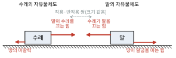
>
> *그림 5.3* 말과 수레의 자유물체도(수평 방향 힘만 그렸다). 말이 수레를 끄는 힘과 수레가 말을 끄는 힘은 작용·반작용 쌍이지만 서로 다른 물체에 작용하므로 상쇄되지 않는다.
>
> 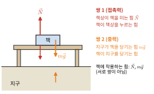
>
> *그림 5.4* 책상 위 책에 관련된 두 작용·반작용 쌍. 책에 작용하는 힘은 $\vec N$과 $m\vec g$이고, 이 둘은 쌍이 아니다. 각각의 짝은 책상과 지구에 작용한다.
>
>

---

## 5.5 여러 가지 힘

### 중력과 무게
지표 근처에서 지구가 질량 $m$인 물체에 가하는 중력은
$$
\vec{F}_g = m\vec{g} = -mg\,\hat{j}
$$
이다($+y$가 위쪽). 이 힘의 크기 $mg$를 물체의 **무게**(weight)라 한다. 무게는 힘이므로 단위는 N이고, 장소에 따라 달라진다. 질량은 장소와 무관하다. 달 표면의 $g$는 약 $1.62\ \text{m/s}^2$이므로 같은 물체의 무게가 지구의 약 $1/6$이다.

체중계가 읽는 값은 체중계가 몸을 떠받치는 수직항력의 크기, 즉 **겉보기 무게**(apparent weight)이다. 가속하는 엘리베이터에서는 겉보기 무게가 $mg$와 다르다.

### 수직항력
물체가 표면을 누르면 표면이 약간 변형되면서 물체를 **표면에 수직으로** 밀어낸다. 이것이 **수직항력(normal force)** $\vec{N}$이다. 수직항력의 크기는 미리 정해진 공식이 없고, **"물체가 표면을 뚫고 들어가지 않는다"는 구속 조건**(constraint)에서 제2법칙으로 결정된다. 그래서 수직항력은 $mg$일 수도, 그보다 크거나 작을 수도 있다. 물체가 표면에서 떨어지려는 순간 $N = 0$이 된다. 수직항력은 밀 수만 있고 당길 수는 없으므로 $N \ge 0$이다.

### 예제 5.2 엘리베이터 속의 체중계
질량 $60\ \text{kg}$인 사람이 엘리베이터 안의 체중계 위에 서 있다. 엘리베이터의 가속도가 (가) 위로 $2.0\ \text{m/s}^2$, (나) 아래로 $2.0\ \text{m/s}^2$, (다) 아래로 $g$(케이블이 끊어짐)일 때 체중계의 눈금(N)을 구하라.

**풀이** 사람에게 작용하는 힘은 중력 $-mg\hat{j}$와 수직항력 $N\hat{j}$ 둘뿐이다(그림 5.5). 제2법칙의 $y$ 성분은
$$
N - mg = ma_y \quad\Rightarrow\quad N = m(g + a_y)
$$
(가) $a_y = +2.0$: $N = 60(9.8 + 2.0) = 708\ \text{N}$. 정지 상태($588\ \text{N}$)보다 무겁게 느낀다.
(나) $a_y = -2.0$: $N = 60(9.8 - 2.0) = 468\ \text{N}$.
(다) $a_y = -g$: $N = 0$. **무중력 상태**(weightlessness)다. 중력은 그대로 작용하지만 사람과 체중계가 같이 떨어지므로 서로 누르지 않는다. 지구를 도는 우주정거장 안의 무중력도 같은 이유다(13장).

눈금은 **속도가 아니라 가속도**에 따라 달라진다. 위로 올라가고 있더라도 감속 중($a_y < 0$)이면 가볍게 느낀다.

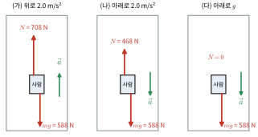

*그림 5.5* 예제 5.2에서 사람의 자유물체도. 중력 $mg = 588\ \text{N}$은 세 경우 모두 같고, 수직항력 $N$(체중계 눈금)만 가속도에 따라 달라진다.


### 장력
줄, 끈, 케이블이 물체를 당기는 힘을 **장력(tension)** $T$라 한다. 장력은 줄을 따라, 물체에서 멀어지는 방향(당기는 방향)으로 작용한다. 줄은 밀 수 없으므로 $T \ge 0$이다.

**질량이 있는 줄의 장력**을 생각하면 "이상적인 줄"의 의미가 분명해진다. 줄을 따라 $x$축을 잡고, $x$와 $x + dx$ 사이의 작은 조각(질량 $dm$)에 제2법칙을 쓰면, 수평으로 가속도 $a$로 움직일 때
$$
T(x + dx) - T(x) = dm\,a \quad\Rightarrow\quad \frac{dT}{dx} = \lambda a
$$
($\lambda = dm/dx$는 선밀도)이다. **줄의 질량을 무시할 수 있으면($\lambda \to 0$) 장력은 줄 전체에서 같다.** 마찰 없고 질량 없는 **이상적인 도르래**는 줄의 방향만 바꾸고 장력의 크기는 바꾸지 않는다. 이 책의 문제에서 따로 말하지 않으면 줄과 도르래는 이상적이라고 가정한다.

### 예제 5.3 질량이 있는 밧줄로 끄는 상자
질량 $M = 2.0\ \text{kg}$인 상자에 질량 $m_r = 0.50\ \text{kg}$, 길이 $L$인 균일한 밧줄을 매어, 밧줄의 다른 끝을 수평으로 $F = 10\ \text{N}$의 힘으로 당긴다. 바닥은 마찰이 없다. 가속도와, 상자로부터 거리 $x$인 지점의 밧줄 장력을 구하라.

**풀이** 상자와 밧줄 전체를 한 계로 보면 외력은 $F$뿐이므로 $a = F/(M + m_r) = 10/2.5 = 4.0\ \text{m/s}^2$.
상자에서 $x$까지의 부분(상자 + 길이 $x$의 밧줄, 질량 $M + m_rx/L$)을 한 계로 보면, 이 계를 당기는 수평 외력은 그 지점의 장력 $T(x)$뿐이다(그림 5.6).
$$
T(x) = \left(M + m_r\frac{x}{L}\right)a
$$
상자에 닿은 끝($x = 0$)에서 $T = 8.0\ \text{N}$, 가운데에서 $9.0\ \text{N}$, 손 쪽 끝($x = L$)에서 $10\ \text{N} = F$이다. 장력은 손에서 상자로 갈수록 선형으로 줄어든다. $dT/dx = m_ra/L = \lambda a$로 위 식과 일치한다. 밧줄은 자기 자신을 가속하는 데 힘의 일부를 쓰므로, 상자에 전달되는 힘이 $F$보다 작다.

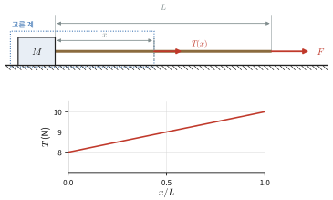

*그림 5.6* 예제 5.3. 위: 상자와 길이 $x$의 밧줄을 한 계(점선)로 고르면, 이 계를 당기는 외력은 자른 지점의 장력 $T(x)$뿐이다. 아래: 장력은 상자 쪽 $8.0\ \text{N}$에서 손 쪽 $10\ \text{N}$까지 선형으로 커진다.


### 용수철 힘
용수철을 자연 길이에서 $x$만큼 늘이거나 줄이면, 변형이 너무 크지 않은 범위에서 용수철은 변형에 비례하고 반대 방향인 힘을 가한다.
$$
F_x = -kx
$$
이것이 **훅 법칙**(Hooke's law)이고, $k$는 **용수철 상수(spring constant)**(단위 N/m)다. 음의 부호는 힘이 항상 **자연 길이(평형 위치) 쪽으로 되돌리는 방향**임을 뜻하며, 이런 힘을 **복원력**(restoring force)이라 한다(그림 5.7). 1장 예제 1.7에서 보았듯이 안정 평형점 근처에서는 거의 모든 힘이 이런 꼴이다. 용수철 두 개를 직렬로 이으면 $1/k = 1/k_1 + 1/k_2$, 병렬로 이으면 $k = k_1 + k_2$이다(연습문제 10).

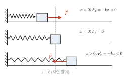

*그림 5.7* 용수철 힘은 언제나 자연 길이($x = 0$) 쪽을 향한다. 압축되면($x < 0$) 밀고, 늘어나면($x > 0$) 당긴다.


> **🔬 최신 연구 노트: 네 가지 기본 상호작용**
> 일상에서 만나는 힘은 종류가 많아 보이지만, 현재 물리학이 아는 **기본 상호작용**(fundamental interaction)은 네 가지뿐이다.
>
> | 상호작용 | 매개 입자 | 도달 거리 | 주요 역할 |
> |---|---|---|---|
> | 중력 | (확립된 양자 이론 없음) | 무한 | 행성 운동, 우주의 구조 |
> | 전자기력 | 광자 | 무한 | 원자·분자·화학 결합, 모든 접촉력 |
> | 강한 상호작용 | 글루온 | 약 $10^{-15}\ \text{m}$ | 쿼크를 묶어 양성자·중성자를 만들고 원자핵을 결합 |
> | 약한 상호작용 | W, Z 보손 | 약 $10^{-18}\ \text{m}$ | 베타 붕괴, 태양의 핵융합 반응 |
>
> 이 장에서 다루는 수직항력, 장력, 용수철 힘, 마찰력은 모두 **원자 사이의 전자기력**이 거시적으로 나타난 것이다. 중력은 일상에서 가장 눈에 띄지만 실제로는 압도적으로 약하다. 두 양성자 사이의 전기력과 중력의 비는
> $$ \frac{ke^2/r^2}{Gm_p^2/r^2} = \frac{(8.988\times10^9)(1.602\times10^{-19})^2}{(6.674\times10^{-11})(1.673\times10^{-27})^2} \approx 1.2\times10^{36} $$
> 이다(거리와 무관). 그런데도 천체 규모에서 중력이 지배하는 이유는, 전하는 양과 음이 있어 큰 물체에서 거의 완벽히 상쇄되지만 질량은 언제나 양수여서 더해지기만 하기 때문이다. 전자기력과 약한 상호작용은 높은 에너지에서 하나의 **전기약력**(electroweak interaction)으로 통합되며, 이 이론에서 입자에 질량을 주는 메커니즘의 증거인 **힉스 보손**이 2012년 CERN의 대형 강입자 충돌기(LHC)에서 발견되었고, 이 메커니즘을 제안한 앙글레르(Englert)와 힉스(Higgs)가 2013년 노벨 물리학상을 받았다. 중력을 양자역학과 통합하는 이론은 아직 확립되지 않았으며, 2장 ★ 박스의 플랑크 단위가 그 규모를 어림해 준다(40장).

---

## 5.6 자유물체도와 풀이 전략

### 풀이 절차
뉴턴 법칙 문제는 다음 순서로 풀면 거의 실수하지 않는다.
1. **계를 정한다.** 어떤 물체(들)에 제2법칙을 쓸지 정한다.
2. **자유물체도(free-body diagram)를 그린다.** 그 물체만 따로 떼어 점이나 상자로 그리고, **그 물체에 작용하는 힘만** 화살표로 그린다. 각 힘마다 "무엇이 주는 힘인가"를 말할 수 있어야 한다. 말할 수 없는 힘(예: "운동의 힘", "원심력")은 그리지 않는다.
3. **좌표축을 정한다.** 가속도 방향(예: 빗면을 따라)으로 축 하나를 잡으면 식이 간단해진다. 물체마다 다른 축을 써도 된다.
4. **성분별로 $\sum F = ma$를 쓴다.**
5. **구속 조건을 쓴다.** 줄로 연결된 물체의 가속도 관계, 표면을 떠나지 않는다는 조건 등.
6. **미지수와 방정식의 개수를 맞추고 푼다.** 기호로 푼 뒤 마지막에 숫자를 넣는다.
7. **검산한다.** 차원, 극한($\theta \to 0$, $m_1 \to 0$ 등), 부호, 크기의 상식성.

빗면 위 상자를 예로 들면 자유물체도는 그림 5.8과 같다. 중력 $m\vec g$를 빗면 축으로 분해하면 $(F_x, F_y) = (mg\sin\theta, -mg\cos\theta)$이다.

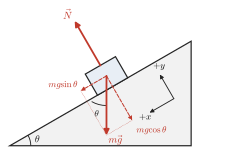

*그림 5.8* 빗면 위 상자의 자유물체도. 빗면을 따라 아래쪽을 $+x$, 빗면에 수직인 바깥쪽을 $+y$로 잡고, 중력 $m\vec g$를 두 성분(점선)으로 나눈다. $m\vec g$와 빗면의 법선 사이의 각은 경사각 $\theta$와 같다.

### 예제 5.4 마찰 없는 빗면
질량 $5.0\ \text{kg}$인 상자가 경사각 $30°$인 마찰 없는 빗면을 미끄러져 내려온다. 가속도와 수직항력을 구하고, 정지 상태에서 출발해 빗면을 따라 $2.0\ \text{m}$ 내려오는 데 걸리는 시간을 구하라.

**풀이** 빗면을 따라 아래쪽을 $+x$, 빗면에 수직으로 바깥쪽을 $+y$로 잡는다(그림 5.8). 중력 $m\vec{g}$의 성분은 $(mg\sin\theta, -mg\cos\theta)$, 수직항력은 $(0, N)$이다.
- $x$: $mg\sin\theta = ma$ → $a = g\sin\theta = 9.8\times0.50 = 4.9\ \text{m/s}^2$
- $y$: $N - mg\cos\theta = 0$ (빗면을 떠나지도 파고들지도 않는다는 구속 조건) → $N = mg\cos\theta = 42\ \text{N}$

$2.0 = \frac{1}{2}(4.9)t^2$에서 $t = 0.90\ \text{s}$.
**검산**: $\theta \to 0$이면 $a \to 0$, $N \to mg$(수평면). $\theta \to 90°$이면 $a \to g$, $N \to 0$(자유낙하). 가속도가 질량과 무관하다는 점도 자유낙하와 같다. 수직항력이 $mg$보다 작다($42\ \text{N} < 49\ \text{N}$)는 점에 주의하자.

### 예제 5.5 접촉한 두 상자
마찰 없는 바닥에 질량 $m_1 = 3.0\ \text{kg}$, $m_2 = 2.0\ \text{kg}$인 상자가 맞닿아 있다. $m_1$을 수평으로 $F = 20\ \text{N}$으로 밀어 두 상자가 함께 움직인다. 가속도와 두 상자가 서로 주고받는 힘을 구하라. 같은 힘으로 $m_2$ 쪽에서 반대로 밀면 어떻게 되는가?

**풀이** 두 상자를 한 계로 보면 수평 외력은 $F$뿐이다(접촉력은 계 안의 작용·반작용 쌍이라 상쇄된다). $a = F/(m_1 + m_2) = 4.0\ \text{m/s}^2$.
$m_2$만의 자유물체도(그림 5.9): 수평력은 $m_1$이 미는 접촉력 $P$뿐이므로 $P = m_2a = 8.0\ \text{N}$. 제3법칙에 따라 $m_2$는 $m_1$을 $8.0\ \text{N}$으로 뒤로 민다. 검산: $m_1$에 대해 $F - P = 20 - 8.0 = 12 = m_1a$. ✓
$m_2$ 쪽에서 밀면 $P = m_1a = 12\ \text{N}$이다. 접촉력은 **뒤에 있는(밀리는) 상자의 질량**에 비례한다. 기차의 연결기에 걸리는 힘이 기관차 바로 뒤에서 가장 큰 것도 같은 이유다.

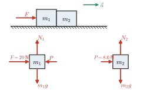

*그림 5.9* 예제 5.5. 위: 두 상자를 $F$로 민다. 아래: 각 상자의 자유물체도. $m_1$과 $m_2$가 서로 미는 힘 $P$는 작용·반작용 쌍이다.


### 예제 5.6 애트우드 기계
이상적인 도르래에 걸친 줄의 양 끝에 질량 $m_1$, $m_2$($m_2 > m_1$)가 매달려 있다. 가속도와 장력을 구하라. $m_1 = 2.0\ \text{kg}$, $m_2 = 3.0\ \text{kg}$일 때 값은?

**풀이** 줄의 길이가 일정하므로 $m_2$가 $a$로 내려가면 $m_1$은 $a$로 올라간다(구속 조건). 각 물체에서 **운동 방향을 양**으로 잡는다(그림 5.10). 줄과 도르래가 이상적이므로 장력은 양쪽에서 같은 $T$이다.
$$
m_1:\ T - m_1g = m_1a, \qquad m_2:\ m_2g - T = m_2a
$$
두 식을 더하면 $T$가 소거된다.
$$
a = \frac{m_2 - m_1}{m_1 + m_2}\,g, \qquad T = m_1(g + a) = \frac{2m_1m_2}{m_1 + m_2}\,g
$$
수치: $a = (1/5)(9.8) = 1.96\ \text{m/s}^2$, $T = 2(2.0)(3.0)(9.8)/5.0 = 23.5\ \text{N}$.
**검산**: $m_1 = m_2$이면 $a = 0$, $T = mg$(평형). $m_1 \to 0$이면 $a \to g$, $T \to 0$(자유낙하). $T$는 $m_1g = 19.6\ \text{N}$과 $m_2g = 29.4\ \text{N}$ 사이에 있다. 그래야 $m_1$은 올라가고 $m_2$는 내려간다. 애트우드 기계는 $a$를 $g$보다 훨씬 작게 만들어, 정밀한 시계가 없던 시절에도 등가속도 운동을 측정할 수 있게 해 준 장치다.

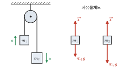

*그림 5.10* 애트우드 기계와 두 물체의 자유물체도($m_1 = 2.0\ \text{kg}$, $m_2 = 3.0\ \text{kg}$). 장력 $T = 23.5\ \text{N}$은 $m_1g$보다 크고 $m_2g$보다 작다.


### 예제 5.7 탁자 위의 상자와 매달린 추
마찰 없는 수평 탁자 위의 상자($m_1 = 4.0\ \text{kg}$)에 맨 줄이 탁자 끝의 도르래를 지나 추($m_2 = 1.0\ \text{kg}$)에 연결되어 있다. 가속도와 장력을 구하라.

**풀이** 구속 조건: 상자가 오른쪽으로 $a$만큼 가속하면 추는 아래로 $a$만큼 가속한다. 상자에서는 오른쪽, 추에서는 아래쪽을 양으로 잡는다(그림 5.11).
- 상자 ($x$): $T = m_1a$. ($y$: $N - m_1g = 0$)
- 추 ($y$, 아래가 +): $m_2g - T = m_2a$

더하면 $a = \dfrac{m_2}{m_1 + m_2}g = 1.96\ \text{m/s}^2$, $T = \dfrac{m_1m_2}{m_1 + m_2}g = 7.8\ \text{N}$.
장력은 추의 무게 $m_2g = 9.8\ \text{N}$보다 작다. 장력이 추의 무게와 같다면 추에 작용하는 알짜힘이 0이 되어 추가 가속될 수 없다. "줄이 매달린 물체의 무게만큼 당긴다"는 생각은 **정지하거나 등속일 때만** 맞다.

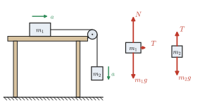

*그림 5.11* 예제 5.7의 장치와 자유물체도. 추에 작용하는 장력 $T = 7.8\ \text{N}$은 추의 무게 $9.8\ \text{N}$보다 작다. (자유물체도의 화살표 축척은 두 물체가 서로 다르다.)


> **🔗 전공 연결: 자유물체도는 공학의 언어다 (기계공학)**
> 기계공학과 2학년의 **공업역학(정역학·동역학)** 과목은 이 절의 내용을 확장한 것이다. 정역학(statics)은 $\sum\vec{F} = 0$과 $\sum\vec{\tau} = 0$(12장)으로 트러스, 보, 기계 부품에 걸리는 힘을 구하고, 동역학(dynamics)은 $\sum\vec{F} = m\vec{a}$로 기계의 운동을 해석한다. 두 과목 모두 자유물체도를 정확히 그리는 것에서 시작하며, 구조물을 부품으로 "잘라" 각 부품의 자유물체도를 그리면 내부의 힘(부재력)이 외력처럼 드러난다. 예제 5.3에서 밧줄을 $x$ 지점에서 잘라 장력을 구한 것이 바로 이 방법이다. 이렇게 구한 내부 힘을 단면적으로 나누면 응력이 되고, 고체역학(재료역학) 과목으로 이어진다(12장).

> **🔗 전공 연결: 지면반력과 보행 분석 (수의학)**
> 동물이 걸을 때 지면이 발에 가하는 힘을 **지면반력**(ground reaction force)이라 하며, 바닥에 묻은 **힘판**(force plate)으로 측정한다. 동물 전체에 제2법칙을 쓰면, 연직 방향으로 $\sum F_{\text{지면},y} - mg = ma_{\text{cm},y}$이다(9장의 질량중심). 걸음은 주기 운동이므로 한 보행 주기 동안 질량중심의 연직 속도는 처음과 같고, 따라서 $a_{\text{cm},y}$의 시간 평균은 0이다. 즉 **모든 다리의 연직 지면반력을 한 주기 동안 평균하면 정확히 체중과 같다.** 순간적인 힘은 체중보다 크거나 작을 수 있다. 수의 정형외과에서는 이 힘을 다리별로 측정해 비교한다. 개는 체중의 절반 이상을 앞다리로 지탱하는 것으로 알려져 있으며, 한쪽 다리에 통증이 있으면 그 다리가 받는 최대 연직 반력과 충격량이 줄고 다른 다리가 더 많은 하중을 맡는다. 힘판 분석은 이처럼 파행(lameness)을 객관적인 수치로 평가하고, 수술이나 약물 치료의 효과를 비교하는 데 쓰인다.

> **🐍 파이썬 실습: 용수철에 매단 물체 — 중력은 평형점만 옮긴다**
> 용수철 상수 $k$인 용수철 아래에 질량 $m$을 매달고, 자연 길이에서 가만히 놓는다. 아래쪽을 $+y$(자연 길이에서 늘어난 길이)로 잡으면 운동방정식은 $m\ddot{y} = mg - ky$이다. 이를 수치적으로 풀어 보자.
> ```python
> import numpy as np
> from scipy.integrate import solve_ivp
> import matplotlib.pyplot as plt
>
> m, k, g = 0.50, 20.0, 9.8            # 질량(kg), 용수철 상수(N/m)
> def rhs(t, s):                       # s = [y, vy], y: 자연 길이에서 아래로 늘어난 길이
>     y, vy = s
>     F = m*g - k*y                    # 알짜힘 = 무게 + 용수철 힘 (아래가 +)
>     return [vy, F/m]
>
> T = 2*np.pi*np.sqrt(m/k)             # 이론 주기
> t = np.linspace(0, 3*T, 3001)
> sol = solve_ivp(rhs, [0, 3*T], [0.0, 0.0], t_eval=t, rtol=1e-10, atol=1e-12)
> y = sol.y[0]
>
> print(f"평형 늘어남 mg/k     = {m*g/k:.4f} m")
> print(f"수치해: 최대 늘어남 = {y.max():.4f} m, 시간 평균 = {y.mean():.4f} m")
> up = np.where((y[:-1] < m*g/k) & (y[1:] >= m*g/k))[0]   # 평형점을 아래로 지나는 순간
> print(f"주기: 이론 {T:.4f} s, 수치 {np.diff(t[up]).mean():.4f} s")
>
> plt.plot(t, y); plt.axhline(m*g/k, ls="--", c="k")
> plt.xlabel("t (s)"); plt.ylabel("stretch y (m)"); plt.gca().invert_yaxis(); plt.show()
> ```
> 실행 결과(그림 5.12): 평형 늘어남 $0.2450\ \text{m}$, 최대 늘어남 $0.4900\ \text{m}$, 시간 평균 약 $0.245\ \text{m}$, 주기는 이론과 수치 모두 $0.9935\ \text{s}$이다. 해석해로 확인해 보자. $y' = y - mg/k$로 놓으면 $m\ddot{y}' = -ky'$가 되어 **중력이 사라진다.** 물체는 평형점 $mg/k$를 중심으로 진폭 $mg/k$, 각진동수 $\sqrt{k/m}$로 진동하므로 $y = (mg/k)(1 - \cos\sqrt{k/m}\,t)$이다. 중력은 진동의 주기를 바꾸지 않고 평형점만 옮긴다. 또 하중을 **갑자기** 걸면 용수철은 정적 평형 늘어남의 **2배**까지 늘어난다. 구조물 설계에서 갑자기 가해지는 하중(충격 하중)을 정적 하중보다 크게 잡는 이유 중 하나다.
>
> 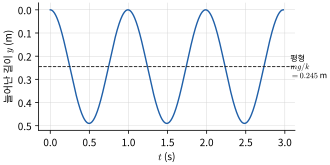
>
> *그림 5.12* 위 코드의 결과. 자연 길이에서 놓은 물체는 평형 늘어남 $mg/k$(점선)를 중심으로 진동하며, 최대 늘어남은 그 2배이다.
>

---

## 핵심 정리

| 법칙·힘 | 내용 | 주의 |
|---|---|---|
| 제1법칙 | $\vec{F}_{\text{net}} = 0 \Leftrightarrow \vec{v}$ 일정 | 관성 기준틀의 존재를 주장 |
| 관성 기준틀 | 제1법칙이 성립하는 기준틀. 서로 등속이면 모두 관성 기준틀 | 지면은 근사적으로 관성 기준틀 |
| 제2법칙 | $\vec{F}_{\text{net}} = m\vec{a} = d\vec{p}/dt$, 성분별 3개 식 | $m\vec{a}$는 힘이 아니다 |
| 제3법칙 | $\vec{F}_{AB} = -\vec{F}_{BA}$ | 다른 물체에 작용, 같은 종류의 힘 |
| 중력·무게 | $\vec{F}_g = m\vec{g}$, 무게 $= mg$ | 겉보기 무게 $= N = m(g + a_y)$ |
| 수직항력 | 표면에 수직, $N \ge 0$ | 크기는 구속 조건으로 결정 |
| 장력 | 줄을 따라 당김, $T \ge 0$ | 질량 없는 줄이면 어디서나 같다. $dT/dx = \lambda a$ |
| 용수철 힘 | $F_x = -kx$ | 직렬 $1/k = \sum 1/k_i$, 병렬 $k = \sum k_i$ |
| 빗면 | $a = g\sin\theta$, $N = mg\cos\theta$ | 마찰 없을 때 |
| 애트우드 기계 | $a = \dfrac{m_2 - m_1}{m_1 + m_2}g$, $T = \dfrac{2m_1m_2}{m_1 + m_2}g$ | |

---

## 연습문제

**기본**
1. 질량 $4.0\ \text{kg}$인 물체에 $\vec{F} = 6.0\hat{i} - 8.0\hat{j}\ \text{N}$의 알짜힘이 작용한다. 가속도 벡터와 그 크기를 구하라.
2. 질량 $70\ \text{kg}$인 우주비행사의 달 표면에서의 무게와 질량을 구하라($g_{\text{달}} = 1.62\ \text{m/s}^2$).
3. 질량 $1200\ \text{kg}$인 자동차가 정지 상태에서 $9.0\ \text{s}$ 만에 일정하게 가속해 $27\ \text{m/s}$가 되었다. 자동차에 작용한 알짜힘은?
4. 그림 5.13과 같이 질량 $2.0\ \text{kg}$인 전등이 두 줄에 매달려 정지해 있다. 한 줄은 수평과 $30°$, 다른 줄은 반대쪽으로 수평과 $60°$를 이룬다. 두 줄의 장력을 구하라.

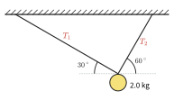

*그림 5.13* 연습문제 4. 질량 $2.0\ \text{kg}$인 전등을 수평과 $30°$, $60°$를 이루는 두 줄이 붙잡고 있다.

5. 책상 위에 책이 놓여 있다. 책에 작용하는 힘을 모두 쓰고, 각 힘의 반작용(어느 물체에 작용하는 어떤 힘인지)을 말하라.
6. 용수철 상수 $200\ \text{N/m}$인 용수철에 $1.0\ \text{kg}$인 물체를 매달아 정지시켰다. 용수철은 얼마나 늘어나는가?

**응용**

7. 질량 $800\ \text{kg}$인 엘리베이터가 위로 올라가다가 $1.5\ \text{m/s}^2$로 감속하고 있다. 케이블의 장력은?
8. 마찰 없는 바닥에서 질량 $1.0$, $2.0$, $3.0\ \text{kg}$인 상자 세 개를 이 순서대로 줄로 일렬로 연결하고, $3.0\ \text{kg}$ 상자를 앞으로 $12\ \text{N}$으로 끈다. 가속도와 두 줄의 장력을 구하라.
9. 그림 5.14와 같이 경사각 $30°$인 마찰 없는 빗면 위에 $m_1 = 4.0\ \text{kg}$인 상자가 있고, 빗면 꼭대기의 도르래를 지난 줄이 연직으로 매달린 $m_2 = 3.0\ \text{kg}$인 추에 연결되어 있다. 가속도의 크기와 방향, 장력을 구하라.

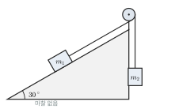

*그림 5.14* 연습문제 9. 마찰 없는 $30°$ 빗면 위의 $m_1$과 연직으로 매달린 $m_2$가 빗면 꼭대기의 도르래를 지나는 줄로 연결되어 있다.

10. 용수철 상수 $k_1$, $k_2$인 두 용수철을 (가) 직렬로, (나) 병렬로 연결했을 때의 등가 용수철 상수가 각각 $k_1k_2/(k_1 + k_2)$, $k_1 + k_2$임을 자유물체도로 유도하라. ((가)에서는 두 용수철의 장력이 같고 늘어남이 더해진다.) $k_1 = 200\ \text{N/m}$, $k_2 = 300\ \text{N/m}$일 때 값을 구하라.
11. 수평으로 가속하는 기차 안에서 천장에 매단 추가 연직에서 $10°$ 기울어진 채 정지해 있다(기차에 대해). 지면 기준틀에서 자유물체도를 그려 기차의 가속도를 구하라. 추는 어느 쪽으로 기울어지는가?
12. 처음에 정지해 있던 질량 $2.0\ \text{kg}$인 물체에 시간에 비례하는 힘 $F = (4.0\ \text{N/s})\,t$가 수평으로 작용한다(마찰 없음). $t = 3.0\ \text{s}$에서의 속도와 이동 거리를 구하라.

**도전**

13. **움직이는 쐐기**: 그림 5.15와 같이 마찰 없는 수평 바닥 위에 질량 $M$, 경사각 $\theta$인 쐐기가 있고, 그 마찰 없는 빗면 위에 질량 $m$인 상자를 놓았다. 상자가 미끄러지는 동안 쐐기도 반대쪽으로 밀려난다. (가) 쐐기의 가속도가 $A = \dfrac{mg\sin\theta\cos\theta}{M + m\sin^2\theta}$, 수직항력이 $N = \dfrac{Mmg\cos\theta}{M + m\sin^2\theta}$임을 보여라. (힌트: 미지수는 $A$, 상자 가속도의 두 성분, $N$이다. 구속 조건은 "쐐기에서 본 상자의 가속도가 빗면에 평행하다"이다.) (나) $M \to \infty$일 때 예제 5.4의 결과로 돌아가는지 확인하라. (다) $M = 4.0\ \text{kg}$, $m = 1.0\ \text{kg}$, $\theta = 30°$일 때 $A$와 $N$을 구하라.

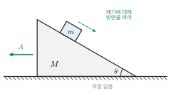

*그림 5.15* 연습문제 13. 상자가 빗면을 따라 미끄러지는 동안 쐐기는 반대쪽으로 가속도 $A$로 밀려난다. 쐐기에 대한 상자의 상대 가속도는 빗면에 평행하다.

14. **이중 애트우드 기계**: 그림 5.16과 같이 천장에 고정된 도르래에 걸친 줄의 한쪽 끝에 $m_1$이 매달려 있고, 다른 쪽 끝에는 움직도르래(질량 무시)가 매달려 있다. 움직도르래에 걸친 두 번째 줄의 양 끝에 $m_2$, $m_3$가 매달려 있다. (가) 구속 조건이 $2a_1 + a_2 + a_3 = 0$(모든 가속도는 아래쪽을 양으로 잰다)임을 보여라. (나) $m_1$의 가속도가 $a_1 = g\dfrac{m_1(m_2 + m_3) - 4m_2m_3}{m_1(m_2 + m_3) + 4m_2m_3}$임을 보여라. (다) $m_1 = 4.0\ \text{kg}$, $m_2 = 1.0\ \text{kg}$, $m_3 = 3.0\ \text{kg}$일 때 세 가속도와 두 장력을 구하라. $m_1 = m_2 + m_3$인데도 $m_1$이 움직이는 이유는?

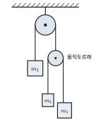

*그림 5.16* 연습문제 14의 이중 애트우드 기계. 고정 도르래의 한쪽에 $m_1$, 다른 쪽에 움직도르래가 매달리고, 움직도르래에 $m_2$와 $m_3$가 매달려 있다.

15. **질량이 있는 줄과 사슬**: (가) 질량 $M$, 길이 $L$인 균일한 밧줄의 위쪽 끝을 잡고 가속도 $a$로 들어 올린다. 아래쪽 끝에서 $y$인 지점의 장력이 $T(y) = M(g + a)\,y/L$임을 보여라. (나) 길이 $L$인 균일한 사슬이 마찰 없는 탁자 위에 놓여 있고, 처음에 길이 $y_0$만큼이 탁자 끝에서 늘어져 정지해 있다. 늘어진 길이 $y$가 $\ddot{y} = (g/L)\,y$를 만족함을 보이고, $y(t) = y_0\cosh\left(\sqrt{g/L}\,t\right)$임을 확인하라. 사슬 전체가 탁자를 떠나는 시각을 구하라. (탁자 모서리에서 사슬이 꺾이는 효과는 무시한다.)
16. **스스로 끌어올리기**: 그림 5.17과 같이 질량 $70\ \text{kg}$인 사람이 질량 $10\ \text{kg}$인 의자에 앉아 있다. 의자에 맨 줄이 천장의 이상적인 도르래를 지나 사람의 손으로 내려온다. 사람이 줄을 당겨 자신과 의자를 끌어올린다. (가) 등속으로 올라가려면 몇 N으로 당겨야 하는가? (나) $1.0\ \text{m/s}^2$로 가속하며 올라가려면? (다) (나)에서 사람이 의자를 누르는 힘은? (사람과 의자를 각각 따로, 그리고 한 계로 보고 자유물체도를 그려라.)

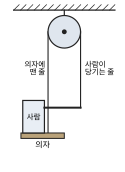

*그림 5.17* 연습문제 16. 의자에 맨 줄이 천장의 도르래를 지나 사람의 손으로 내려온다. 사람과 의자를 한 계로 보면 줄 두 가닥이 위로 당긴다.


## 연습문제 답과 힌트
1. $\vec{a} = 1.5\hat{i} - 2.0\hat{j}\ \text{m/s}^2$, 크기 $2.5\ \text{m/s}^2$.
2. 무게 $113\ \text{N}$(지구에서는 $686\ \text{N}$), 질량은 $70\ \text{kg}$ 그대로.
3. $a = 3.0\ \text{m/s}^2$, $F = 3.6\times10^3\ \text{N}$.
4. 수평 성분 $T_1\cos30° = T_2\cos60°$, 연직 성분 $T_1\sin30° + T_2\sin60° = mg$. $T_1 = 9.8\ \text{N}$($30°$ 줄), $T_2 = 17\ \text{N}$($60°$ 줄). 연직에 가까운 줄이 더 큰 장력을 받는다.
5. 지구의 중력(반작용: 책이 지구를 당기는 중력), 책상의 수직항력(반작용: 책이 책상을 누르는 힘). 중력과 수직항력은 쌍이 아니다.
6. $x = mg/k = 0.049\ \text{m} = 4.9\ \text{cm}$.
7. 감속 중이므로 $a_y = -1.5\ \text{m/s}^2$. $T = m(g + a_y) = 800(8.3) = 6.6\times10^3\ \text{N}$.
8. $a = 12/6.0 = 2.0\ \text{m/s}^2$. $1.0$–$2.0\ \text{kg}$ 사이 줄: $T = 1.0\times2.0 = 2.0\ \text{N}$, $2.0$–$3.0\ \text{kg}$ 사이 줄: $T = (1.0 + 2.0)\times2.0 = 6.0\ \text{N}$. 각 줄은 자기 뒤에 있는 질량 전체를 가속한다.
9. $m_2g = 29.4\ \text{N} > m_1g\sin30° = 19.6\ \text{N}$이므로 추가 내려간다. $a = \dfrac{m_2 - m_1\sin\theta}{m_1 + m_2}g = 1.4\ \text{m/s}^2$, $T = m_2(g - a) = 25\ \text{N}$.
10. (가) 장력 $F$가 같으므로 $x = x_1 + x_2 = F/k_1 + F/k_2$. (나) 늘어남 $x$가 같으므로 $F = k_1x + k_2x$. 직렬 $120\ \text{N/m}$, 병렬 $500\ \text{N/m}$.
11. 수평: $T\sin\theta = ma$, 연직: $T\cos\theta = mg$. $a = g\tan10° = 1.7\ \text{m/s}^2$. 추는 가속도의 **반대쪽**(뒤쪽)으로 기울어진다. 이 장치는 그대로 가속도계가 된다.
12. $a = 2.0t$, $v = t^2 = 9.0\ \text{m/s}$, $x = t^3/3 = 9.0\ \text{m}$. 힘이 시간에 따라 변하므로 3장 3.6절의 방법으로 적분한다.
13. (가) 쐐기가 $-x$ 방향으로 $A$, 상자가 $(a_x, a_y)$로 가속한다고 하자. 상자: $ma_x = N\sin\theta$, $ma_y = N\cos\theta - mg$. 쐐기: $MA = N\sin\theta$. 구속 조건: 쐐기에 대한 상자의 상대 가속도 $(a_x + A, a_y)$가 빗면을 따라 아래로 향하므로 $a_y = -(a_x + A)\tan\theta$. 네 식을 풀면 주어진 결과가 나온다. (나) $M \to \infty$: $A \to 0$, $N \to mg\cos\theta$. (다) $A = 1.0\ \text{m/s}^2$, $N = 8.0\ \text{N}$($mg\cos\theta = 8.5\ \text{N}$보다 작다. 쐐기가 물러나므로 상자가 빗면을 덜 누른다).
14. (가) 첫째 줄의 길이가 일정하므로 움직도르래의 가속도는 $-a_1$. 둘째 줄의 길이가 일정하므로 $(a_2 - a_P) + (a_3 - a_P) = 0$, 즉 $a_2 + a_3 = 2a_P = -2a_1$. (나) 움직도르래의 질량이 0이므로 $T_1 = 2T_2$. $m_1a_1 = m_1g - T_1$, $m_2a_2 = m_2g - T_2$, $m_3a_3 = m_3g - T_2$와 구속 조건을 연립하면 $T_2 = \dfrac{4m_1m_2m_3g}{m_1(m_2 + m_3) + 4m_2m_3}$이고, $a_1$은 주어진 식이다. (다) 분모 $= 4(4) + 4(3) = 28$. $a_1 = g/7 = 1.4\ \text{m/s}^2$(아래로), $a_2 = -5g/7 = -7.0\ \text{m/s}^2$(위로 $7.0$), $a_3 = 3g/7 = 4.2\ \text{m/s}^2$(아래로), $T_2 = 16.8\ \text{N}$, $T_1 = 33.6\ \text{N}$. 검산: $2(1.4) - 7.0 + 4.2 = 0$. ✓ $m_2 \ne m_3$이면 움직도르래 쪽 두 물체가 서로에 대해 가속하므로 둘째 줄의 장력이 줄어든다. 그 결과 첫째 줄의 장력 $T_1 = 33.6\ \text{N}$이 $m_1g = 39.2\ \text{N}$보다 작아 $m_1$이 내려간다. $m_1$의 입장에서 움직도르래 쪽은 질량 $m_2 + m_3 = 4\ \text{kg}$이 아니라 "유효 질량" $4m_2m_3/(m_2 + m_3) = 3\ \text{kg}$인 하나의 물체처럼 보인다. 실제로 이 값을 예제 5.6의 공식에 넣으면 $a_1 = g(4 - 3)/(4 + 3) = g/7$이다.
15. (가) 아래쪽 길이 $y$ 부분(질량 $My/L$)에 대해 $T - (My/L)g = (My/L)a$. (나) 사슬 전체(질량 $M$)가 같은 속력으로 움직이고, 운동 방향의 알짜힘은 늘어진 부분의 무게 $(My/L)g$이므로 $M\ddot{y} = Mgy/L$. $\cosh$를 두 번 미분하면 $(g/L)\cosh$이고 $y(0) = y_0$, $\dot{y}(0) = 0$. 떠나는 시각: $y = L$에서 $t = \sqrt{L/g}\,\cosh^{-1}(L/y_0)$.
16. 사람과 의자를 한 계로 보면 위로 작용하는 외력은 줄 두 가닥(사람 손을 당기는 줄과 의자에 맨 줄)의 장력 $2T$이다. (가) $2T = (80)(9.8)$에서 $T = 392\ \text{N}$. (나) $2T - 80g = 80(1.0)$에서 $T = 432\ \text{N}$. (다) 사람: $T + N - 70g = 70(1.0)$에서 $N = 324\ \text{N}$. 검산(의자): $T - N - 10g = 432 - 324 - 98 = 10 = 10(1.0)$. ✓ 자기 몸무게의 절반 남짓한 힘으로 자신을 들어 올릴 수 있다.

## 영어 용어 정리
| 한글 | English |
|---|---|
| 힘 / 알짜힘 | force / net force |
| 상호작용 | interaction |
| 접촉력 / 장거리력 | contact force / long-range force |
| 중첩 원리 | superposition principle |
| 관성 | inertia |
| 관성 기준틀 | inertial reference frame |
| 뉴턴의 운동 법칙 | Newton's laws of motion |
| 관성 질량 / 중력 질량 | inertial mass / gravitational mass |
| 등가 원리 | equivalence principle |
| 운동방정식 | equation of motion |
| 작용·반작용 | action and reaction |
| 무게 / 겉보기 무게 | weight / apparent weight |
| 무중력 상태 | weightlessness |
| 수직항력 | normal force |
| 장력 | tension |
| 이상적인 도르래 | ideal (massless, frictionless) pulley |
| 용수철 상수 / 훅 법칙 | spring constant / Hooke's law |
| 복원력 | restoring force |
| 구속 조건 | constraint |
| 자유물체도 | free-body diagram |
| 애트우드 기계 | Atwood machine |
| 기본 상호작용 | fundamental interaction |
| 지면반력 / 힘판 | ground reaction force / force plate |
