# 15장 진동

> 대응 교재: Halliday 12판 15장 · Young&Freedman 15판 14장
> 진동은 물리학 전체에서 가장 자주 만나는 운동이다. 용수철과 진자뿐 아니라 분자, 결정 속 원자, 건물, 전기회로(29장), 양자 조화 진동자(37장)까지 모두 같은 미분방정식을 따른다. 이 장은 1장 1.6~1.7절(미분방정식, 복소수)을 본격적으로 쓰는 첫 장이다.

## 학습 목표
- 복원력이 변위에 비례하는 계의 운동방정식 $\ddot{x} = -\omega^2x$를 세우고, 초기 조건으로 진폭과 위상상수를 구할 수 있다.
- 안정 평형점 근처의 작은 진동을 퍼텐셜의 2계 도함수 $U''(x_0)$로 다룰 수 있다.
- 단진자·물리진자·비틀림 진자의 주기를 토크 방정식이나 에너지 방법으로 유도할 수 있다.
- 단조화 운동을 등속 원운동의 사영과 복소수 페이저로 표현할 수 있다.
- 감쇠 진동의 세 영역(약한 감쇠, 임계 감쇠, 과감쇠)을 구분하고, 품질 인자 $Q$의 의미를 설명할 수 있다.
- 강제 진동의 정상상태 진폭과 위상을 복소수로 구하고, 공명 곡선과 흡수 일률을 해석할 수 있다.

## 고등학교 물리와 무엇이 다른가
고등학교에서는 용수철 진자의 주기 $T = 2\pi\sqrt{m/k}$와 단진자의 주기 $T = 2\pi\sqrt{L/g}$를 외우고, 위치를 $x = A\sin\omega t$로 썼다. 대학에서는 출발점이 **운동방정식**이다. 뉴턴 제2법칙에서 2계 미분방정식을 세우고, 그 해로서 $\cos$ 함수가 나오며, 주기는 그 결과로 따라 나온다. 그러면 처음 보는 계(U자관 속 액체, 분자, 물에 뜬 나무토막)의 진동수도 스스로 구할 수 있다. 또 고등학교에서 다루지 않은 **감쇠**와 **강제 진동**을 다룬다. 공학에서 실제로 중요한 것은 이쪽이다. 건물이 지진에, 자동차가 울퉁불퉁한 길에, 회로가 신호에 어떻게 반응하는지가 모두 강제 감쇠 진동의 문제다.

---

## 15.1 단조화 운동

### 운동방정식과 그 해
마찰 없는 수평면 위에서 용수철 상수 $k$인 용수철에 질량 $m$인 물체가 달려 있다(그림 15.1). 평형 위치를 $x = 0$으로 잡으면 훅 법칙(Hooke's law) $F = -kx$와 뉴턴 제2법칙에서

$$
m\frac{d^2x}{dt^2} = -kx \quad\Longrightarrow\quad \boxed{\frac{d^2x}{dt^2} = -\omega^2x,\qquad \omega = \sqrt{\frac{k}{m}}}
$$

이다. 이 미분방정식을 따르는 운동을 **단조화 운동**(simple harmonic motion, SHM)이라 한다. 두 번 미분해서 자기 자신의 $-\omega^2$배가 되는 함수는 $\cos\omega t$와 $\sin\omega t$이고, 방정식이 선형이므로 이들의 선형 결합이 일반해다.

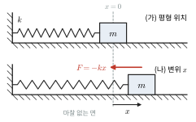

*그림 15.1* 마찰 없는 면 위의 용수철 진자. (가) 용수철이 늘거나 줄지 않은 평형 위치를 $x = 0$으로 잡는다. (나) 물체가 $x$만큼 벗어나면 용수철은 변위와 반대 방향으로 $F = -kx$의 복원력을 작용한다.

$$
x(t) = A\cos(\omega t + \phi) = C_1\cos\omega t + C_2\sin\omega t
$$

- $A$: **진폭(amplitude)**, $\omega$: **각진동수(angular frequency)** [rad/s], $\omega t + \phi$: **위상(phase)**, $\phi$: **위상상수(phase constant)**
- **주기(period)** $T = 2\pi/\omega = 2\pi\sqrt{m/k}$, **진동수(frequency)** $f = 1/T = \omega/2\pi$ [Hz]

속도와 가속도는 미분으로 얻는다.
$$
v(t) = -\omega A\sin(\omega t + \phi), \qquad a(t) = -\omega^2A\cos(\omega t + \phi) = -\omega^2x(t)
$$
속도는 변위보다 위상이 $\pi/2$ 앞서고, 가속도는 변위와 위상이 $\pi$ 다르다(항상 평형점을 향한다). 그림 15.2에서 각 양이 최대가 되는 시각을 비교해 보라.

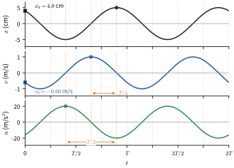

*그림 15.2* 예제 15.1의 운동($A = 5.0\ \text{cm}$, $\omega = 20\ \text{rad/s}$, $\phi = 0.644\ \text{rad}$, $T = 0.314\ \text{s}$)의 $x$, $v$, $a$. 점은 각 양이 처음으로 최대가 되는 시각이다. $v$는 $x$보다 $T/4$(위상 $\pi/2$) 먼저, $a$는 $T/2$(위상 $\pi$) 먼저 최대가 된다. 네모는 초기 조건 $x_0$, $v_0$이다.

> **💡 개념 확인: 주기는 진폭과 무관하다**
> $T = 2\pi\sqrt{m/k}$에는 진폭이 없다. 크게 흔들면 더 먼 거리를 가지만 복원력도 비례해서 커지므로 시간은 같다. 이 **등시성**(isochronism)은 복원력이 변위에 **정확히** 비례할 때만 성립한다. 진자는 작은 각에서만 근사적으로 등시적이다(15.3절 ★).

### 초기 조건
2계 미분방정식이므로 상수 2개($A$, $\phi$)를 정하려면 조건 2개가 필요하다. $t = 0$에서 $x(0) = x_0$, $v(0) = v_0$이면
$$
x_0 = A\cos\phi,\quad v_0 = -\omega A\sin\phi \quad\Longrightarrow\quad A = \sqrt{x_0^2 + \left(\frac{v_0}{\omega}\right)^2},\quad \tan\phi = -\frac{v_0}{\omega x_0}
$$
$\tan^{-1}$은 사분면을 따져야 한다(1장 💡 참고). $\cos\phi$의 부호는 $x_0$, $\sin\phi$의 부호는 $-v_0$의 부호와 같다.

### 예제 15.1 초기 조건에서 운동 결정하기
질량 $0.50\ \text{kg}$인 물체가 $k = 200\ \text{N/m}$인 용수철에 달려 있다. $t = 0$에서 $x_0 = 0.040\ \text{m}$, $v_0 = -0.60\ \text{m/s}$이다. $x(t)$를 구하고 최대 속력, 최대 가속도, 역학적 에너지를 구하라.

**풀이**
$\omega = \sqrt{200/0.50} = 20\ \text{rad/s}$. $v_0/\omega = -0.030\ \text{m}$이므로 $A = \sqrt{0.040^2 + 0.030^2} = 0.050\ \text{m}$.
$\cos\phi = 0.040/0.050 = 0.80 > 0$, $\sin\phi = -v_0/(\omega A) = 0.60 > 0$이므로 $\phi$는 1사분면, $\phi = 0.644\ \text{rad}\ (36.9°)$.
$$
x(t) = (0.050\ \text{m})\cos(20t + 0.644)
$$
$v_{\max} = \omega A = 1.0\ \text{m/s}$, $a_{\max} = \omega^2A = 20\ \text{m/s}^2$, $E = \frac{1}{2}kA^2 = 0.25\ \text{J}$.
검산: $\frac{1}{2}mv_0^2 + \frac{1}{2}kx_0^2 = 0.090 + 0.160 = 0.25\ \text{J}$. 일치한다.

### 예제 15.2 연직 용수철
용수철에 물체를 매달았더니 용수철이 $4.9\ \text{cm}$ 늘어나 정지했다. 물체를 아래로 조금 당겼다 놓을 때 진동 주기를 구하라. 중력이 운동방정식에 어떤 영향을 주는지 설명하라.

**풀이**
아래를 $+y$로, 용수철이 자연 길이일 때를 $y = 0$으로 잡으면(그림 15.3) $m\ddot{y} = mg - ky$이다. 평형 늘음 $\Delta\ell = mg/k$를 쓰고 새 변수 $y' = y - \Delta\ell$(평형점에서 잰 변위)를 도입하면
$$
m\ddot{y}' = mg - k(y' + \Delta\ell) = -ky'
$$
중력은 **평형점만 옮기고** 진동수는 바꾸지 않는다. $\omega = \sqrt{k/m} = \sqrt{g/\Delta\ell} = \sqrt{9.8/0.049} = 14\ \text{rad/s}$, $T = 2\pi/\omega = 0.44\ \text{s}$. 질량도 용수철 상수도 몰라도 정적 늘음만으로 주기를 안다.

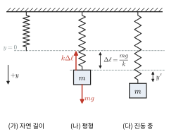

*그림 15.3* 연직 용수철. (가) 자연 길이일 때 끝의 위치를 $y = 0$으로 잡는다. (나) 물체를 매달면 $k\Delta\ell = mg$인 곳에서 평형을 이룬다. (다) 평형점에서 잰 변위 $y'$에 대해서는 중력 없이 $m\ddot{y}' = -ky'$이다.

### 안정 평형 근처의 작은 진동
1장 예제 1.7에서 보았듯, 퍼텐셜 $U(x)$의 최소점 $x_0$ 근처에서
$$
U(x) \approx U(x_0) + \frac{1}{2}U''(x_0)(x - x_0)^2 \quad\Longrightarrow\quad F = -\frac{dU}{dx} \approx -U''(x_0)(x - x_0)
$$
이므로 **유효 용수철 상수** $k_{\text{eff}} = U''(x_0)$인 단조화 운동을 한다. 이것이 단조화 운동이 물리학 어디에나 나오는 이유다.

### 예제 15.3 이원자 분자의 진동 (레너드–존스 퍼텐셜)
두 원자 사이의 퍼텐셜이 $U(r) = 4\varepsilon\left[(\sigma/r)^{12} - (\sigma/r)^6\right]$이다. 평형 거리 $r_0$와 유효 용수철 상수를 구하라. 두 원자의 환산 질량을 $\mu$라 할 때 진동 각진동수는?

**풀이**
$U'(r) = 4\varepsilon\left[-12\sigma^{12}/r^{13} + 6\sigma^6/r^7\right] = 0$에서 $r_0^6 = 2\sigma^6$, $r_0 = 2^{1/6}\sigma \approx 1.12\sigma$(그림 15.4).
$U''(r) = 4\varepsilon\left[156\sigma^{12}/r^{14} - 42\sigma^6/r^8\right]$에 $\sigma^6/r_0^6 = 1/2$를 넣으면
$$
k_{\text{eff}} = U''(r_0) = \frac{4\varepsilon}{r_0^2}\left(\frac{156}{4} - \frac{42}{2}\right) = \frac{72\varepsilon}{r_0^2} = \frac{72\varepsilon}{2^{1/3}\sigma^2} \approx 57.1\frac{\varepsilon}{\sigma^2}
$$
두 물체 문제는 상대 좌표 $r$에 대해 질량을 환산 질량 $\mu = m_1m_2/(m_1 + m_2)$로 바꾼 한 물체 문제가 되므로 $\omega = \sqrt{k_{\text{eff}}/\mu}$이다. 분자 진동은 적외선 영역의 빛을 흡수하는데, 이것이 적외선 분광법으로 분자의 결합을 식별하는 원리다(38장).

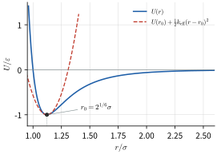

*그림 15.4* 레너드–존스 퍼텐셜(파랑)과 최소점 $r_0$ 근처의 포물선 근사(빨강 점선, $k_{\text{eff}} = 57.1\,\varepsilon/\sigma^2$). 최소점 가까이에서는 둘이 거의 겹치므로 작은 진동은 단조화 운동이다. 압축 쪽($r < r_0$)이 훨씬 가파른 비대칭은 열팽창의 원인이 된다(18장).

---

## 15.2 단조화 운동의 에너지

$x = A\cos(\omega t + \phi)$, $v = -\omega A\sin(\omega t + \phi)$, $k = m\omega^2$을 쓰면
$$
U = \frac{1}{2}kx^2 = \frac{1}{2}kA^2\cos^2(\omega t + \phi), \qquad K = \frac{1}{2}mv^2 = \frac{1}{2}kA^2\sin^2(\omega t + \phi)
$$
$$
E = K + U = \frac{1}{2}kA^2 = \text{일정}
$$
에너지는 퍼텐셜과 운동에너지 사이를 진동수 $2\omega$로 오간다. 한 주기 동안 $\cos^2$과 $\sin^2$의 평균은 각각 $1/2$이므로 **시간 평균** $\langle K\rangle = \langle U\rangle = E/2$이다. 에너지 보존식에서 위치에 따른 속력도 바로 나온다(그림 15.5).
$$
v(x) = \pm\omega\sqrt{A^2 - x^2}
$$

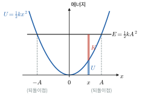

*그림 15.5* 단조화 운동의 에너지. 퍼텐셜 $U = \frac{1}{2}kx^2$은 포물선이고 전체 에너지 $E$는 수평선이다. 위치 $x$에서 둘 사이의 간격이 운동에너지 $K$이며, $K = 0$인 $x = \pm A$가 되돌이점이다.

### 에너지 방법으로 진동수 구하기
어떤 계의 에너지를 하나의 좌표 $q$로
$$
E = \frac{1}{2}M_{\text{eff}}\dot{q}^2 + \frac{1}{2}K_{\text{eff}}q^2
$$
꼴로 쓸 수 있으면, $dE/dt = \dot{q}(M_{\text{eff}}\ddot{q} + K_{\text{eff}}q) = 0$에서 바로 $\omega = \sqrt{K_{\text{eff}}/M_{\text{eff}}}$를 얻는다. 힘을 일일이 따지기 어려운 계에서 매우 강력한 방법이다.

### 예제 15.4 U자관 속 액체의 진동
단면이 균일한 U자관에 밀도 $\rho$인 액체가 전체 길이 $L$만큼 들어 있다. 한쪽 액면을 눌렀다 놓으면 액체가 진동한다. 점성을 무시하고 주기를 구하라. $L = 0.50\ \text{m}$이면?

**풀이**
관의 단면적을 $A$, 한쪽 액면이 평형에서 $y$만큼 올라갔다고 하자(그림 15.6). 다른 쪽은 $y$만큼 내려간다. 액체 전체가 속력 $\dot{y}$로 움직이므로 $K = \frac{1}{2}(\rho AL)\dot{y}^2$.
퍼텐셜 에너지 변화는, 내려간 쪽의 길이 $y$인 액체 기둥(질량 $\rho Ay$)을 올라간 쪽 위로 옮긴 것과 같다. 질량중심이 $y$만큼 올라가므로 $U = (\rho Ay)g\,y = \rho Agy^2$.
$$
E = \frac{1}{2}(\rho AL)\dot{y}^2 + \frac{1}{2}(2\rho Ag)y^2 \quad\Longrightarrow\quad \omega = \sqrt{\frac{2\rho Ag}{\rho AL}} = \sqrt{\frac{2g}{L}}
$$
밀도와 단면적에 무관하다. $L = 0.50\ \text{m}$이면 $\omega = 6.26\ \text{rad/s}$, $T = 1.0\ \text{s}$.

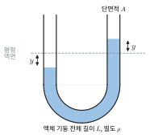

*그림 15.6* U자관 속 액체. 한쪽 액면이 평형에서 $y$ 올라가면 다른 쪽은 $y$ 내려간다. 높이 차 $2y$만큼의 액체 기둥 무게가 복원력이 된다.

---

## 15.3 단진자와 물리진자

### 단진자
길이 $L$인 가벼운 줄 끝에 질량 $m$인 점질량이 매달린 **단진자**(simple pendulum)를 회전 운동으로 다룬다. 줄이 연직선과 각 $\theta$를 이룰 때(그림 15.7), 매단 점에 대한 중력 토크는 $\tau = -mgL\sin\theta$이고(장력은 매단 점을 지나므로 토크가 없다), 관성모멘트는 $I = mL^2$이다. 회전의 뉴턴 제2법칙 $\tau = I\ddot{\theta}$에서

$$
\ddot{\theta} = -\frac{g}{L}\sin\theta
$$

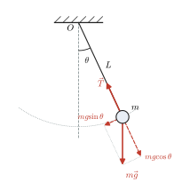

*그림 15.7* 단진자. 장력 $\vec T$는 매단 점 $O$를 지나므로 토크가 없고, 중력의 접선 성분 $mg\sin\theta$가 $\theta$를 줄이는 쪽으로 복원 토크 $-mgL\sin\theta$를 만든다. 점선 화살표는 $m\vec g$의 두 성분이다.

이 방정식은 비선형이어서 초등함수로 풀리지 않는다. 각이 작으면 $\sin\theta \approx \theta$이므로
$$
\ddot{\theta} \approx -\frac{g}{L}\theta, \qquad \omega = \sqrt{\frac{g}{L}}, \qquad T_0 = 2\pi\sqrt{\frac{L}{g}}
$$
주기는 질량에 무관하다. 이는 중력 질량과 관성 질량이 같기 때문이며(등가 원리, 13장), 뉴턴은 진자 실험으로 이를 확인했다.

> **★ 심화: 큰 진폭의 진자와 타원적분**
> 진폭 $\theta_0$에서 에너지 보존 $\frac{1}{2}mL^2\dot{\theta}^2 = mgL(\cos\theta - \cos\theta_0)$을 시간에 대해 풀면
> $$T = 4\sqrt{\frac{L}{2g}}\int_0^{\theta_0}\frac{d\theta}{\sqrt{\cos\theta - \cos\theta_0}}$$
> 이다. $\sin(\theta/2) = k\sin u$, $k = \sin(\theta_0/2)$로 치환하면
> $$T = 4\sqrt{\frac{L}{g}}\,K(k), \qquad K(k) = \int_0^{\pi/2}\frac{du}{\sqrt{1 - k^2\sin^2u}}$$
> 를 얻는다. $K(k)$를 **제1종 완전 타원적분**(complete elliptic integral of the first kind)이라 한다. 피적분함수를 $k^2$에 대해 전개해 항별 적분하면 $K = \frac{\pi}{2}\left(1 + \frac{k^2}{4} + \frac{9k^4}{64} + \cdots\right)$이고, $k \approx \theta_0/2$이므로
> $$T \approx T_0\left(1 + \frac{\theta_0^2}{16} + \frac{11\theta_0^4}{3072} + \cdots\right)$$
> 이다. $\theta_0 = 10°$이면 $T/T_0 = 1.0019$, $30°$이면 $1.0174$, $90°$이면 $1.1803$이다(`scipy.special.ellipk`로 확인. 이 함수는 인수로 $k^2$을 받는다). 1장 연습문제 14의 수치 결과와 비교해 보라.

### 물리진자
크기가 있는 강체가 질량중심에서 거리 $d$인 수평축에 매달려 흔들리는 것을 **물리진자**(physical pendulum)라 한다. 축에 대한 관성모멘트를 $I$라 하면 중력 토크는 $-Mgd\sin\theta$이므로(그림 15.8)
$$
I\ddot{\theta} = -Mgd\sin\theta \approx -Mgd\,\theta \quad\Longrightarrow\quad T = 2\pi\sqrt{\frac{I}{Mgd}}
$$
점질량이면 $I = Md^2$이 되어 단진자 식으로 돌아간다. 물리진자와 주기가 같은 단진자의 길이 $L_0 = I/(Md)$를 **등가 단진자 길이**라 하고, 축에서 질량중심 방향으로 $L_0$만큼 떨어진 점을 **진동 중심**(center of oscillation)이라 한다.

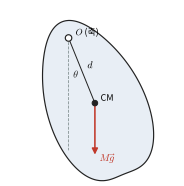

*그림 15.8* 물리진자. 축 $O$에서 질량중심(CM)까지 거리가 $d$이고, $O$와 CM을 잇는 선이 연직선과 각 $\theta$를 이룬다. 질량중심에 작용하는 중력 $M\vec g$가 축에 대해 토크 $-Mgd\sin\theta$를 만든다.

### 예제 15.5 막대 진자
길이 $L = 1.00\ \text{m}$인 균일한 막대가 한쪽 끝을 지나는 수평축에 매달려 흔들린다. (가) 작은 진동의 주기를 구하라. (나) 축의 위치를 막대 위에서 옮길 때 주기가 가장 짧아지는 축 위치와 그때의 주기를 구하라.

**풀이**
(가) $I = \frac{1}{3}ML^2$, $d = L/2$이므로
$$
T = 2\pi\sqrt{\frac{ML^2/3}{MgL/2}} = 2\pi\sqrt{\frac{2L}{3g}} = 1.64\ \text{s}
$$
등가 단진자 길이는 $2L/3$이다.
(나) 질량중심에서 거리 $d$인 축에 대해 평행축 정리로 $I = M(L^2/12 + d^2)$이므로
$$
T(d) = 2\pi\sqrt{\frac{L^2/12 + d^2}{gd}}
$$
$f(d) = L^2/(12d) + d$를 최소로 하면 된다. $f'(d) = -L^2/(12d^2) + 1 = 0$에서 $d = L/\sqrt{12} = 0.289\ \text{m}$(회전반지름과 같다). 그때 $T_{\min} = 2\pi\sqrt{2d/g} = 1.53\ \text{s}$. $d\to0$이면 복원 토크가 없어 $T\to\infty$, $d$가 크면 관성모멘트가 커져 $T$가 커지므로 중간에 최솟값이 있다(그림 15.9).

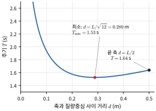

*그림 15.9* 길이 $1.00\ \text{m}$인 막대 진자의 주기 $T(d) = 2\pi\sqrt{(L^2/12 + d^2)/(gd)}$. $d = L/\sqrt{12}$에서 최소 $1.53\ \text{s}$이고, 끝에 축이 있으면($d = L/2$) $1.64\ \text{s}$이다.

### 비틀림 진자
철사에 매단 원판을 축 둘레로 각 $\theta$만큼 비틀면 철사가 복원 토크 $\tau = -\kappa\theta$를 만든다($\kappa$: 비틀림 상수). $I\ddot{\theta} = -\kappa\theta$이므로 $T = 2\pi\sqrt{I/\kappa}$이다. 이 진자는 작은 각 근사가 필요 없을 만큼 넓은 범위에서 선형이며, 캐번디시의 중력 상수 측정(13장)과 기계식 손목시계의 밸런스 휠에 쓰였다.

---

## 15.4 단조화 운동과 등속 원운동

### 기준원
반지름 $A$인 원 위를 각속도 $\omega$로 등속 원운동하는 점 $P$를 생각한다. $t = 0$에 $P$가 $x$축과 각 $\phi$를 이루면 시각 $t$의 위치는
$$
\vec{r}(t) = A\cos(\omega t + \phi)\,\hat{i} + A\sin(\omega t + \phi)\,\hat{j}
$$
이다. 이 점의 $x$ 성분(그림자)은 정확히 단조화 운동이다. 속도의 $x$ 성분 $-\omega A\sin(\omega t + \phi)$, 구심가속도 $\omega^2A$의 $x$ 성분 $-\omega^2A\cos(\omega t + \phi)$도 15.1절 결과와 같다. 그래서 단조화 운동의 $\omega$를 "각"진동수라 부른다. 이 원을 **기준원**(reference circle)이라 한다(그림 15.10).

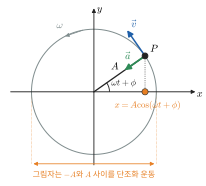

*그림 15.10* 기준원. 반지름 $A$인 원 위를 각속도 $\omega$로 도는 점 $P$의 $x$축 그림자(주황)는 $x = A\cos(\omega t + \phi)$로 단조화 운동을 한다. $P$의 속도 $\vec v$(크기 $\omega A$)와 구심가속도 $\vec a$(크기 $\omega^2A$)의 $x$ 성분이 각각 단조화 운동의 속도와 가속도다.

### 복소수 표현과 페이저
기준원을 복소평면에 놓으면 $\tilde{z}(t) = Ae^{i(\omega t + \phi)}$이고, 실제 변위는 그 실수부 $x = \text{Re}\,\tilde{z}$이다. 상수 부분을 묶어 **복소 진폭** $\tilde{A} = Ae^{i\phi}$를 정의하면 $\tilde{z} = \tilde{A}e^{i\omega t}$이다. 이 회전하는 화살표를 **페이저**(phasor)라 한다.

복소 표현의 장점은 미분이 곱셈이 된다는 것이다: $d/dt \to i\omega$. 속도 $i\omega\tilde{z}$는 변위 페이저를 $90°$ 앞으로 돌린 것이고, 가속도 $-\omega^2\tilde{z}$는 $180°$ 돌린 것이다(그림 15.11). 진동수가 같은 두 진동의 합은 두 페이저의 벡터 합으로 구한다. 이 방법은 15.6절 강제 진동, 16장 파동의 간섭, 29장 교류 회로, 33장 빛의 간섭에서 핵심 도구가 된다.

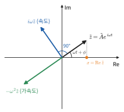

*그림 15.11* 복소평면 위의 페이저. 세 화살표가 함께 각속도 $\omega$로 돌며, 속도 페이저 $i\omega\tilde z$는 변위 페이저보다 $90°$, 가속도 페이저 $-\omega^2\tilde z$는 $180°$ 앞선다. 실제 변위는 실수축 위의 그림자 $x = \text{Re}\,\tilde z$이다. (길이의 단위가 서로 달라 길이 비는 임의로 그렸다.)

> **💡 개념 확인: 2차원 단조화 운동**
> $x = A\cos\omega t$, $y = A\sin\omega t$이면 원운동, $y = B\sin\omega t$($B \ne A$)이면 타원 운동이다. 두 방향의 진동수가 다르고 비가 유리수이면 닫힌 곡선(리사주 도형, Lissajous figure)이 생긴다. 등방적 2차원 용수철($\vec{F} = -k\vec{r}$)에 매단 물체가 그리는 궤도는 언제나 원점이 중심인 타원이다. 같은 타원이라도 원점이 초점인 케플러 궤도(13장)와는 구별해야 한다.

---

## 15.5 감쇠 진동

### 운동방정식
실제 진동은 마찰이나 공기 저항 때문에 점점 잦아든다. 속도에 비례하는 저항력 $F_d = -b\dot{x}$를 넣으면
$$
m\ddot{x} + b\dot{x} + kx = 0 \quad\Longrightarrow\quad \ddot{x} + 2\beta\dot{x} + \omega_0^2x = 0,\qquad \beta = \frac{b}{2m},\ \omega_0 = \sqrt{\frac{k}{m}}
$$
$\omega_0$를 **고유 각진동수(natural angular frequency)**, $\beta$를 **감쇠 상수**라 한다. 1장 예제 1.8처럼 $x = e^{st}$를 넣으면 특성 방정식 $s^2 + 2\beta s + \omega_0^2 = 0$에서 $s = -\beta \pm\sqrt{\beta^2 - \omega_0^2}$이다. 근호 안의 부호에 따라 세 가지 운동이 나온다(그림 15.12).

| 영역 | 조건 | 해 | 특징 |
|---|---|---|---|
| 약한 감쇠(underdamped) | $\beta < \omega_0$ | $x = Ae^{-\beta t}\cos(\omega_dt + \phi)$, $\omega_d = \sqrt{\omega_0^2 - \beta^2}$ | 진폭이 지수적으로 줄며 진동 |
| 임계 감쇠(critically damped) | $\beta = \omega_0$ | $x = (C_1 + C_2t)e^{-\beta t}$ | 진동 없이 가장 빨리 평형으로 |
| 과감쇠(overdamped) | $\beta > \omega_0$ | $x = C_1e^{s_1t} + C_2e^{s_2t}$ ($s_{1,2} < 0$) | 진동 없이 천천히 평형으로 |

임계 감쇠에서 특성 방정식이 중근을 가지므로 두 번째 해가 $te^{-\beta t}$가 된다. 대입해서 확인해 보라. 감쇠가 있으면 진동이 느려지지만($\omega_d < \omega_0$), 약한 감쇠에서는 그 차이가 $\beta^2$ 차수로 아주 작다.

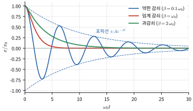

*그림 15.12* 같은 초기 조건($x(0) = x_0$, $v(0) = 0$)에서 감쇠 상수만 바꾼 운동. 약한 감쇠(파랑)는 포락선 $\pm Ae^{-\beta t}$(점선) 안에서 진동하며 잦아들고, 임계 감쇠(빨강)는 진동 없이 가장 빨리, 과감쇠(초록)는 진동 없이 더 천천히 평형으로 돌아간다.

### 에너지 손실과 품질 인자 $Q$
$E = \frac{1}{2}m\dot{x}^2 + \frac{1}{2}kx^2$을 미분하고 운동방정식을 쓰면
$$
\frac{dE}{dt} = \dot{x}(m\ddot{x} + kx) = -b\dot{x}^2
$$
저항력이 하는 일률이 정확히 에너지 손실률이다. 감쇠가 약하면 한 주기 동안의 평균으로 $\langle\dot{x}^2\rangle \approx \omega_0^2A^2/2$, 즉 $\langle m\dot{x}^2\rangle \approx E$이므로
$$
\frac{dE}{dt} \approx -\frac{b}{m}E = -2\beta E \quad\Longrightarrow\quad E(t) = E_0e^{-2\beta t}
$$
에너지는 진폭의 제곱에 비례하므로 진폭 $\propto e^{-\beta t}$와 맞는다. 진동자가 얼마나 "오래 울리는지"를 나타내는 무차원 수가 **품질 인자**(quality factor)다.
$$
Q = \frac{\omega_0}{2\beta} \approx 2\pi\times\frac{\text{저장된 에너지}}{\text{한 주기 동안 잃는 에너지}}
$$
에너지가 $1/e$로 줄어드는 동안 약 $Q/(2\pi)$번 진동한다. 공학에서는 $Q$ 대신 **감쇠비(damping ratio)** $\zeta = \beta/\omega_0 = 1/(2Q)$를 자주 쓴다. 임계 감쇠는 $\zeta = 1$이다.

### 예제 15.6 진폭이 절반으로 줄어드는 진동자
약하게 감쇠하는 진동자의 진폭이 10번 진동하는 동안 처음의 절반으로 줄었다. (가) $\beta T$와 $Q$를 구하라($T$는 주기). (나) 한 주기에 잃는 에너지의 비율은?

**풀이**
(가) $e^{-\beta(10T)} = 1/2$이므로 $\beta T = (\ln2)/10 = 0.0693$. 약한 감쇠에서 $\omega_0 \approx 2\pi/T$이므로
$$
Q = \frac{\omega_0}{2\beta} \approx \frac{\pi}{\beta T} = \frac{\pi}{0.0693} = 45
$$
(나) 한 주기 뒤 에너지 비 $e^{-2\beta T} = 2^{-1/5} = 0.871$이므로 약 <strong>13%</strong>를 잃는다. 근사식 $2\pi/Q = 0.139$도 비슷하다. $Q$가 클수록 이 근사가 정확해진다.

> **🔗 전공 연결: 기계진동학**
> 기계공학과의 **기계진동학**(mechanical vibrations)은 이 장의 운동방정식을 $m\ddot{x} + c\dot{x} + kx = F(t)$로 쓰고($c$는 감쇠 계수), 감쇠비 $\zeta$와 진동수비 $r = \omega/\omega_0$를 써서 모든 결과를 정리한다. 대표적인 주제는 다음과 같다.
> - **자동차 서스펜션**: 충격을 받은 뒤 크게 출렁이지 않고 빨리 가라앉도록 감쇠기(쇼크 업소버)를 설계한다. 승용차에서는 보통 임계 감쇠보다 약한 감쇠($\zeta < 1$)를 택한다. 너무 강하면 노면 충격이 그대로 전달된다.
> - **회전 불균형**: 회전축에서 거리 $e$인 곳에 질량 $m_u$가 치우쳐 있으면 크기 $m_ue\omega^2$인 회전력이 생겨 강제 진동을 일으킨다. 세탁기 탈수 때 기계가 흔들리는 원인이다.
> - **진동 절연(vibration isolation)**: 기계를 받침 위에 올려 바닥으로 전달되는 힘을 줄이려면, 받침의 고유 진동수가 가진 진동수보다 충분히 낮아야 한다. 전달률 계산에 따르면 $r > \sqrt2$일 때부터 전달되는 힘이 가진력보다 작아진다.
> - **다자유도계**: 여러 질량이 연결된 계는 행렬 고윳값 문제로 정규 모드를 구한다(아래 ★ 결합 진동자).

---

## 15.6 강제 진동과 공명

### 정상상태 해: 복소수 방법
감쇠 진동자에 주기적인 힘 $F_0\cos\omega t$를 가한다($\omega$: **구동 진동수**).
$$
\ddot{x} + 2\beta\dot{x} + \omega_0^2x = \frac{F_0}{m}\cos\omega t
$$
일반해는 (동차 방정식의 해, 곧 감쇠하는 **과도 해**) + (특수해, 곧 **정상상태 해**)이다. 과도 해는 시간 $\sim1/\beta$ 뒤에 사라지므로, 오래 지난 뒤에는 정상상태 해만 남는다. 정상상태 해를 구하려고 구동항을 $\frac{F_0}{m}e^{i\omega t}$로 바꾸고 $\tilde{x} = \tilde{A}e^{i\omega t}$를 대입하면 $d/dt \to i\omega$이므로
$$
\left(\omega_0^2 - \omega^2 + 2i\beta\omega\right)\tilde{A} = \frac{F_0}{m} \quad\Longrightarrow\quad \tilde{A} = \frac{F_0/m}{\omega_0^2 - \omega^2 + 2i\beta\omega}
$$
복소수의 크기와 편각을 구하면 $x(t) = \text{Re}\,\tilde{x} = A(\omega)\cos(\omega t - \delta)$이고

$$
\boxed{A(\omega) = \frac{F_0/m}{\sqrt{(\omega_0^2 - \omega^2)^2 + 4\beta^2\omega^2}},\qquad \tan\delta = \frac{2\beta\omega}{\omega_0^2 - \omega^2}}
$$

이다. $\delta$는 변위가 구동력보다 늦는 위상이다.
- $\omega \ll \omega_0$: $A \to F_0/k$(정적 변위), $\delta \to 0$. 천천히 밀면 용수철처럼 따라온다.
- $\omega = \omega_0$: $A = F_0/(2m\beta\omega_0) = Q\,F_0/k$, $\delta = 90°$. 정적 변위의 $Q$배가 된다.
- $\omega \gg \omega_0$: $A \approx F_0/(m\omega^2) \to 0$, $\delta \to 180°$. 관성이 지배하여 힘과 반대로 움직인다.

진폭이 최대가 되는 진동수는 $A$의 분모를 최소로 하는 $\omega_r = \sqrt{\omega_0^2 - 2\beta^2}$이다(1장 연습문제 13). 이처럼 구동 진동수가 고유 진동수 근처일 때 진폭이 크게 커지는 현상을 **공명**(resonance)이라 한다(그림 15.13).

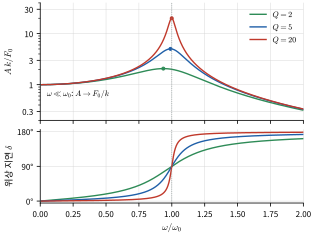

*그림 15.13* 강제 진동의 정상상태 진폭(위, 세로축은 로그 눈금)과 위상 지연 $\delta$(아래). 진폭은 정적 변위 $F_0/k$를 단위로 그렸다. 점은 진폭이 최대인 $\omega_r = \sqrt{\omega_0^2 - 2\beta^2}$이고, 공명에서의 진폭은 정적 변위의 약 $Q$배다. 모든 곡선에서 $\omega = \omega_0$일 때 $\delta = 90°$이다.

> **💡 개념 확인: 세 가지 "진동수"를 구별하라**
> 감쇠·강제 진동에는 비슷하지만 다른 진동수가 셋 나온다. ① 고유 각진동수 $\omega_0 = \sqrt{k/m}$, ② 감쇠 진동의 각진동수 $\omega_d = \sqrt{\omega_0^2 - \beta^2}$(자유롭게 놓아 둘 때 실제로 진동하는 진동수), ③ 진폭 공명 각진동수 $\omega_r = \sqrt{\omega_0^2 - 2\beta^2}$. 약한 감쇠($Q \gg 1$)에서는 셋이 거의 같지만, 시험에서는 어느 것을 묻는지 정확히 구분해야 한다. 한편 흡수 **일률**은 정확히 $\omega_0$에서 최대가 된다(연습문제 17).

### 흡수 일률과 공명의 폭
정상상태에서 구동력이 하는 평균 일률은 $\langle F\dot{x}\rangle$이다. $\dot{x} = -\omega A\sin(\omega t - \delta)$와 $\langle\cos\omega t\sin(\omega t - \delta)\rangle = -\frac{1}{2}\sin\delta$를 쓰면
$$
\langle P\rangle = \frac{1}{2}F_0\omega A\sin\delta = \frac{F_0^2}{m}\cdot\frac{\beta\omega^2}{(\omega_0^2 - \omega^2)^2 + 4\beta^2\omega^2}
$$
이다. 이 일률은 정상상태에서 감쇠력이 소모하는 일률과 같다. $\omega = \omega_0$에서 최대 $F_0^2/(4m\beta)$이고, 최댓값의 절반이 되는 두 진동수 사이 간격(**반치폭, FWHM**)은 정확히 $\Delta\omega = 2\beta$이다. 따라서
$$
Q = \frac{\omega_0}{\Delta\omega}
$$
$Q$가 클수록 공명이 **높고 좁다**(그림 15.14). 라디오가 원하는 방송국만 골라 듣는 것(29장), 원자시계가 정확한 것(🔬 아래) 모두 높은 $Q$ 덕분이다.

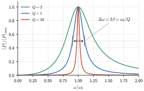

*그림 15.14* 평균 흡수 일률을 각각의 최댓값으로 나누어 그린 곡선. 모두 정확히 $\omega = \omega_0$에서 최대이고, 최댓값의 절반이 되는 두 진동수 사이 간격(반치폭)이 $\Delta\omega = 2\beta = \omega_0/Q$이다. 화살표는 $Q = 5$의 반치폭이다.

> **🐍 파이썬 실습: 공명 곡선**
> $Q$를 바꿔 가며 진폭 공명 곡선을 그리고, 흡수 일률의 반치폭이 $\omega_0/Q$인지 확인한다. 마지막으로 운동방정식을 직접 수치 적분하여 정상상태 진폭이 공식과 같은지 검증한다.
> ```python
> import numpy as np
> import matplotlib.pyplot as plt
> from scipy.integrate import solve_ivp
>
> w0 = 1.0                                   # 고유 각진동수 (단위를 w0 = 1로)
> w = np.linspace(0.01, 2.0, 2000)
> for Q in [2, 5, 20]:
>     beta = w0/(2*Q)
>     A = 1/np.sqrt((w0**2 - w**2)**2 + 4*beta**2*w**2)   # F0/m = 1
>     P = beta*w**2*A**2                                  # 평균 흡수 일률
>     half = w[P >= P.max()/2]
>     print(f"Q={Q:2d}: 진폭 최대 w={w[A.argmax()]:.3f}, "
>           f"반치폭={half[-1]-half[0]:.3f} (w0/Q={w0/Q:.3f})")
>     plt.plot(w, A, label=f"Q={Q}")
>
> # 검증: Q=5, w=0.9 에서 운동방정식을 직접 풀어 정상상태 진폭과 비교
> beta, wd = 0.1, 0.9
> f = lambda t, y: [y[1], np.cos(wd*t) - 2*beta*y[1] - w0**2*y[0]]
> sol = solve_ivp(f, [0, 200], [0, 0], max_step=0.05)
> amp_num = np.abs(sol.y[0][sol.t > 150]).max()
> amp_th = 1/np.sqrt((w0**2 - wd**2)**2 + 4*beta**2*wd**2)
> print(f"수치 정상상태 진폭 {amp_num:.3f}, 이론 {amp_th:.3f}")
> plt.xlabel("omega/omega0"); plt.ylabel("A k/F0"); plt.legend(); plt.show()
> ```
> 실행 결과는 다음과 같다.
> ```
> Q= 2: 진폭 최대 w=0.936, 반치폭=0.499 (w0/Q=0.500)
> Q= 5: 진폭 최대 w=0.990, 반치폭=0.198 (w0/Q=0.200)
> Q=20: 진폭 최대 w=1.000, 반치폭=0.049 (w0/Q=0.050)
> 수치 정상상태 진폭 3.821, 이론 3.821
> ```
> 진폭 최대 위치는 $\omega_r = \sqrt{1 - 2\beta^2}$(예: $Q = 2$이면 $0.935$)와 맞고, 반치폭은 격자 간격(약 0.001) 오차 안에서 $\omega_0/Q$와 같다. 수치 적분에서 $t < 50$ 구간을 그려 보면 과도 해가 사라지는 과정도 볼 수 있다.

### 예제 15.7 빨래판 도로 위의 자동차
질량 $1200\ \text{kg}$인 자동차에 질량 합 $300\ \text{kg}$인 승객이 타자 차체가 $3.0\ \text{cm}$ 내려앉았다. 이 차가 $5.0\ \text{m}$ 간격으로 둔덕이 있는 도로를 달린다. 차체의 상하 진동이 공명하는 주행 속력을 구하라. (차 전체를 하나의 용수철 위 질량으로 본다.)

**풀이**
네 바퀴 용수철 전체의 유효 용수철 상수 $k = (300)(9.8)/0.030 = 9.8\times10^4\ \text{N/m}$. 승객을 태운 질량 $M = 1500\ \text{kg}$이므로
$$
\omega_0 = \sqrt{k/M} = 8.08\ \text{rad/s}, \qquad f_0 = \omega_0/2\pi = 1.29\ \text{Hz}
$$
속력 $v$로 달리면 둔덕을 만나는 진동수는 $f = v/(5.0\ \text{m})$이다. $f = f_0$에서
$$
v = (1.29\ \text{Hz})(5.0\ \text{m}) = 6.4\ \text{m/s} \approx 23\ \text{km/h}
$$
이 속력 근처에서 차가 크게 출렁인다. 더 빨리 또는 더 느리게 달리면 진동이 줄어든다. 감쇠기가 없다면 공명에서 진폭이 매우 커질 것이다.

> **★ 심화: 결합 진동자와 정규 모드**
> 질량 $m$인 두 물체가 각각 벽과 용수철 상수 $k$인 용수철로, 서로는 $k_c$인 용수철로 연결되어 있다(벽–$k$–$m$–$k_c$–$m$–$k$–벽, 그림 15.15). 평형에서 잰 변위를 $x_1$, $x_2$라 하면
> $$m\ddot{x}_1 = -kx_1 - k_c(x_1 - x_2), \qquad m\ddot{x}_2 = -kx_2 - k_c(x_2 - x_1)$$
> 두 식을 더하고 빼면 새 좌표 $q_1 = x_1 + x_2$, $q_2 = x_1 - x_2$가 서로 분리된다.
> $$\ddot{q}_1 = -\frac{k}{m}q_1, \qquad \ddot{q}_2 = -\frac{k + 2k_c}{m}q_2$$
> 각각 독립적인 단조화 운동이며, 이런 집단 운동을 **정규 모드**(normal mode)라 한다. 모드 1($\omega_1 = \sqrt{k/m}$)은 두 물체가 같은 방향으로 움직여 가운데 용수철이 늘지 않고, 모드 2($\omega_2 = \sqrt{(k + 2k_c)/m}$)는 반대 방향으로 움직인다. 행렬로 쓰면 $\ddot{\vec{x}} = -\mathsf{K}\vec{x}/m$의 고윳값 문제이고, 정규 모드는 고유벡터다. 한 물체만 당겼다 놓으면 두 모드가 섞여 맥놀이(17장)가 생기고, 에너지가 두 물체 사이를 천천히 오간다(연습문제 15). 물체 수를 무한히 늘리면 16장의 파동 방정식이 된다. 결정 속 원자의 집단 진동(포논)과 분자의 진동 모드가 이 방법으로 계산된다.
> 
> 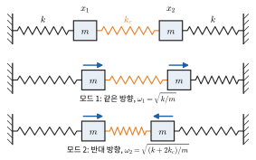
> 
> *그림 15.15* 결합 진동자(위)와 두 정규 모드. 모드 1에서는 두 물체가 같은 방향으로 같은 만큼 움직여 가운데 용수철(주황)이 늘지 않고, 모드 2에서는 반대 방향으로 움직여 가운데 용수철이 늘고 준다.

> **🔗 전공 연결: 건물의 내진 설계**
> 건물은 거대한 다자유도 진동자다. 지진은 땅을 흔드는 구동력이고, 건물의 고유 진동수가 지진파의 주된 진동수와 가까우면 공명으로 피해가 커진다. 일반적으로 높은 건물일수록 고유 주기가 길다. 내진 설계는 이 장의 개념으로 이해할 수 있다.
> - **면진(base isolation)**: 건물과 기초 사이에 수평으로 부드러운 받침(적층 고무 등)을 넣어 건물 전체의 고유 진동수를 지진동의 주요 진동수보다 크게 낮춘다. 진동 절연과 같은 원리($r > \sqrt2$)다.
> - **제진(damping)**: 구조물에 감쇠기를 달아 $\beta$를 키워 공명 진폭을 줄인다($A_{\text{res}} = QF_0/k$).
> - **동조 질량 감쇠기(tuned mass damper)**: 건물 꼭대기에 고유 진동수를 건물에 맞춘 무거운 진자나 질량–용수철 장치를 달면, 건물이 흔들릴 때 이 장치가 반대 위상으로 크게 흔들리며 에너지를 흡수한다. 위 ★ 결합 진동자의 응용이다. 바람에 의한 초고층 건물의 흔들림을 줄이는 데도 쓴다.

> **🔬 최신 연구 노트: 원자시계와 초정밀 진동자**
> 시계는 "진동수가 안정한 진동자 + 진동 횟수를 세는 장치"다. 진자시계에서 시작해, 오늘날 손목시계 대부분은 **수정 진동자**(quartz crystal oscillator)를 쓴다. 수정은 압전 물질이어서 전압을 걸면 변형되고, 변형되면 전압이 생기므로 전기회로와 결합한 기계적 진동자가 된다. 소리굽쇠 모양 수정 진동자는 흔히 $32\,768\ \text{Hz} = 2^{15}\ \text{Hz}$로 만들어, 2진 계수 회로로 15번 반으로 나누면 정확히 1 Hz가 된다. 수정 진동자는 $Q$가 매우 높아 공명이 좁고, 그래서 진동수가 안정하다.
> 훨씬 더 안정한 진동자는 원자다. 2019년 SI 재정의(2장) 이후에도 **초**(second)는 세슘-133 원자의 바닥상태 초미세 준위 사이 전이 진동수를 정확히 $\Delta\nu_{\text{Cs}} = 9\,192\,631\,770\ \text{Hz}$로 고정하여 정의한다. 원자시계는 마이크로파 발진기의 진동수를 이 원자 공명에 계속 맞추는(되먹임) 장치다. GPS 위성에도 원자시계가 실려 있으며, 상대론 보정이 필요할 만큼 정밀하다(35장). 최근에는 진동수가 약 $10^{14}\text{–}10^{15}\ \text{Hz}$인 광학 전이를 이용한 **광시계**(optical clock)가 세슘 시계보다 훨씬 높은 정밀도에 이르렀고, 초를 다시 정의하는 후보로 국제적으로 논의되고 있다. 진동수가 높고 공명 폭이 좁을수록, 곧 $Q = \omega_0/\Delta\omega$가 클수록 좋은 시계라는 이 장의 결론이 그대로 적용된다.

---

## 핵심 정리

| 개념 | 핵심 식 | 비고 |
|---|---|---|
| 단조화 운동 | $\ddot{x} = -\omega^2x$, $x = A\cos(\omega t + \phi)$ | $T = 2\pi/\omega$, 진폭과 무관 |
| 용수철 진자 | $\omega = \sqrt{k/m}$ | 연직이어도 같음 (평형점만 이동) |
| 초기 조건 | $A = \sqrt{x_0^2 + (v_0/\omega)^2}$, $\tan\phi = -v_0/(\omega x_0)$ | 사분면 주의 |
| 작은 진동 | $k_{\text{eff}} = U''(x_0)$ | 모든 안정 평형점 근처 |
| 에너지 | $E = \frac{1}{2}kA^2$, $\langle K\rangle = \langle U\rangle = E/2$ | $v = \pm\omega\sqrt{A^2 - x^2}$ |
| 단진자 | $T_0 = 2\pi\sqrt{L/g}$ | 큰 진폭: $T \approx T_0(1 + \theta_0^2/16)$ |
| 물리진자 | $T = 2\pi\sqrt{I/(Mgd)}$ | 비틀림 진자: $T = 2\pi\sqrt{I/\kappa}$ |
| 기준원·페이저 | $x = \text{Re}[\tilde{A}e^{i\omega t}]$ | $d/dt \to i\omega$ |
| 감쇠 진동 | $\ddot{x} + 2\beta\dot{x} + \omega_0^2x = 0$ | $\omega_d = \sqrt{\omega_0^2 - \beta^2}$, $E \propto e^{-2\beta t}$ |
| 품질 인자 | $Q = \omega_0/(2\beta) = \omega_0/\Delta\omega$ | 감쇠비 $\zeta = 1/(2Q)$ |
| 강제 진동 | $A = \dfrac{F_0/m}{\sqrt{(\omega_0^2 - \omega^2)^2 + 4\beta^2\omega^2}}$ | 공명에서 $A = QF_0/k$, $\delta = 90°$ |
| 흡수 일률 | $\langle P\rangle = \dfrac{F_0^2}{m}\dfrac{\beta\omega^2}{(\omega_0^2 - \omega^2)^2 + 4\beta^2\omega^2}$ | $\omega_0$에서 최대, 반치폭 $2\beta$ |

---

## 연습문제

**기본**
1. 물체의 위치가 $x(t) = (0.12\ \text{m})\cos(5.0t + \pi/3)$이다. 진동수, 주기, $x(0)$, $v(0)$, 최대 속력, 최대 가속도를 구하라.
2. 질량 $0.25\ \text{kg}$인 물체가 $k = 100\ \text{N/m}$인 용수철에 달려 진동한다. 진동수와 주기를 구하라.
3. $g = 9.80\ \text{m/s}^2$인 곳에서 길이 $0.994\ \text{m}$인 단진자의 주기는?
4. $k = 50\ \text{N/m}$인 용수철 진자가 진폭 $0.10\ \text{m}$로 진동한다. 역학적 에너지와, $x = 0.050\ \text{m}$에서의 운동에너지를 구하라.
5. 단조화 운동에서 운동에너지와 퍼텐셜 에너지가 같아지는 위치는 진폭의 몇 배인가? $x = A/2$에서 운동에너지는 전체 에너지의 몇 %인가?
6. $f_0 = 200\ \text{Hz}$, $Q = 50$인 소리굽쇠의 감쇠 상수 $\beta$와, 진폭이 $1/e$로 줄어드는 데 걸리는 시간을 구하라.

**응용**

7. 질량 $1.0\ \text{kg}$인 물체에 $k_1 = 100\ \text{N/m}$, $k_2 = 300\ \text{N/m}$인 두 용수철을 그림 15.16과 같이 (가) 병렬로, (나) 직렬로 연결했을 때의 주기를 각각 구하라. 유효 용수철 상수를 유도하라.

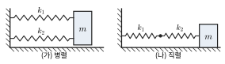

*그림 15.16* 연습문제 7. (가) 병렬 연결, (나) 직렬 연결.

8. $g = 9.80\ \text{m/s}^2$인 곳에서 정확히 맞던 진자시계를 $g = 9.78\ \text{m/s}^2$인 곳으로 옮겼다. 하루에 몇 초 늦거나 빨라지는가?
9. 반지름 $R = 0.20\ \text{m}$인 얇은 고리가 가장자리의 한 점에 걸린 못에 매달려 고리 면 안에서 흔들린다. 작은 진동의 주기를 구하라.
10. 질량 $2.0\ \text{kg}$, 반지름 $0.10\ \text{m}$인 균일한 원판을 중심에 철사로 매달아 비틀림 진자를 만들었더니 주기가 $1.5\ \text{s}$였다. 철사의 비틀림 상수 $\kappa$를 구하라.
11. 주기 $2.0\ \text{s}$로 단조화 운동하는 물체가 $x = A$에서 $x = A/2$까지 가는 데 걸리는 최소 시간은?
12. 예제 15.7의 자동차에서 바퀴 하나가 맡는 질량을 $375\ \text{kg}$, 용수철 상수를 전체의 $1/4$로 볼 때, 임계 감쇠가 되는 감쇠 계수 $b$를 구하라.
13. $Q = 20$인 진동자에 크기 $F_0$인 힘을 천천히 가하면 정적 변위가 $1.0\ \text{mm}$이다. 같은 진폭의 힘을 고유 진동수로 가할 때 정상상태 진폭은? 이때 변위와 힘의 위상차는?

**도전**

14. (가) ★ 박스의 에너지 보존식에서 큰 진폭 진자의 주기 적분식을 유도하고, 치환으로 타원적분 꼴을 얻어라. (나) $K(k)$를 전개해 $T \approx T_0(1 + \theta_0^2/16)$을 보여라. (다) $\theta_0 = 30°$일 때 근사식과 정확한 값을 비교하라.
15. ★ 박스의 결합 진동자에서 $m = 1.0\ \text{kg}$, $k = 100\ \text{N/m}$, $k_c = 10\ \text{N/m}$이다. $t = 0$에 $x_1 = A$, $x_2 = 0$, 두 속도는 0이다. (가) $x_1(t)$, $x_2(t)$를 구하고 $x_1 = A\cos(\Omega_-t)\cos(\Omega_+t)$ 꼴로 정리하라($\Omega_\pm = (\omega_2 \pm \omega_1)/2$). (나) 처음으로 물체 1이 거의 멈추고 물체 2가 모든 에너지를 가지는 시각을 구하라.
16. (13장 연결) 밀도가 균일한 지구(반지름 $R = 6371\ \text{km}$, 표면 중력 $g = 9.8\ \text{m/s}^2$)를 그림 15.17과 같이 꿰뚫는 곧은 터널(중심을 지나지 않아도 됨)을 마찰 없이 미끄러지는 물체의 운동이 단조화 운동임을 보이고, 터널 반대편 끝까지 가는 시간을 구하라. 이 시간이 터널의 방향에 무관함을 설명하라.

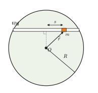

*그림 15.17* 연습문제 16. 지구 중심 $O$를 지나지 않는 곧은 터널 속의 물체. $\vec r$는 중심에서 잰 위치, $s$는 터널 중점에서 잰 변위다.

17. 강제 감쇠 진동자의 평균 흡수 일률 $\langle P\rangle(\omega)$가 정확히 $\omega = \omega_0$에서 최대이고, 최댓값의 절반이 되는 두 진동수의 차가 감쇠 세기와 상관없이 **정확히** $2\beta$임을 증명하라.

## 연습문제 답과 힌트
1. $\omega = 5.0\ \text{rad/s}$이므로 $f = 0.80\ \text{Hz}$, $T = 1.26\ \text{s}$. $x(0) = 0.12\cos(\pi/3) = 0.060\ \text{m}$, $v(0) = -(0.12)(5.0)\sin(\pi/3) = -0.52\ \text{m/s}$, $v_{\max} = 0.60\ \text{m/s}$, $a_{\max} = 3.0\ \text{m/s}^2$.
2. $\omega = 20\ \text{rad/s}$, $f = 3.18\ \text{Hz}$, $T = 0.314\ \text{s}$.
3. $T = 2\pi\sqrt{0.994/9.80} = 2.00\ \text{s}$. 반주기가 1초인 "초진자"다.
4. $E = \frac{1}{2}(50)(0.10)^2 = 0.25\ \text{J}$, $U = \frac{1}{2}(50)(0.050)^2 = 0.0625\ \text{J}$이므로 $K = 0.19\ \text{J}$.
5. $\frac{1}{2}kx^2 = \frac{1}{2}\cdot\frac{1}{2}kA^2$에서 $x = \pm A/\sqrt2 = \pm0.707A$. $x = A/2$이면 $U = E/4$이므로 $K$는 75%.
6. $\beta = \omega_0/(2Q) = 2\pi(200)/100 = 12.6\ \text{s}^{-1}$, $\tau = 1/\beta = 0.080\ \text{s}$. (약 16번 진동하는 동안 진폭이 $1/e$로 준다.)
7. 병렬: 변위가 같고 힘이 더해지므로 $k = k_1 + k_2 = 400\ \text{N/m}$, $T = 0.314\ \text{s}$. 직렬: 힘이 같고 늘음이 더해지므로 $1/k = 1/k_1 + 1/k_2$, $k = 75\ \text{N/m}$, $T = 0.726\ \text{s}$.
8. $T'/T = \sqrt{9.80/9.78} = 1.00102$. 주기가 길어져 시계가 **늦어진다**. 하루 동안 늦는 시간 $86400(1 - T/T') \approx 88\ \text{s}$.
9. 평행축 정리로 $I = MR^2 + MR^2 = 2MR^2$, $d = R$. $T = 2\pi\sqrt{2R/g} = 1.27\ \text{s}$. 길이 $2R$인 단진자와 같다.
10. $I = \frac{1}{2}MR^2 = 0.010\ \text{kg·m}^2$, $\kappa = 4\pi^2I/T^2 = 0.18\ \text{N·m/rad}$.
11. $x = A\cos\omega t = A/2$에서 $\omega t = \pi/3$, $t = T/6 = 0.33\ \text{s}$.
12. $k = 2.45\times10^4\ \text{N/m}$. 임계 조건 $\beta = \omega_0$, 즉 $b_c = 2\sqrt{km} = 2\sqrt{(2.45\times10^4)(375)} = 6.1\times10^3\ \text{N·s/m}$.
13. $A = QF_0/k = 20\ \text{mm}$. 변위가 힘보다 $90°$ 늦다(속도가 힘과 같은 위상).
14. (다) $T/T_0$: 근사 $1 + (\pi/6)^2/16 = 1.0171$, 정확한 값 $\frac{2}{\pi}K(\sin15°) = 1.0174$. 다음 항 $11\theta_0^4/3072$까지 더하면 $1.01740$으로 거의 일치한다.
15. (가) $q_1 = A\cos\omega_1t$, $q_2 = A\cos\omega_2t$이므로 $x_1 = \frac{A}{2}(\cos\omega_1t + \cos\omega_2t) = A\cos\Omega_-t\cos\Omega_+t$, $x_2 = \frac{A}{2}(\cos\omega_1t - \cos\omega_2t) = A\sin\Omega_-t\sin\Omega_+t$. (나) $\omega_1 = 10.0$, $\omega_2 = \sqrt{120} = 10.95\ \text{rad/s}$. $\Omega_-t = \pi/2$에서 $t = \pi/(\omega_2 - \omega_1) = 3.3\ \text{s}$.
16. 껍질 정리(13장)로 중심에서 $r$인 곳의 중력은 $\vec{F} = -(mg/R)\vec{r}$. 터널 방향 성분은 터널 중점에서 잰 변위 $s$에 대해 $F_s = -(mg/R)s$이므로 $\omega = \sqrt{g/R}$. 편도 시간 $= T/2 = \pi\sqrt{R/g} = 2.53\times10^3\ \text{s} \approx 42\ \text{min}$. $\omega$에 터널의 기하가 들어가지 않으므로 방향에 무관하다. (지표 근처를 도는 위성의 공전 주기의 절반과 같다.)
17. 힌트: $\langle P\rangle = \dfrac{F_0^2\beta}{m}\cdot\dfrac{1}{(\omega_0^2 - \omega^2)^2/\omega^2 + 4\beta^2}$로 쓰면, $(\omega_0^2 - \omega^2)/\omega = \omega_0^2/\omega - \omega$가 0일 때, 곧 $\omega = \omega_0$에서 최대다. 절반 조건은 $|\omega_0^2/\omega - \omega| = 2\beta$, 즉 $\omega^2 \pm 2\beta\omega - \omega_0^2 = 0$. 두 양의 근은 $\omega_\pm = \sqrt{\beta^2 + \omega_0^2} \pm \beta$이므로 차는 정확히 $2\beta$이다.

## 영어 용어 정리
| 한글 | English |
|---|---|
| 진동 | oscillation |
| 단조화 운동 | simple harmonic motion (SHM) |
| 훅 법칙 | Hooke's law |
| 진폭 / 위상 / 위상상수 | amplitude / phase / phase constant |
| 주기 / 진동수 / 각진동수 | period / frequency / angular frequency |
| 등시성 | isochronism |
| 평형 위치 | equilibrium position |
| 환산 질량 | reduced mass |
| 단진자 / 물리진자 / 비틀림 진자 | simple pendulum / physical pendulum / torsion pendulum |
| 진동 중심 | center of oscillation |
| 타원적분 | elliptic integral |
| 기준원 / 페이저 | reference circle / phasor |
| 감쇠 진동 | damped oscillation |
| 약한 감쇠 / 임계 감쇠 / 과감쇠 | underdamped / critically damped / overdamped |
| 품질 인자 / 감쇠비 | quality factor / damping ratio |
| 강제 진동 / 구동 진동수 | forced oscillation / driving frequency |
| 과도 해 / 정상상태 해 | transient solution / steady-state solution |
| 공명 / 공명 곡선 | resonance / resonance curve |
| 반치폭 | full width at half maximum (FWHM) |
| 결합 진동자 / 정규 모드 | coupled oscillators / normal mode |
| 진동 절연 / 면진 | vibration isolation / base isolation |
| 동조 질량 감쇠기 | tuned mass damper |
| 수정 진동자 / 원자시계 | quartz crystal oscillator / atomic clock |
