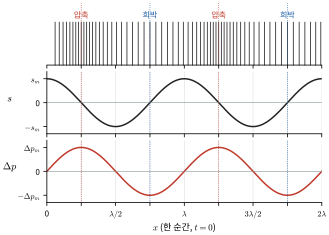
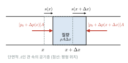
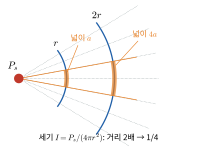
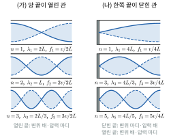
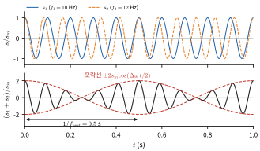
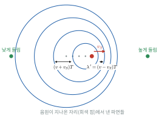
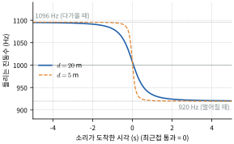
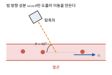
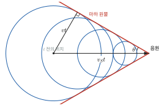
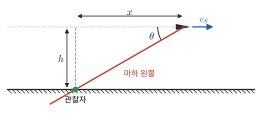

# 17장 소리

> 대응 교재: Halliday 12판 17장 · Young&Freedman 15판 16장
> 소리는 유체(14장) 속을 전파하는 종파이며, 16장의 파동 수학이 그대로 적용된다. 이 장에서는 음속을 매질의 탄성과 밀도에서 유도하고, 소리의 세기와 데시벨, 관 속 정상파, 맥놀이, 도플러 효과, 충격파를 다룬다. 마지막에는 의료·수의 영상에서 쓰는 초음파와, 간섭을 이용한 능동 소음 제거를 살펴본다.

## 학습 목표
- 음파를 변위파와 압력파로 나타내고, 두 표현 사이의 관계 $\Delta p_m = \rho v\omega s_m$을 유도할 수 있다.
- 유체 조각에 뉴턴 제2법칙을 적용해 음파의 파동 방정식과 음속 $v = \sqrt{B/\rho}$를 유도하고, 이상기체의 음속 $v = \sqrt{\gamma RT/M}$을 계산할 수 있다.
- 소리의 세기를 진폭으로 나타내고, 데시벨 척도로 세기 비를 계산할 수 있다.
- 열린 관과 닫힌 관의 정상파 조건을 경계 조건에서 유도하고, 공명 진동수를 구할 수 있다.
- 맥놀이 진동수를 유도하고, 도플러 효과를 음원과 관찰자가 움직이는 경우에 대해 유도·적용할 수 있다.
- 충격파의 마하 원뿔 각을 구하고, 초음파 영상의 원리(펄스-에코, 음향 임피던스, 도플러 혈류 측정)를 설명할 수 있다.

## 고등학교 물리와 무엇이 다른가
고등학교에서는 "공기 중 음속은 약 340 m/s"를 외우고, 관의 공명 조건과 도플러 공식을 그림과 함께 외웠다. 대학에서는 음속을 **매질의 성질에서 계산**한다. 12장의 부피 탄성률, 14장의 유체 밀도, 16장의 파동 방정식을 결합하면 음속이 나오고, 이상기체라면 온도와 분자량만으로 음속이 정해진다. 또 소리를 **압력의 파동**으로도 보는 관점이 중요하다. 마이크와 귀가 감지하는 것은 공기 분자의 변위가 아니라 압력 변화이며, 관의 열린 끝·닫힌 끝 조건도 압력으로 생각하면 명확해진다. 도플러 공식은 외우지 않고 "파면 사이 간격"과 "파면을 만나는 빈도"로 매번 유도할 수 있어야 한다.

---

## 17.1 음파와 음속

### 변위파와 압력파
**음파**(sound wave)는 매질 속을 전파하는 역학적 종파다. 사람이 들을 수 있는 진동수는 대략 $20\ \text{Hz}$에서 $20\ \text{kHz}$이고, 그보다 낮으면 **초저주파(infrasound)**, 높으면 **초음파**(ultrasound)라 한다.

공기를 $x$ 방향으로 진행하는 음파를 생각한다. 평형 위치가 $x$인 공기 조각의 변위를 $s(x, t)$라 하면(종파이므로 $s$도 $x$ 방향),
$$
s(x, t) = s_m\cos(kx - \omega t)
$$
이다. 넓이 $A$, 두께 $\Delta x$인 얇은 공기층을 보자. 왼쪽 면은 $s(x)$, 오른쪽 면은 $s(x + \Delta x)$만큼 움직이므로 부피 변화는
$$
\Delta V = A[s(x + \Delta x) - s(x)] = A\Delta x\frac{\partial s}{\partial x}, \qquad \frac{\Delta V}{V} = \frac{\partial s}{\partial x}
$$
이다. 12장의 **부피 탄성률(bulk modulus)** $B = -\Delta p/(\Delta V/V)$를 쓰면 압력 변화는

$$
\Delta p = -B\frac{\partial s}{\partial x} = Bks_m\sin(kx - \omega t) = \Delta p_m\sin(kx - \omega t)
$$

이다. 압력 진폭은 $\Delta p_m = Bks_m$이고, 아래에서 유도할 $v = \sqrt{B/\rho}$를 쓰면 $B = \rho v^2$이므로

$$
\boxed{\Delta p_m = (\rho v\omega)\,s_m}
$$

이다. 변위파($\cos$)와 압력파($\sin$)는 위상이 $90°$ 다르다. 변위가 0인 곳에서 압력 변화가 최대이고, 변위가 최대인 곳에서 압력 변화는 0이다. 변위가 0인 점의 양쪽 공기가 그 점을 향해 몰려들거나(압축, compression) 그 점에서 멀어질 때(희박, rarefaction) 압력 변화가 가장 크기 때문이다(그림 17.1).



*그림 17.1* 한 순간($t = 0$)의 음파. 위: 공기층(세로선)의 위치. 가운데: 변위 $s = s_m\cos kx$. 아래: 압력 변화 $\Delta p = \Delta p_m\sin kx$. 변위가 0이고 양쪽 공기가 몰려드는 곳(빨강 점선)이 압축으로 $\Delta p$가 최대이고, 양쪽 공기가 멀어지는 곳(파랑 점선)이 희박으로 $\Delta p$가 최소다.

### 음파의 파동 방정식
같은 공기층에 뉴턴 제2법칙을 쓴다. 층의 질량은 $\rho A\Delta x$, 가속도는 $\partial^2s/\partial t^2$이고, 알짜 힘은 양쪽 면의 압력 차이다(그림 17.2).
$$
\rho A\Delta x\frac{\partial^2s}{\partial t^2} = A[\Delta p(x) - \Delta p(x + \Delta x)] = -A\Delta x\frac{\partial(\Delta p)}{\partial x} = A\Delta x\,B\frac{\partial^2s}{\partial x^2}
$$
$$
\Longrightarrow\quad \frac{\partial^2s}{\partial x^2} = \frac{\rho}{B}\frac{\partial^2s}{\partial t^2}, \qquad \boxed{v = \sqrt{\frac{B}{\rho}}}
$$
16장의 줄과 같은 파동 방정식이다. 줄의 $v = \sqrt{\tau/\mu}$처럼 음속도 $\sqrt{\text{탄성(복원력)}/\text{관성(밀도)}}$ 꼴이다. $\Delta p$도 같은 파동 방정식을 만족한다.



*그림 17.2* 단면적 $A$인 관 속에서 평형 위치가 $x$와 $x + \Delta x$ 사이인 공기층. 두 면이 각각 $s(x)$, $s(x + \Delta x)$만큼 움직이며, 양쪽 공기가 미는 힘의 차이가 층(질량 $\rho A\Delta x$)을 가속한다.

> **★ 심화: 유체 방정식에서 음파로**
> 14장 ★ 박스의 연속 방정식 $\partial_t\rho + \nabla\cdot(\rho\vec{v}) = 0$과 오일러 방정식 $\rho(\partial_t\vec{v} + (\vec{v}\cdot\nabla)\vec{v}) = -\nabla p$에서 출발한다. 정지 상태($\rho_0$, $p_0$, $\vec{v} = 0$)에서 작은 교란 $\rho = \rho_0 + \rho'$, $p = p_0 + p'$, $\vec{v}$를 넣고 교란의 2차 이상 항을 버리면(**선형화**)
> $$\partial_t\rho' + \rho_0\nabla\cdot\vec{v} = 0, \qquad \rho_0\partial_t\vec{v} = -\nabla p'$$
> 이다. 첫 식을 $t$로 미분하고 둘째 식의 발산을 넣으면 $\partial_t^2\rho' = \nabla^2p'$이다. 압력과 밀도 사이의 관계 $p' = (\partial p/\partial\rho)\rho'$를 쓰면
> $$\nabla^2p' = \frac{1}{v^2}\frac{\partial^2p'}{\partial t^2}, \qquad v^2 = \left(\frac{\partial p}{\partial\rho}\right)_S$$
> 인 3차원 파동 방정식을 얻는다. 아래첨자 $S$는 엔트로피가 일정한(단열) 변화를 뜻한다. $B = \rho(\partial p/\partial\rho)$이므로 본문의 결과와 같다. 진폭이 커서 버린 비선형 항이 중요해지면 파형이 점점 가팔라져 충격파(17.6절)가 된다.

### 이상기체의 음속
음파의 압축과 팽창은 빠르고, 압축된 곳과 팽창된 곳 사이의 거리(반파장)가 열이 확산하기에는 너무 멀다. 그래서 공기의 압축은 **단열 과정**(adiabatic process)으로 본다(19장). 단열 과정에서 $pV^\gamma = \text{일정}$이므로
$$
B = -V\frac{dp}{dV} = \gamma p
$$
이다($\gamma = C_p/C_V$, 공기는 약 1.40). 이상기체 상태방정식 $p = \rho RT/M$을 쓰면

$$
\boxed{v = \sqrt{\frac{\gamma p}{\rho}} = \sqrt{\frac{\gamma RT}{M}}}
$$

이다($R = 8.314\ \text{J/(mol·K)}$, $M$: 몰질량). 이상기체의 음속은 **압력에 무관하고 절대온도의 제곱근에 비례**하며, 가벼운 기체일수록 빠르다. 기체 분자의 평균 속력도 $\sqrt{RT/M}$에 비례하므로(19장), 음속은 분자 속력과 같은 정도의 크기다. 소리는 결국 분자들이 서로 부딪치며 운동량을 전달하는 과정이기 때문이다.

> **★ 심화: 뉴턴의 음속과 라플라스의 보정**
> 뉴턴은 공기의 압축이 **등온** 과정이라고 가정해 $B = p$, $v = \sqrt{p/\rho}$를 얻었다. 20 °C에서 이 값은 약 $290\ \text{m/s}$로, 측정값보다 약 15% 작다. 이후 라플라스는 압축이 단열 과정이어서 $B = \gamma p$여야 함을 지적했고, 보정 인자 $\sqrt\gamma = \sqrt{1.40} = 1.18$이 차이를 정확히 메웠다. 역학만으로 풀 것 같던 문제가 사실은 열역학 문제였던 셈이다.

| 매질 | 음속 (대략, m/s) |
|---|---|
| 공기 (0 °C) | 331 |
| 공기 (20 °C) | 343 |
| 헬륨 (20 °C) | 1007 |
| 물 (20 °C) | 1480 |
| 바닷물 | 1520 |
| 연조직 (초음파 장비의 표준 가정값) | 1540 |
| 강철 (종파) | 약 6000 |

액체와 고체는 기체보다 훨씬 밀도가 크지만, 부피 탄성률은 그보다 더 크기 때문에 음속이 더 빠르다.

### 예제 17.1 음속 계산
(가) 공기($\gamma = 1.40$, $M = 28.97\ \text{g/mol}$)의 20 °C와 0 °C에서의 음속을 구하라. (나) 물의 부피 탄성률이 $2.2\times10^9\ \text{Pa}$일 때 물속 음속을 구하라.

**풀이**
(가) $v = \sqrt{\dfrac{(1.40)(8.314)(293.15)}{0.02897}} = 343\ \text{m/s}$. 0 °C에서는 $T = 273.15\ \text{K}$이므로 $331\ \text{m/s}$. $v \propto \sqrt{T}$를 실온 근처에서 1차 근사하면 $v \approx (331 + 0.61\,T_C)\ \text{m/s}$이다($T_C$는 섭씨온도).
(나) $v = \sqrt{2.2\times10^9/1000} = 1.48\times10^3\ \text{m/s}$. 공기의 약 4.3배다.

---

## 17.2 음의 세기와 데시벨

### 세기
**세기(intensity)** $I$는 파동의 진행 방향에 수직인 단위 넓이를 통해 단위 시간에 전달되는 평균 에너지, 곧 $I = \bar{P}/A$ [W/m²]이다. 16.4절의 줄과 같은 방법으로 유도한다. 면 $A$의 왼쪽 공기가 오른쪽 공기에 가하는 힘은 $\Delta p\,A$(평형 압력 $p_0$의 일은 한 주기 평균이 0)이고, 그 면은 속도 $\partial s/\partial t$로 움직이므로
$$
I = \left\langle\Delta p\frac{\partial s}{\partial t}\right\rangle = \left\langle[Bks_m\sin(kx - \omega t)][\omega s_m\sin(kx - \omega t)]\right\rangle = \frac{1}{2}Bk\omega s_m^2
$$
$B = \rho v^2$, $k = \omega/v$를 쓰면

$$
\boxed{I = \frac{1}{2}\rho v\omega^2s_m^2 = \frac{\Delta p_m^2}{2\rho v}}
$$

이다. 줄의 $\bar{P} = \frac{1}{2}\mu v\omega^2y_m^2$과 같은 꼴이다. $Z = \rho v$를 **음향 임피던스**(acoustic impedance)라 하며, 16장 ★의 줄의 임피던스와 같은 역할을 한다(17.5절 🔗).

**점 음원**: 일률 $P_s$로 모든 방향에 고르게 소리를 내는 음원에서 거리 $r$인 곳의 세기는, 에너지가 넓이 $4\pi r^2$인 구면에 퍼지므로(흡수가 없다면, 그림 17.3)
$$
I = \frac{P_s}{4\pi r^2}
$$
이다. 세기는 거리의 제곱에 반비례하고, 진폭은 거리에 반비례한다.



*그림 17.3* 점 음원에서 나온 같은 에너지 흐름(주황 원뿔)이 거리 $2r$에서는 거리 $r$에서보다 4배 넓은 면에 퍼진다. 그래서 세기는 $1/4$로 줄어든다.

### 데시벨 척도
사람의 귀는 $10^{-12}\ \text{W/m}^2$ 정도에서 $1\ \text{W/m}^2$ 정도까지 12자릿수의 세기를 감지하며, 감각은 세기의 **비**에 반응한다. 그래서 로그 척도인 **음의 세기 준위**(sound level)를 쓴다.
$$
\beta = (10\ \text{dB})\log_{10}\frac{I}{I_0}, \qquad I_0 = 10^{-12}\ \text{W/m}^2
$$
$I_0$는 1 kHz 근처의 가청 문턱에 해당하는 기준값이다. 세기가 10배가 되면 $+10\ \text{dB}$, 100배이면 $+20\ \text{dB}$, 2배이면 $+3.0\ \text{dB}$이다. 대략 120 dB 근처에서 귀에 통증을 느낀다. (음향 측정에서는 압력의 실효값 $p_{\text{rms}}$로 정의한 음압 준위 $L_p = 20\log_{10}(p_{\text{rms}}/20\ \mu\text{Pa})$를 주로 쓰는데, 공기 중 평면파에서는 $\beta$와 거의 같은 값이 된다.)

> **💡 개념 확인: 데시벨은 더할 수 없다**
> 80 dB짜리 기계 두 대를 함께 돌리면 160 dB이 될까? 아니다. 서로 무관한(위상 관계가 일정하지 않은) 두 소리는 **세기**가 더해지므로, 세기가 2배가 되어 $80 + 10\log_{10}2 = 83\ \text{dB}$이다. 반대로 80 dB에서 70 dB로 10 dB 줄이려면 세기를 1/10로 줄여야 한다. 거리를 2배로 하면 세기는 1/4이므로 $-6.0\ \text{dB}$이다.

### 예제 17.2 압력 진폭과 변위 진폭
20 °C 공기($\rho = 1.21\ \text{kg/m}^3$, $v = 343\ \text{m/s}$)에서 진동수 $1.0\ \text{kHz}$인 음파의 세기가 (가) $1.0\ \text{W/m}^2$(120 dB), (나) $10^{-12}\ \text{W/m}^2$(0 dB)일 때, 압력 진폭과 변위 진폭을 구하라.

**풀이**
$\Delta p_m = \sqrt{2\rho vI}$, $s_m = \Delta p_m/(\rho v\omega)$, $\omega = 2\pi(1000) = 6283\ \text{rad/s}$이다.
(가) $\Delta p_m = \sqrt{2(1.21)(343)(1.0)} = 29\ \text{Pa}$, $s_m = 29/[(1.21)(343)(6283)] = 1.1\times10^{-5}\ \text{m}$.
(나) 세기가 $10^{-12}$배이므로 진폭은 $10^{-6}$배: $\Delta p_m = 2.9\times10^{-5}\ \text{Pa}$, $s_m = 1.1\times10^{-11}\ \text{m}$.
대기압 $10^5\ \text{Pa}$에 비하면 120 dB의 큰 소리조차 압력 변화는 $0.03\%$에 불과하다. 가청 문턱에서 공기의 변위 진폭은 원자 지름($\sim10^{-10}\ \text{m}$)보다 작다. 귀가 얼마나 예민한 압력 감지기인지 보여 준다.

### 예제 17.3 점 음원
일률 $1.0\ \text{W}$로 고르게 소리를 내는 점 음원이 있다. 거리 $10\ \text{m}$와 $20\ \text{m}$에서 음의 세기 준위를 구하라.

**풀이**
$I(10\ \text{m}) = 1.0/(4\pi\cdot100) = 7.96\times10^{-4}\ \text{W/m}^2$, $\beta = 10\log_{10}(7.96\times10^8) = 89\ \text{dB}$.
거리가 2배이면 세기는 1/4이므로 $89 - 6.0 = 83\ \text{dB}$. 1 W는 작아 보이지만, 사람 목소리의 음향 일률보다 훨씬 크다.

---

## 17.3 관과 현의 정상파

### 관 속 공기기둥의 경계 조건
관 속 공기도 16장의 줄처럼 정상파를 만든다. 경계 조건은 다음과 같다.
- **닫힌 끝**: 공기가 벽을 뚫고 움직일 수 없으므로 **변위 마디**. 변위와 압력은 위상이 $90°$ 다르므로(17.1절) 이곳은 **압력 배**다.
- **열린 끝**: 관 밖의 넓은 대기와 연결되어 있으므로 압력이 대기압에 고정된다. **압력 마디**이고, 따라서 **변위 배**다. 실제로는 배가 관 끝보다 조금 바깥에 생기므로, 계산에 쓰는 유효 길이가 실제 길이보다 약간(관 반지름의 0.6배 정도) 길다(**끝보정**).

> **💡 개념 확인: 열린 끝에서도 반사가 일어나는 이유**
> 관 끝이 열려 있으면 소리가 다 빠져나갈 것 같지만, 관 안(좁은 통로)과 관 밖(넓은 공간)은 음향적으로 성질이 크게 다른 매질처럼 작용한다. 16장 ★의 "가벼운 줄로 이어진 끝"과 비슷하게, 압력파가 뒤집혀 반사된다. 그래서 열린 관도 정상파를 만들고 악기가 될 수 있다. 관 반지름이 파장에 비해 작을수록 반사가 강하다.

### 공명 진동수
길이 $L$인 관에서 경계 조건을 만족하는 정상파의 파장과 진동수는 다음과 같다.

**양 끝이 열린 관** (변위 배–배): 양 끝 사이에 반파장의 정수배가 들어간다.
$$
L = n\frac{\lambda}{2} \quad\Longrightarrow\quad f_n = \frac{nv}{2L},\qquad n = 1, 2, 3, \ldots
$$

**한쪽 끝이 닫힌 관** (변위 마디–배): 마디에서 배까지는 $\lambda/4$이므로 사분파장의 홀수배가 들어간다.
$$
L = n\frac{\lambda}{4} \quad\Longrightarrow\quad f_n = \frac{nv}{4L},\qquad n = 1, 3, 5, \ldots
$$

닫힌 관의 기본 진동수는 같은 길이의 열린 관의 절반이고, **홀수 조화파만** 있다. 그래서 두 관은 같은 음높이를 내도 음색이 다르다(그림 17.4).



*그림 17.4* 길이 $L$인 관 속 공기의 정상파에서 변위 진폭의 분포(실선과 점선은 반주기 차이가 나는 두 순간). (가) 양 끝이 열린 관은 양 끝이 변위 배이고 모든 조화파가 있다. (나) 왼쪽 끝이 닫힌 관은 닫힌 끝이 변위 마디, 열린 끝이 변위 배이고 홀수 조화파만 있다. 압력의 마디와 배는 변위와 반대다.

### 악기와 음색
현악기는 16.7절의 양 끝 고정 줄로 $f_n = (n/2L)\sqrt{\tau/\mu}$이고, 관악기는 관의 공명을 쓴다. 줄의 진동은 공기를 직접 거의 움직이지 못하므로, 기타나 바이올린은 몸통(울림통)과 그 속 공기가 진동을 공기로 전달한다. 악기를 튕기거나 불면 기본 진동수와 여러 조화파가 동시에 생기고, 각 조화파의 상대 세기가 **음색**(timbre)을 결정한다. 수학적으로는 주기 $T$인 모든 주기 함수가 진동수 $1/T$의 정수배인 사인파들의 합으로 표현된다는 **푸리에 급수**(Fourier series)가 그 근거다.

### 예제 17.4 외이도의 공명
사람의 외이도(귓구멍)는 바깥으로 열려 있고 안쪽은 고막으로 막힌 길이 약 $2.5\ \text{cm}$의 관으로 볼 수 있다. 20 °C 공기에서 외이도의 기본 공명 진동수를 구하라.

**풀이**
한쪽이 닫힌 관이므로 $f_1 = v/(4L) = 343/(4\times0.025) = 3.4\times10^3\ \text{Hz}$. 사람의 청각은 대략 2~5 kHz 영역에서 가장 예민한데, 외이도의 공명이 그 이유 중 하나다. 이 진동수 근처의 소리는 고막에서 압력이 커진다. 동물마다 외이도의 길이와 모양이 달라 공명 진동수가 다르며, 이는 종마다 잘 듣는 음역이 다른 것과 관계가 있다.

---

## 17.4 맥놀이

진동수가 조금 다른 두 소리를 같은 곳에서 들으면 소리의 크기가 주기적으로 커졌다 작아졌다 한다. 이를 **맥놀이**(beat)라 한다. 한 지점에서 두 음파의 변위가
$$
s_1 = s_m\cos\omega_1t, \qquad s_2 = s_m\cos\omega_2t
$$
라 하자. 합 공식 $\cos\alpha + \cos\beta = 2\cos\frac{\alpha - \beta}{2}\cos\frac{\alpha + \beta}{2}$를 쓰면
$$
s = \left[2s_m\cos\left(\frac{\omega_1 - \omega_2}{2}t\right)\right]\cos\left(\frac{\omega_1 + \omega_2}{2}t\right)
$$
이다. $\omega_1 \approx \omega_2$이면 평균 진동수 $(\omega_1 + \omega_2)/2$로 빠르게 진동하면서, 진폭(대괄호, **포락선**)이 천천히 변한다(그림 17.5). 귀는 진폭의 크기에 반응하는데, $|\cos(\Delta\omega\,t/2)|$는 각진동수 $\Delta\omega$로 반복되므로 (각진동수 $\Delta\omega/2$인 코사인의 절댓값이기 때문이다)

$$
\boxed{f_{\text{beat}} = |f_1 - f_2|}
$$

이다. 15장 ★ 결합 진동자에서 에너지가 두 물체 사이를 오가던 것도 같은 수학이다.



*그림 17.5* 진동수 $10\ \text{Hz}$와 $12\ \text{Hz}$인 두 소리(위)를 더하면(아래) 진폭이 포락선(빨강 점선)을 따라 커졌다 작아졌다 한다. 큰 소리는 $1/f_{\text{beat}} = 1/(2\ \text{Hz}) = 0.5\ \text{s}$마다 반복된다.

### 예제 17.5 소리굽쇠로 기타 조율하기
$440\ \text{Hz}$ 소리굽쇠와 기타 줄을 함께 울렸더니 초당 3번의 맥놀이가 들렸다. 줄을 조금 조였더니 맥놀이가 초당 2번으로 줄었다. 처음 줄의 진동수는? 맞추려면 더 조여야 하는가?

**풀이**
처음 진동수는 $443\ \text{Hz}$ 또는 $437\ \text{Hz}$이다. 줄을 조이면 장력이 커져 진동수가 올라간다($f \propto \sqrt\tau$). 진동수가 올라갔는데 맥놀이가 줄었으므로 440 Hz에 가까워진 것이고, 처음 진동수는 **437 Hz**였다. 맥놀이가 없어질 때까지 조금 더 조이면 된다.

---

## 17.5 도플러 효과

음원이나 관찰자가 매질(공기)에 대해 움직이면 관찰자가 듣는 진동수가 음원의 진동수와 달라진다. 이것이 **도플러 효과**(Doppler effect)다. 지나가는 구급차의 사이렌이 다가올 때는 높게, 멀어질 때는 낮게 들린다. 아래에서 $v$는 공기에 대한 음속, $v_D$와 $v_S$는 공기에 대한 관찰자(detector)와 음원(source)의 속력이며, 두 운동은 음원과 관찰자를 잇는 직선 위에서 일어난다고 한다.

### 관찰자가 움직일 때
음원이 정지해 있으면 파면은 간격 $\lambda = v/f$로 퍼져 나간다. 관찰자가 음원 쪽으로 $v_D$로 다가가면, 관찰자에 대한 파면의 상대 속력이 $v + v_D$이므로 단위 시간에 만나는 파면 수는
$$
f' = \frac{v + v_D}{\lambda} = f\frac{v + v_D}{v}
$$
이다. 멀어지면 $v_D$ 앞의 부호가 바뀐다. 관찰자의 운동은 **파장을 바꾸지 않고 파면을 만나는 빈도**를 바꾼다.

### 음원이 움직일 때
음원이 관찰자 쪽으로 $v_S$로 다가가면서 주기 $T = 1/f$마다 파면을 낸다. 한 파면이 나온 뒤 다음 파면이 나올 때까지 앞의 파면은 $vT$ 나아가고 음원은 $v_ST$ 쫓아가므로, 음원 앞쪽의 파면 간격은
$$
\lambda' = (v - v_S)T \quad\Longrightarrow\quad f' = \frac{v}{\lambda'} = f\frac{v}{v - v_S}
$$
이다. 음원의 운동은 **파장 자체를 바꾼다**. 음원 뒤쪽에서는 $\lambda' = (v + v_S)T$로 늘어난다(그림 17.6).



*그림 17.6* 오른쪽으로 $v_S = v/2$로 움직이는 음원이 주기 $T$마다 낸 파면. 각 파면은 낸 순간의 음원 위치(회색 점)를 중심으로 퍼지므로, 음원 앞쪽의 파면 간격은 $(v - v_S)T$로 좁고 뒤쪽은 $(v + v_S)T$로 넓다.

### 일반식
두 효과를 합치면

$$
\boxed{f' = f\,\frac{v \pm v_D}{v \mp v_S}}
$$

이다. 부호는 "서로 **다가가는** 운동이면 진동수가 커지는 쪽"으로 고른다. 곧 관찰자가 음원 쪽으로 가면 분자에 $+$, 음원이 관찰자 쪽으로 가면 분모에 $-$이다. 운동 방향이 두 물체를 잇는 직선과 각을 이루면, 그 직선 방향의 속도 성분을 쓴다(음원은 소리를 낸 순간의 위치 기준).

속력이 음속보다 훨씬 작으면 $(1 - x)^{-1}\approx 1 + x$를 써서
$$
\frac{\Delta f}{f} \approx \frac{v_D + v_S}{v} = \frac{u_{\text{rel}}}{v}
$$
로, 상대 접근 속력 $u_{\text{rel}}$만으로 정해진다. 하지만 정확한 식은 $v_D$와 $v_S$에 대해 대칭이 아니다. 소리는 매질이 있어 "누가 매질에 대해 움직이는지"가 의미가 있기 때문이다. 매질이 없는 빛의 도플러 효과는 상대 속도만으로 정해지며, 특수 상대성 이론으로 다룬다(35장).

### 예제 17.6 구급차 사이렌
진동수 $1000\ \text{Hz}$의 사이렌을 울리는 구급차가 $30\ \text{m/s}$로 달린다. 길가에 서 있는 사람이 듣는 진동수를 구급차가 (가) 다가올 때, (나) 멀어질 때 구하라($v = 343\ \text{m/s}$).

**풀이**
(가) $f' = 1000\times\dfrac{343}{343 - 30} = 1096\ \text{Hz}$. (나) $f' = 1000\times\dfrac{343}{343 + 30} = 920\ \text{Hz}$.
지나가는 순간 음높이가 약 16% 떨어진다. 진동수 비 $1096/920 = 1.19$는 음계로 반음 약 세 개($2^{3/12} = 1.19$)에 해당한다.

> **🐍 파이썬 실습: 지나가는 음원의 도플러 곡선**
> 실제로 구급차는 관찰자를 비켜 지나가므로 시선 방향 속도 성분이 연속적으로 변한다. 또 소리가 관찰자에게 도착하는 데 시간이 걸린다. 아래 코드는 소리를 낸 시각마다 음원 위치와 시선 방향을 계산하고, 그 소리가 **도착하는** 시각에 대해 관측 진동수를 그린다.
> ```python
> import numpy as np
> import matplotlib.pyplot as plt
>
> v, f0 = 343.0, 1000.0           # 음속(m/s), 사이렌 진동수(Hz)
> vs, d = 30.0, 20.0              # 음원 속력(m/s), 관찰자와 도로 사이 거리(m)
> obs = np.array([0.0, d])        # 관찰자 위치, 음원은 x축 위를 +x 방향으로 달림
>
> te = np.linspace(-10, 10, 4001)                 # 소리를 낸 시각
> src = np.stack([vs*te, np.zeros_like(te)], 1)   # 그 시각의 음원 위치
> r = obs - src
> dist = np.linalg.norm(r, axis=1)
> tr = te + dist/v                                # 관찰자에게 도착하는 시각
> cos_th = r[:, 0]/dist                           # 음원 속도와 관찰자 방향 사이 각의 cos
> f = f0/(1 - vs*cos_th/v)                        # 움직이는 음원의 도플러 식
>
> print(f"접근 극한 {f0*v/(v-vs):.1f} Hz, 멀어짐 극한 {f0*v/(v+vs):.1f} Hz")
> print(f"계산된 최대 {f.max():.1f} Hz, 최소 {f.min():.1f} Hz")
> i = np.argmin(np.abs(f - f0))                   # 진동수가 f0인 순간
> print(f"f = f0 인 소리가 들리는 시각 {tr[i]:.3f} s (최근접 통과는 0 s)")
>
> plt.plot(tr, f); plt.axhline(f0, ls=":", c="gray")
> plt.xlabel("reception time (s)"); plt.ylabel("observed f (Hz)"); plt.show()
> ```
> 실행 결과는 다음과 같다.
> ```
> 접근 극한 1095.8 Hz, 멀어짐 극한 919.6 Hz
> 계산된 최대 1095.6 Hz, 최소 919.7 Hz
> f = f0 인 소리가 들리는 시각 0.058 s (최근접 통과는 0 s)
> ```
> 멀리 있을 때는 예제 17.6의 값에 가깝고, 음원이 가장 가까이 지나는 순간 낸 소리(시선에 수직이므로 $f = f_0$)는 $d/v = 0.058\ \text{s}$ 뒤에 도착한다. 거리 `d`를 줄이면 진동수가 바뀌는 구간이 짧고 가팔라진다. 길가에서 듣는 "이이잉–우웅" 소리의 모양이다(그림 17.7).
> 
> 
> 
> *그림 17.7* 위 코드로 계산한 관측 진동수. 음원이 멀리 있을 때는 예제 17.6의 값(1096 Hz, 920 Hz)에 가깝고, 도로에서 관찰자까지 거리 $d$가 작을수록 진동수가 바뀌는 구간이 짧고 가파르다.

### 움직이는 반사체: 이중 도플러
정지한 음원에서 나온 진동수 $f$의 소리가 속력 $u$로 다가오는 물체에 반사되어 돌아온다. 물체는 먼저 "다가가는 관찰자"로서 $f_1 = f(v + u)/v$를 받고, 이어서 "다가오는 음원"으로서 그 진동수를 다시 내보낸다.
$$
f'' = f_1\frac{v}{v - u} = f\frac{v + u}{v - u} \approx f\left(1 + \frac{2u}{v}\right)\quad(u \ll v)
$$
진동수 변화가 한 번 도플러의 두 배다. 박쥐의 반향정위, 경찰의 속도 측정기(전파를 쓰지만 같은 원리), 초음파 도플러 혈류 측정이 모두 이 원리다.

### 예제 17.7 초음파 도플러 혈류 측정
$5.0\ \text{MHz}$의 초음파 탐촉자를 혈관에 비스듬히 대어, 초음파 빔이 혈류 방향과 $60°$를 이룬다. 혈류 속력이 $0.50\ \text{m/s}$이고 조직 속 음속을 $1540\ \text{m/s}$로 둘 때, 적혈구에서 반사된 초음파의 진동수 변화를 구하라.

**풀이**
빔 방향의 혈류 속도 성분은 $u\cos\theta$이고(그림 17.8) $u \ll v$이므로
$$
\Delta f \approx \frac{2f u\cos\theta}{v} = \frac{2(5.0\times10^6)(0.50)(0.50)}{1540} = 1.6\times10^3\ \text{Hz}
$$
송신 진동수는 MHz인데 진동수 변화는 kHz로, 마침 **가청 영역**에 있다. 그래서 도플러 장비는 이 차이 진동수를 스피커로 들려주기도 한다. 혈류가 다가오는지 멀어지는지는 $\Delta f$의 부호로 안다. 빔과 혈류가 수직($\theta = 90°$)이면 신호가 없으므로, 측정 때 각도를 기울이는 이유다.



*그림 17.8* 예제 17.7의 배치. 초음파 빔(주황 점선)이 혈류 방향과 $\theta = 60°$를 이루므로, 적혈구의 속도 $u$ 가운데 빔 방향 성분 $u\cos\theta$만 진동수를 바꾼다.

> **🔗 전공 연결: 초음파 진단 (수의영상의학)**
> 초음파 영상은 수의학에서 X선과 함께 가장 많이 쓰는 영상 진단법이다. 개·고양이의 복부 장기, 심장(심장초음파), 임신 진단, 말·소의 생식기 검사 등에 쓰인다. 원리는 이 장의 물리 그대로다.
> - **펄스-에코(pulse-echo)**: 탐촉자(압전 소자)가 짧은 초음파 펄스를 보내고, 조직 경계에서 반사되어 돌아오는 시간 $t$를 잰다. 장비는 연조직 음속을 $1540\ \text{m/s}$로 가정해 깊이를 $d = vt/2$로 계산한다(연습문제 11).
> - **진동수 선택**: 진단용 초음파는 대략 수 MHz에서 십수 MHz를 쓴다. 진동수가 높을수록 파장($5\ \text{MHz}$에서 $\lambda = v/f \approx 0.3\ \text{mm}$)이 짧아 해상도가 좋지만, 조직에서의 흡수(감쇠)가 커져 깊이 들어가지 못한다. 그래서 고양이나 소형견의 얕은 장기는 높은 진동수로, 대형 동물의 깊은 장기는 낮은 진동수로 본다.
> - **음향 임피던스와 반사**: 경계에서의 세기 반사율은 16장 ★와 같은 식 $R = \left(\dfrac{Z_2 - Z_1}{Z_2 + Z_1}\right)^2$, $Z = \rho v$이다. 공기($Z \approx 4\times10^2\ \text{kg/(m}^2\text{s)}$)와 연조직($Z \approx 1.6\times10^6$) 사이에서는 $R \approx 0.999$로 거의 모든 에너지가 반사된다. 그래서 탐촉자와 피부 사이의 공기층을 없애려고 **젤**을 바른다. 털 사이에 공기가 많이 갇히는 동물은 검사 부위의 **털을 깎고** 젤이나 알코올을 충분히 쓴다. 같은 이유로 공기가 찬 폐나 장 내 가스 뒤쪽은 잘 보이지 않고, 뼈도 임피던스 차이가 커서 강한 반사와 그 뒤의 음영을 만든다.
> - **도플러 영상**: 예제 17.7의 이중 도플러로 혈류의 방향과 속력을 색으로 표시하여, 심장 판막의 역류나 혈관 협착(14장 🔗)을 진단한다.

---

## 17.6 충격파

음원의 속력 $v_S$가 음속 $v$보다 크면 17.5절의 공식은 분모가 음수가 되어 의미를 잃는다. 이때 음원은 자기가 낸 파면보다 앞서 나간다. 각 순간에 낸 구면 파면들은 음원을 꼭짓점으로 하는 원뿔에 모두 접하며, 그 원뿔면에 파면이 겹쳐 압력이 갑자기 뛰는 **충격파**(shock wave)가 생긴다(그림 17.9).

시간 $t$ 전에 낸 파면은 반지름 $vt$로 퍼졌고, 그동안 음원은 $v_St$ 나아갔으므로, 원뿔의 반꼭지각 $\theta$는
$$
\boxed{\sin\theta = \frac{vt}{v_St} = \frac{v}{v_S}}
$$
를 만족한다. 이 원뿔을 **마하 원뿔(Mach cone)**, $v_S/v$를 **마하 수**(Mach number)라 한다. 초음속으로 나는 비행기가 끌고 가는 원뿔이 땅에 닿아 지나가는 순간, 지상의 관찰자는 큰 폭음인 **소닉 붐**(sonic boom)을 듣는다.



*그림 17.9* 마하 2.0으로 움직이는 음원(예제 17.8)이 과거에 낸 파면(파랑)과 그 파면들에 모두 접하는 마하 원뿔(빨강). 시간 $t$ 전에 낸 파면의 반지름 $vt$와 그동안 음원이 간 거리 $v_St$가 직각삼각형을 이루어 $\sin\theta = v/v_S$이고, 여기서는 $\theta = 30°$이다.

> **💡 개념 확인: 소닉 붐은 "음속 돌파의 순간"에만 나는가?**
> 아니다. 소닉 붐은 비행기가 음속을 넘는 순간 한 번 나는 소리가 아니라, 초음속으로 나는 **동안 내내** 끌고 다니는 원뿔이 지나가는 곳마다 들리는 소리다. 비행 경로 아래의 사람들은 각자 원뿔이 자기를 지나는 순간에 폭음을 듣는다. 또 비행기가 머리 위를 지나는 순간이 아니라 이미 지나간 뒤에 들린다(연습문제 16). 같은 현상이 물 위에서도 일어난다. 물결파 속력보다 빠른 배가 만드는 V자 모양 뱃물결이 그것이다. 하전 입자가 물속에서 물속의 빛의 속력($c/n$)보다 빨리 움직이면 빛의 충격파인 **체렌코프 복사**(Cherenkov radiation)가 생기며, 원자로 냉각수가 푸르게 빛나는 이유다.

### 예제 17.8 초음속 비행기
음속이 $320\ \text{m/s}$인 고도에서 비행기가 마하 2.0으로 수평 비행한다. 마하 원뿔의 반꼭지각과 비행기의 속력을 구하라.

**풀이**
$\sin\theta = 1/2.0$이므로 $\theta = 30°$. 속력 $v_S = 2.0\times320 = 640\ \text{m/s}$. 마하 수가 클수록 원뿔이 뾰족해진다.

> **🔬 최신 연구 노트: 능동 소음 제거**
> 소음 제거 헤드폰은 16장의 **상쇄 간섭**을 공학적으로 구현한 장치다. 이어컵 바깥(또는 안쪽)의 마이크가 소음을 받아들이면, 전자 회로(디지털 신호 처리기)가 그 파형을 계산해 위상이 반대인 "반소음(anti-noise)"을 스피커로 낸다. 소음 $p_n = p_0\cos\omega t$와 반소음 $-p_0\cos(\omega t - \delta)$가 더해지면, 위상 오차 $\delta$가 남을 때 잔여 진폭은 페이저 계산으로
> $$|1 - e^{-i\delta}|\,p_0 = 2\sin(\delta/2)\,p_0 \approx \delta\,p_0$$
> 이다. 회로의 처리 지연이 $\tau$이면 $\delta = \omega\tau$이므로, 진동수가 높을수록 같은 지연에서도 위상 오차가 커진다. 예를 들어 지연이 $50\ \mu\text{s}$라면 잔여 진폭을 10%(−20 dB) 이하로 낮출 수 있는 진동수는 $\omega\tau < 0.1$, 곧 약 $320\ \text{Hz}$ 이하다. 또 파장이 짧은 고주파에서는 마이크와 귀 사이의 작은 거리 차이도 큰 위상 차이를 만든다. 그래서 능동 소음 제거는 엔진음이나 비행기 소음 같은 **저주파 소음에 특히 효과적**이고, 고주파 소음은 이어컵의 차음재 같은 수동적 방법으로 막는다. 같은 원리가 자동차 실내 소음 저감, 산업용 덕트 소음 제어에도 쓰이며, 소음 파형을 예측하는 적응 필터 알고리즘의 개선이 꾸준히 연구되고 있다.

---

## 핵심 정리

| 개념 | 핵심 식 | 비고 |
|---|---|---|
| 변위파와 압력파 | $s = s_m\cos(kx - \omega t)$, $\Delta p = \Delta p_m\sin(kx - \omega t)$ | 위상차 $90°$ |
| 압력 진폭 | $\Delta p = -B\,\partial s/\partial x$, $\Delta p_m = \rho v\omega s_m$ | |
| 음속 | $v = \sqrt{B/\rho}$ | 파동 방정식에서 유도 |
| 이상기체 음속 | $v = \sqrt{\gamma RT/M}$ | 단열 압축, 압력에 무관 |
| 세기 | $I = \frac{1}{2}\rho v\omega^2s_m^2 = \Delta p_m^2/(2\rho v)$ | 점 음원: $I = P_s/(4\pi r^2)$ |
| 데시벨 | $\beta = 10\log_{10}(I/I_0)$, $I_0 = 10^{-12}\ \text{W/m}^2$ | 2배 → +3 dB, 10배 → +10 dB |
| 열린 관 | $f_n = nv/(2L)$, $n = 1, 2, 3, \ldots$ | 양 끝 변위 배 |
| 닫힌 관 | $f_n = nv/(4L)$, $n = 1, 3, 5, \ldots$ | 홀수 조화파만 |
| 맥놀이 | $f_{\text{beat}} = \lvert f_1 - f_2\rvert$ | 포락선의 진동 |
| 도플러 효과 | $f' = f\dfrac{v \pm v_D}{v \mp v_S}$ | 다가가면 진동수 증가 |
| 이중 도플러 | $f'' = f\dfrac{v + u}{v - u} \approx f(1 + 2u/v)$ | 초음파 혈류, 박쥐 |
| 충격파 | $\sin\theta = v/v_S$ | 마하 수 $v_S/v$ |
| 음향 임피던스 | $Z = \rho v$, $R = \left(\dfrac{Z_2 - Z_1}{Z_2 + Z_1}\right)^2$ | 초음파 젤 |

---

## 연습문제

**기본**
1. 20 °C 공기에서 사람이 들을 수 있는 가장 낮은 소리($20\ \text{Hz}$)와 가장 높은 소리($20\ \text{kHz}$)의 파장을 구하라.
2. 번개가 친 뒤 3.0초 후에 천둥소리가 들렸다. 번개까지의 거리는? (빛의 이동 시간은 무시한다.)
3. 세기가 $1.0\times10^{-6}\ \text{W/m}^2$인 소리의 세기 준위는? 세기를 2배로 하면 몇 dB 늘어나는가?
4. 각각 80 dB의 소음을 내는 똑같은 기계 두 대를 함께 돌릴 때 소음 준위는?
5. 길이 $0.40\ \text{m}$인 관에 대해 20 °C 공기에서 (가) 양 끝이 열린 경우의 제1, 제2 조화파, (나) 한쪽 끝이 닫힌 경우의 가장 낮은 두 공명 진동수를 구하라.
6. 진동수가 $440\ \text{Hz}$와 $444\ \text{Hz}$인 두 소리를 함께 들을 때 맥놀이 진동수와 들리는 음의 진동수는?

**응용**

7. 일률 $1.0\ \text{W}$인 점 음원에서 거리가 얼마나 떨어져야 소리가 60 dB이 되는가? (흡수는 무시한다.)
8. $-10\ \text{°C}$와 $30\ \text{°C}$ 공기의 음속을 구하라. 20 °C에서 $440\ \text{Hz}$로 맞춘 관악기(관의 길이는 일정)를 $30\ \text{°C}$에서 불면 진동수는 얼마가 되는가?
9. $25\ \text{m/s}$로 달리는 자동차 A가 진동수 $500\ \text{Hz}$의 경적을 울린다. 마주 오는 자동차 B는 $15\ \text{m/s}$로 달린다. B의 운전자가 듣는 진동수를 두 차가 서로 다가갈 때와 서로 지나쳐 멀어질 때 각각 구하라.
10. 박쥐가 $10\ \text{m/s}$로 벽을 향해 날면서 $40.0\ \text{kHz}$의 초음파를 낸다. 박쥐가 듣는 반사파의 진동수는?
11. 초음파 탐촉자가 보낸 펄스의 반사파가 $65\ \mu\text{s}$ 뒤에 돌아왔다. 연조직 음속을 $1540\ \text{m/s}$로 둘 때 반사면의 깊이는? $7.5\ \text{MHz}$ 초음파의 조직 속 파장은?
12. 총알이 $600\ \text{m/s}$로 20 °C 공기 속을 날아간다. 마하 수와 마하 원뿔의 반꼭지각을 구하라.

**도전**

13. (★ 음속과 헬륨) (가) ★ 박스의 선형화 과정을 따라 음파의 3차원 파동 방정식을 유도하라. (나) 단열 이상기체에서 $(\partial p/\partial\rho)_S = \gamma p/\rho$임을 보이고, 20 °C 헬륨($\gamma = 5/3$, $M = 4.003\ \text{g/mol}$)의 음속을 구하라. (다) 헬륨을 들이마시고 말하면 목소리가 높게 들린다. 성대의 진동수(기본 음높이)는 거의 그대로인데 왜 그렇게 들리는지, 성도(목과 입 안 공간)의 공명으로 설명하라.
14. 음원과 관찰자가 모두 지면에 정지해 있고 바람이 음원에서 관찰자 쪽으로 속력 $w$로 분다. (가) 관찰자가 듣는 진동수가 변하지 않음을 공기 기준틀에서의 도플러 식으로 보여라. (나) 음원과 관찰자가 같은 속도로 같은 방향으로 움직일 때(바람 없음)도 진동수가 변하지 않음을 보여라.
15. 정지한 음원이 $2000\ \text{Hz}$의 소리를 다가오는 자동차를 향해 보낸다. 자동차에서 반사된 소리와 원래 소리 사이에서 $120\ \text{Hz}$의 맥놀이가 들렸다. 자동차의 속력을 구하라($v = 343\ \text{m/s}$). 근사식 $\Delta f \approx 2fu/v$로 구한 값과 비교하라.
16. 예제 17.8의 비행기(음속 $320\ \text{m/s}$인 공기 속을 마하 2.0)가 고도 $5.0\ \text{km}$로 수평 비행한다. 비행기가 관찰자 바로 위를 지난 뒤 얼마 후에 소닉 붐이 들리는가? (고도에 따른 음속 변화는 무시한다.) 그림 17.10은 원뿔면이 관찰자에게 닿는 순간을 나타낸다.



*그림 17.10* 연습문제 16. 고도 $h$로 수평 비행하는 비행기가 끄는 마하 원뿔(빨강)이 지상의 관찰자에게 닿는 순간, 비행기는 관찰자 바로 위에서 수평으로 $x$만큼 앞에 있다.

17. (🔬 능동 소음 제거) (가) 소음과 반소음의 진폭이 같고 위상 오차가 $\delta$일 때 잔여 세기가 원래 세기의 $4\sin^2(\delta/2)$배임을 보여라. (나) 500 Hz 소음을 20 dB 이상 줄이려면 회로의 처리 지연이 얼마보다 짧아야 하는가? (다) 진폭이 5% 어긋나고 위상 오차는 없을 때는 몇 dB 줄어드는가?

## 연습문제 답과 힌트
1. $\lambda = v/f$: $17\ \text{m}$와 $1.7\ \text{cm}$. 가청 음파의 파장은 사람 몸이나 방 크기와 비슷한 범위에 걸쳐 있다. 그래서 소리는 문틈이나 기둥 뒤로 잘 돌아 들어간다(회절, 34장).
2. $d = (343)(3.0) = 1.0\ \text{km}$. "3초에 1 km"라는 어림이 나온다.
3. $\beta = 10\log_{10}(10^6) = 60\ \text{dB}$. $10\log_{10}2 = 3.0\ \text{dB}$ 늘어난다.
4. $83\ \text{dB}$.
5. (가) $f_1 = 343/0.80 = 429\ \text{Hz}$, $f_2 = 858\ \text{Hz}$. (나) $f_1 = 343/1.60 = 214\ \text{Hz}$, $f_3 = 643\ \text{Hz}$ (짝수 조화파 없음).
6. 맥놀이 $4\ \text{Hz}$, 들리는 음 $442\ \text{Hz}$.
7. $I = 10^{-6}\ \text{W/m}^2$에서 $r = \sqrt{P_s/(4\pi I)} = 2.8\times10^2\ \text{m}$. 실제로는 공기의 흡수와 지면 반사 때문에 이 값과 다르다.
8. $v(-10\ \text{°C}) = 325\ \text{m/s}$, $v(30\ \text{°C}) = 349\ \text{m/s}$. $f \propto v \propto\sqrt{T}$이므로 $440\sqrt{303.15/293.15} = 447\ \text{Hz}$. 관악기는 따뜻해지면 음이 높아진다.
9. 다가갈 때: $500\times\dfrac{343 + 15}{343 - 25} = 563\ \text{Hz}$. 멀어질 때: $500\times\dfrac{343 - 15}{343 + 25} = 446\ \text{Hz}$.
10. 벽은 다가오는 관찰자가 받은 진동수를 그대로 반사한다. $f'' = 40.0\times\dfrac{343 + 10}{343 - 10} = 42.4\ \text{kHz}$.
11. $d = vt/2 = (1540)(65\times10^{-6})/2 = 5.0\ \text{cm}$. $\lambda = 1540/(7.5\times10^6) = 0.21\ \text{mm}$.
12. 마하 수 $600/343 = 1.75$, $\theta = \sin^{-1}(343/600) = 35°$.
13. (나) $p\rho^{-\gamma} = \text{일정}$을 미분하면 $dp/d\rho = \gamma p/\rho$. $v_{\text{He}} = \sqrt{(5/3)(8.314)(293.15)/0.004003} = 1.01\times10^3\ \text{m/s}$로 공기의 약 2.9배. (다) 성도는 관처럼 공명하며, 그 공명 진동수(포먼트)는 $v/L$에 비례한다. 헬륨 속에서는 $v$가 커져 공명 진동수들이 올라가므로, 성대가 만든 여러 조화파 중 높은 조화파가 강조되어 음색이 높고 가늘게 들린다. 기본 음높이 자체는 성대의 진동수로 정해지므로 크게 변하지 않는다.
14. (가) 공기 기준틀에서 음원은 바람 반대 방향으로(관찰자에게서 멀어지며) $w$, 관찰자는 음원 쪽으로 $w$로 움직인다. $f' = f\dfrac{v + w}{v + w} = f$. (나) 공기에 대해 음원과 관찰자가 같은 방향으로 $u$로 움직이면(음원이 뒤에서 따라감) $f' = f\dfrac{v - u}{v - u} = f$. 상대 운동이 없으면 진동수 변화가 없다.
15. $\dfrac{v + u}{v - u} = \dfrac{2120}{2000} = 1.06$에서 $u = v\dfrac{0.06}{2.06} = 10.0\ \text{m/s}$. 근사식: $u = v\Delta f/(2f) = 343\times120/4000 = 10.3\ \text{m/s}$로 3% 정도 크게 나온다.
16. 원뿔면이 관찰자에 닿을 때 비행기는 수평으로 $x = h/\tan\theta = 5000/\tan30° = 8.7\ \text{km}$ 앞에 있다. 걸린 시간 $t = x/v_S = 8660/640 = 14\ \text{s}$.
17. (가) 잔여 진폭 $|1 - e^{-i\delta}| = 2\sin(\delta/2)$배, 세기는 그 제곱. (나) 20 dB은 세기 1/100, 진폭 1/10이므로 $2\sin(\delta/2) \le 0.1$, $\delta \le 0.100\ \text{rad}$. $\tau \le 0.100/(2\pi\times500) = 32\ \mu\text{s}$. (다) 잔여 진폭 0.05배, 세기 0.0025배이므로 $-26\ \text{dB}$.

## 영어 용어 정리
| 한글 | English |
|---|---|
| 음파 | sound wave |
| 초저주파 / 초음파 | infrasound / ultrasound |
| 변위 진폭 / 압력 진폭 | displacement amplitude / pressure amplitude |
| 압축 / 희박 | compression / rarefaction |
| 부피 탄성률 | bulk modulus |
| 음속 | speed of sound |
| 단열 과정 / 비열비 | adiabatic process / ratio of specific heats |
| 세기 / 음의 세기 준위 | intensity / sound level |
| 데시벨 | decibel (dB) |
| 음향 임피던스 | acoustic impedance |
| 열린 관 / 닫힌 관 | open pipe / closed pipe |
| 끝보정 | end correction |
| 음색 / 푸리에 급수 | timbre / Fourier series |
| 맥놀이 / 포락선 | beat / envelope |
| 도플러 효과 | Doppler effect |
| 반향정위 | echolocation |
| 탐촉자 / 펄스-에코 | transducer / pulse-echo |
| 충격파 / 마하 원뿔 / 마하 수 | shock wave / Mach cone / Mach number |
| 소닉 붐 | sonic boom |
| 체렌코프 복사 | Cherenkov radiation |
| 능동 소음 제거 | active noise cancellation (ANC) |
