# 20장 엔트로피와 열역학 제2법칙

> 대응 교재: Halliday 12판 20장 · Young&Freedman 15판 20장
> 제1법칙은 에너지가 보존된다는 것만 말할 뿐, 과정이 **어느 방향으로** 일어나는지는 말해 주지 않는다. 깨진 컵이 저절로 붙거나, 미지근한 물이 저절로 뜨거운 부분과 차가운 부분으로 나뉘어도 에너지는 보존된다. 그런 일이 일어나지 않는 이유를 설명하는 것이 엔트로피와 제2법칙이다. 이 장은 엔트로피를 열역학적으로 정의하고(20.1~20.2절), 열기관과 냉동기의 한계를 유도한 뒤(20.3~20.4절), 엔트로피와 온도의 통계적 의미와 볼츠만 분포를 다룬다(20.5~20.6절).

## 학습 목표
- 가역 과정과 비가역 과정을 구분하고, 엔트로피 변화 $\Delta S = \int\delta Q_{\text{rev}}/T$를 계산할 수 있다.
- 비가역 과정(자유 팽창, 열전도, 혼합)의 엔트로피 변화를 같은 상태를 잇는 가역 경로로 계산할 수 있다.
- 카르노 순환의 효율을 이상기체로 유도하고, 어떤 열기관도 카르노 효율을 넘을 수 없음을 엔트로피로 증명할 수 있다.
- 오토 순환의 효율과 냉동기·열펌프의 성능 계수를 계산할 수 있다.
- 미시 상태의 수로 엔트로피 $S = k_B\ln W$를 정의하고, 열역학적 엔트로피와 같음을 보일 수 있다.
- 열저장체와 접촉한 계에서 볼츠만 분포를 유도하고, 2준위계와 반응 속도에 적용할 수 있다.

## 고등학교 물리와 무엇이 다른가
고등학교에서는 "열은 고온에서 저온으로 흐른다", "열효율은 100%가 될 수 없다"를 서술형 법칙으로 배웠다. 대학 물리에서는 이 법칙들을 **엔트로피라는 상태함수의 부등식** $\Delta S_{\text{전체}} \ge 0$ 하나로 통합하고, 그로부터 열기관 효율의 상한 $1 - T_C/T_H$를 **유도**한다. 또 엔트로피를 미시 상태의 수로 다시 정의하여, 거시 세계의 비가역성이 사실은 "압도적으로 그럴듯한 쪽으로 가는" 확률의 문제임을 본다. 마지막으로 온도의 통계적 정의 $1/T = \partial S/\partial E$에서 19장에서 쓴 볼츠만 인자를 유도한다. 이 볼츠만 분포는 화학 반응 속도, 반도체, 그리고 2024년 노벨 물리학상의 주제인 볼츠만 머신에까지 쓰인다.

---

## 20.1 비가역 과정과 엔트로피

### 비가역 과정
뜨거운 물체와 차가운 물체를 접촉시키면 열은 언제나 뜨거운 쪽에서 차가운 쪽으로 흐르고, 그 반대는 저절로 일어나지 않는다. 기체는 진공으로 퍼지지만 저절로 한쪽에 모이지 않는다. 마찰은 운동에너지를 내부에너지로 바꾸지만 그 반대는 일어나지 않는다. 이처럼 거꾸로 되돌릴 수 없는 과정을 **비가역 과정**(irreversible process)이라 한다. 실제로 일어나는 과정은 모두 비가역적이다.

반대로 계와 주위를 모두 처음 상태로 되돌릴 수 있는 이상적인 과정을 **가역 과정**(reversible process)이라 한다. 가역 과정은 (1) 준정적이고, (2) 마찰 같은 소산이 없으며, (3) 유한한 온도차를 통한 열전달이 없어야 한다. 온도가 $dT$만큼만 다른 열저장체와 무한히 천천히 열을 주고받는 과정이 그 예다. 가역 과정은 실제 과정의 극한이며, 계산의 기준으로 쓴다.

### 엔트로피의 정의
18장 ★ 박스에서 이상기체의 $\delta Q$는 경로에 의존하지만 $\delta Q/T$는 완전 미분임을 보았다. 이는 이상기체뿐 아니라 모든 계에서 성립하는 일반적인 사실이며(★ 클라우지우스 부등식), 다음과 같이 **엔트로피(entropy)** $S$를 정의한다.

$$
dS = \frac{\delta Q_{\text{rev}}}{T}, \qquad \Delta S = S_f - S_i = \int_i^f\frac{\delta Q_{\text{rev}}}{T}
$$

단위는 J/K이다. 핵심은 두 가지다.
1. 적분은 **가역 경로**를 따라 계산한다.
2. 엔트로피는 **상태함수**다. 따라서 실제 과정이 비가역이더라도, 같은 처음·나중 상태를 잇는 **아무 가역 경로**나 골라 계산하면 된다.

### 열역학 제2법칙
> **열역학 제2법칙(second law of thermodynamics)**: 고립계의 엔트로피는 비가역 과정에서 증가하고, 가역 과정에서 일정하다. 줄어드는 일은 없다.
> $$
> \Delta S_{\text{고립계}} \ge 0
> $$

계가 고립되어 있지 않으면 계와 주위를 합친 "우주"의 엔트로피에 적용한다. 계 자신의 엔트로피는 줄어들 수 있다(냉장고 속 음식, 자라는 생물). 그 대신 주위의 엔트로피가 그보다 더 많이 늘어난다.

> **💡 개념 확인: 엔트로피는 "무질서도"인가?**
> 엔트로피를 무질서도라고 부르는 경우가 많지만, 이는 비유일 뿐이고 오해를 낳기도 한다. 정확한 의미는 20.5절에서 보듯 "같은 거시 상태를 만드는 미시 상태의 수의 로그"다. 예를 들어 과포화 용액에서 결정이 석출되면 용질은 "질서 있게" 되지만, 그때 방출된 열이 주위의 엔트로피를 더 늘려 전체 엔트로피는 증가한다. "무질서"보다는 "에너지가 퍼져 있는 방식의 수"로 생각하는 편이 안전하다.

---

## 20.2 엔트로피 변화 계산

### 등온 과정과 상변화
온도 $T$가 일정한 가역 과정에서는 $\Delta S = Q/T$이다. 녹는점에서 질량 $m$이 녹으면 $\Delta S = mL_f/T$이다.

### 예제 20.1 얼음이 녹을 때
$0\ °\text{C}$의 얼음 $1.00\ \text{kg}$이 $0\ °\text{C}$의 물이 된다. 얼음의 엔트로피 변화는? 이 얼음이 (가) $0\ °\text{C}$보다 아주 조금 따뜻한 열저장체에서, (나) $20\ °\text{C}$의 방 공기에서 열을 받았다면 우주의 엔트로피 변화는 각각 얼마인가?

**풀이** $\Delta S_{\text{얼음}} = \dfrac{mL_f}{T} = \dfrac{(1.00)(3.33\times10^5)}{273.15} = +1219\ \text{J/K}$.

(가) 열저장체는 같은 온도에서 같은 열을 잃으므로 $-1219\ \text{J/K}$. 합은 0으로, 가역 과정이다.

(나) 방은 $293.15\ \text{K}$에서 열을 잃으므로 $\Delta S_{\text{방}} = -3.33\times10^5/293.15 = -1136\ \text{J/K}$. 합은 $+83\ \text{J/K} > 0$이다. 유한한 온도차를 통한 열전달은 비가역적이다.

### 온도가 변하는 경우
비열이 일정한 물체를 $T_i$에서 $T_f$로 가역적으로 데우면 $\delta Q = mc\,dT$이므로

$$
\Delta S = \int_{T_i}^{T_f}\frac{mc\,dT}{T} = mc\ln\frac{T_f}{T_i}
$$

이다. 실제 가열이 비가역(예: 불꽃으로 가열)이어도 처음·나중 상태가 같으면 결과는 같다.

### 이상기체의 엔트로피 변화
이상기체에서 $\delta Q_{\text{rev}} = dE_{\text{int}} + p\,dV = nC_V\,dT + \dfrac{nRT}{V}dV$이므로

$$
\Delta S = nC_V\ln\frac{T_f}{T_i} + nR\ln\frac{V_f}{V_i}
$$

이다. 처음과 나중 상태만으로 정해진다는 것이 식에 그대로 드러난다.

### 예제 20.2 자유 팽창의 엔트로피
단열된 상자 안에서 이상기체 1.00 mol이 진공으로 자유 팽창하여 부피가 2배가 되었다. 엔트로피 변화를 구하라.

**풀이** 자유 팽창은 $Q = 0$이지만 비가역 과정이므로 $\Delta S = Q/T = 0$이라고 하면 **틀린다**. 18장에서 본 것처럼 처음과 나중 온도가 같으므로, 같은 두 상태를 잇는 가역 **등온 팽창**으로 계산한다(그림 20.1).

$$
\Delta S = nR\ln\frac{V_f}{V_i} = (1.00)(8.314)\ln2 = +5.76\ \text{J/K}
$$

주위는 아무 변화가 없으므로 우주의 엔트로피도 $5.76\ \text{J/K}$ 늘었다. 20.5절에서 이 값을 분자의 배치 수로 다시 얻는다.

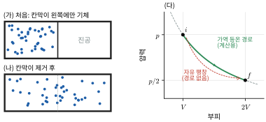

*그림 20.1* (가) 단열된 상자에서 기체가 칸막이 왼쪽에만 있고 오른쪽은 진공이다. (나) 칸막이를 없애면 기체가 상자 전체로 퍼진다. (다) 처음 상태 $i$와 나중 상태 $f$는 같은 등온선 위에 있다. 자유 팽창의 중간 상태는 평형 상태가 아니어서 $pV$ 도표에 경로를 그릴 수 없다(빨간 점선은 상징적 표시). 엔트로피는 상태함수이므로 같은 두 상태를 잇는 가역 등온 경로(초록)로 계산한다.

### 예제 20.3 뜨거운 물과 차가운 물의 혼합
$90\ °\text{C}$의 물 $0.50\ \text{kg}$과 $10\ °\text{C}$의 물 $1.00\ \text{kg}$을 단열 용기에서 섞는다. 전체 엔트로피 변화를 구하라.

**풀이** 나중 온도는 $T_f = (0.50\cdot90 + 1.00\cdot10)/1.50 = 36.7\ °\text{C} = 309.8\ \text{K}$이다. 각각을 가역적으로 데우거나 식혔다고 보고 계산한다.

$$
\Delta S_{\text{뜨거운 물}} = (0.50)(4186)\ln\frac{309.8}{363.15} = -332\ \text{J/K}, \quad
\Delta S_{\text{찬물}} = (1.00)(4186)\ln\frac{309.8}{283.15} = +377\ \text{J/K}
$$

합은 $+44\ \text{J/K}$이다. 같은 열 $|Q|$가 오가도 낮은 온도에서 받는 쪽의 $Q/T$가 더 크기 때문에 전체 엔트로피는 언제나 증가한다(연습문제 14에서 일반적으로 증명).

---

## 20.3 열기관과 카르노 기관

### 열기관과 효율
**열기관**(heat engine)은 고온 열저장체(온도 $T_H$)에서 열 $Q_H$를 받아 일 $W$를 하고, 남은 열 $Q_C$를 저온 열저장체($T_C$)에 버리는 순환 장치다(그림 20.2). 여기서 $Q_H$, $Q_C$는 크기(양수)로 쓴다. 순환이므로 $\Delta E_{\text{int}} = 0$이고 $W = Q_H - Q_C$이다. **열효율**(thermal efficiency)은

$$
\eta = \frac{W}{Q_H} = 1 - \frac{Q_C}{Q_H}
$$

이다. 경험적으로 $Q_C = 0$인 기관은 없다.

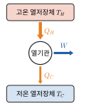

*그림 20.2* 열기관의 에너지 흐름도. 한 순환 동안 고온 열저장체에서 $Q_H$를 받아 일 $W$를 하고 나머지 $Q_C$를 저온 열저장체에 버린다. 화살표 굵기는 에너지의 크기를 나타내며 $Q_H = W + Q_C$이다.

> **켈빈–플랑크 표현**: 하나의 열저장체에서 열을 받아 그 전부를 일로 바꾸는 것 외에 다른 효과가 없는 순환 과정은 불가능하다.

### 카르노 순환
1824년 카르노(Sadi Carnot)가 제안한 **카르노 순환**(Carnot cycle)은 두 열저장체 사이에서 작동하는 가역 순환으로, 두 등온 과정과 두 단열 과정으로 이루어진다(그림 20.3). 작동 물질을 이상기체로 놓고 효율을 계산하자.

1. $a\to b$: $T_H$에서 등온 팽창. $\Delta E_{\text{int}} = 0$이므로 $Q_H = nRT_H\ln(V_b/V_a)$.
2. $b\to c$: 단열 팽창, $T_H\to T_C$. $T_HV_b^{\gamma-1} = T_CV_c^{\gamma-1}$.
3. $c\to d$: $T_C$에서 등온 압축. $Q_C = nRT_C\ln(V_c/V_d)$.
4. $d\to a$: 단열 압축, $T_C\to T_H$. $T_HV_a^{\gamma-1} = T_CV_d^{\gamma-1}$.

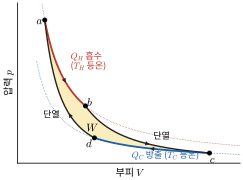

*그림 20.3* 이상기체 카르노 순환의 $pV$ 도표($\gamma = 5/3$, $T_C/T_H = 1/2$로 계산). $a\to b$는 $T_H$ 등온 팽창(빨강), $c\to d$는 $T_C$ 등온 압축(파랑), $b\to c$와 $d\to a$는 단열 과정이다. 시계 방향 순환으로 둘러싸인 넓이가 한 순환에 기체가 한 알짜 일 $W$이다.

2와 4의 식을 나누면 $(V_b/V_a)^{\gamma-1} = (V_c/V_d)^{\gamma-1}$, 즉 $V_b/V_a = V_c/V_d$이다. 따라서 로그 항이 약분되어

$$
\frac{Q_C}{Q_H} = \frac{T_C}{T_H}, \qquad \eta_{\text{카르노}} = 1 - \frac{T_C}{T_H}
$$

이다. $Q_H/T_H = Q_C/T_C$는 고온부에서 받은 엔트로피와 저온부에 버린 엔트로피가 같다는 뜻이다. 가역 순환에서 작동 물질의 엔트로피 변화는 0이므로 당연하다. $TS$ 도표에서 카르노 순환은 직사각형이고, 그 넓이가 한 순환의 일 $W$이다(그림 20.4).

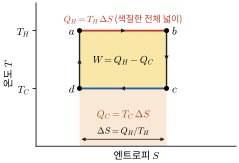

*그림 20.4* $TS$ 도표의 카르노 순환. 가역 과정에서 $\delta Q = T\,dS$이므로 곡선 아래 넓이가 열이다. 윗변 아래 넓이가 $Q_H = T_H\Delta S$, 아랫변 아래 넓이가 $Q_C = T_C\Delta S$이고, 그 차인 직사각형 넓이가 $W$이다. 단열 과정은 엔트로피가 일정한 세로선이다.

### 카르노 정리: 효율의 상한
**같은 두 온도 사이에서 작동하는 어떤 열기관도 카르노 기관보다 효율이 높을 수 없다.** 엔트로피로 간단히 증명할 수 있다. 임의의 열기관이 한 순환 동안 $T_H$에서 $Q_H$를 받고 $T_C$에 $Q_C$를 버린다. 작동 물질은 처음 상태로 돌아오므로 $\Delta S_{\text{물질}} = 0$이고, 두 열저장체의 엔트로피 변화는 $-Q_H/T_H$와 $+Q_C/T_C$이다. 제2법칙에서

$$
\Delta S_{\text{우주}} = -\frac{Q_H}{T_H} + \frac{Q_C}{T_C} \ge 0 \quad\Rightarrow\quad \frac{Q_C}{Q_H} \ge \frac{T_C}{T_H} \quad\Rightarrow\quad \eta \le 1 - \frac{T_C}{T_H}
$$

등호는 가역 기관일 때만 성립한다. 카르노 효율은 **작동 물질과 무관**하며 두 온도만으로 정해진다. 효율을 높이려면 $T_H$를 높이거나 $T_C$를 낮춰야 하고, $T_C = 0\ \text{K}$가 아닌 한 100%는 불가능하다.

### 예제 20.4 화력 발전소의 효율 한계
증기 터빈에 들어가는 증기의 온도가 $550\ °\text{C}$, 복수기(응축기)의 온도가 $30\ °\text{C}$이다. 최대 효율은 얼마인가? 출력 $1.0\ \text{GW}$를 내려면 최소 얼마의 열을 버려야 하는가?

**풀이** $\eta_C = 1 - \dfrac{303}{823} = 0.632$, 즉 63%이다. 이 효율에서 $Q_H = W/\eta = 1.58\ \text{GW}$, 버리는 열은 $Q_C = Q_H - W = 0.58\ \text{GW}$이다. 실제 발전소는 마찰, 유한한 온도차의 열전달 같은 비가역성 때문에 효율이 이보다 상당히 낮고, 버리는 열은 출력보다 큰 경우가 많다. 발전소가 강이나 바닷가에 있고 거대한 냉각탑을 갖춘 이유다.

### 오토 순환
가솔린 엔진을 이상화한 **오토 순환**(Otto cycle)은 두 단열 과정과 두 등적 과정으로 이루어진다. 부피 $V_1$의 공기–연료 혼합물을 $V_2 = V_1/r$로 단열 압축하고($r$은 **압축비**), 점화로 부피가 일정한 채 열 $Q_H$를 받은 뒤, 단열 팽창하고, 등적 과정으로 열 $Q_C$를 버린다(그림 20.5). 네 상태의 온도를 $T_1$(압축 전), $T_2$, $T_3$, $T_4$(배기 전)라 하면

$$
Q_H = nC_V(T_3 - T_2), \qquad Q_C = nC_V(T_4 - T_1)
$$

이고, 두 단열 과정에서 $T_2 = T_1r^{\gamma-1}$, $T_3 = T_4r^{\gamma-1}$이다. 따라서 $T_3 - T_2 = r^{\gamma-1}(T_4 - T_1)$이고

$$
\eta_{\text{오토}} = 1 - \frac{T_4 - T_1}{T_3 - T_2} = 1 - \frac{1}{r^{\gamma-1}}
$$

이다.

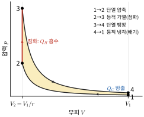

*그림 20.5* 오토 순환의 $pV$ 도표. 예제 20.5의 값($r = 10$, $\gamma = 1.40$, $T_1 = 300\ \text{K}$, $T_3 = 2000\ \text{K}$)으로 계산했다. 열은 등적 과정 $2\to3$에서 받고 $4\to1$에서 버리며, 둘러싸인 넓이가 한 순환의 일이다.

### 예제 20.5 압축비와 효율
압축비 $r = 10$인 오토 순환($\gamma = 1.40$)의 효율을 구하라. 같은 순환의 최고 온도와 최저 온도가 각각 $T_3 = 2000\ \text{K}$, $T_1 = 300\ \text{K}$일 때 같은 온도 사이 카르노 효율과 비교하라.

**풀이** $\eta = 1 - 10^{-0.40} = 1 - 0.398 = 0.602$, 즉 60%이다. 카르노 효율은 $1 - 300/2000 = 0.85$이다. 오토 순환은 열을 한 온도에서 받지 않고 $T_2$에서 $T_3$까지 변하는 온도에서 받기 때문에(유한한 온도차를 통한 열 출입) 카르노보다 효율이 낮다. 압축비를 높이면 효율이 오르지만, 가솔린 엔진은 압축 중에 혼합기가 저절로 발화하는 노킹 때문에 압축비에 한계가 있다. 공기만 압축하는 디젤 엔진(19장 예제 19.5)이 더 높은 압축비를 쓸 수 있는 이유다.

> **🔗 전공 연결: 엔진과 발전소의 효율 (기계공학 열역학·열기관)**
> 기계공학과의 **공업열역학**은 이 절을 실제 기관으로 확장한다. 가솔린 엔진은 오토 순환, 디젤 엔진은 디젤 순환, 가스 터빈과 제트 엔진은 브레이턴 순환(Brayton cycle), 증기 발전소는 물의 상변화를 쓰는 랭킨 순환(Rankine cycle)으로 이상화한다. 모든 순환의 효율은 같은 온도 범위의 카르노 효율을 넘지 못하므로, 설계의 방향은 늘 같다. 고온부 온도를 높이고(내열 재료, 터빈 날개 냉각), 저온부 온도를 낮추며, 비가역성(마찰, 유한한 온도차의 열전달, 급격한 팽창)을 줄인다. 가스 터빈의 뜨거운 배기가스로 다시 증기를 만들어 랭킨 순환을 돌리는 **복합 발전**은 버려지던 $Q_C$를 다음 기관의 $Q_H$로 써서 전체 효율을 높이는 방법이다. 실무에서는 각 장치에서 생기는 엔트로피 생성량을 계산해 손실이 큰 곳을 찾는 **엑서지(exergy) 분석**을 쓴다.

> **★ 심화: 클라우지우스 부등식**
> 계가 순환하는 동안 온도가 $T_1, T_2, \ldots$인 여러 열저장체와 열 $\delta Q_1, \delta Q_2, \ldots$를 주고받는다고 하자(받으면 양수). 작동 물질은 처음으로 돌아오므로 엔트로피 변화가 0이고, 열저장체들의 엔트로피 변화는 $-\sum\delta Q_i/T_i$이다. 제2법칙에서 $-\sum\delta Q_i/T_i \ge 0$이므로 연속적인 경우
> $$
> \oint\frac{\delta Q}{T} \le 0 \qquad (\text{등호는 가역 순환})
> $$
> 이다(여기서 $T$는 열을 주고받는 열저장체의 온도). 이것이 **클라우지우스 부등식**(Clausius inequality)이다. 가역 순환에서 $\oint\delta Q_{\text{rev}}/T = 0$이므로 $\int\delta Q_{\text{rev}}/T$는 경로에 무관하고, 엔트로피가 상태함수라는 것이 일반적으로 증명된다. 또 상태 $i$에서 $f$로 가는 비가역 경로와 $f$에서 $i$로 돌아오는 가역 경로로 순환을 만들면 $\int_i^f\delta Q/T \le S_f - S_i$를 얻는다. 단열($\delta Q = 0$) 고립계에서는 $\Delta S \ge 0$이 되어 제2법칙의 엔트로피 표현으로 돌아온다. (이 유도는 엔트로피 표현의 제2법칙을 가정했으므로 엄밀한 증명이라기보다 일관성 확인이다.) 역사적·논리적으로는 켈빈–플랑크 표현에서 출발해 이 부등식을 유도하고 엔트로피를 정의하는 순서를 밟으며, 엄밀한 열역학 강의는 흔히 이 순서를 따른다.

---

## 20.4 냉동기와 열펌프

### 성능 계수
**냉동기**(refrigerator)는 열기관을 거꾸로 돌린 것이다(그림 20.6). 일 $W$를 받아 저온부에서 열 $Q_C$를 빼내 고온부로 $Q_H = Q_C + W$를 버린다. 냉동기의 성능은 **성능 계수(coefficient of performance)**

$$
K = \frac{Q_C}{W} = \frac{Q_C}{Q_H - Q_C}
$$

로 나타낸다. 가역(카르노) 냉동기는 $Q_C/Q_H = T_C/T_H$이므로

$$
K_{\text{카르노}} = \frac{T_C}{T_H - T_C}
$$

이다. 같은 장치를 겨울에 실외(저온)에서 열을 빼 실내(고온)로 넣는 데 쓰면 **열펌프**(heat pump)다. 목적이 $Q_H$이므로 성능 계수는

$$
K_{\text{열펌프}} = \frac{Q_H}{W}, \qquad K_{\text{열펌프, 카르노}} = \frac{T_H}{T_H - T_C}
$$

이다. 온도차가 작을수록 성능 계수가 크다. 제2법칙에서 $\Delta S_{\text{우주}} = Q_H/T_H - Q_C/T_C \ge 0$이므로 실제 성능 계수는 카르노 값보다 작다(연습문제로 확인해 보라).

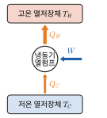

*그림 20.6* 냉동기(열펌프)의 에너지 흐름도. 일 $W$를 받아 저온부에서 $Q_C$를 빼내고 고온부에 $Q_H = Q_C + W$를 버린다. 냉동기는 $Q_C$, 열펌프는 $Q_H$가 목적이다.

> **클라우지우스 표현**: 저온 물체에서 고온 물체로 열을 옮기는 것 외에 다른 효과가 없는 순환 과정은 불가능하다. 즉 일을 들이지 않는 냉동기($W = 0$, $K = \infty$)는 없다.

켈빈–플랑크 표현과 클라우지우스 표현은 동등하다(그림 20.7). 한쪽을 어기는 장치가 있으면 그것을 보통의 기관이나 냉동기와 결합해 다른 쪽을 어기는 장치를 만들 수 있기 때문이다.

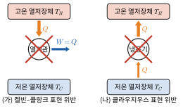

*그림 20.7* 제2법칙이 금지하는 두 장치. (가) 열을 모두 일로 바꾸는 완벽한 열기관($Q_C = 0$)은 켈빈–플랑크 표현에 어긋난다. (나) 일 없이 열을 저온부에서 고온부로 옮기는 완벽한 냉동기($W = 0$)는 클라우지우스 표현에 어긋난다.

### 예제 20.6 냉장고와 열펌프
(가) 내부 $4\ °\text{C}$, 부엌 $25\ °\text{C}$인 냉장고의 최대 성능 계수는? (나) 실내 $20\ °\text{C}$, 실외 $-5\ °\text{C}$일 때 열펌프의 최대 성능 계수는? 전기 난로와 비교하라.

**풀이**
(가) $K = \dfrac{277.15}{298.15 - 277.15} = 13.2$. 일 1 J로 열 13.2 J을 빼낼 수 있다는 이론적 상한이다.

(나) $K = \dfrac{293.15}{25} = 11.7$. 전기 난로는 전기 에너지 1 J을 열 1 J로 바꿀 뿐이지만($K = 1$), 이상적인 열펌프는 같은 전기로 11.7 J을 실내에 넣는다. 에너지 보존을 어기는 것이 아니라 실외의 열을 "퍼 올리는" 것이다. 실제 열펌프의 성능 계수는 이 값보다 훨씬 작지만 1보다는 충분히 커서 난방 에너지를 크게 아낀다.

> **💡 개념 확인: 냉장고 문을 열어 두면 부엌이 시원해질까?**
> 아니다. 오히려 더워진다. 냉장고는 부엌 공기에서 $Q_C$를 빼서 냉장고 뒤쪽으로 $Q_H = Q_C + W$를 버린다. 둘 다 부엌 안이므로 알짜로 부엌에 더해지는 에너지는 $W$(전기 에너지)이다. 에어컨은 실외기를 밖에 두어 $Q_H$를 실외로 버리기 때문에 실내를 식힐 수 있다.

---

## 20.5 엔트로피의 통계적 의미

### 미시 상태와 거시 상태
상자를 왼쪽과 오른쪽 절반으로 나누고 구별 가능한 분자 $N$개를 넣자. "왼쪽에 $n$개"라는 **거시 상태**(macrostate)는 어떤 분자가 왼쪽에 있는지에 따라 여러 **미시 상태**(microstate)로 실현된다. 그 수, 곧 **다중도**(multiplicity)는

$$
W(n) = \binom{N}{n} = \frac{N!}{n!\,(N - n)!}
$$

이다. 모든 미시 상태가 똑같은 확률로 나타난다고 가정하면(**등확률 가정**), 거시 상태의 확률은 $W$에 비례한다. 분자가 4개이면 미시 상태는 $2^4 = 16$개이고, $W = 1, 4, 6, 4, 1$이다(그림 20.8). 모두 왼쪽에 있을 확률은 $1/16$이다.

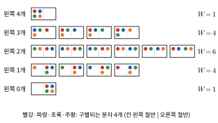

*그림 20.8* 구별되는 분자 4개를 상자의 두 절반에 배치하는 16가지 미시 상태. 같은 줄은 "왼쪽에 $n$개"라는 같은 거시 상태에 속하며, 그 수가 다중도 $W(n) = \binom{4}{n}$이다. 2개씩 나뉘는 거시 상태가 가장 많은 미시 상태(6개)를 가진다.

### 예제 20.7 모든 분자가 한쪽에 모일 확률
분자 (가) 4개, (나) 100개, (다) $6.0\times10^{23}$개가 모두 왼쪽 절반에 있을 확률을 구하라.

**풀이** 각 분자가 왼쪽에 있을 확률이 1/2이고 서로 독립이므로 $P = 2^{-N}$이다.
(가) $1/16 = 0.0625$. (나) $2^{-100} = 7.9\times10^{-31}$. (다) $2^{-6.0\times10^{23}} = 10^{-1.8\times10^{23}}$.

분자 100개만 되어도, 우주의 나이(약 138억 년) 동안 1초에 10억 번씩 확인해도 한 번 볼 기대 횟수가 0.0003번 정도인 확률이다. 자유 팽창이 거꾸로 일어나지 않는 것은 역학 법칙이 금지해서가 아니라(뉴턴 법칙은 시간을 뒤집어도 성립한다), 그런 상태가 **압도적으로 드물기** 때문이다. 이것이 비가역성의 통계적 의미다.

### 분포의 날카로움과 스털링 근사
$N$이 크면 $W(n)$은 $n = N/2$에서 매우 날카로운 봉우리를 이룬다(그림 20.9). 큰 $N$에서 $\ln N!$은 **스털링 근사(Stirling's approximation)**

$$
\ln N! \approx N\ln N - N
$$

로 계산한다($\ln N! = \sum\ln k \approx \int_1^N\ln x\,dx$). 이를 이용하면 $W(n)$이 평균 $N/2$, 표준편차 $\sqrt{N}/2$인 정규 분포에 가까움을 보일 수 있다. 상대적 폭 $(\sqrt{N}/2)/(N/2) = 1/\sqrt{N}$은 $N = 10^{24}$이면 $10^{-12}$이다. 거시적인 계에서 평형 상태의 거시 변수가 거의 요동 없이 정해진 값을 갖는 이유다.

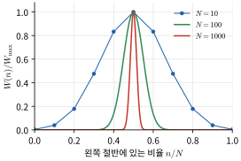

*그림 20.9* 왼쪽 절반에 있는 분자의 비율 $n/N$에 대한 다중도 $W(n)$(최댓값으로 나눔). $N$이 10, 100, 1000으로 커질수록 봉우리의 상대적 폭이 $1/\sqrt{N}$로 좁아진다. $N \sim 10^{24}$이면 사실상 $n/N = 1/2$인 한 점이 된다.

### 볼츠만의 엔트로피
볼츠만(Ludwig Boltzmann)은 엔트로피를 다중도로 정의했다.

$$
S = k_B\ln W
$$

로그를 쓰는 이유는 엔트로피가 **더해지는 양**이어야 하기 때문이다. 독립된 두 계를 합치면 다중도는 곱해지고($W = W_1W_2$), 로그는 그것을 합으로 바꾼다($S = S_1 + S_2$).

이 정의가 열역학적 엔트로피와 같은지 자유 팽창으로 확인하자. 부피가 $V$에서 $2V$로 늘면 분자 하나가 있을 수 있는 위치의 수가 2배가 되므로, $N$개 분자 전체의 미시 상태 수는 $2^N$배가 된다.

$$
\Delta S = k_B\ln\frac{W_f}{W_i} = k_B\ln2^N = Nk_B\ln2 = nR\ln2
$$

예제 20.2의 열역학적 결과와 정확히 같다. 일반적으로 부피가 $V_i$에서 $V_f$로 바뀌면 $\Delta S = Nk_B\ln(V_f/V_i)$로, 20.2절 이상기체 식의 둘째 항을 재현한다.

> **🔬 최신 연구 노트: 정보와 엔트로피**
> 1948년 섀넌(Claude Shannon)은 통신 이론에서, 확률 $p_i$로 나타나는 메시지들의 평균 정보량을 $H = -\sum_ip_i\log_2p_i$(단위: 비트)로 정의했다. 모든 $W$개의 경우가 같은 확률이면 $H = \log_2W$이므로, 볼츠만 엔트로피와 $S = (k_B\ln2)H$의 관계에 있다. 엔트로피는 "계의 미시 상태를 정확히 지정하는 데 모자란 정보의 양"으로 해석할 수 있다.
> 이 연결은 단순한 비유가 아니다. **란다우어 원리**(Landauer's principle)에 따르면 1비트의 정보를 지우는(두 상태 중 하나를 정해진 상태로 되돌리는) 과정은 최소 $k_BT\ln2$의 열을 주위에 내놓아야 한다. 300 K에서 이는 $2.87\times10^{-21}\ \text{J}$(약 0.018 eV)이다. 이 원리는 분자의 속도를 보고 칸막이 문을 여닫아 열을 저절로 고온부로 보내는 듯한 **맥스웰의 도깨비(Maxwell's demon)** 역설을 푸는 열쇠로 널리 받아들여진다. 도깨비가 측정 결과를 기억하고 다시 지우는 과정에서 최소한 그만큼의 엔트로피가 생겨 제2법칙이 지켜진다. 란다우어 한계에 가까운 열 방출은 콜로이드 입자 등을 이용한 정밀 실험에서도 측정되었다. 오늘날 컴퓨터 소자가 비트당 소모하는 에너지는 이 한계보다 훨씬 크지만, 계산의 물리적 한계를 논할 때 출발점이 되는 원리다.

---

## 20.6 볼츠만 분포

### 온도의 통계적 정의
18장의 제1법칙을 가역 과정에 쓰면 $dE_{\text{int}} = T\,dS - p\,dV$이다. 부피를 고정하면

$$
\frac{1}{T} = \left(\frac{\partial S}{\partial E}\right)_V
$$

이다. 이것을 거꾸로 **온도의 정의**로 삼을 수 있다. 에너지를 조금 더했을 때 엔트로피(미시 상태 수의 로그)가 얼마나 늘어나는지가 온도의 역수다. 두 계가 에너지를 주고받으며 전체 엔트로피 $S_1(E_1) + S_2(E - E_1)$이 최대가 되는 평형에서는 $\partial S_1/\partial E_1 = \partial S_2/\partial E_2$, 즉 $T_1 = T_2$이다. 제0법칙의 통계적 근거다(연습문제 16).

### 볼츠만 분포의 유도

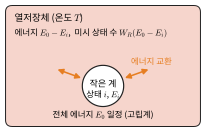

*그림 20.10* 온도 $T$인 큰 열저장체와 에너지를 주고받는 작은 계. 전체 에너지 $E_0$는 일정하므로, 작은 계가 에너지 $E_i$인 상태에 있으면 열저장체의 에너지는 $E_0 - E_i$이고 그때 열저장체가 가질 수 있는 미시 상태의 수가 그 상태의 확률을 정한다.

작은 계(분자 하나라도 좋다)가 온도 $T$인 큰 열저장체와 접촉해 있다(그림 20.10). 전체 에너지 $E_0$는 일정하다. 작은 계가 에너지 $E_i$인 특정 미시 상태 $i$에 있을 확률은, 그때 열저장체가 가질 수 있는 미시 상태 수 $W_R(E_0 - E_i)$에 비례한다(전체의 모든 미시 상태가 등확률이므로).

$$
P_i \propto W_R(E_0 - E_i) = \exp\left[\frac{S_R(E_0 - E_i)}{k_B}\right]
$$

$E_i \ll E_0$이므로 $S_R$을 테일러 전개(1장)하고 $\partial S_R/\partial E = 1/T$을 쓰면

$$
S_R(E_0 - E_i) \approx S_R(E_0) - \frac{E_i}{T}
$$

이다. 첫째 항은 $i$에 무관한 상수이므로

$$
P_i = \frac{e^{-E_i/k_BT}}{Z}, \qquad Z = \sum_i e^{-E_i/k_BT}
$$

를 얻는다. 이것이 **볼츠만 분포**(Boltzmann distribution)이고, $Z$를 **분배 함수**(partition function)라 한다. 19장에서 쓴 볼츠만 인자 $e^{-E/k_BT}$의 근거가 바로 이것이다. 열저장체의 엔트로피는 에너지에 대해 지수적으로 미시 상태 수를 늘리므로, 작은 계가 에너지를 $E_i$만큼 "빌려 가면" 열저장체의 경우의 수가 $e^{-E_i/k_BT}$배로 줄어든다는 것이 이 식의 의미다.

평균 에너지는 $\beta = 1/k_BT$로 두면 19장 ★과 같은 방법으로

$$
\langle E\rangle = \sum_iE_iP_i = -\frac{\partial\ln Z}{\partial\beta}
$$

이다. 분배 함수 하나에서 계의 열역학적 성질을 모두 얻을 수 있어 통계역학의 중심 도구가 된다.

### 2준위계
에너지가 $0$과 $\varepsilon$인 두 상태만 있는 계(원자의 두 에너지 준위, 자기장 속 스핀)를 생각하자. 들뜬 상태와 바닥 상태에 있는 원자 수의 비는

$$
\frac{N_2}{N_1} = e^{-\varepsilon/k_BT}
$$

이다. $k_BT \ll \varepsilon$이면 거의 모두 바닥 상태에 있고, $k_BT \gg \varepsilon$이면 두 상태에 거의 반씩 나뉜다(그림 20.11). 19장에서 진동 자유도가 상온에서 "얼어 있는" 이유가 이것이다. 진동 에너지 준위 간격이 $k_BT$보다 크면 들뜬 상태에 있는 분자가 거의 없어 진동이 비열에 기여하지 못한다.

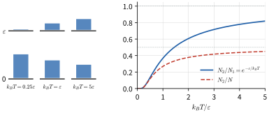

*그림 20.11* 에너지 $0$과 $\varepsilon$인 2준위계. 왼쪽: 세 온도에서 두 준위의 점유 비율(막대 높이). 오른쪽: 점유 비 $N_2/N_1 = e^{-\varepsilon/k_BT}$와 들뜬 상태의 비율 $N_2/N$. 온도가 아무리 높아도 $N_2/N$은 $1/2$을 넘지 않는다.

### 예제 20.8 들뜬 상태의 비율
300 K에서 에너지 차이가 (가) $0.10\ \text{eV}$(분자 진동 정도), (나) $2.0\ \text{eV}$(가시광선 전이 정도)인 두 준위의 점유 비 $N_2/N_1$을 구하라.

**풀이** $k_BT = (1.381\times10^{-23})(300)/(1.602\times10^{-19}) = 0.0259\ \text{eV}$이다.
(가) $\varepsilon/k_BT = 3.87$, $N_2/N_1 = e^{-3.87} = 0.021$.
(나) $\varepsilon/k_BT = 77.4$, $N_2/N_1 = e^{-77.4} \approx 3\times10^{-34}$.

상온의 물체가 가시광선을 내지 않는 이유다. 가시광선을 내려면 수천 K로 가열하거나(백열등, 태양), 레이저처럼 열평형이 아닌 방법으로 들뜬 상태를 채워야 한다(38장 밀도 반전).

### 반응 속도와 아레니우스 식
화학 반응이 일어나려면 분자가 **활성화 에너지(activation energy)** $E_a$(몰당)를 넘어야 한다(그림 20.12). 그만큼의 에너지를 가진 분자의 비율은 볼츠만 인자에 비례하므로 반응 속도 상수는

$$
k_{\text{반응}} = Ae^{-E_a/RT}
$$

를 따른다. 이를 **아레니우스 식**(Arrhenius equation)이라 한다. 지수 함수이므로 온도에 매우 민감하다.

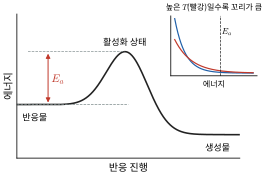

*그림 20.12* 반응물이 생성물이 되려면 높이 $E_a$인 에너지 언덕을 넘어야 한다. 오른쪽 위: 에너지가 $E_a$보다 큰 분자의 비율(색칠한 꼬리)은 볼츠만 인자 때문에 온도가 조금만 올라도 크게 늘어난다.

> **🔗 전공 연결: 약물의 안정성과 자유에너지 (약제학·물리약학)**
> 의약품의 분해 반응도 아레니우스 식을 따르는 경우가 많다. 활성화 에너지가 $80\ \text{kJ/mol}$인 분해 반응이라면 $40\ °\text{C}$에서의 속도는 $25\ °\text{C}$의 $\exp\left[\frac{80\,000}{8.314}\left(\frac{1}{298.15} - \frac{1}{313.15}\right)\right] = 4.7$배이다. 이 원리를 거꾸로 써서, 높은 온도에서 짧은 기간 분해 속도를 재고 보관 온도의 유효 기간을 추정하는 것이 **가속 안정성 시험**의 기본 생각이다. 백신과 생물의약품을 냉장 보관하는 콜드체인의 근거도 같다.
> 약물이 수용체에 결합할지는 엔트로피까지 포함한 **깁스 자유에너지(Gibbs free energy)** $G = H - TS$로 판단한다(★ 박스). 결합의 표준 자유에너지 변화 $\Delta G^\circ = \Delta H^\circ - T\Delta S^\circ$가 음수일수록 결합이 강하고, 8장에서 본 것처럼 $\Delta G^\circ = RT\ln K_d$이다. 물을 싫어하는(소수성) 부분이 서로 뭉치는 **소수성 효과**는 주로 엔트로피가 이끄는 과정으로 알려져 있다. 소수성 표면 주위에서 구조가 제약되어 있던 물 분자들이 풀려나면서 물의 엔트로피가 늘어나기 때문이다. 약물 설계에서 결합의 "엔탈피–엔트로피 균형"을 따지는 이유다.

> **★ 심화: 깁스 자유에너지와 자발성**
> 온도 $T$, 압력 $p$가 일정한 주위(열저장체)와 접촉한 계가 열 $Q$를 받으면, 주위의 엔트로피는 $-Q/T$만큼 변한다. 압력이 일정하면 $Q = \Delta H$($H = E_{\text{int}} + pV$는 **엔탈피**)이므로 제2법칙은
> $$
> \Delta S_{\text{우주}} = \Delta S - \frac{\Delta H}{T} \ge 0 \quad\Leftrightarrow\quad \Delta G = \Delta H - T\Delta S \le 0
> $$
> 가 된다. 즉 등온·등압 과정은 **계의 깁스 자유에너지가 줄어드는 방향**으로 자발적으로 일어나고, 평형에서 $G$는 최소다. 주위의 엔트로피를 계의 양 $\Delta H/T$로 바꾸어 넣었기 때문에, 계만 보고 판단할 수 있다는 것이 장점이다. 부피가 일정하면 같은 논리로 헬름홀츠 자유에너지 $F = E_{\text{int}} - TS$가 최소가 되며, 통계역학에서는 $F = -k_BT\ln Z$로 분배 함수와 이어진다. 상평형, 화학 평형, 단백질 접힘, 약물 결합이 모두 이 틀로 기술된다.

> **🔬 최신 연구 노트: 2024 노벨 물리학상 — 볼츠만 머신과 인공신경망**
> 2024년 노벨 물리학상은 존 홉필드(John Hopfield)와 제프리 힌턴(Geoffrey Hinton)에게 "인공신경망을 이용한 기계학습을 가능하게 한 기초적인 발견과 발명"의 공로로 수여되었다. 두 업적의 핵심 아이디어는 이 장의 통계물리에서 왔다.
> **홉필드 네트워크**(Hopfield network)는 값이 $s_i = \pm1$인 뉴런 $N$개가 대칭인 가중치 $w_{ij} = w_{ji}$로 연결된 망이다. 홉필드는 이 망에 자성체의 스핀 모형과 같은 꼴의 **에너지 함수**
> $$
> E = -\frac{1}{2}\sum_{i\neq j}w_{ij}s_is_j
> $$
> 를 부여했다. 뉴런 하나를 그 "국소장" $\sum_jw_{ij}s_j$의 부호에 맞추는 갱신은 $E$를 절대 늘리지 않으므로, 망은 에너지 지형의 골짜기(국소 최소점)로 굴러 내려가 멈춘다. 기억시킬 패턴 $\xi^\mu$로 가중치를 $w_{ij} \propto \sum_\mu\xi_i^\mu\xi_j^\mu$로 정하면 그 패턴들이 골짜기가 되어, 일부가 훼손된 입력에서 출발해도 원래 패턴을 되찾는 **연상 기억**(associative memory)이 된다.
> **볼츠만 머신**(Boltzmann machine)은 힌턴이 동료들과 함께 이 생각을 확률적으로 확장한 것이다. 뉴런이 결정론적으로 갱신되는 대신, 망 전체의 상태가 20.6절의 **볼츠만 분포** $P \propto e^{-E/T}$를 따르도록 확률적으로 갱신된다($T$는 무작위성을 조절하는 매개변수). 관측되지 않는 숨은 뉴런을 두고, 망이 만들어 내는 상태의 분포가 학습 데이터의 분포와 비슷해지도록 가중치를 조정한다. 그러면 망은 데이터의 통계적 특징을 학습하여 패턴을 분류하거나 새로운 예를 생성할 수 있다. 에너지 함수, 볼츠만 분포, 분배 함수 같은 통계물리의 도구가 기계학습의 언어가 된 것이다.

> **🐍 파이썬 실습: 홉필드 네트워크의 기억 회복**
> 뉴런 100개짜리 홉필드 네트워크에 무작위 패턴 3개를 저장하고, 그중 하나를 25% 훼손한 뒤 갱신 규칙으로 되살린다. "겹침" $m = \frac{1}{N}\sum_is_i\xi_i$은 1이면 완전히 일치, 0이면 무관함을 뜻한다.
> ```python
> import numpy as np
> rng = np.random.default_rng(1)
>
> N, P = 100, 3                               # 뉴런 수, 저장할 패턴 수
> xi = rng.choice([-1, 1], size=(P, N))       # 저장할 무작위 패턴 (각 성분 ±1)
> W = (xi.T @ xi) / N                         # 헤브 규칙: w_ij = (1/N) Σ ξ_i ξ_j
> np.fill_diagonal(W, 0)                      # 자기 자신과의 연결은 없음
>
> def energy(s):
>     return -0.5 * s @ W @ s                 # 홉필드 에너지 함수
>
> s = xi[0].copy()
> flip = rng.choice(N, size=25, replace=False)
> s[flip] *= -1                               # 패턴 0의 25%를 뒤집어 훼손
> print(f"시작: 겹침 = {s @ xi[0] / N:.2f}, E = {energy(s):.2f}")
>
> for sweep in range(3):                      # 비동기 갱신: 한 번에 뉴런 하나
>     for i in rng.permutation(N):
>         s[i] = 1 if W[i] @ s >= 0 else -1   # 국소장의 부호를 따름
>     print(f"{sweep+1}회 갱신 후: 겹침 = {s @ xi[0] / N:.2f}, E = {energy(s):.2f}")
>
> print("저장된 패턴의 에너지:", [round(float(energy(p)), 2) for p in xi])
> ```
> 실행하면 겹침이 0.50에서 출발해 한 번 갱신 후 1.00이 되고, 에너지는 $-11.52$에서 $-49.54$로 내려가 더 변하지 않는다. 저장된 세 패턴의 에너지($-49.54$, $-48.9$, $-49.3$)가 모두 깊은 골짜기임도 확인할 수 있다. `P`를 20, 30으로 늘려 보라. 저장 패턴이 많아지면 골짜기들이 서로 간섭해 회복에 실패한다(뉴런 수에 비해 저장 용량에 한계가 있다). 갱신 규칙을 "확률 $1/(1 + e^{-2h_i/T})$로 $+1$"로 바꾸면 볼츠만 머신의 확률적 갱신이 되며, $T \to 0$에서 위의 결정론적 규칙으로 돌아간다.

---

## 핵심 정리

| 주제 | 핵심 식 | 비고 |
|---|---|---|
| 엔트로피 정의 | $dS = \delta Q_{\text{rev}}/T$ | 상태함수, 가역 경로로 계산 |
| 제2법칙 | $\Delta S_{\text{고립계}} \ge 0$ | 등호는 가역 과정 |
| 상변화·가열 | $\Delta S = mL/T$, $\Delta S = mc\ln(T_f/T_i)$ | |
| 이상기체 | $\Delta S = nC_V\ln(T_f/T_i) + nR\ln(V_f/V_i)$ | 자유 팽창 $nR\ln2$ |
| 열기관 | $\eta = W/Q_H = 1 - Q_C/Q_H$ | 켈빈–플랑크 표현 |
| 카르노 | $\eta_C = 1 - T_C/T_H$, $Q_C/Q_H = T_C/T_H$ | 모든 기관의 상한 |
| 오토 순환 | $\eta = 1 - r^{1-\gamma}$ | $r$: 압축비 |
| 냉동기·열펌프 | $K = Q_C/W \le T_C/(T_H - T_C)$, $K_{\text{HP}} = Q_H/W \le T_H/(T_H - T_C)$ | 클라우지우스 표현 |
| 클라우지우스 부등식 ★ | $\oint\delta Q/T \le 0$ | |
| 볼츠만 엔트로피 | $S = k_B\ln W$, $\ln N! \approx N\ln N - N$ | 등확률 가정 |
| 통계적 온도 | $1/T = (\partial S/\partial E)_V$ | |
| 볼츠만 분포 | $P_i = e^{-E_i/k_BT}/Z$, $\langle E\rangle = -\partial\ln Z/\partial\beta$ | 열저장체와 접촉 |
| 아레니우스 | $k = Ae^{-E_a/RT}$ | |
| 깁스 자유에너지 ★ | $\Delta G = \Delta H - T\Delta S \le 0$ | 등온·등압 자발성 |

---

## 연습문제

**기본**
1. $100\ °\text{C}$의 물 $0.500\ \text{kg}$이 모두 같은 온도의 수증기가 될 때 엔트로피 변화는? ($L_v = 2.26\times10^6\ \text{J/kg}$)
2. 500 K와 300 K 사이에서 작동하는 카르노 기관의 효율은? 한 순환에 $1000\ \text{J}$을 받으면 일과 버리는 열은?
3. 효율이 25%인 엔진이 한 순환에 $500\ \text{J}$의 일을 한다. 한 순환에 받는 열과 버리는 열은?
4. 400 K 열저장체에서 300 K 열저장체로 열 $1.00\ \text{kJ}$이 전도로 흘렀다. 우주의 엔트로피 변화는?
5. 성능 계수가 4.0인 냉동기가 내부에서 $200\ \text{J}$을 빼낸다. 필요한 일과 바깥으로 버리는 열은?
6. 구별 가능한 분자 10개를 상자의 두 절반에 배치한다. 모두 왼쪽에 있을 확률과, 5개씩 나뉘는 미시 상태의 수는?

**응용**

7. 단원자 이상기체 1.00 mol을 300 K에서 600 K로 (가) 부피 일정, (나) 압력 일정 조건에서 가열할 때의 엔트로피 변화를 각각 구하라. 왜 (나)가 더 큰가?
8. 물 $1.00\ \text{kg}$을 $20\ °\text{C}$에서 $80\ °\text{C}$로 데울 때 엔트로피 변화를 구하라. $Q/T_{\text{평균}}$($T_{\text{평균}} = 50\ °\text{C}$)으로 어림한 값과 비교하라.
9. 압축비 8인 오토 순환($\gamma = 1.40$)의 효율을 구하라. 압축비를 8에서 10으로 올리면 효율은 몇 %p 오르는가?
10. 에너지 차이가 $0.050\ \text{eV}$인 2준위계에서 $N_2/N_1 = 0.10$이 되는 온도는?
11. 활성화 에너지가 $100\ \text{kJ/mol}$인 약물 분해 반응이 있다. $25\ °\text{C}$에서 보관할 때는 $5\ °\text{C}$(냉장)에서 보관할 때보다 분해 속도가 몇 배인가?
12. 실내를 $20\ °\text{C}$로 유지하려면 $10\ \text{kW}$의 열을 넣어야 한다. 실외가 $0\ °\text{C}$일 때 이상적인 열펌프에 필요한 전력은? 실제 열펌프의 성능 계수가 카르노 값보다 작아야 함을 엔트로피로 보여라.
13. 구별 가능한 분자 $N$개의 상자 문제에서 $n = N/2 + x$일 때, 스털링 근사를 써서 $\ln W(n) \approx \ln W(N/2) - 2x^2/N$임을 보여라. 이로부터 분포의 표준편차가 $\sqrt{N}/2$임을 확인하라. (힌트: $\ln(1 + u) \approx u - u^2/2$)

**도전**

14. 질량 $m$, 비열 $c$인 같은 두 물체(온도 $T_1$, $T_2$)를 접촉시켜 열평형에 이르게 했다. 전체 엔트로피 변화가 $\Delta S = 2mc\ln\dfrac{(T_1 + T_2)/2}{\sqrt{T_1T_2}}$이고 언제나 $\Delta S \ge 0$임을 증명하라.
15. (유한한 열원에서 얻는 최대 일) 문제 14의 두 물체(각각 물 $1.00\ \text{kg}$, $100\ °\text{C}$와 $0\ °\text{C}$) 사이에서 그림 20.13과 같이 무한히 작은 가역 기관을 계속 돌려 두 물체의 온도가 같아질 때까지 일을 얻는다. (가) 나중 온도가 $\sqrt{T_1T_2}$임을 전체 엔트로피 변화가 0이라는 조건에서 보이고, (나) 얻는 일을 구하라. (다) 같은 온도 사이의 카르노 효율을 처음 온도에 적용한 값과 비교해, 왜 실제 효율이 더 낮은지 설명하라.

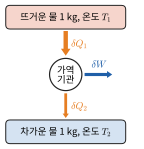

*그림 20.13* 연습문제 15. 온도가 변하는 두 물체 사이에서 작은 가역 기관이 한 번 돌 때마다 뜨거운 물에서 $\delta Q_1$을 받고 차가운 물에 $\delta Q_2$를 버리며 일 $\delta W$를 한다. 두 물체의 온도가 같아지면 멈춘다.

16. (2준위계의 비열과 아인슈타인 고체) (가) 2준위계($0$, $\varepsilon$) $N$개의 평균 에너지가 $\langle E\rangle = \dfrac{N\varepsilon}{e^{\varepsilon/k_BT} + 1}$임을 분배 함수로 유도하고, 비열 $C = d\langle E\rangle/dT$가 $k_BT \approx 0.42\varepsilon$에서 최댓값 약 $0.44Nk_B$를 가짐을 보여라(이 봉우리를 쇼트키 비정상이라 한다). (나) (파이썬) 진동자 $N$개에 에너지 양자 $q$개를 나누는 아인슈타인 고체의 다중도는 $W(N, q) = \dbinom{q + N - 1}{q}$이다. 진동자 300개인 고체 A와 200개인 고체 B가 에너지 양자 100개를 나눠 가질 때, 가장 확률이 큰 $q_A$를 `math.lgamma`로 계산하라. 그 결과가 $\partial S_A/\partial q_A = \partial S_B/\partial q_B$(두 고체의 온도가 같음)와 맞는지 설명하라.

---

## 연습문제 답과 힌트
1. $\Delta S = mL_v/T = (0.500)(2.26\times10^6)/373.15 = 3.03\times10^3\ \text{J/K}$.
2. $\eta = 1 - 300/500 = 0.40$. $W = 400\ \text{J}$, $Q_C = 600\ \text{J}$.
3. $Q_H = W/\eta = 2000\ \text{J}$, $Q_C = 1500\ \text{J}$.
4. $\Delta S = -\dfrac{1000}{400} + \dfrac{1000}{300} = +0.833\ \text{J/K}$.
5. $W = Q_C/K = 50\ \text{J}$, $Q_H = 250\ \text{J}$.
6. $2^{-10} = 1/1024 \approx 9.8\times10^{-4}$. $\binom{10}{5} = 252$.
7. (가) $\frac{3}{2}R\ln2 = 8.64\ \text{J/K}$. (나) $\frac{5}{2}R\ln2 = 14.4\ \text{J/K}$. 압력이 일정하면 부피도 2배가 되어 $R\ln2$가 더해진다. (확인: $C_p = C_V + R$.)
8. $\Delta S = (1.00)(4186)\ln(353.15/293.15) = 779\ \text{J/K}$. 어림값 $(4186)(60)/323.15 = 777\ \text{J/K}$으로 0.3% 이내로 맞는다. 온도 변화가 절대온도에 비해 작으면 $\ln(1 + x) \approx x$이기 때문이다.
9. $1 - 8^{-0.4} = 0.565$. 압축비 10이면 0.602이므로 약 3.7%p 오른다.
10. $T = \dfrac{\varepsilon}{k_B\ln10} = \dfrac{0.050\ \text{eV}}{(8.617\times10^{-5}\ \text{eV/K})(2.303)} = 252\ \text{K}$.
11. $\exp\left[\dfrac{100\,000}{8.314}\left(\dfrac{1}{278.15} - \dfrac{1}{298.15}\right)\right] = e^{2.90} = 18$배. 냉장 보관하면 분해가 약 1/18로 느려진다(이 활성화 에너지에서).
12. $K_{\text{카르노}} = 293.15/20 = 14.7$이므로 $W = 10/14.7 = 0.68\ \text{kW}$. 엔트로피: $\Delta S = Q_H/T_H - Q_C/T_C \ge 0$이고 $Q_C = Q_H - W$를 넣으면 $Q_H/W \le T_H/(T_H - T_C)$.
13. $\ln W(n) = \ln N! - \ln n! - \ln(N - n)!$에 스털링 근사를 쓰고 $n = \frac{N}{2}(1 + u)$, $u = 2x/N$으로 두면 $\ln W \approx N\ln2 - \frac{N}{2}u^2 = N\ln2 - 2x^2/N$. 따라서 $W \propto e^{-2x^2/N} = e^{-x^2/(2\sigma^2)}$, $\sigma^2 = N/4$, $\sigma = \sqrt{N}/2$.
14. $T_f = (T_1 + T_2)/2$. $\Delta S = mc\ln(T_f/T_1) + mc\ln(T_f/T_2) = mc\ln(T_f^2/T_1T_2)$. 산술평균 ≥ 기하평균이므로 $T_f \ge \sqrt{T_1T_2}$이고 $\Delta S \ge 0$. 등호는 $T_1 = T_2$일 때뿐이다. (예: 각각 물 1.00 kg, 100 °C와 0 °C이면 $\Delta S = 101\ \text{J/K}$.)
15. (가) 가역이므로 $\Delta S = mc\ln(T_f/T_1) + mc\ln(T_f/T_2) = 0$에서 $T_f = \sqrt{T_1T_2} = \sqrt{(373.15)(273.15)} = 319.3\ \text{K}$ $(46.1\ °\text{C})$. (나) 에너지 보존에서 $W = mc(T_1 + T_2 - 2T_f) = (4186)(7.78) = 3.26\times10^4\ \text{J}$. (다) 뜨거운 물이 잃은 열은 $mc(T_1 - T_f) = 2.26\times10^5\ \text{J}$이므로 전체 효율은 $14.4\%$로, 처음 온도로 계산한 카르노 효율 $26.8\%$보다 낮다. 온도차가 점점 줄어 각 순간의 카르노 효율이 0을 향해 내려가기 때문이다. (그냥 섞으면 일은 0이고 나중 온도는 50 °C로 더 높다.)
16. (가) $Z = 1 + e^{-\beta\varepsilon}$(입자 하나), $\langle E\rangle = -N\partial\ln Z/\partial\beta = N\varepsilon/(e^{\beta\varepsilon} + 1)$. $x = \varepsilon/k_BT$로 두면 $C/Nk_B = x^2e^x/(e^x + 1)^2$. 미분해 0이 되는 점을 수치로 풀면 $x = 2.40$, 즉 $k_BT = 0.417\varepsilon$에서 $C_{\max} = 0.439Nk_B$. 고온에서는 두 준위가 반씩 차서 더 받을 에너지가 없으므로 $C \to 0$이다. (나) $\ln W_A(q_A) + \ln W_B(100 - q_A)$를 $q_A = 0, \ldots, 100$에 대해 계산하면 최대는 $q_A = 60$이다. 이는 진동자당 에너지 양자가 같은 $q_A/N_A = q_B/N_B = 0.2$에 해당한다. 큰 $q$, $N$에서 $\partial\ln W/\partial q \approx \ln(1 + N/q)$이므로 두 고체의 $\partial S/\partial q$가 같아지는 조건과 일치한다. 계산해 보면 $q_A$ 분포의 표준편차는 약 5.4로, $q_A \le 40$일 확률은 $2\times10^{-4}$ 정도에 불과하다.

---

## 영어 용어 정리
| 한글 | English |
|---|---|
| 가역 과정 / 비가역 과정 | reversible / irreversible process |
| 엔트로피 | entropy |
| 열역학 제2법칙 | second law of thermodynamics |
| 고립계 | isolated system |
| 열기관 / 열효율 | heat engine / thermal efficiency |
| 열저장체 | thermal reservoir |
| 켈빈–플랑크 표현 / 클라우지우스 표현 | Kelvin–Planck statement / Clausius statement |
| 카르노 순환 / 카르노 정리 | Carnot cycle / Carnot's theorem |
| 오토 순환 / 압축비 | Otto cycle / compression ratio |
| 브레이턴 순환 / 랭킨 순환 | Brayton cycle / Rankine cycle |
| 냉동기 / 열펌프 / 성능 계수 | refrigerator / heat pump / coefficient of performance |
| 클라우지우스 부등식 | Clausius inequality |
| 미시 상태 / 거시 상태 / 다중도 | microstate / macrostate / multiplicity |
| 등확률 가정 | postulate of equal a priori probabilities |
| 스털링 근사 | Stirling's approximation |
| 볼츠만 분포 / 분배 함수 | Boltzmann distribution / partition function |
| 2준위계 | two-level system |
| 활성화 에너지 / 아레니우스 식 | activation energy / Arrhenius equation |
| 엔탈피 / 깁스 자유에너지 | enthalpy / Gibbs free energy |
| 헬름홀츠 자유에너지 | Helmholtz free energy |
| 소수성 효과 | hydrophobic effect |
| 섀넌 엔트로피 / 란다우어 원리 | Shannon entropy / Landauer's principle |
| 맥스웰의 도깨비 | Maxwell's demon |
| 홉필드 네트워크 / 볼츠만 머신 | Hopfield network / Boltzmann machine |
| 연상 기억 | associative memory |
| 쇼트키 비정상 / 아인슈타인 고체 | Schottky anomaly / Einstein solid |
