# 25장 전류, 저항, 직류 회로

> 대응 교재: Halliday 12판 26장, 27장 · Young&Freedman 15판 25장, 26장
> 지금까지는 전하가 정지한 정전기학을 다루었다. 이 장에서 처음으로 전하가 **움직인다**. 도체 속에 전기장이 있으면 전하가 흐르고(22장의 "도체 내부 $E = 0$"은 평형일 때만 맞다), 그 흐름을 전류라 한다. 전류를 미시적으로(전자의 표류)와 거시적으로(옴의 법칙, 키르히호프 법칙) 이해하고, 축전기를 충전하고 방전하는 RC 회로로 1장의 1계 미분방정식을 실제 회로에 적용한다.

## 학습 목표
- 전류와 전류밀도를 정의하고, 표류 속도와 전류밀도의 관계 $\vec{J} = nq\vec{v}_d$를 유도할 수 있다.
- 비저항과 저항을 구별하고, 단면이 변하는 도체의 저항을 적분으로 구할 수 있다.
- 드루드 모형으로 옴의 법칙 $\vec{J} = \sigma\vec{E}$를 유도하고 그 한계를 설명할 수 있다.
- 기전력과 내부 저항을 가진 전원의 단자 전압, 일률, 최대 전력 전달 조건을 구할 수 있다.
- 키르히호프의 두 법칙으로 여러 고리 회로를 연립방정식으로 풀 수 있다.
- RC 회로의 충전·방전을 미분방정식으로 풀고, 시간 상수와 에너지 출입을 해석할 수 있다.

## 고등학교 물리와 무엇이 다른가
고등학교에서는 $V = IR$, 직렬·병렬 합성 저항, 소비 전력 $P = VI$를 계산했다. 대학에서는 세 가지가 새롭다. 첫째, 전류를 **벡터장** $\vec{J}$로 다루고 옴의 법칙을 $\vec{J} = \sigma\vec{E}$라는 **국소적인 법칙**으로 쓴다. 저항 $R$은 이것을 도체 전체에 대해 적분한 결과다. 둘째, 옴의 법칙이 왜 성립하는지 전자의 운동으로 설명한다(드루드 모형). 셋째, 축전기가 들어간 회로에서는 전류가 시간에 따라 변하므로 회로 방정식이 **미분방정식**이 된다. 이 장에서 다루는 RC 회로는 28장의 RL 회로, 29장의 RLC 회로로 이어진다.

---

## 25.1 전류와 전류밀도

### 전류
도선의 한 단면을 시간 $dt$ 동안 지나는 알짜 전하가 $dq$일 때 **전류**(electric current)는
$$
I = \frac{dq}{dt}
$$
이다. 단위는 **암페어(ampere)** $\text{A} = \text{C/s}$이며, SI 기본 단위다. 2019년 재정의 이후 암페어는 기본전하 $e = 1.602\,176\,634\times10^{-19}\ \text{C}$를 고정해 정의한다. 즉 $1\ \text{A}$는 1초에 기본전하 $1/e\approx6.24\times10^{18}$개가 지나가는 전류다.

전류의 방향은 **양전하가 움직이는 방향**으로 약속한다. 금속에서 실제로 움직이는 것은 전자이므로 전자는 전류와 반대 방향으로 움직인다. 전류는 부호(도선을 따라 어느 쪽인가)만 있는 스칼라다(1장 💡).

### 전류밀도
도체의 단면을 지나는 전류의 분포를 나타내려면 **전류밀도(current density)** $\vec{J}$(단위 넓이당 전류, $\text{A/m}^2$)가 필요하다. 면 $S$를 지나는 전류는 $\vec{J}$의 선속이다.
$$
I = \int_S\vec{J}\cdot d\vec{A}
$$
전하 $q$를 가진 운반자가 단위 부피당 $n$개 있고 평균 속도 $\vec{v}_d$로 움직인다고 하자. 시간 $dt$ 동안 넓이 $A$인 단면을 지나는 운반자는 길이 $v_d\,dt$인 원기둥 속에 있던 것들(그림 25.1), 즉 $nAv_d\,dt$개이다. 따라서 $I = nqAv_d$이고
$$
\boxed{\vec{J} = nq\vec{v}_d}
$$
이다. $\vec{v}_d$를 **표류 속도**(drift velocity)라 한다. 전자($q = -e$)의 경우 $\vec{v}_d$는 $\vec{J}$와 반대 방향이다.

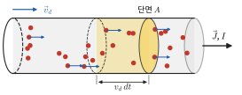

*그림 25.1* 표류 속도 $\vec{v}_d$로 움직이는 운반자(빨강, 양전하로 그렸다). 시간 $dt$ 동안 단면 $A$를 지나는 운반자는 길이 $v_d\,dt$인 원기둥(노랑) 속에 있던 것들이다. 실제 금속에서는 전자가 $\vec{J}$의 반대 방향으로 움직인다.

### 예제 25.1 구리 도선 속 전자의 표류 속도
지름 $2.0\ \text{mm}$인 구리 도선에 $5.0\ \text{A}$가 흐른다. 구리의 전도 전자 밀도는 $n = 8.49\times10^{28}\ \text{m}^{-3}$(원자 하나당 전자 하나)이다. 전류밀도와 표류 속력을 구하라.

**풀이**
$A = \pi(1.0\times10^{-3})^2 = 3.14\times10^{-6}\ \text{m}^2$이므로 $J = I/A = 1.6\times10^6\ \text{A/m}^2$.
$$
v_d = \frac{J}{ne} = \frac{1.59\times10^6}{(8.49\times10^{28})(1.60\times10^{-19})} = 1.2\times10^{-4}\ \text{m/s}
$$
1초에 $0.12\ \text{mm}$, 1 m를 가는 데 2시간 넘게 걸린다. 그런데 스위치를 켜면 전등은 즉시 켜진다. 전자 하나가 스위치에서 전등까지 가는 것이 아니라, 도선 전체에 **전기장이 거의 광속으로 퍼지면서** 도선 속 모든 전자가 동시에 표류하기 시작하기 때문이다. 수도관에 물이 가득 차 있으면 꼭지를 여는 즉시 물이 나오는 것과 비슷하다.

> **★ 심화: 연속 방정식과 도체 속 전하의 소멸**
> 전하는 보존된다. 닫힌 곡면 $S$를 빠져나가는 전류는 안의 전하가 줄어드는 비율과 같다.
> $$\oint_S\vec{J}\cdot d\vec{A} = -\frac{dq_{\text{in}}}{dt}\quad\xrightarrow{\text{발산 정리}}\quad\nabla\cdot\vec{J} + \frac{\partial\rho}{\partial t} = 0$$
> 이것이 **연속 방정식**(continuity equation)이다. 14장 유체의 연속 방정식과 같은 꼴이다. 정상 전류($\partial\rho/\partial t = 0$)에서는 $\nabla\cdot\vec{J} = 0$이고, 이것이 아래 키르히호프 접합 법칙의 미분형이다.
> 도체 내부에 전하 밀도 $\rho$가 생겼다고 하자. 옴의 법칙 $\vec{J} = \sigma\vec{E}$와 가우스 법칙 $\nabla\cdot\vec{E} = \rho/\varepsilon_0$를 연속 방정식에 넣으면
> $$\frac{\partial\rho}{\partial t} = -\frac{\sigma}{\varepsilon_0}\rho\quad\Longrightarrow\quad\rho(t) = \rho_0e^{-t/\tau_r},\qquad\tau_r = \frac{\varepsilon_0}{\sigma}$$
> 이다. 내부 전하는 지수적으로 사라져 표면으로 간다(22장의 "전하는 표면에만"). 구리에서 $\tau_r = \varepsilon_0\rho\approx1.5\times10^{-19}\ \text{s}$이다. 사실 이 값은 25.3절의 충돌 시간($\sim10^{-14}\ \text{s}$)보다 훨씬 짧아서, 그런 짧은 시간에는 옴의 법칙 자체가 맞지 않는다. 실제로는 전하가 충돌 시간 정도에 걸쳐 진동하며 사라진다. 어느 쪽이든 금속이 정전기 평형에 이르는 시간은 일상의 척도에서 순간이다. 반면 비저항이 큰 절연체에서는 $\tau_r$이 몇 초에서 몇 시간까지 길어진다(연습문제 7).

---

## 25.2 저항과 옴의 법칙

### 비저항과 전도도
대부분의 도체에서, 일정한 온도라면 전류밀도는 전기장에 비례한다.
$$
\boxed{\vec{E} = \rho\vec{J}\quad\text{또는}\quad\vec{J} = \sigma\vec{E}}
$$
$\rho$(단위 $\Omega\cdot\text{m}$)를 **비저항(resistivity)**, $\sigma = 1/\rho$를 **전도도**(conductivity)라 한다. 비저항은 물질의 성질이다. 구리는 $1.69\times10^{-8}\ \Omega\cdot\text{m}$, 유리는 $10^{10}\sim10^{14}\ \Omega\cdot\text{m}$ 정도로 물질에 따라 20자리 이상 차이 난다. 이렇게 넓은 범위에 걸친 물리량은 드물다.

### 저항
길이 $L$, 단면적 $A$인 균일한 도선(그림 25.2)의 양끝에 전위차 $V$를 걸면, 도선 속 장은 $E = V/L$이고 전류는 $I = JA = \sigma EA$이다. 따라서
$$
V = \left(\frac{\rho L}{A}\right)I\quad\Longrightarrow\quad \boxed{R = \frac{V}{I} = \frac{\rho L}{A}}
$$
$R$을 **저항**(resistance)이라 하며 단위는 **옴(ohm)** $\Omega = \text{V/A}$이다. 저항은 물체의 성질이다(모양과 물질에 의존). 단면이 변하면 얇은 조각의 직렬로 보고 적분한다.
$$
R = \int\frac{\rho\,d\ell}{A(\ell)}
$$

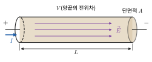

*그림 25.2* 길이 $L$, 단면적 $A$인 도선의 양끝에 전위차 $V$를 걸면 도선 속에 균일한 장 $E = V/L$이 생기고, 전류 $I = \sigma EA$가 흐른다.

**옴의 법칙**(Ohm's law)은 "$R$이 $V$나 $I$에 무관하게 일정하다"는 진술이다. $V = IR$은 저항의 정의일 뿐이고, 옴의 법칙은 그 $R$이 상수라는 **물질의 경험적 성질**이다.

> **💡 개념 확인: 옴의 법칙은 자연법칙이 아니다**
> 쿨롱 법칙이나 에너지 보존과 달리, 옴의 법칙은 많은 물질(금속, 전해질)이 근사적으로 따르는 성질일 뿐이다. 다이오드는 한쪽 방향으로만 전류를 잘 흘리고(39장), 백열전구의 필라멘트는 뜨거워질수록 저항이 커져 $I$–$V$ 그래프가 직선이 아니다(그림 25.3). 이런 소자를 **비옴성(non-ohmic)** 소자라 한다. 이들에서도 $R = V/I$는 정의할 수 있지만 상수가 아니다.
>
> 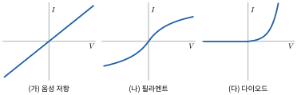
>
> *그림 25.3* (가) 옴성 저항: 원점을 지나는 직선. (나) 백열전구 필라멘트: 전류가 클수록 뜨거워져 $V/I$가 커진다. (다) 다이오드: 한쪽 방향으로만 전류가 잘 흐른다(정성적인 모양).

### 온도 의존성
금속의 비저항은 온도에 따라 거의 선형으로 증가한다.
$$
\rho(T)\approx\rho_0\left[1 + \alpha(T - T_0)\right]
$$
$\alpha$를 **비저항의 온도 계수**라 한다(구리 $4.3\times10^{-3}\ \text{K}^{-1}$). 온도가 올라가면 격자 진동이 커져 전자가 더 자주 산란되기 때문이다(25.3절). 반도체는 반대로 온도가 올라가면 전도 전자가 늘어나 비저항이 줄어든다(39장).

### 예제 25.2 동심 원통 사이의 지름 방향 저항
안 반지름 $a$, 바깥 반지름 $b$, 길이 $L$인 두 동심 도체 원통 사이가 비저항 $\rho$인 물질로 채워져 있다. 두 원통 사이에 지름 방향으로 흐르는 전류에 대한 저항을 구하라(그림 25.4).

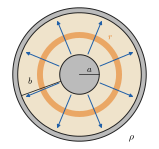

*그림 25.4* 예제 25.2의 단면. 전류(파랑)는 안쪽 원통에서 바깥 원통으로 지름 방향으로 흐르고, 반지름 $r$, 두께 $dr$인 원통 껍질(주황)들이 직렬로 쌓인 것으로 본다.

**풀이**
전류는 지름 방향으로 흐르고, 반지름 $r$에서 전류가 지나는 넓이는 $A(r) = 2\pi rL$이다. 두께 $dr$인 원통 껍질을 직렬로 쌓는다.
$$
R = \int_a^b\frac{\rho\,dr}{2\pi rL} = \frac{\rho}{2\pi L}\ln\frac{b}{a}
$$
동축 케이블 절연체를 통해 새는 **누설 저항**, 땅에 박은 접지봉의 접지 저항 같은 문제가 이 꼴이다. 24장의 동축 축전기 $C = 2\pi\kappa\varepsilon_0L/\ln(b/a)$와 곱하면 $RC = \rho\kappa\varepsilon_0$로 **모양에 무관**하다(연습문제 7). 이것은 우연이 아니다. 같은 전극 배치에서 $C$와 $1/R$은 모두 "같은 장의 선속 대 전위차"의 비이기 때문이다.

### 예제 25.3 백금 저항 온도계
산업용 백금 저항 온도계(Pt100)는 $0\ °\text{C}$에서 $R_0 = 100.0\ \Omega$이고 평균 온도 계수가 $\alpha = 3.85\times10^{-3}\ \text{K}^{-1}$이다. 저항이 $138.5\ \Omega$으로 측정되었다면 온도는?

**풀이**
$R = R_0[1 + \alpha T]$에서
$$
T = \frac{R/R_0 - 1}{\alpha} = \frac{0.385}{3.85\times10^{-3}} = 100\ °\text{C}
$$
금속 저항의 온도 의존성은 정밀한 온도 측정에 쓰인다. 실험실 항온조, 공정 제어, 의약품 보관 냉장고의 온도 기록 장치 등에 이런 측온 저항체가 들어간다. 정밀한 측정에서는 선형 근사 대신 2차 항까지 포함한 표준 식을 쓴다.

---

## 25.3 미시적 전도 모형

### 드루드 모형
금속 속의 전도 전자는 매우 빠르게 무질서하게 움직이며 격자의 불완전한 부분(진동하는 이온, 불순물)과 계속 충돌한다. 전기장이 없으면 무질서한 속도의 평균은 0이다. 장 $\vec{E}$를 걸면 충돌과 충돌 사이에 전자는 가속도 $\vec{a} = -e\vec{E}/m$으로 가속된다. **드루드 모형**(Drude model)은 다음 두 가지를 가정한다.
1. 충돌 직후 전자의 속도는 무작위 방향이다(장에 의해 얻은 속도를 잃는다).
2. 충돌 사이의 평균 시간은 $\tau$(**평균 자유 시간**)이다.

그러면 전자들의 평균 속도, 즉 표류 속도는 "가속도 × 마지막 충돌 이후 평균 시간"이다.
$$
\vec{v}_d = -\frac{e\vec{E}}{m}\tau\quad\Longrightarrow\quad\vec{J} = -ne\vec{v}_d = \frac{ne^2\tau}{m}\vec{E}
$$
$$
\boxed{\sigma = \frac{ne^2\tau}{m},\qquad\rho = \frac{m}{ne^2\tau}}
$$
$\vec{J}$가 $\vec{E}$에 비례한다. **옴의 법칙이 유도되었다.** 핵심은 $\tau$가 장에 무관하다는 점이다. 전자의 무질서한 속력이 표류 속도보다 엄청나게 크기 때문에(아래 예제), 장을 걸어도 충돌 사이의 시간은 거의 바뀌지 않는다.

이 모형은 평균 운동방정식 $m\dfrac{d\vec{v}_d}{dt} = -e\vec{E} - \dfrac{m\vec{v}_d}{\tau}$로 쓸 수도 있다. 충돌을 속도에 비례하는 "마찰"로 본 것이다. 정상 상태($d\vec{v}_d/dt = 0$)에서 위와 같은 결과가 나온다. 6장의 종단 속도와 같은 구조다. 그림 25.5는 이 운동을 과장해 그린 것이다.

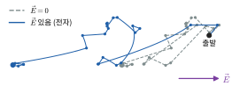

*그림 25.5* 같은 충돌 순서에 대해 장이 없을 때(회색 점선)와 장이 있을 때(파랑)의 전자 경로. 점은 충돌 위치다. 충돌 사이에 전자는 $-e\vec{E}/m$로 가속되어 포물선을 그리므로, 전체적으로 $\vec{E}$의 반대쪽으로 표류한다. 실제 표류는 무질서한 운동에 비해 훨씬 작다(예제 25.4).

### 예제 25.4 구리의 평균 자유 시간과 평균 자유 경로
구리($\rho = 1.69\times10^{-8}\ \Omega\cdot\text{m}$, $n = 8.49\times10^{28}\ \text{m}^{-3}$)에서 평균 자유 시간을 구하라. 전자의 무질서한 속력을 (가) 고전적 열속력 $\sqrt{3k_BT/m}$($300\ \text{K}$), (나) 양자역학이 주는 페르미 속력 $v_F = 1.57\times10^6\ \text{m/s}$로 잡고 평균 자유 경로를 각각 구하라.

**풀이**
$$
\tau = \frac{m}{ne^2\rho} = \frac{9.11\times10^{-31}}{(8.49\times10^{28})(1.60\times10^{-19})^2(1.69\times10^{-8})} = 2.5\times10^{-14}\ \text{s}
$$
(가) $v_{\text{th}} = \sqrt{3k_BT/m_e} = 1.17\times10^5\ \text{m/s}$, $\lambda = v_{\text{th}}\tau = 2.9\ \text{nm}$.
(나) $\lambda = v_F\tau = 3.9\times10^{-8}\ \text{m} = 39\ \text{nm}$.

구리 원자 사이의 거리는 약 $0.26\ \text{nm}$이므로, 어느 쪽이든 전자는 원자 십여~백여 개를 지나쳐야 한 번 충돌한다. 고전적인 그림(전자가 이온과 당구공처럼 부딪친다)으로는 이렇게 긴 경로를 이해할 수 없다. 양자역학에서는 완벽하게 주기적인 격자 속의 전자파는 산란되지 않고, **격자의 불규칙성**(열진동, 불순물, 결함)만이 산란을 일으킨다(39장). 또 금속 전자의 속력은 온도와 거의 무관한 페르미 속력이다. 고전 모형에서는 평균 자유 경로가 일정하다면 $v_{\text{th}}\propto\sqrt{T}$ 때문에 $\tau\propto1/\sqrt{T}$, $\rho\propto\sqrt{T}$를 예측하지만, 실제 금속은 상온 근처에서 $\rho\propto T$에 가깝다. 드루드 모형은 옴의 법칙의 **구조**를 잘 설명하지만, $\tau$의 크기와 온도 의존성을 제대로 설명하려면 양자역학이 필요하다.

또 표류 속력 $10^{-4}\ \text{m/s}$(예제 25.1)는 무질서한 속력 $10^6\ \text{m/s}$의 100억분의 1이다. 장이 전자의 운동을 아주 조금 "기울일" 뿐이라는 뜻이고, $\tau$가 장에 무관하다는 가정이 잘 맞는 이유다.

---

## 25.4 기전력과 일률

### 기전력
도선 속에서 전하는 전위가 낮아지는 방향으로 흐르며 에너지를 잃는다. 전류가 계속 흐르려면 전하를 전위가 낮은 곳에서 높은 곳으로 다시 "퍼 올리는" 장치가 필요하다. 이것이 **기전력원**(source of emf)이다. 전지(화학 반응), 발전기(전자기 유도, 28장), 태양전지(광전 효과, 39장)가 예다. 단위 전하를 퍼 올리는 데 하는 일을 **기전력(electromotive force, emf)** $\mathcal{E}$라 한다. 이름과 달리 힘이 아니라 단위가 볼트인 양이다.
$$
\mathcal{E} = \frac{dW}{dq}
$$

### 내부 저항과 단자 전압
실제 전원은 내부에도 저항 $r$이 있다. 외부 저항 $R$을 연결하면(그림 25.6) 회로를 한 바퀴 돌 때 에너지 보존에서 $\mathcal{E} - Ir - IR = 0$이므로
$$
I = \frac{\mathcal{E}}{R + r}, \qquad V_{\text{단자}} = \mathcal{E} - Ir
$$
전류가 클수록 단자 전압이 떨어진다. 자동차 시동을 걸 때(큰 전류) 전조등이 잠깐 어두워지는 이유다.

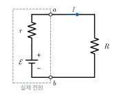

*그림 25.6* 실제 전원(점선 상자)은 기전력 $\mathcal{E}$와 내부 저항 $r$의 직렬로 나타낸다. 단자 $a$, $b$ 사이의 전압은 $V_{\text{단자}} = \mathcal{E} - Ir$이다.

### 일률
전위차 $V$를 지나 전하 $dq$가 이동하면 에너지 $V\,dq$가 전달되므로, 일률은
$$
P = \frac{dW}{dt} = IV
$$
이다. 저항에서는 이 에너지가 열로 바뀌며(**줄 열, Joule heating**), $V = IR$을 쓰면
$$
P = I^2R = \frac{V^2}{R}
$$
이다. 미시적으로는 단위 부피당 일률 $\vec{J}\cdot\vec{E} = \sigma E^2$이다. 전기장이 전자를 가속해 준 에너지가 충돌로 격자에 넘어가 격자 진동(열)이 된다.

### 최대 전력 전달
내부 저항 $r$인 전원에서 외부 저항 $R$로 전달되는 일률은
$$
P(R) = I^2R = \frac{\mathcal{E}^2R}{(R + r)^2}
$$
이다. $dP/dR = \mathcal{E}^2\dfrac{(R + r) - 2R}{(R + r)^3} = 0$에서 $R = r$일 때 최대이며, $P_{\max} = \mathcal{E}^2/4r$이다. 이때 효율 $R/(R + r)$은 50%에 불과하다. 신호를 최대한 크게 받아야 하는 통신·오디오 회로에서는 $R = r$로 **임피던스 정합**(impedance matching)을 하지만, 효율이 중요한 전력 계통에서는 $R\gg r$로 설계한다.

> **🔬 최신 연구 노트: 리튬이온 배터리**
> 스마트폰, 노트북, 전기차의 **리튬이온 배터리**(lithium-ion battery)는 충전할 때 리튬 이온이 양극(리튬 금속 산화물)에서 빠져나와 전해질을 지나 음극(주로 흑연)의 층 사이에 끼어들고, 방전할 때 반대로 움직인다. 이온이 전해질 속을 이동하는 동안 전자는 외부 회로를 돌며 일을 한다. 셀 하나의 공칭 전압은 대략 $3.6\sim3.7\ \text{V}$로, 같은 무게의 이전 세대 이차전지보다 에너지 밀도가 높다. 리튬이온 배터리의 개발은 2019년 노벨 화학상(Goodenough, Whittingham, Yoshino)으로 인정받았다.
> 이 장의 개념으로 보면 배터리는 "기전력 $\mathcal{E}$ + 내부 저항 $r$"이다.
> - 용량은 흔히 mAh로 표시한다. $1\ \text{mAh} = 10^{-3}\ \text{A}\times3600\ \text{s} = 3.6\ \text{C}$이다. 에너지는 $Q\mathcal{E}$이므로 $4000\ \text{mAh}$, $3.7\ \text{V}$ 셀은 약 $53\ \text{kJ}$($14.8\ \text{Wh}$)를 저장한다(연습문제 12).
> - 내부 저항에서 나는 열 $I^2r$ 때문에 급속 충전·방전 때 배터리가 뜨거워진다. 온도가 지나치게 올라가면 내부 반응이 열을 더 내는 악순환(열 폭주)이 일어날 수 있어, 배터리 관리 시스템이 셀마다 전압·전류·온도를 감시한다.
> - 충방전을 반복하면 전극 표면의 피막 성장 등으로 내부 저항이 커지고 용량이 줄어든다. 오래 쓴 휴대폰이 큰 전류가 필요할 때 갑자기 꺼지는 것은 $V_{\text{단자}} = \mathcal{E} - Ir$이 기기의 최소 작동 전압 아래로 떨어지기 때문이다.
>
> 더 안전하고 에너지 밀도가 높은 전고체 전해질, 리튬보다 흔한 원소를 쓰는 나트륨이온 전지 등이 활발히 연구되고 있다. 24장의 슈퍼커패시터와 비교해 보라.

### 예제 25.5 전지의 최대 출력
기전력 $12\ \text{V}$, 내부 저항 $2.0\ \Omega$인 전원에 외부 저항 $R$을 연결한다. (가) $R = 4.0\ \Omega$일 때 전류, 단자 전압, 외부 저항의 일률, 효율을 구하라. (나) 외부 일률이 최대인 $R$과 그때의 일률은?

**풀이**
(가) $I = 12/(4.0 + 2.0) = 2.0\ \text{A}$, $V_{\text{단자}} = 12 - (2.0)(2.0) = 8.0\ \text{V}$, $P = I^2R = 16\ \text{W}$. 전원이 내는 일률 $\mathcal{E}I = 24\ \text{W}$ 중 $8.0\ \text{W}$는 내부 저항에서 열이 되므로 효율은 $16/24 = 67\%$.
(나) $R = r = 2.0\ \Omega$에서 $P_{\max} = 12^2/(4\times2.0) = 18\ \text{W}$, 효율 50%. $R = 4.0\ \Omega$은 일률은 조금 작지만 효율이 더 높다(그림 25.7).

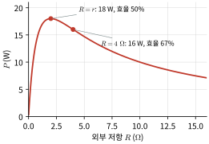

*그림 25.7* 예제 25.5($\mathcal{E} = 12\ \text{V}$, $r = 2.0\ \Omega$)에서 외부 저항에 전달되는 일률 $P(R) = \mathcal{E}^2R/(R + r)^2$. $R = r$에서 최대이고, $R$이 더 크면 일률은 조금 줄지만 효율이 올라간다.

---

## 25.5 키르히호프 법칙

### 두 법칙
복잡한 회로는 두 가지 보존 법칙으로 푼다.
1. **접합 법칙(junction rule)**: 회로의 한 접합점으로 들어오는 전류의 합은 나가는 전류의 합과 같다. $\sum I_{\text{in}} = \sum I_{\text{out}}$. 정상 상태에서 접합점에 전하가 쌓이지 않는다는 **전하 보존**이다(★ 연속 방정식).
2. **고리 법칙(loop rule)**: 회로의 닫힌 고리를 한 바퀴 돌 때 전위 변화의 합은 0이다. $\sum\Delta V = 0$. 정전기장의 $\oint\vec{E}\cdot d\vec{\ell} = 0$, 즉 **에너지 보존**이다.

고리 법칙을 쓸 때의 부호 규칙:
- 저항을 전류 방향으로 지나면 $-IR$, 반대 방향으로 지나면 $+IR$.
- 기전력원을 $-$극에서 $+$극으로 지나면 $+\mathcal{E}$, 반대이면 $-\mathcal{E}$.

전류의 방향은 처음에 마음대로 정한다. 답이 음수로 나오면 실제 방향이 반대라는 뜻일 뿐이다.

### 직렬과 병렬
- **직렬**: 같은 전류, 전압이 더해진다. $R_{\text{eq}} = R_1 + R_2 + \cdots$
- **병렬**: 같은 전압, 전류가 더해진다. $\dfrac{1}{R_{\text{eq}}} = \dfrac{1}{R_1} + \dfrac{1}{R_2} + \cdots$

24장 축전기와 반대다(24장 💡).

### 예제 25.6 두 고리 회로
그림 25.8처럼 위아래 두 접합점 사이에 세 갈래가 병렬로 있다. 왼쪽 갈래에는 $\mathcal{E}_1 = 12\ \text{V}$와 $R_1 = 2.0\ \Omega$, 가운데 갈래에는 $R_3 = 6.0\ \Omega$, 오른쪽 갈래에는 $\mathcal{E}_2 = 6.0\ \text{V}$와 $R_2 = 4.0\ \Omega$이 있다. 두 전지 모두 $+$극이 위쪽 접합점을 향한다. 각 갈래의 전류와 각 소자의 일률을 구하라.

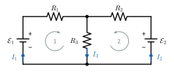

*그림 25.8* 예제 25.6의 회로($\mathcal{E}_1 = 12\ \text{V}$, $\mathcal{E}_2 = 6.0\ \text{V}$, $R_1 = 2.0\ \Omega$, $R_2 = 4.0\ \Omega$, $R_3 = 6.0\ \Omega$). 파란 화살표는 처음에 정한 전류의 방향, 회색 원호는 고리 법칙을 쓸 때 도는 방향이다.

**풀이**
왼쪽 갈래에서 위로 흐르는 전류를 $I_1$, 오른쪽 갈래에서 위로 흐르는 전류를 $I_2$라 하면, 위쪽 접합점에서 가운데 갈래로 내려가는 전류는 접합 법칙에 의해 $I_3 = I_1 + I_2$이다. 왼쪽 고리와 오른쪽 고리에 고리 법칙을 쓴다.
$$
\mathcal{E}_1 - I_1R_1 - I_3R_3 = 0 \;\Rightarrow\; 8I_1 + 6I_2 = 12, \qquad \mathcal{E}_2 - I_2R_2 - I_3R_3 = 0 \;\Rightarrow\; 6I_1 + 10I_2 = 6
$$
연립하면 $I_1 = 21/11 = 1.91\ \text{A}$, $I_2 = -6/11 = -0.545\ \text{A}$, $I_3 = 15/11 = 1.36\ \text{A}$이다.
$I_2$가 음수이므로 오른쪽 갈래의 실제 전류는 **아래로** 흐른다. 즉 전지 2는 $+$극으로 전류가 들어가 **충전되고** 있다.
- 전지 1이 내는 일률: $\mathcal{E}_1I_1 = 22.9\ \text{W}$
- 전지 2가 받는 일률: $\mathcal{E}_2|I_2| = 3.27\ \text{W}$
- 저항의 열: $I_1^2R_1 + I_2^2R_2 + I_3^2R_3 = 7.29 + 1.19 + 11.16 = 19.6\ \text{W}$

$22.9 = 3.27 + 19.6$으로 에너지가 보존된다. 갈래 수가 많아지면 미지수가 늘어날 뿐 방법은 같다. 연립방정식은 행렬로 쓰고 `numpy.linalg.solve`로 풀면 편하다.

### 전류계와 전압계
- **전류계**(ammeter)는 측정할 갈래에 **직렬**로 넣는다(그림 25.9). 회로를 방해하지 않으려면 내부 저항이 아주 **작아야** 한다.
- **전압계**(voltmeter)는 측정할 두 점에 **병렬**로 댄다. 전류를 거의 빼앗지 않으려면 내부 저항이 아주 **커야** 한다(연습문제 13).

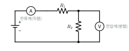

*그림 25.9* 전류계(A)는 $R_1$, $R_2$에 흐르는 전류를 재기 위해 직렬로, 전압계(V)는 $R_2$ 양단의 전압을 재기 위해 병렬로 연결한다.

### 휘트스톤 브리지
네 저항 $R_1, R_2, R_3, R_4$로 마름모를 만들고, 한 대각선에 전원을, 다른 대각선에 검류계를 연결한 회로가 **휘트스톤 브리지**(Wheatstone bridge)다(그림 25.10). 위쪽 꼭짓점 $A$와 아래쪽 꼭짓점 $B$ 사이에 전원이 있고, 왼쪽 갈래 $A$–$R_1$–$C$–$R_2$–$B$와 오른쪽 갈래 $A$–$R_3$–$D$–$R_4$–$B$의 중간점 $C$, $D$ 사이에 검류계가 있다. 검류계 전류가 0인 **평형 조건**은 $V_C = V_D$, 즉 두 갈래가 전압을 같은 비율로 나누는 것이다.
$$
\frac{R_2}{R_1 + R_2} = \frac{R_4}{R_3 + R_4}\quad\Longleftrightarrow\quad\frac{R_1}{R_2} = \frac{R_3}{R_4}
$$
세 저항을 알면 나머지 하나를 정밀하게 잴 수 있다. 평형점에서는 전류가 0이므로 검류계의 내부 저항이나 전원의 변동이 결과에 영향을 주지 않는다.

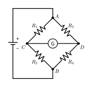

*그림 25.10* 휘트스톤 브리지. 전원은 $A$와 $B$ 사이에, 검류계(G)는 $C$와 $D$ 사이에 있다. $R_1/R_2 = R_3/R_4$이면 $V_C = V_D$가 되어 검류계에 전류가 흐르지 않는다.

### 예제 25.7 스트레인 게이지와 휘트스톤 브리지
금속박 **스트레인 게이지**(strain gauge)를 구조물에 붙이면, 구조물이 변형률 $\varepsilon$만큼 늘어날 때 게이지의 저항이 $\Delta R/R = G\varepsilon$만큼 변한다($G$는 게이지 계수). $G = 2.0$, $R = 350\ \Omega$인 게이지를 휘트스톤 브리지의 한 변에 넣고, 나머지 세 변은 모두 $350\ \Omega$으로 한다. 공급 전압 $5.0\ \text{V}$일 때, 변형률 $5.0\times10^{-4}$에 대한 브리지 출력 전압은?

**풀이**
$\Delta R = G\varepsilon R = (2.0)(5.0\times10^{-4})(350) = 0.35\ \Omega$. 게이지가 $R_1$ 자리에 있으면 $V_C = V\dfrac{R}{2R + \Delta R}$, $V_D = V/2$이므로
$$
V_{\text{out}} = |V_C - V_D| = V\frac{\Delta R}{2(2R + \Delta R)}\approx\frac{V}{4}\frac{\Delta R}{R} = \frac{5.0}{4}(1.0\times10^{-3}) = 1.25\ \text{mV}
$$
(근사 없이 계산하면 $1.249\ \text{mV}$.) 밀리볼트 신호를 증폭해 읽는다. 저항이 0.1% 변하는 것을 직접 재기는 어렵지만, 브리지는 "변화분"만 출력으로 내놓는다.

> **🔗 전공 연결: 스트레인 게이지와 실험 응력 해석(기계공학)**
> 12장에서 배운 응력과 변형률을 실제 구조물에서 재는 가장 흔한 방법이 위 예제의 스트레인 게이지다. 게이지 계수 $G\approx2$의 대부분은 도선이 늘어나며 길어지고 가늘어지는 기하학적 효과($R = \rho L/A$에서 $L$ 증가, $A$ 감소)에서 온다. 늘어난 길이 비율이 $\varepsilon$이고 푸아송 비가 $\nu$이면 $\Delta R/R\approx(1 + 2\nu)\varepsilon + \Delta\rho/\rho$이고, 금속의 $\nu\approx0.3$이면 기하학적 기여만 $1.6$이다. 게이지 자체의 온도 변화도 저항을 바꾸므로, 실제로는 브리지의 다른 변에 같은 게이지를 붙여 온도 효과를 상쇄한다(하프·풀 브리지). 하중계(로드셀), 압력 센서, 토크 센서가 모두 이 원리다. 기계공학과의 고체역학 실험과 계측공학에서 직접 다룬다.

---

## 25.6 RC 회로

### 충전
처음에 충전되지 않은 축전기 $C$를 저항 $R$을 통해 기전력 $\mathcal{E}$에 연결한다($t = 0$, 그림 25.11). 시각 $t$에서 축전기의 전하가 $q$, 전류가 $I = dq/dt$이면 고리 법칙에서
$$
\mathcal{E} - IR - \frac{q}{C} = 0\quad\Longrightarrow\quad R\frac{dq}{dt} = \mathcal{E} - \frac{q}{C}
$$
이다. 1장 1.6절 (2)의 꼴(종단 속도와 같은 방정식)이다. 변수분리하면
$$
\int_0^q\frac{dq'}{C\mathcal{E} - q'} = \int_0^t\frac{dt'}{RC}\quad\Longrightarrow\quad\boxed{q(t) = C\mathcal{E}\left(1 - e^{-t/RC}\right),\qquad I(t) = \frac{\mathcal{E}}{R}e^{-t/RC}}
$$
이다. $\tau = RC$를 **시간 상수**(time constant)라 한다($\Omega\cdot\text{F} = \text{s}$). $t = \tau$에서 축전기는 최종 전하의 $1 - 1/e = 63.2\%$까지 충전되고, $5\tau$ 후에는 99.3%이다(그림 25.12).
- $t = 0$ 직후: 축전기는 전압이 0이므로 **도선처럼** 행동한다. $I = \mathcal{E}/R$.
- $t\to\infty$: 전류가 0이 되어 축전기는 **끊어진 회로처럼** 행동한다.

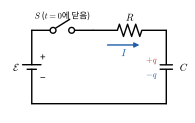

*그림 25.11* RC 충전 회로. $t = 0$에 스위치 $S$를 닫는다. 축전기의 전하 $q$와 전류 $I = dq/dt$의 방향을 그림처럼 잡으면 고리 법칙은 $\mathcal{E} - IR - q/C = 0$이다.

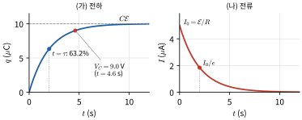

*그림 25.12* 예제 25.8($R = 2.0\ \text{M}\Omega$, $C = 1.0\ \mu\text{F}$, $\mathcal{E} = 10\ \text{V}$, $\tau = 2.0\ \text{s}$)의 (가) 전하와 (나) 전류. $t = \tau$에서 전하는 최종값의 63.2%, 전류는 처음 값의 $1/e$이다. 축전기 전압이 $9.0\ \text{V}$가 되는 때는 $t = \tau\ln10 = 4.6\ \text{s}$이다.

### 방전
전하 $Q_0$로 충전된 축전기를 저항 $R$에 연결하면 $-IR - q/C = 0$, $I = dq/dt$이므로
$$
\frac{dq}{dt} = -\frac{q}{RC}\quad\Longrightarrow\quad q(t) = Q_0e^{-t/RC}, \qquad I(t) = -\frac{Q_0}{RC}e^{-t/RC}
$$
이다. 방사성 붕괴, 약물의 1구획 제거와 같은 지수 감쇠다. 반감기는 $\tau\ln2$이다.

### 충전의 에너지 출입
충전하는 동안 전지가 한 일은 $W = \mathcal{E}\int I\,dt = \mathcal{E}\cdot C\mathcal{E} = C\mathcal{E}^2$이다. 축전기에 저장된 에너지는 $\frac{1}{2}C\mathcal{E}^2$이다. 저항에서 난 열은
$$
\int_0^\infty I^2R\,dt = \frac{\mathcal{E}^2}{R}\int_0^\infty e^{-2t/RC}dt = \frac{\mathcal{E}^2}{R}\cdot\frac{RC}{2} = \frac{1}{2}C\mathcal{E}^2
$$
이다. **전지가 한 일의 정확히 절반이 열로 사라진다. 그 비율은 $R$에 무관하다.** 저항이 작으면 큰 전류가 짧게, 크면 작은 전류가 길게 흘러 같은 열이 난다. 24장 예제 24.4의 손실과 같은 성질이다. 연습문제 16에서 이 손실을 줄이는 방법을 생각한다.

### 예제 25.8 RC 회로의 시간 상수
$R = 2.0\ \text{M}\Omega$, $C = 1.0\ \mu\text{F}$인 직렬 회로를 $t = 0$에 $10\ \text{V}$ 전지에 연결했다. (가) 시간 상수와 처음 전류, (나) 축전기 전압이 $9.0\ \text{V}$가 되는 시각, (다) 충전이 끝날 때까지 저항에서 나는 열을 구하라.

**풀이**
(가) $\tau = RC = 2.0\ \text{s}$, $I_0 = \mathcal{E}/R = 5.0\ \mu\text{A}$.
(나) $1 - e^{-t/\tau} = 0.90$에서 $t = \tau\ln10 = 4.6\ \text{s}$(그림 25.12).
(다) $\frac{1}{2}C\mathcal{E}^2 = \frac{1}{2}(1.0\times10^{-6})(10)^2 = 50\ \mu\text{J}$.

> **🐍 파이썬 실습: RC 회로의 충전과 에너지 수지**
> 예제 25.8의 회로를 오일러 방법으로 풀고 정확한 해와 비교한다. 전지가 한 일, 저항의 열, 축전기 에너지를 수치 적분으로 계산해 에너지 보존을 확인한다.
> ```python
> import numpy as np
> import matplotlib.pyplot as plt
>
> emf, R, C = 10.0, 2.0e6, 1.0e-6          # 기전력(V), 저항(Ω), 전기용량(F)
> tau = R*C                                # 시간 상수 2.0 s
> dt = 1e-4
> t = np.arange(0, 10*tau, dt)
> q = np.zeros_like(t)                     # 충전: dq/dt = (emf - q/C)/R
> for i in range(len(t) - 1):
>     q[i+1] = q[i] + (emf - q[i]/C)/R*dt  # 오일러 방법
> I = (emf - q/C)/R                        # 전류
>
> exact = C*emf*(1 - np.exp(-t/tau))
> print("t = τ 에서 q/Cε :", round(q[int(tau/dt)]/(C*emf), 4), "(정확한 값 1 - 1/e = 0.6321)")
> print("최대 상대 오차  :", f"{np.abs(q - exact).max()/(C*emf):.1e}")
>
> W_batt = np.sum(emf*I)*dt                # 전지가 한 일
> heat   = np.sum(I**2*R)*dt               # 저항에서 난 열
> U_C    = q[-1]**2/(2*C)                  # 축전기에 저장된 에너지
> print(f"전지의 일 {W_batt*1e6:.1f} μJ = 열 {heat*1e6:.1f} μJ + 저장 {U_C*1e6:.1f} μJ")
>
> plt.plot(t, q/(C*emf), label="q/(C emf)"); plt.plot(t, I*R/emf, label="I R/emf")
> plt.xlabel("t (s)"); plt.legend(); plt.show()
> ```
> 실행 결과: $t = \tau$에서 `0.6321`, 최대 상대 오차 `9.2e-06`, 그리고 `전지의 일 100.0 μJ = 열 50.0 μJ + 저장 50.0 μJ`. 정확히 절반이 열이 된다. `R`을 바꾸어 실행해 보라. 시간 척도는 바뀌지만 에너지의 분배는 그대로다(`t`의 범위가 `10*tau`로 함께 바뀐다).

> **🔗 전공 연결: 제세동기와 RC 방전(수의학·약학)**
> 심실세동처럼 심장 근육의 전기 활동이 무질서해지면, 짧고 강한 전류를 심장에 흘려 모든 근육 세포를 한꺼번에 탈분극시킨 뒤 정상 리듬이 돌아오기를 기다린다. **제세동기**(defibrillator)는 축전기에 에너지를 저장했다가 몸을 통해 방전하는 RC 회로다. 예를 들어 $100\ \mu\text{F}$를 $2.0\ \text{kV}$로 충전하면 저장 에너지는 $\frac{1}{2}CV^2 = 200\ \text{J}$이고, 몸의 저항을 $50\ \Omega$으로 가정하면 시간 상수는 $RC = 5\ \text{ms}$, 처음 전류는 $V/R = 40\ \text{A}$이다(실제 장치는 인덕터를 넣거나 극성을 바꾸어 파형을 조절한다). 동물병원의 응급 소생술에서도 같은 장치를 쓰며, 체구가 작은 개·고양이는 체중에 맞추어 에너지를 낮게 설정한다. 거꾸로 신경 세포막은 막 저항과 막 전기용량이 병렬로 연결된 RC 회로이며(24장 🔗), 그 시간 상수가 신경이 자극에 반응하는 빠르기를 정한다.

---

## 핵심 정리

| 개념 | 핵심 식 | 비고 |
|---|---|---|
| 전류 | $I = dq/dt = \int\vec{J}\cdot d\vec{A}$ | $1\ \text{A}$ = 초당 $1/e$개의 기본전하 |
| 전류밀도 | $\vec{J} = nq\vec{v}_d$ | 금속에서 $v_d\sim10^{-4}\ \text{m/s}$ |
| 연속 방정식 ★ | $\nabla\cdot\vec{J} + \partial\rho/\partial t = 0$ | 전하 보존 |
| 옴의 법칙(국소) | $\vec{J} = \sigma\vec{E}$, $\rho = 1/\sigma$ | 물질의 성질 |
| 저항 | $R = \rho L/A$, $R = \int\rho\,d\ell/A$ | $\rho(T)\approx\rho_0[1 + \alpha\Delta T]$ |
| 드루드 모형 | $\sigma = ne^2\tau/m$ | 구리 $\tau\approx2.5\times10^{-14}\ \text{s}$ |
| 기전력과 내부 저항 | $V_{\text{단자}} = \mathcal{E} - Ir$ | |
| 일률 | $P = IV = I^2R = V^2/R$ | 최대 전력 전달 $R = r$ |
| 키르히호프 | $\sum I = 0$ (접합), $\sum\Delta V = 0$ (고리) | 전하·에너지 보존 |
| 저항의 연결 | 직렬 $\sum R_i$, 병렬 $1/R = \sum1/R_i$ | 축전기와 반대 |
| RC 충전 | $q = C\mathcal{E}(1 - e^{-t/RC})$ | $\tau = RC$ |
| RC 방전 | $q = Q_0e^{-t/RC}$ | 충전 시 일의 절반이 열 |

---

## 연습문제

**기본**
1. 도선의 전류가 $I(t) = I_0e^{-t/\tau}$($I_0 = 2.0\ \text{A}$, $\tau = 0.50\ \text{s}$)로 줄어든다. $t = 0$부터 $\infty$까지 지나간 전하와 전자의 수를 구하라.
2. 길이 $10\ \text{m}$, 지름 $1.0\ \text{mm}$인 구리 도선의 저항을 구하라($\rho = 1.69\times10^{-8}\ \Omega\cdot\text{m}$).
3. $220\ \text{V}$에서 $1.0\ \text{kW}$를 내는 전열기의 저항과 전류는?
4. 기전력 $1.50\ \text{V}$인 전지에 저항을 연결했더니 전류 $0.30\ \text{A}$에서 단자 전압이 $1.35\ \text{V}$였다. 내부 저항과 외부 저항은?
5. $4.0\ \Omega$, $6.0\ \Omega$, $12\ \Omega$을 병렬로 연결한 합성 저항은?
6. $R = 10\ \text{k}\Omega$, $C = 47\ \mu\text{F}$인 RC 회로의 시간 상수와, 방전할 때 전하가 절반이 되는 시간은?

**응용**

7. 동축 케이블($a = 0.50\ \text{mm}$, $b = 2.0\ \text{mm}$, $L = 10\ \text{m}$)의 절연체가 비저항 $1.0\times10^{13}\ \Omega\cdot\text{m}$, 유전 상수 $2.3$이다. (가) 두 도체 사이의 누설 저항을 구하라. (나) 전기용량과 곱해 $RC = \rho\kappa\varepsilon_0$임을 확인하고, 이 케이블을 충전한 뒤 떼어 두면 전하가 얼마 만에 $1/e$로 줄어드는지 구하라.
8. (휘트스톤 브리지) 그림 25.10의 브리지에서 $R_1 = 100\ \Omega$, $R_2 = 200\ \Omega$, $R_3 = 200\ \Omega$, $R_4 = 100\ \Omega$, 검류계 저항 $R_g = 50\ \Omega$, 전원 $10\ \text{V}$(내부 저항 무시)이다. 키르히호프 법칙으로 검류계 전류의 크기와 방향, 전원에서 본 등가 저항을 구하라.
9. 예제 25.3의 Pt100 온도계의 저항이 $119.4\ \Omega$일 때 온도는?
10. 최대 전력 전달 조건을 유도하고, $R = r/2$, $r$, $2r$일 때 외부 일률과 효율을 비교하라. 효율이 90%가 되려면 $R/r$은 얼마여야 하는가?
11. 은의 비저항은 $1.6\times10^{-8}\ \Omega\cdot\text{m}$, 전도 전자 밀도는 $5.9\times10^{28}\ \text{m}^{-3}$이다. 드루드 모형으로 평균 자유 시간을 구하라. 지름 $1.0\ \text{mm}$인 은 도선에 $1.0\ \text{A}$가 흐를 때 도선 속의 전기장은?
12. (🔬 배터리) $3.7\ \text{V}$, $4000\ \text{mAh}$ 리튬이온 셀이 저장하는 전하(C)와 에너지(J, Wh)를 구하라. 평균 $2.0\ \text{W}$를 소비하는 기기를 몇 시간 쓸 수 있는가? 내부 저항이 $0.10\ \Omega$이고 $2.0\ \text{A}$로 방전할 때 셀 내부에서 나는 열의 일률은?
13. (전압계의 부하 효과) 그림 25.13과 같이 $12\ \text{V}$ 전원(내부 저항 무시)에 $10\ \text{k}\Omega$ 두 개가 직렬로 연결되어 있다. 내부 저항 $100\ \text{k}\Omega$인 전압계로 한 저항의 양단 전압을 재면 얼마로 읽히는가? 실제 값과의 차이를 1% 이내로 하려면 전압계 저항이 얼마 이상이어야 하는가?

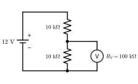

*그림 25.13* 연습문제 13. 내부 저항 $R_V$인 전압계를 아래쪽 저항에 병렬로 대면, 그 부분의 합성 저항이 줄어 읽는 값이 실제보다 작아진다.

**도전**

14. 저항 $R$이 직렬로 하나, 병렬로 하나씩 번갈아 무한히 이어진 사다리 회로(첫 단자는 직렬 저항으로 시작, 그림 25.14)의 등가 저항이 $R\dfrac{1 + \sqrt5}{2}$임을 보여라. (힌트: 한 단을 떼어 내도 나머지는 원래 회로와 같다.)

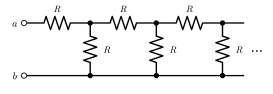

*그림 25.14* 연습문제 14의 무한 사다리 회로. 단자 $a$, $b$ 사이의 등가 저항을 구한다.

15. 모든 변이 저항 $R$인 무한한 정사각형 격자에서 이웃한 두 격자점 사이의 등가 저항이 $R/2$임을 보여라. (힌트: 한 점에 전류 $I$를 넣어 무한히 먼 곳으로 빼내는 경우와, 무한히 먼 곳에서 다른 점으로 $I$를 빼내는 경우를 중첩한다.)
16. 축전기 $C$를 기전력 $\mathcal{E}$로 충전할 때, 전원의 전압을 $\mathcal{E}/N$, $2\mathcal{E}/N$, $\ldots$, $\mathcal{E}$로 $N$단계에 걸쳐 올리며(각 단계마다 충분히 기다린다) 충전하면 저항에서 나는 총 열이 $\frac{1}{2}C\mathcal{E}^2/N$임을 보여라. $N\to\infty$의 의미는?
17. (파이썬) 기전력 $\mathcal{E}$에 $R_1$이 직렬로 연결되고, 축전기 $C$와 저항 $R_2$가 병렬로 연결된 회로(축전기에 누설 저항이 있는 경우, 그림 25.15)에서 축전기 전압이 $V_C(t) = \dfrac{\mathcal{E}R_2}{R_1 + R_2}\left(1 - e^{-t/\tau'}\right)$, $\tau' = \dfrac{R_1R_2}{R_1 + R_2}C$임을 보여라. 🐍 코드를 고쳐 $R_1 = R_2 = 2.0\ \text{M}\Omega$인 경우를 수치로 풀고 확인하라.

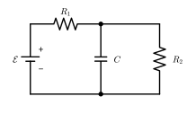

*그림 25.15* 연습문제 17. 축전기 $C$에 누설 저항 $R_2$가 병렬로 붙어 있고, $R_1$을 거쳐 충전된다.

---

## 연습문제 답과 힌트
1. $Q = \int_0^\infty I\,dt = I_0\tau = 1.0\ \text{C}$, 전자 $6.2\times10^{18}$개.
2. $R = \rho L/A = 0.22\ \Omega$.
3. $R = V^2/P = 48\ \Omega$, $I = 4.5\ \text{A}$.
4. $r = (1.50 - 1.35)/0.30 = 0.50\ \Omega$, $R = 1.35/0.30 = 4.5\ \Omega$.
5. $1/R = 1/4 + 1/6 + 1/12 = 1/2$이므로 $R = 2.0\ \Omega$.
6. $\tau = 0.47\ \text{s}$, $t_{1/2} = \tau\ln2 = 0.33\ \text{s}$.
7. (가) $R = \dfrac{\rho\ln(b/a)}{2\pi L} = 2.2\times10^{11}\ \Omega$. (나) $C = 2\pi\kappa\varepsilon_0L/\ln(b/a) = 0.92\ \text{nF}$, $RC = \rho\kappa\varepsilon_0 = 2.0\times10^2\ \text{s}$. 약 3분 반이다. 축전기도 "자기 방전"한다.
8. 접점 전위를 미지수로 두고 접합 법칙을 쓰면 $V_C = 60/11 = 5.45\ \text{V}$, $V_D = 50/11 = 4.55\ \text{V}$. 검류계 전류 $(V_C - V_D)/R_g = 18\ \text{mA}$, $C$에서 $D$로. 전원 전류 $0.0727\ \text{A}$이므로 $R_{\text{eq}} = 138\ \Omega$ (정확히 $137.5\ \Omega$).
9. $T = (119.4/100 - 1)/3.85\times10^{-3} = 50\ °\text{C}$ (50.4 °C).
10. $P/P_{\max}$는 $R = r/2$: $8/9$, $R = r$: $1$, $R = 2r$: $8/9$. 효율은 각각 33%, 50%, 67%. 효율 $R/(R + r) = 0.9$이면 $R = 9r$.
11. $\tau = m/(ne^2\rho) = 3.8\times10^{-14}\ \text{s}$. $J = 1.27\times10^6\ \text{A/m}^2$, $E = \rho J = 2.0\times10^{-2}\ \text{V/m}$. 도선 1 m에 $20\ \text{mV}$만 걸린다.
12. $Q = 4.0\ \text{A}\times3600\ \text{s} = 1.44\times10^4\ \text{C}$, $E = Q\mathcal{E} = 5.3\times10^4\ \text{J} = 14.8\ \text{Wh}$, $7.4$시간. 열 $I^2r = 0.40\ \text{W}$.
13. 전압계와 저항의 병렬 $9.09\ \text{k}\Omega$이므로 읽음 $12\times9.09/19.09 = 5.71\ \text{V}$(실제 $6.00\ \text{V}$, 4.8% 작게). 1% 이내이려면 $R_V\gtrsim500\ \text{k}\Omega$ (정확히 $R_V\ge495\ \text{k}\Omega$). 힌트: 읽음 $= 6\cdot\dfrac{2R_p}{R + R_p}$, $R_p = RR_V/(R + R_V)$에서 $0.99\times6$ 이상 조건을 푼다.
14. $R_{\text{eq}} = R + \dfrac{RR_{\text{eq}}}{R + R_{\text{eq}}}$에서 $R_{\text{eq}}^2 - RR_{\text{eq}} - R^2 = 0$, 양의 근 $R(1 + \sqrt5)/2 = 1.618R$.
15. 한 점에 $I$를 넣으면 대칭에 의해 이웃한 네 변으로 $I/4$씩 흐른다. 다른 점에서 $I$를 빼내는 경우도 그 점으로 이어진 네 변에서 $I/4$씩 들어온다. 중첩하면 두 점을 잇는 변에 $I/2$가 흐르므로 전위차 $IR/2$, 등가 저항 $R/2$.
16. 각 단계에서 전압이 $\mathcal{E}/N$만큼 오르므로 그 단계의 손실은 $\frac{1}{2}C(\mathcal{E}/N)^2$이다(예제 24.4·본문의 결과를 각 단계에 적용). $N$단계 합은 $\frac{1}{2}C\mathcal{E}^2/N$. $N\to\infty$는 축전기 전압과 전원 전압의 차이가 늘 무한소인 **준정적(가역) 충전**으로, 손실이 0이 된다. 20장의 가역 과정과 같은 생각이다.
17. 힌트: $C$에서 본 회로를 테브난 등가 회로(기전력 $\mathcal{E}R_2/(R_1 + R_2)$, 저항 $R_1\parallel R_2$)로 바꾸면 보통의 RC 충전이 된다. 직접 풀려면 접합 법칙 $I_1 = C\,dV_C/dt + V_C/R_2$와 고리 법칙 $\mathcal{E} = I_1R_1 + V_C$를 연립한다. 수치 해는 $\tau' = 1.0\ \text{s}$, 최종 전압 $5.0\ \text{V}$와 일치한다. 코드에서 갱신식을 `q[i+1] = q[i] + ((emf - q[i]/C)/R1 - q[i]/(C*R2))*dt`로 바꾼다.

---

## 영어 용어 정리
| 한글 | English |
|---|---|
| 전류 / 암페어 | electric current / ampere |
| 전류밀도 | current density |
| 표류 속도 | drift velocity |
| 연속 방정식 | continuity equation |
| 비저항 / 전도도 | resistivity / conductivity |
| 저항 / 옴 | resistance / ohm |
| 옴의 법칙 / 비옴성 | Ohm's law / non-ohmic |
| 비저항의 온도 계수 | temperature coefficient of resistivity |
| 평균 자유 시간 / 평균 자유 경로 | mean free time / mean free path |
| 드루드 모형 | Drude model |
| 페르미 속력 | Fermi speed |
| 기전력 | electromotive force (emf) |
| 내부 저항 / 단자 전압 | internal resistance / terminal voltage |
| 줄 열 | Joule heating |
| 최대 전력 전달 / 임피던스 정합 | maximum power transfer / impedance matching |
| 키르히호프 법칙(접합·고리) | Kirchhoff's rules (junction, loop) |
| 전류계 / 전압계 / 검류계 | ammeter / voltmeter / galvanometer |
| 휘트스톤 브리지 | Wheatstone bridge |
| 스트레인 게이지 / 게이지 계수 | strain gauge / gauge factor |
| 시간 상수 | time constant |
| 제세동기 | defibrillator |
| 리튬이온 배터리 | lithium-ion battery |
