# 28장 전자기 유도와 인덕턴스

> 대응 교재: Halliday 12판 30장 · Young&Freedman 15판 29장, 30장
> 27장에서는 전류가 자기장을 만든다는 것을 보았다. 이 장은 그 반대, 곧 **변하는 자기장이 전류(기전력)를 만든다**는 패러데이의 발견을 다룬다. 발전기, 변압기, 무선 충전기, 전기 기타의 픽업, 인덕션 레인지가 모두 이 원리로 움직인다. 1장 1.8절의 면적분(선속)과 선적분, 1.6절의 1계 미분방정식을 쓴다. 25장 RC 회로와 나란히 놓고 읽으면 RL 회로가 쉽게 이해된다.

## 학습 목표
- 자기 선속을 면적분으로 계산하고, 패러데이 법칙으로 유도 기전력을 구할 수 있다.
- 렌츠 법칙으로 유도 전류의 방향을 정하고, 그것이 에너지 보존의 결과임을 설명할 수 있다.
- 움직이는 도체의 운동 기전력을 로런츠 힘으로 유도하고, 발전기의 출력과 역학적 일을 연결할 수 있다.
- 변하는 자기장이 만드는 유도 전기장이 비보존적임을 이해하고, 대칭이 있는 경우 그 크기를 구할 수 있다.
- 자체 인덕턴스와 상호 인덕턴스를 정의하고 솔레노이드, 토로이드, 동축선에 대해 계산할 수 있다.
- RL 회로의 미분방정식을 풀고, 자기장에 저장된 에너지 $\frac{1}{2}LI^2$와 에너지 밀도 $B^2/2\mu_0$를 유도할 수 있다.

## 고등학교 물리와 무엇이 다른가
고등학교에서는 "코일을 지나는 자기 선속이 변하면 $V = -N\dfrac{\Delta\Phi}{\Delta t}$의 유도 기전력이 생긴다"를 배우고, 자석을 코일에 넣었다 빼는 그림에서 전류 방향을 정했다. 대학에서는 세 가지가 새롭다. 첫째, 선속을 **면적분** $\Phi_B = \int\vec{B}\cdot d\vec{A}$로 정의하므로 균일하지 않은 자기장도 다룬다. 둘째, 유도 기전력이 생기는 두 가지 이유, 곧 **도체가 움직이는 경우**(로런츠 힘)와 **자기장이 변하는 경우**(유도 전기장)를 구별한다. 뒤쪽은 "변하는 자기장 주위에는 도선이 없어도 전기장이 생긴다"는 놀라운 결론으로 이어지고, 30장에서 맥스웰 방정식의 하나가 된다. 셋째, 인덕턴스라는 회로 소자를 도입하여 전류가 변하는 회로를 미분방정식으로 푼다.

---

## 28.1 패러데이 법칙

### 자기 선속
면 $S$를 지나는 **자기 선속**(magnetic flux)은

$$
\Phi_B = \int_S\vec{B}\cdot d\vec{A}
$$

이다(1.8절). 단위는 웨버($1\ \text{Wb} = 1\ \text{T·m}^2$)다. 자기장이 균일하고 넓이 $A$인 평면과 각 $\theta$를 이루는 법선 방향이면 $\Phi_B = BA\cos\theta$이다(그림 28.1).

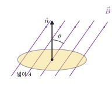

*그림 28.1* 넓이 $A$인 평면 고리를 지나는 자기 선속. 법선 $\hat{n}$과 $\vec{B}$가 이루는 각이 $\theta$이면 $\Phi_B = BA\cos\theta$이다. 고리를 지나는 자기장선의 수에 비례한다고 생각하면 된다.

### 패러데이 법칙
닫힌 회로를 지나는 자기 선속이 시간에 따라 변하면 회로에 기전력이 생긴다.

$$
\boxed{\mathcal{E} = -\frac{d\Phi_B}{dt}}
$$

이것이 **패러데이 유도 법칙**(Faraday's law of induction)이다. 감은 수가 $N$인 코일이면 각 고리의 기전력이 직렬로 더해져 $\mathcal{E} = -N\,d\Phi_B/dt$가 된다. 여기서 $N\Phi_B$를 **선속 고리**(flux linkage)라 부르기도 한다. 선속을 바꾸는 방법은 셋이다.
1. 자기장의 크기를 바꾼다(전자석의 전류를 바꾸거나 자석을 움직인다).
2. 회로의 넓이를 바꾼다(28.3절의 미끄러지는 막대).
3. 회로와 자기장 사이의 각을 바꾼다(28.3절의 발전기).

**부호 규약.** 회로를 도는 방향을 하나 정하면, 오른손 규칙으로 그 방향에 대응하는 면의 법선 $d\vec{A}$가 정해진다. 그 법선으로 $\Phi_B$를 계산했을 때 $\mathcal{E} > 0$이면 기전력이 정한 방향으로 전류를 밀고, $\mathcal{E} < 0$이면 반대 방향으로 민다. 실제로는 다음 절의 렌츠 법칙으로 방향을 정하고 패러데이 법칙으로는 크기만 구하는 경우가 많다.

### 예제 28.1 솔레노이드 안의 코일
단위 길이당 감은 수가 $2.0\times10^4\ \text{m}^{-1}$인 긴 솔레노이드에 $2.0\ \text{A}$가 흐른다. 솔레노이드 안에 지름 $2.0\ \text{cm}$, 감은 수 100인 작은 코일이 같은 축으로 들어 있다(그림 28.2). 솔레노이드 전류를 $20\ \text{ms}$ 동안 일정한 비율로 0까지 줄일 때 작은 코일의 유도 기전력은?

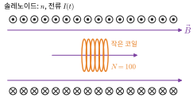

*그림 28.2* 긴 솔레노이드(단면) 안에 같은 축으로 들어 있는 작은 코일. 작은 코일을 지나는 선속은 그 안쪽의 균일한 자기장 $B = \mu_0 nI$만으로 정해진다.

**풀이**
솔레노이드 내부 자기장은 $B = \mu_0 nI$이므로 $\dfrac{dB}{dt} = \mu_0 n\dfrac{dI}{dt} = (4\pi\times10^{-7})(2.0\times10^4)\left(\dfrac{2.0}{0.020}\right) = 2.51\ \text{T/s}$.
작은 코일의 넓이 $A = \pi(0.010)^2 = 3.14\times10^{-4}\ \text{m}^2$이므로
$$
|\mathcal{E}| = NA\frac{dB}{dt} = (100)(3.14\times10^{-4})(2.51) = 7.9\times10^{-2}\ \text{V} = 79\ \text{mV}
$$
결과는 솔레노이드의 지름과 무관하다. 작은 코일 안쪽의 자기장만 선속에 들어가기 때문이다. 기전력과 $dI/dt$의 비 $7.9\times10^{-4}\ \text{H}$는 28.5절의 상호 인덕턴스다.

---

## 28.2 렌츠 법칙

패러데이 법칙의 음(−)의 부호가 뜻하는 바를 말로 하면 다음과 같다.

> **렌츠 법칙(Lenz's law)**: 유도 전류는 **자신을 만든 선속의 변화를 방해하는 방향**으로 흐른다.

자석의 N극을 코일에 가까이 가져가면 코일을 지나는 (자석 쪽에서 나오는) 선속이 늘어난다. 유도 전류는 이 증가를 방해하도록, 곧 코일이 자석 쪽에 N극을 만들도록 흐른다. 그래서 자석은 밀려나는 힘을 받는다. 자석을 멀리하면 반대로 끌어당기는 힘을 받는다(그림 28.3). 어느 쪽이든 **자석을 움직이는 사람이 일을 해야 하고**, 그 일이 회로에서 열로 바뀐다.

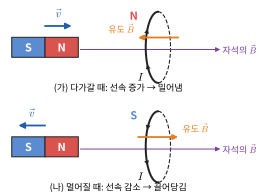

*그림 28.3* (가) N극이 다가오면 코일을 지나는 오른쪽 방향 선속이 늘어나므로, 유도 전류는 왼쪽 방향의 유도 자기장을 만들어 자석 쪽에 N극이 생기고 자석을 밀어낸다. (나) 자석이 멀어지면 선속이 줄어드므로 유도 전류는 반대로 흘러 같은 방향의 자기장을 만들고(자석 쪽이 S극) 자석을 끌어당긴다. 실선 쪽이 관찰자에게 가까운 고리 부분이다.

렌츠 법칙이 반대였다고 상상해 보자. 자석을 조금만 밀어 넣어도 유도 전류가 자석을 더 끌어당기고, 그러면 선속이 더 빨리 늘어 전류가 더 커지고, 자석은 저절로 가속될 것이다. 에너지가 공짜로 생기는 영구기관이 된다. 렌츠 법칙은 **에너지 보존의 결과**다.

> **💡 개념 확인: 유도 전류는 "자기장"이 아니라 "자기장의 변화"에 반대한다**
> 흔한 오개념은 "유도 전류의 자기장은 언제나 바깥 자기장과 반대 방향"이라는 것이다. 틀렸다. 바깥 자기장이 **줄어들고** 있으면 유도 전류는 그 감소를 메우려고 **같은 방향**의 자기장을 만든다.
> 또 하나: 강한 네오디뮴 자석을 구리관 속으로 떨어뜨리면 매우 천천히 떨어진다(그림 28.4). 구리는 자석에 붙지 않는데도 그렇다. 자석이 지나갈 때 관 벽의 각 고리에 선속 변화가 생기고, 그 **와전류**(eddy current)가 렌츠 법칙에 따라 자석의 운동을 방해한다. 관에 세로로 홈을 내면 와전류가 고리를 따라 돌 수 없어서 효과가 크게 줄어든다.
>
> 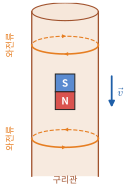
>
> *그림 28.4* 구리관 속으로 떨어지는 자석(N극이 아래). 자석 아래쪽 관 벽에서는 선속이 늘고 위쪽에서는 줄어서, 위에서 볼 때 아래 와전류는 반시계, 위 와전류는 시계 방향으로 돈다. 아래 고리는 자석을 밀어 올리고 위 고리는 끌어 올려, 둘 다 낙하를 방해한다.

---

## 28.3 운동 기전력

### 미끄러지는 막대와 로런츠 힘
균일한 자기장 $\vec{B}$(지면으로 들어가는 방향) 속에 놓인 ⊐ 모양 레일 위에서 길이 $L$인 도체 막대가 속도 $v$로 오른쪽으로 미끄러진다. 레일 왼쪽 끝에는 저항 $R$이 연결되어 있다(그림 28.5).

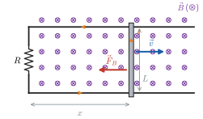

*그림 28.5* 지면으로 들어가는 균일한 자기장(⊗) 속에서 ⊐ 모양 레일 위의 막대가 속도 $\vec{v}$로 움직인다. 회로의 넓이 $Lx$가 늘어나므로 유도 전류 $I$(주황)는 반시계 방향으로 돌고(막대에서는 위로), 막대는 운동을 방해하는 자기력 $\vec{F}_B$를 받는다.

**패러데이 법칙으로 보면**: 회로의 넓이는 $Lx$이고 $dx/dt = v$이므로 $|\mathcal{E}| = \dfrac{d}{dt}(BLx) = BLv$이다.

**로런츠 힘으로 보면**: 막대 속 자유 전자(전하 $-e$)도 속도 $\vec{v}$로 움직이므로 힘 $\vec{F} = (-e)\vec{v}\times\vec{B}$를 받는다. 이 힘은 막대를 따라 향하므로 전하를 막대 한쪽 끝으로 밀어낸다. 단위 전하당 이 힘을 막대 길이만큼 적분한 것이 기전력이다.

$$
\mathcal{E} = \int(\vec{v}\times\vec{B})\cdot d\vec{\ell} = vBL
$$

두 방법은 같은 답을 준다. 이렇게 **도체가 자기장 속에서 움직여 생기는 기전력**을 **운동 기전력**(motional emf)이라 한다. 렌츠 법칙에 따르면 넓이가 늘어 선속이 증가하므로 유도 전류는 회로를 반시계 방향으로 돈다(막대에서는 위쪽으로). 전류 $I = BLv/R$가 흐르는 막대는 자기력 $F = ILB = B^2L^2v/R$를 받고, 그 방향은 **운동을 방해하는 쪽**(왼쪽)이다.

### 에너지 보존
막대를 일정한 속력으로 끌려면 외력이 자기력과 같아야 하므로, 외력의 일률은

$$
P_{\text{외력}} = Fv = \frac{B^2L^2v^2}{R} = I^2R
$$

이다. 외력이 한 역학적 일이 정확히 저항의 열로 바뀐다. 발전기의 원리가 이것이다. 자기력 자체($q\vec{v}\times\vec{B}$)는 전하에 일을 하지 않는다는 점에 주의하라. 자기력은 에너지의 "통로" 역할만 하고, 일은 막대를 미는 외력이 한다.

### 예제 28.2 저절로 멈추는 막대
그림 28.5에서 $B = 0.50\ \text{T}$, $L = 0.20\ \text{m}$, $R = 0.10\ \Omega$, 막대 질량 $m = 50\ \text{g}$이다(레일과 막대의 저항, 마찰은 무시). 막대를 $v_0 = 2.0\ \text{m/s}$로 밀어 놓았다. (가) 처음 순간의 유도 전류와 자기력, (나) 속력 $v(t)$, (다) 멈출 때까지 가는 거리, (라) 발생하는 열을 구하라.

**풀이**
(가) $\mathcal{E} = BLv_0 = 0.20\ \text{V}$, $I = 2.0\ \text{A}$, $F = ILB = 0.20\ \text{N}$ (운동 반대 방향).
(나) 운동방정식 $m\dfrac{dv}{dt} = -\dfrac{B^2L^2}{R}v$는 1장의 1계 선형 방정식이다.
$$
v(t) = v_0e^{-t/\tau}, \qquad \tau = \frac{mR}{B^2L^2} = \frac{(0.050)(0.10)}{(0.50)^2(0.20)^2} = 0.50\ \text{s}
$$
(다) $x_\infty = \int_0^\infty v\,dt = v_0\tau = 1.0\ \text{m}$. 속력이 지수적으로 줄어 이론상 영원히 멈추지 않지만, 가는 거리는 유한하다(그림 28.6).
(라) $Q = \int_0^\infty I^2R\,dt = \dfrac{B^2L^2}{R}\int_0^\infty v_0^2e^{-2t/\tau}dt = \dfrac{B^2L^2}{R}\cdot\dfrac{v_0^2\tau}{2} = \dfrac{1}{2}mv_0^2 = 0.10\ \text{J}$. 처음 운동에너지가 모두 열로 바뀌었다.

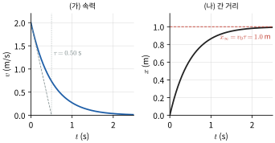

*그림 28.6* 예제 28.2의 막대. (가) 속력은 시간 상수 $\tau = 0.50\ \text{s}$로 지수적으로 줄어든다(점선은 처음 기울기). (나) 간 거리는 $x_\infty = v_0\tau = 1.0\ \text{m}$에 다가간다.

### 회전하는 코일: 교류 발전기
넓이 $A$, 감은 수 $N$인 코일이 균일한 자기장 $B$ 속에서 자기장에 수직인 축을 중심으로 각속도 $\omega$로 돈다. 코일 면의 법선이 자기장과 이루는 각이 $\theta = \omega t$이면(그림 28.7)

$$
\Phi_B = BA\cos\omega t \quad\Longrightarrow\quad \mathcal{E} = -N\frac{d\Phi_B}{dt} = NBA\omega\sin\omega t
$$

기전력이 사인 함수로 변하는 **교류**(alternating current)가 나온다(29장). 최대 기전력은 $\mathcal{E}_{\max} = NBA\omega$이고, 코일 면이 자기장과 나란한 순간($\theta = 90°$, 선속이 0인 순간)에 최대라는 점에 주의하라. 선속 자체가 아니라 선속의 **변화율**이 최대인 순간이다(그림 28.8).

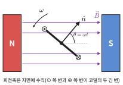

*그림 28.7* 자석 사이에서 도는 코일을 회전축 방향(위)에서 본 모습. 굵은 선이 옆에서 본 코일 면이고, ⊙와 ⊗는 코일의 두 긴 변을 지나는 도선이다. 법선 $\hat{n}$이 $\vec{B}$와 이루는 각 $\theta = \omega t$가 시간에 따라 늘어난다.

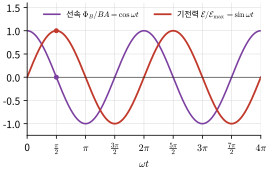

*그림 28.8* 회전 코일을 지나는 선속 $\Phi_B \propto \cos\omega t$와 기전력 $\mathcal{E} \propto \sin\omega t$. 선속이 0인 순간($\omega t = \pi/2$, 코일 면이 자기장과 나란함)에 기전력이 최대다.

### 예제 28.3 발전기의 출력과 토크
감은 수 100, 넓이 $0.010\ \text{m}^2$인 코일이 $0.50\ \text{T}$ 속에서 $60\ \text{Hz}$로 돈다. (가) 최대 기전력, (나) $50\ \Omega$ 저항을 연결했을 때 평균 전력, (다) 코일을 돌리는 데 필요한 평균 토크를 구하라(코일의 저항과 인덕턴스는 무시).

**풀이**
(가) $\omega = 2\pi(60) = 377\ \text{rad/s}$, $\mathcal{E}_{\max} = (100)(0.50)(0.010)(377) = 188\ \text{V}$.
(나) $P = \mathcal{E}^2/R = \dfrac{\mathcal{E}_{\max}^2}{R}\sin^2\omega t$이고 $\langle\sin^2\rangle = 1/2$이므로 $\langle P\rangle = \dfrac{\mathcal{E}_{\max}^2}{2R} = \dfrac{(188.5)^2}{100} = 355\ \text{W}$.
(다) 에너지 보존에서 $\langle\tau\rangle\omega = \langle P\rangle$이므로 $\langle\tau\rangle = 355/377 = 0.94\ \text{N·m}$. 전구를 더 많이 연결하면(부하가 커지면) 전류가 커지고, 코일이 받는 자기 토크(26장 $\tau = NIAB\sin\theta$)가 커져서 돌리기가 더 힘들어진다. 발전소의 터빈이 전력 수요에 맞춰 증기를 더 넣어야 하는 이유다.

> **🔗 전공 연결: 발전기, 와전류, 무선 충전**
> - **발전기와 모터 (기계공학)**: 모터와 발전기는 같은 기계다. 모터에 전류를 흘리면 토크가 생기고(26장), 모터 축을 바깥에서 돌리면 기전력이 생긴다. 모터가 돌 때도 코일에 운동 기전력이 생기는데, 이는 전원 전압과 반대 방향이라 **역기전력**(back emf)이라 한다. 역기전력은 회전 속력에 비례하므로($\mathcal{E}_b = k_e\omega$), 모터가 막 출발할 때(속력 0)는 역기전력이 없어 전류가 매우 크고, 빨리 돌수록 전류가 준다. SI 단위로 쓰면 역기전력 상수 $k_e$와 27장의 토크 상수 $k_t$는 같은 값이다. 에너지 보존 $\tau\omega = \mathcal{E}_bI$에서 바로 나온다.
> - **와전류의 이용**: 금속판이 자기장 속에서 움직이면 판 안에 와전류가 생겨 운동을 방해한다. 이것을 이용한 **와전류 브레이크**는 마찰 없이 제동하므로 마모가 없다. 반대로 변압기·모터 철심에서 와전류는 에너지 손실이므로 얇은 판을 절연해 겹쳐(성층 철심) 줄인다. 인덕션 레인지는 바닥 코일의 교류 자기장으로 냄비 바닥에 와전류를 일으켜 냄비 자체를 가열한다. 기계공학의 **와전류 탐상**(비파괴 검사)은 코일을 금속 표면에 대고 와전류의 변화를 측정해 균열을 찾는다.
> - **무선 충전**: 충전 패드의 코일에 교류를 흘리면 그 자기장이 기기 속 코일을 지나며 기전력을 유도한다. 두 코일이 공기를 사이에 둔 변압기(29장)이고, 효율은 28.5절의 상호 인덕턴스가 결정한다. 거리가 멀어지면 상호 인덕턴스가 빠르게 줄어(연습문제 17) 효율이 떨어지므로 기기를 패드에 바짝 붙여야 한다. 두 코일을 같은 진동수에 공명시키면(29장) 조금 더 먼 거리에서도 에너지를 보낼 수 있다.

> **🔬 최신 연구 노트: 회생 제동**
> 전기차와 하이브리드차, 전동차는 브레이크를 밟을 때 바퀴를 돌리던 모터를 **발전기로 바꿔** 쓴다. 바퀴의 운동에너지가 코일을 돌려 기전력을 만들고, 그 전류로 배터리를 충전한다(25장 🔬 리튬이온 배터리). 렌츠 법칙에 따라 유도 전류는 회전을 방해하는 토크를 만들므로, 이 과정 자체가 제동력이 된다. 예제 28.3의 (다)에서 부하가 클수록 돌리기 힘들었던 것과 같은 원리다. 마찰 브레이크에서는 운동에너지가 모두 열로 버려지지만, **회생 제동**(regenerative braking)은 그 일부를 다시 쓸 수 있는 전기에너지로 되돌린다. 실제로 되돌릴 수 있는 양은 모터·인버터·배터리의 효율과 배터리가 받아들일 수 있는 충전 속도에 따라 제한되고, 속력이 매우 낮으면 기전력이 작아 제동력도 작아지므로, 실제 차량은 마찰 브레이크를 함께 쓴다. 승강기, 풍력 발전기, 산업용 로봇에서도 같은 원리로 에너지를 회수한다.

---

## 28.4 유도 전기장

### 도선이 움직이지 않는데 왜 전하가 움직이는가
예제 28.1에서 작은 코일은 가만히 있었다. 그러므로 운동 기전력($\vec{v}\times\vec{B}$)은 없다. 그런데도 코일 속 전하가 회로를 따라 돌았다. 정지한 전하를 움직이는 것은 전기력뿐이므로, **변하는 자기장이 전기장을 만든다**고 결론지어야 한다. 기전력은 단위 전하가 회로를 한 바퀴 도는 동안 받는 일이므로 $\mathcal{E} = \oint\vec{E}\cdot d\vec{\ell}$이고, 패러데이 법칙은

$$
\boxed{\oint_C\vec{E}\cdot d\vec{\ell} = -\frac{d}{dt}\int_S\vec{B}\cdot d\vec{A}}
$$

가 된다. 이 식에서 $C$는 도선일 필요가 없는 **임의의 닫힌 경로**다. 도선이 있으면 이 전기장이 전류를 흘리고, 도선이 없어도 전기장은 그곳에 있다. 이것이 30장 맥스웰 방정식의 하나이자, 31장 전자기파가 존재하는 이유다.

이 **유도 전기장**(induced electric field)은 전하가 만드는 정전기장과 근본적으로 다르다.

| | 정전기장 (21~23장) | 유도 전기장 |
|---|---|---|
| 원천 | 전하 | 변하는 자기장 |
| 장선 | 양전하에서 시작해 음전하에서 끝남 | 시작도 끝도 없는 닫힌 고리 |
| $\oint\vec{E}\cdot d\vec{\ell}$ | 0 (보존장) | $-d\Phi_B/dt$ (비보존장) |
| 전위 | 정의할 수 있음 | **정의할 수 없음** |

유도 전기장에서는 같은 두 점 사이라도 경로에 따라 $\int\vec{E}\cdot d\vec{\ell}$이 달라지므로 "전위차"가 하나로 정해지지 않는다. 변하는 자기장이 있는 회로에서 전압계를 연결하는 도선의 경로에 따라 측정값이 달라지는 것도 이 때문이다.

### 예제 28.4 솔레노이드 안팎의 유도 전기장
반지름 $R = 5.0\ \text{cm}$인 긴 솔레노이드 내부의 균일한 자기장이 $dB/dt = 0.10\ \text{T/s}$로 증가한다. 축에서 거리 $r$인 곳의 유도 전기장을 구하고, $r = 2.0\ \text{cm}$와 $r = 10\ \text{cm}$에서 값을 구하라.

**풀이**
축 대칭성 때문에 $\vec{E}$는 축을 중심으로 하는 원의 접선 방향이고 크기는 $r$에만 의존한다(지름 방향 성분이 있다면 축 방향 대칭과 $\oint\vec{E}\cdot d\vec{A} = 0$에 모순된다). 반지름 $r$인 원을 경로로 잡는다.
- $r < R$: $E(2\pi r) = \pi r^2\dfrac{dB}{dt}$이므로 $E = \dfrac{r}{2}\dfrac{dB}{dt}$.
- $r > R$: 선속은 솔레노이드 단면만 지나므로 $E(2\pi r) = \pi R^2\dfrac{dB}{dt}$, 곧 $E = \dfrac{R^2}{2r}\dfrac{dB}{dt}$.

$r = 2.0\ \text{cm}$: $E = (0.010)(0.10) = 1.0\times10^{-3}\ \text{V/m}$. $r = 10\ \text{cm}$: $E = \dfrac{(0.050)^2}{2(0.10)}(0.10) = 1.25\times10^{-3}\ \text{V/m}$. 최댓값은 $r = R$에서 $2.5\times10^{-3}\ \text{V/m}$이다(그림 28.9).
**솔레노이드 바깥은 자기장이 0인데도 전기장이 있다.** 전기장은 그 지점의 자기장이 아니라 경로가 둘러싼 선속의 변화로 정해지기 때문이다. 렌츠 법칙에 따라 $\vec{E}$의 방향은 위에서 볼 때(자기장이 관찰자 쪽을 향할 때) 시계 방향이다.

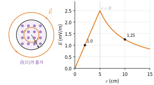

*그림 28.9* (가) 관찰자 쪽을 향하는 자기장(⊙)이 증가할 때 유도 전기장선은 솔레노이드 안팎에서 시계 방향의 닫힌 원이다. (나) 예제 28.4의 값으로 그린 $E(r)$. 안에서는 $r$에 비례하고, 자기장이 0인 바깥에서도 $1/r$로 줄어들 뿐 0이 아니다.

> **★ 심화: 미분형 패러데이 법칙과 베타트론**
> 스토크스 정리 $\oint_C\vec{E}\cdot d\vec{\ell} = \int_S(\nabla\times\vec{E})\cdot d\vec{A}$를 쓰면, 고정된 임의의 면 $S$에 대해 $\int_S(\nabla\times\vec{E} + \partial\vec{B}/\partial t)\cdot d\vec{A} = 0$이므로
> $$\nabla\times\vec{E} = -\frac{\partial\vec{B}}{\partial t}$$
> 이다(30장 ★). 정전기에서는 $\nabla\times\vec{E} = 0$이어서 $\vec{E} = -\nabla V$로 쓸 수 있었지만, 이제는 그럴 수 없다.
> **베타트론**(betatron)은 유도 전기장으로 전자를 가속하는 원형 가속기다. 전자를 반지름 $R$인 원궤도에 붙잡아 두려면 궤도 위 자기장 $B_{\text{orb}}$가 $p = eB_{\text{orb}}R$(26장)를 만족해야 하고, 동시에 궤도 안쪽 선속 $\Phi = \pi R^2\bar{B}$($\bar{B}$는 궤도 안의 평균 자기장)의 변화가 만드는 유도 전기장 $E = \frac{1}{2\pi R}\frac{d\Phi}{dt} = \frac{R}{2}\frac{d\bar{B}}{dt}$가 전자를 접선 방향으로 가속한다. $\frac{dp}{dt} = eE$와 $\frac{dp}{dt} = eR\frac{dB_{\text{orb}}}{dt}$를 같게 놓으면
> $$B_{\text{orb}} = \frac{1}{2}\bar{B}$$
> 라는 **베타트론 조건**을 얻는다(처음에 둘 다 0에서 출발할 때). 자석의 극 모양을 가운데가 센 쪽으로 깎아 이 조건을 맞춘다. 운동량에 대한 식이므로 상대론적 전자에도 그대로 성립한다.

---

## 28.5 인덕턴스

### 상호 인덕턴스
가까이 놓인 두 코일에서 코일 1의 전류 $I_1$이 만든 자기장은 코일 2를 지나는 선속 고리 $N_2\Phi_{21}$을 만든다. 비오–사바르 법칙에 따라 자기장은 전류에 비례하므로 $N_2\Phi_{21} \propto I_1$이고, 그 비례상수를 **상호 인덕턴스(mutual inductance)** $M$이라 한다.

$$
M = \frac{N_2\Phi_{21}}{I_1}, \qquad \mathcal{E}_2 = -M\frac{dI_1}{dt}
$$

단위는 헨리($1\ \text{H} = 1\ \text{Wb/A} = 1\ \text{V·s/A}$)다. 놀랍게도 반대 방향으로 정의한 $M_{12} = N_1\Phi_{12}/I_2$는 언제나 $M_{21}$과 같다(노이만 공식으로 증명하거나, 다음 절 에너지 논증으로 보일 수 있다). 그래서 첨자 없이 $M$으로 쓴다. 예제 28.1에서 $M = 7.9\times10^{-4}\ \text{H}$였다.

### 자체 인덕턴스
코일 자신의 전류가 만든 선속도 코일 자신을 지난다. 그 선속 고리와 전류의 비가 **자체 인덕턴스(self-inductance)** 또는 간단히 **인덕턴스**(inductance)다.

$$
\boxed{L = \frac{N\Phi_B}{I}, \qquad \mathcal{E}_L = -L\frac{dI}{dt}}
$$

인덕턴스는 코일의 모양과 감은 수(그리고 내부 물질)로만 정해지고 전류와 무관하다. 전기용량 $C = Q/V$가 도체의 기하로만 정해졌던 것과 같다. 회로에서 인덕턴스가 큰 소자를 **인덕터**(inductor)라 하고 기호 ─∿∿∿─(코일 모양)로 그린다. 렌츠 법칙에 따라 자체 유도 기전력은 **전류의 변화를 방해**한다. 전류를 늘리려 하면 반대 방향, 줄이려 하면 같은 방향으로 기전력이 생긴다. 인덕터는 전류의 "관성"과 같다.

**솔레노이드의 인덕턴스.** 길이 $\ell$, 단면적 $A$, 감은 수 $N$($n = N/\ell$)인 긴 솔레노이드에서 $B = \mu_0 nI$이므로

$$
L = \frac{N(\mu_0 nI)A}{I} = \mu_0 n^2A\ell = \frac{\mu_0 N^2A}{\ell}
$$

인덕턴스는 **감은 수의 제곱**에 비례한다. 감은 수를 두 배로 하면 자기장도 두 배, 그 자기장이 지나는 고리 수도 두 배가 되기 때문이다.

**토로이드의 인덕턴스.** 안쪽 반지름 $a$, 바깥쪽 반지름 $b$, 높이 $h$인 직사각형 단면의 토로이드(그림 28.10)에서 $B = \mu_0 NI/2\pi r$이므로, 단면을 지나는 선속은

$$
\Phi_B = \int_a^b\frac{\mu_0 NI}{2\pi r}h\,dr = \frac{\mu_0 NIh}{2\pi}\ln\frac{b}{a}, \qquad L = \frac{N\Phi_B}{I} = \frac{\mu_0 N^2h}{2\pi}\ln\frac{b}{a}
$$

이다. 예를 들어 $N = 500$, $a = 5.0\ \text{cm}$, $b = 10\ \text{cm}$, $h = 2.0\ \text{cm}$이면 $L = 6.9\times10^{-4}\ \text{H}$이다.

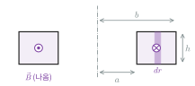

*그림 28.10* 토로이드를 중심축(일점쇄선)을 지나는 평면으로 자른 단면. 두께 $dr$인 띠를 지나는 선속 $B\,h\,dr$을 $a$에서 $b$까지 적분한다.

### 예제 28.5 솔레노이드의 인덕턴스
예제 27.6의 솔레노이드(길이 $50\ \text{cm}$, 반지름 $2.0\ \text{cm}$, 1000번 감음)의 인덕턴스를 구하라. 전류가 $1.0\ \text{ms}$ 동안 $2.0\ \text{A}$에서 0으로 일정하게 줄면 자체 유도 기전력은 얼마인가?

**풀이**
$A = \pi(0.020)^2 = 1.26\times10^{-3}\ \text{m}^2$, $L = \dfrac{(4\pi\times10^{-7})(1000)^2(1.26\times10^{-3})}{0.50} = 3.2\times10^{-3}\ \text{H} = 3.2\ \text{mH}$.
$|\mathcal{E}_L| = L|dI/dt| = (3.16\times10^{-3})(2.0/1.0\times10^{-3}) = 6.3\ \text{V}$. 전류를 줄이려는 변화에 반대하므로, 기전력은 원래 전류 방향으로 전류를 계속 흘리려 한다. 스위치를 갑자기 열면 $dI/dt$가 매우 커서 스위치 접점에 불꽃이 튄다(연습문제 12).

---

## 28.6 RL 회로와 자기 에너지

### 전류의 성장
기전력 $\mathcal{E}$인 전지, 저항 $R$, 인덕터 $L$을 직렬로 연결하고 $t = 0$에 스위치를 닫는다(그림 28.11).

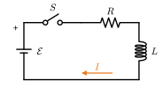

*그림 28.11* 전지 $\mathcal{E}$, 스위치 $S$, 저항 $R$, 인덕터 $L$로 이루어진 직렬 RL 회로.

키르히호프 고리 법칙(인덕터 양단의 전압 강하는 $L\,dI/dt$)에서

$$
\mathcal{E} - IR - L\frac{dI}{dt} = 0
$$

이다. 1장 1.6절 (2)와 같은 꼴이므로, $I(0) = 0$일 때 해는

$$
\boxed{I(t) = \frac{\mathcal{E}}{R}\left(1 - e^{-t/\tau_L}\right), \qquad \tau_L = \frac{L}{R}}
$$

이다. $\tau_L$을 **유도 시간 상수**(inductive time constant)라 한다($\text{H}/\Omega = \text{s}$). 스위치를 닫는 순간 인덕터는 전류의 급변을 막아 "끊긴 도선"처럼 행동하고(전지 전압이 모두 인덕터에 걸린다), 오랜 시간이 지나면 $dI/dt = 0$이 되어 "보통 도선"처럼 행동한다. 축전기와 정반대다(25장의 RC 회로에서 축전기는 처음에 보통 도선, 나중에 끊긴 도선처럼 행동했다). 그림 28.12 (가)가 이 성장 곡선이다.

### 전류의 감소
전류 $I_0$가 흐르던 회로에서 전지를 빼고 $R$과 $L$만 남기면 $L\,dI/dt + IR = 0$이므로 $I(t) = I_0e^{-t/\tau_L}$로 줄어든다. 전원이 없는데도 한동안 전류가 흐른다(그림 28.12 (나)). 그 에너지는 어디서 왔을까?

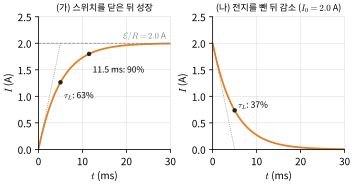

*그림 28.12* 예제 28.6의 값($\tau_L = 5.0\ \text{ms}$, $\mathcal{E}/R = 2.0\ \text{A}$)으로 그린 전류. (가) 성장: $t = \tau_L$에서 최종값의 63%, $t = \tau_L\ln10 = 11.5\ \text{ms}$에서 90%. (나) 감소: $t = \tau_L$에서 처음 값의 37%. 점선은 처음 기울기로, $\tau_L$에서 최종값에 닿는다.

### 자기장에 저장된 에너지
고리 방정식에 $I$를 곱하면

$$
\mathcal{E}I = I^2R + LI\frac{dI}{dt}
$$

이다. 좌변은 전지가 공급하는 일률, 첫째 항은 저항의 열, 둘째 항은 **인덕터에 쌓이는 에너지의 증가율** $dU_B/dt$이다. 따라서 전류를 0에서 $I$까지 늘리는 동안 인덕터에 쌓인 에너지는

$$
U_B = \int_0^I LI'\,dI' = \boxed{\frac{1}{2}LI^2}
$$

이다. 축전기의 $\frac{1}{2}CV^2$에 대응한다. 이 에너지는 어디에 있는가? 솔레노이드에 $L = \mu_0 n^2A\ell$, $B = \mu_0 nI$를 넣으면

$$
U_B = \frac{1}{2}\mu_0 n^2A\ell I^2 = \frac{B^2}{2\mu_0}(A\ell)
$$

이고 $A\ell$은 자기장이 있는 부피다. 그러므로 **에너지는 자기장 자체에 저장되어 있고**, 그 밀도는

$$
\boxed{u_B = \frac{B^2}{2\mu_0}}
$$

이다. 솔레노이드에서 유도했지만 이 식은 일반적으로 성립한다. 전기장의 에너지 밀도 $u_E = \frac{1}{2}\varepsilon_0E^2$(24장)와 함께 31장에서 전자기파가 나르는 에너지를 계산할 때 쓴다.

### 예제 28.6 RL 회로의 에너지 흐름
$\mathcal{E} = 12\ \text{V}$, $R = 6.0\ \Omega$, $L = 30\ \text{mH}$인 직렬 RL 회로에서 $t = 0$에 스위치를 닫았다. (가) 시간 상수와 최종 전류, (나) 전류가 최종값의 90%에 이르는 시각, (다) 최종 상태에서 인덕터의 에너지, (라) $t = \tau_L$에서 전지의 일률, 저항의 열 발생률, 인덕터의 에너지 증가율을 구하라.

**풀이**
(가) $\tau_L = L/R = 5.0\ \text{ms}$, $I_\infty = \mathcal{E}/R = 2.0\ \text{A}$.
(나) $1 - e^{-t/\tau_L} = 0.90$에서 $t = \tau_L\ln10 = 11.5\ \text{ms}$.
(다) $U_B = \frac{1}{2}(0.030)(2.0)^2 = 0.060\ \text{J}$.
(라) $I(\tau_L) = 2.0(1 - e^{-1}) = 1.264\ \text{A}$. 전지: $\mathcal{E}I = 15.2\ \text{W}$. 저항: $I^2R = 9.6\ \text{W}$. 인덕터: $LI\,dI/dt = I\cdot\mathcal{E}e^{-1} = (1.264)(4.41) = 5.6\ \text{W}$. $9.6 + 5.6 = 15.2$로 에너지가 보존된다. 그림 28.13은 이 세 일률을 시간에 따라 그린 것이다. 처음에는 공급한 에너지가 주로 인덕터에 쌓이고, 나중에는 모두 저항의 열이 된다.

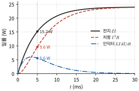

*그림 28.13* 예제 28.6의 회로에서 전지가 공급하는 일률 $\mathcal{E}I$, 저항의 열 발생률 $I^2R$, 인덕터의 에너지 증가율 $LI\,dI/dt$. 언제나 앞의 것이 뒤의 두 개의 합이다. 점은 $t = \tau_L$에서의 값이다.

### 예제 28.7 동축 케이블의 인덕턴스 (에너지 방법)
안쪽 도체 반지름 $a$, 바깥 도체 반지름 $b$인 동축 케이블에서 두 도체에 크기 $I$의 전류가 반대 방향으로 흐른다(전류는 도체 표면에만 흐른다고 본다). 단위 길이당 인덕턴스를 구하라(그림 28.14).

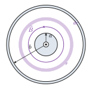

*그림 28.14* 동축 케이블의 단면. 자기장은 두 도체 사이($a < r < b$)에만 있다. 반지름 $r$, 두께 $dr$인 원통 껍질(색칠한 부분)의 자기 에너지를 더한다.

**풀이**
앙페르 법칙으로 $a < r < b$에서 $B = \mu_0 I/2\pi r$, 그 밖에서는 0이다(27장 연습문제 7). 길이 $\ell$에 저장된 에너지는 두께 $dr$인 원통 껍질(부피 $2\pi r\ell\,dr$)로 적분하여
$$
U_B = \int_a^b\frac{1}{2\mu_0}\left(\frac{\mu_0 I}{2\pi r}\right)^2 2\pi r\ell\,dr = \frac{\mu_0 I^2\ell}{4\pi}\ln\frac{b}{a}
$$
이를 $\frac{1}{2}LI^2$과 같게 놓으면
$$
\frac{L}{\ell} = \frac{\mu_0}{2\pi}\ln\frac{b}{a}
$$
선속을 직접 계산하기 어려운 경우에도 에너지 방법은 간단하다. 24장의 동축 축전기 $C/\ell = 2\pi\varepsilon_0/\ln(b/a)$와 곱하면 $LC/\ell^2 = \mu_0\varepsilon_0 = 1/c^2$이 된다. 이것은 우연이 아니다. 동축선을 따라 신호가 빛의 속력으로 전파된다는 뜻이다(내부가 진공일 때. 31장).

> **🐍 파이썬 실습: 자기장 속에서 떨어지는 막대**
> 수직으로 세운 두 레일(간격 $L$, 아래쪽에 저항 $R$) 사이를 질량 $m$인 막대가 마찰 없이 떨어진다(그림 28.15). 레일 면에 수직인 자기장 $B$가 있다. 운동방정식 $m\dot{v} = mg - B^2L^2v/R$을 수치로 풀고, 해석해 $v = v_T(1 - e^{-t/\tau})$와 에너지 보존(중력이 한 일 = 운동에너지 + 열)을 확인한다.
>
> 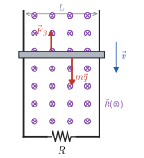
>
> *그림 28.15* 레일 면에 수직인 자기장(⊗) 속에서 떨어지는 막대. 막대가 받는 힘은 중력 $m\vec{g}$와, 운동을 방해하는 위쪽 자기력 $\vec{F}_B$이다.
>
> ```python
> import numpy as np
> from scipy.integrate import solve_ivp
>
> m, L, B, R, g = 0.020, 0.25, 0.80, 0.50, 9.8   # kg, m, T, ohm, m/s^2
>
> def rhs(t, y):                 # y = [낙하 거리, 속력, 발생한 열]
>     x, v, Q = y
>     I = B*L*v/R                # 유도 전류 (운동 기전력 / 저항)
>     return [v, g - I*L*B/m, I**2*R]
>
> sol = solve_ivp(rhs, [0, 1.5], [0, 0, 0], rtol=1e-9, atol=1e-12,
>                 dense_output=True)
> vT = m*g*R/(B*L)**2
> tau = m*R/(B*L)**2
> for t in [0.25, 0.5, 1.0, 1.5]:
>     x, v, Q = sol.sol(t)
>     exact = vT*(1 - np.exp(-t/tau))
>     print(f"t={t:4.2f} s  v={v:.4f} m/s (해석해 {exact:.4f})")
>
> x, v, Q = sol.y[:, -1]
> print(f"종단 속력 vT = {vT:.3f} m/s, 시간 상수 tau = {tau:.3f} s")
> print(f"중력이 한 일 {m*g*x:.5f} J = 운동에너지 {0.5*m*v**2:.5f} J"
>       f" + 열 {Q:.5f} J")
> ```
> 실행 결과는 다음과 같다.
> ```
> t=0.25 s  v=1.5487 m/s (해석해 1.5487)
> t=0.50 s  v=2.1184 m/s (해석해 2.1184)
> t=1.00 s  v=2.4051 m/s (해석해 2.4051)
> t=1.50 s  v=2.4439 m/s (해석해 2.4439)
> 종단 속력 vT = 2.450 m/s, 시간 상수 tau = 0.250 s
> 중력이 한 일 0.60055 J = 운동에너지 0.05973 J + 열 0.54082 J
> ```
> 6장의 "속도에 비례하는 끌림힘을 받는 낙하"와 수학적으로 똑같다. 여기서는 끌림 계수가 $b = B^2L^2/R$인 셈이다. 종단 속력에 이르면 중력이 하는 일률 $mgv_T$가 모두 저항의 열 $I^2R$로 바뀐다. 이 에너지 장부가 정확히 맞는지 마지막 줄에서 확인하라. $B$를 2배로 하면 종단 속력은 $1/4$이 된다.

---

## 핵심 정리

| 개념 | 핵심 식 | 비고 |
|---|---|---|
| 자기 선속 | $\Phi_B = \int\vec{B}\cdot d\vec{A}$ | 단위 Wb = T·m² |
| 패러데이 법칙 | $\mathcal{E} = -N\,d\Phi_B/dt$ | 크기·각·넓이의 변화 |
| 렌츠 법칙 | 유도 전류는 선속 변화를 방해 | 에너지 보존의 결과 |
| 운동 기전력 | $\mathcal{E} = \int(\vec{v}\times\vec{B})\cdot d\vec{\ell}$, 막대: $BLv$ | 외력의 일률 = $I^2R$ |
| 교류 발전기 | $\mathcal{E} = NBA\omega\sin\omega t$ | 선속 0일 때 기전력 최대 |
| 유도 전기장 | $\oint\vec{E}\cdot d\vec{\ell} = -d\Phi_B/dt$ | 비보존장, 전위 없음 |
| 솔레노이드 안팎 | $E = \frac{r}{2}\dot{B}$ ($r < R$), $\frac{R^2}{2r}\dot{B}$ ($r > R$) | |
| 상호 인덕턴스 | $M = N_2\Phi_{21}/I_1$, $\mathcal{E}_2 = -M\,dI_1/dt$ | $M_{12} = M_{21}$ |
| 자체 인덕턴스 | $L = N\Phi_B/I$, $\mathcal{E}_L = -L\,dI/dt$ | 솔레노이드: $\mu_0 N^2A/\ell$ |
| 토로이드·동축선 | $\frac{\mu_0 N^2h}{2\pi}\ln\frac{b}{a}$, $\frac{L}{\ell} = \frac{\mu_0}{2\pi}\ln\frac{b}{a}$ | |
| RL 회로 | $I = \frac{\mathcal{E}}{R}(1 - e^{-t/\tau_L})$, $\tau_L = L/R$ | 감소: $I_0e^{-t/\tau_L}$ |
| 자기 에너지 | $U_B = \frac{1}{2}LI^2$, $u_B = B^2/2\mu_0$ | 에너지는 장에 저장 |

---

## 연습문제

**기본**
1. 넓이 $0.040\ \text{m}^2$인 고리에 수직인 자기장이 $0.10\ \text{s}$ 동안 일정하게 $0.50\ \text{T}$에서 0으로 줄었다. 유도 기전력은? 감은 수가 20이면?
2. 길이 $0.50\ \text{m}$인 막대가 $0.30\ \text{T}$인 자기장에 수직으로 $4.0\ \text{m/s}$로 움직인다(막대도 자기장과 속도에 수직). 막대 양 끝 사이의 기전력은?
3. 감은 수 300, 길이 $25\ \text{cm}$, 단면적 $4.0\ \text{cm}^2$인 솔레노이드의 인덕턴스를 구하라.
4. 인덕턴스 $0.20\ \text{H}$인 코일의 전류가 $10\ \text{ms}$ 동안 $3.0\ \text{A}$에서 $1.0\ \text{A}$로 일정하게 줄었다. 자체 유도 기전력의 크기와, 그 기전력이 전류와 같은 방향인지 반대 방향인지 답하라.
5. $L = 50\ \text{mH}$, $R = 10\ \Omega$인 RL 회로의 시간 상수는? 스위치를 닫은 뒤 전류가 최종값의 절반이 되는 시각은?
6. MRI 장치의 $1.5\ \text{T}$ 자기장의 에너지 밀도를 구하라. 공기가 견딜 수 있는 정도의 큰 전기장 $1.0\times10^6\ \text{V/m}$의 에너지 밀도와 비교하라.

**응용**

7. 그림 28.16과 같이 위쪽으로 $10\ \text{A}$가 흐르는 긴 직선 도선의 오른쪽 같은 평면에 직사각형 고리(도선과 나란한 변 $b = 0.20\ \text{m}$, 수직인 변 $a = 0.10\ \text{m}$)가 있다. 가까운 변이 도선에서 $x = 0.10\ \text{m}$인 순간, 고리가 도선에서 멀어지는 방향으로 $5.0\ \text{m/s}$로 움직인다. 유도 기전력의 크기와 유도 전류의 방향(시계/반시계)을 구하라.

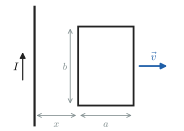

*그림 28.16* 연습문제 7의 배치.

8. 길이 $L$인 도체 막대가 한 끝을 축으로 자기장 $B$에 수직인 평면에서 각속도 $\omega$로 돈다. 두 끝 사이의 기전력이 $\frac{1}{2}B\omega L^2$임을 보여라. 길이 $5.0\ \text{m}$인 헬리콥터 날개가 초당 5바퀴 돌고, 지구 자기장의 연직 성분이 $5.0\times10^{-5}\ \text{T}$일 때 값을 구하라.
9. 단위 길이당 감은 수 $n_1$인 긴 솔레노이드 안에 감은 수 $N_2$, 단면적 $A_2$인 짧은 코일이 같은 축으로 들어 있다. 상호 인덕턴스가 $M = \mu_0 n_1N_2A_2$임을 보이고, 예제 28.1의 값을 다시 얻어라.
10. 한 변이 $0.10\ \text{m}$, 저항 $0.020\ \Omega$인 정사각형 고리가 일정한 속력 $2.0\ \text{m/s}$로 $0.40\ \text{T}$의 균일한 자기장 영역(경계가 직선)에 그림 28.17과 같이 들어간다. 고리가 들어가는 동안의 유도 전류, 고리를 일정한 속력으로 유지하는 데 필요한 힘, 고리가 완전히 들어갈 때까지 발생하는 열을 구하라. 완전히 들어간 뒤에는 어떻게 되는가?

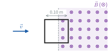

*그림 28.17* 연습문제 10의 배치. 점선이 자기장 영역의 경계다.

11. 반지름 $3.0\ \text{cm}$, 단위 길이당 감은 수 1000인 긴 솔레노이드에 $I(t) = (2.0\ \text{A})\sin(2\pi\cdot60t)$가 흐른다. 축에서 $1.5\ \text{cm}$와 $6.0\ \text{cm}$인 곳에서 유도 전기장의 최댓값을 구하라. 두 값이 같은 이유는?
12. $0.80\ \text{H}$인 인덕터에 $3.0\ \text{A}$가 흐르고 있다. 스위치를 열자 전류가 인덕터와 병렬로 연결된 $1000\ \Omega$ 보호 저항으로 흐르게 되었다. 스위치를 연 직후 인덕터 양단의 전압과, 전류가 줄어드는 시간 상수, 저항에서 발생하는 총 열을 구하라. 보호 저항이 없다면 어떤 일이 생기는가?
13. 예제 28.7의 결과를 써서 $a = 0.50\ \text{mm}$, $b = 2.0\ \text{mm}$인 동축 케이블의 단위 길이당 인덕턴스를 구하라.

**도전**

14. 🐍 박스의 떨어지는 막대에 대해 (가) 운동방정식을 세우고 $v(t) = v_T(1 - e^{-t/\tau})$, $v_T = mgR/(B^2L^2)$, $\tau = v_T/g$를 유도하라. (나) 종단 속력에서 $mgv_T = I^2R$임을 보여라. (다) 막대가 처음 $t$초 동안 떨어진 거리 $y(t)$를 구하고, 그 동안 발생한 열을 에너지 보존으로 구하라.
15. 수평 레일 위의 막대(질량 $m$, 길이 $L$, 균일한 연직 자기장 $B$)를 처음 속력 $v_0$로 밀었다. 레일 끝에는 저항 대신 저항 $R$과 전기용량 $C$(처음에 대전되지 않음)가 직렬로 연결되어 있다. (가) 막대의 최종 속력이 $v_f = \dfrac{mv_0}{m + B^2L^2C}$임을 보여라. (힌트: $m\,dv = -BLI\,dt = -BL\,dq$.) (나) 저항에서 발생한 열이 $R$과 무관하게 $\frac{1}{2}mv_0^2\cdot\dfrac{B^2L^2C}{m + B^2L^2C}$임을 보여라.
16. ★ 박스의 베타트론 조건 $B_{\text{orb}} = \frac{1}{2}\bar{B}$를 직접 유도하라. 궤도 위 자기장이 궤도 안 평균의 절반이 되도록 하려면 자기장이 반지름에 따라 어떻게 변해야 하는지 정성적으로 설명하라.
17. 반지름 $a$인 원형 고리 1과 반지름 $b$인 원형 고리 2가 같은 축 위에 거리 $z$($z \gg a, b$)만큼 떨어져 있다. (가) 상호 인덕턴스가 $M \approx \dfrac{\mu_0\pi a^2b^2}{2z^3}$임을 보이고, $a$와 $b$에 대해 대칭이어서 $M_{12} = M_{21}$과 맞음을 확인하라. (나) 무선 충전기에서 두 코일의 거리를 2배로 하면 상호 인덕턴스는 몇 배가 되는가(이 근사가 성립한다고 할 때)?

## 연습문제 답과 힌트
1. $|\mathcal{E}| = (0.040)(0.50)/(0.10) = 0.20\ \text{V}$. $N = 20$이면 $4.0\ \text{V}$.
2. $\mathcal{E} = BLv = 0.60\ \text{V}$.
3. $L = \mu_0N^2A/\ell = (4\pi\times10^{-7})(300)^2(4.0\times10^{-4})/(0.25) = 1.8\times10^{-4}\ \text{H}$.
4. $|\mathcal{E}| = (0.20)(2.0/0.010) = 40\ \text{V}$. 전류 감소를 방해하므로 **전류와 같은 방향**.
5. $\tau_L = 5.0\ \text{ms}$, $t = \tau_L\ln2 = 3.5\ \text{ms}$.
6. $u_B = (1.5)^2/(2\mu_0) = 9.0\times10^5\ \text{J/m}^3$. $u_E = \frac{1}{2}\varepsilon_0E^2 = 4.4\ \text{J/m}^3$. 실험실에서 만드는 자기장은 전기장보다 훨씬 많은 에너지를 저장할 수 있다.
7. 고리를 지나는 선속 $\Phi = \dfrac{\mu_0 Ib}{2\pi}\ln\dfrac{x + a}{x}$를 $t$로 미분하면 $|\mathcal{E}| = \dfrac{\mu_0 Ibv}{2\pi}\left(\dfrac{1}{x} - \dfrac{1}{x + a}\right) = 1.0\times10^{-5}\ \text{V}$. (두 긴 변의 운동 기전력 차로 구해도 같다.) 도선 오른쪽의 자기장은 지면으로 들어가는 방향이고 선속이 줄어들므로, 유도 전류는 들어가는 방향의 자기장을 만들도록 **시계 방향**.
8. 축에서 $r$인 조각의 속력은 $\omega r$이므로 $\mathcal{E} = \int_0^L B\omega r\,dr = \frac{1}{2}B\omega L^2$. 헬리콥터: $\frac{1}{2}(5.0\times10^{-5})(2\pi\cdot5)(5.0)^2 = 2.0\times10^{-2}\ \text{V}$. 작아서 위험하지 않다.
9. $\Phi_{21} = \mu_0 n_1I_1A_2$, $M = N_2\Phi_{21}/I_1 = \mu_0 n_1N_2A_2 = (4\pi\times10^{-7})(2.0\times10^4)(100)(3.14\times10^{-4}) = 7.9\times10^{-4}\ \text{H}$.
10. $\mathcal{E} = BLv = 0.080\ \text{V}$, $I = 4.0\ \text{A}$, $F = ILB = 0.16\ \text{N}$. 들어가는 데 $0.050\ \text{s}$, 열 $= (0.16\ \text{N})(0.10\ \text{m}) = 1.6\times10^{-2}\ \text{J}$ ($= I^2Rt$). 완전히 들어가면 선속이 일정하므로 전류도 힘도 0이다.
11. $\dot{B}_{\max} = \mu_0 nI_0\omega = 0.947\ \text{T/s}$. $r = 1.5\ \text{cm}$: $E = \frac{r}{2}\dot{B}_{\max} = 7.1\times10^{-3}\ \text{V/m}$. $r = 6.0\ \text{cm}$: $E = \frac{R^2}{2r}\dot{B}_{\max} = 7.1\times10^{-3}\ \text{V/m}$. $r = R/2$와 $r = 2R$에서 $\frac{r}{2}$와 $\frac{R^2}{2r}$이 같아진다.
12. 스위치를 연 순간 인덕터 전류는 연속이므로 $3.0\ \text{A}$가 $1000\ \Omega$으로 흐르고, 인덕터 양단 전압은 $3.0\times10^3\ \text{V}$. $\tau_L = L/R = 0.80\ \text{ms}$. 열 $= \frac{1}{2}LI^2 = 3.6\ \text{J}$. 보호 저항이 없으면 저항이 사실상 무한대인 공기 틈으로 전류가 흐르려 하므로 매우 큰 전압이 생겨 스위치 접점에서 방전(불꽃)이 일어나고 소자가 손상될 수 있다. 실제 회로에서는 인덕터에 역방향 다이오드(플라이백 다이오드)를 병렬로 달아 전류가 돌아 흐를 길을 만든다.
13. $L/\ell = (2\times10^{-7})\ln4 = 2.8\times10^{-7}\ \text{H/m}$.
14. (가) $m\dot{v} = mg - \dfrac{B^2L^2}{R}v$. (나) $v_T$에서 $I = BLv_T/R = mg/(BL)$이므로 $I^2R = mgv_T$. (다) $y(t) = v_T\left[t - \tau(1 - e^{-t/\tau})\right]$, 열 $Q = mgy - \frac{1}{2}mv^2$. 🐍의 수치: $t = 1.5\ \text{s}$에서 $y = 3.064\ \text{m}$, $Q = 0.541\ \text{J}$.
15. (가) $m(v_0 - v) = BLq$이고, 최종 상태에서 전류가 0이므로 축전기 전압 $q/C$가 운동 기전력 $BLv_f$와 같다. $q = CBLv_f$를 넣으면 된다. (나) 열 $= \frac{1}{2}mv_0^2 - \frac{1}{2}mv_f^2 - \frac{q^2}{2C} = \frac{1}{2}mv_0^2 - \frac{1}{2}(m + B^2L^2C)v_f^2$를 정리한다. $R$은 과정의 빠르기($\tau = RC_{\text{eff}}$)만 정한다. 24장 예제 24.4의 "충전된 축전기를 빈 축전기에 연결할 때의 에너지 손실"과 같은 구조다.
16. 힌트는 ★ 박스에 있다. $B_{\text{orb}} < \bar{B}$이어야 하므로 자기장은 중심에서 세고 바깥으로 갈수록 약해야 한다. 자석의 극면을 가운데가 가깝도록 깎는다.
17. (가) 27장의 축 위 쌍극자장 $B \approx \mu_0 Ia^2/(2z^3)$이 고리 2 위에서 거의 균일하므로 $\Phi_{21} \approx \pi b^2B$. (나) $1/z^3$이므로 $1/8$. 실제 무선 충전은 코일 간격이 코일 크기와 비슷하여 이 근사가 정확하지 않지만, 거리가 멀어지면 결합이 빠르게 약해진다는 결론은 같다.

## 영어 용어 정리
| 한글 | English |
|---|---|
| 전자기 유도 | electromagnetic induction |
| 자기 선속 | magnetic flux |
| 패러데이 유도 법칙 | Faraday's law of induction |
| 렌츠 법칙 | Lenz's law |
| 유도 기전력 / 유도 전류 | induced emf / induced current |
| 운동 기전력 | motional emf |
| 와전류 | eddy current |
| 발전기 / 교류 | generator / alternating current |
| 역기전력 | back emf |
| 회생 제동 | regenerative braking |
| 유도 전기장 | induced electric field |
| 비보존장 | nonconservative field |
| 베타트론 | betatron |
| 상호 인덕턴스 | mutual inductance |
| 자체 인덕턴스 | self-inductance |
| 인덕터 | inductor |
| 헨리 | henry |
| 유도 시간 상수 | inductive time constant |
| 자기 에너지 밀도 | magnetic energy density |
| 선속 고리 | flux linkage |