# 35장 특수 상대성 이론

> 대응 교재: Halliday 12판 37장 · Young&Freedman 15판 37장
> 31장에서 맥스웰 방정식은 빛의 속력을 $c = 1/\sqrt{\mu_0\varepsilon_0}$로 예측했다. 그런데 "누구에 대한" 속력인가? 이 질문에 대한 아인슈타인의 답이 특수 상대성 이론이다. 두 가설에서 출발해 동시성의 상대성, 시간 팽창, 길이 수축을 차례로 유도하고, 이를 로런츠 변환으로 묶은 뒤, 운동량과 에너지를 상대론적으로 다시 정의한다. ★ 박스에서는 시간과 공간을 하나의 4차원 시공간으로 다루는 4차원 벡터와 불변 간격을 소개한다. 마지막으로 GPS가 상대론 보정 없이는 작동할 수 없는 이유를 계산한다.

## 학습 목표
- 상대성 원리와 광속 불변의 두 가설을 말하고, 갈릴레이 변환이 왜 수정되어야 하는지 설명할 수 있다.
- 빛 시계와 사고 실험으로 동시성의 상대성, 시간 팽창 $\Delta t = \gamma\Delta t_0$, 길이 수축 $L = L_0/\gamma$를 유도할 수 있다.
- 두 가설에서 로런츠 변환을 유도하고, 이를 써서 사건의 좌표 변환, 속도 덧셈, 상대론적 도플러 효과를 계산할 수 있다.
- 상대론적 운동량 $\vec{p} = \gamma m\vec{v}$와 에너지 $E = \gamma mc^2$를 정의하고, 일–에너지 정리를 적분해 $K = (\gamma - 1)mc^2$를 유도할 수 있다.
- $E^2 = (pc)^2 + (mc^2)^2$와 불변 질량을 써서 붕괴·충돌·결합 에너지 문제를 풀 수 있다.
- (★) 4차원 벡터와 불변 간격으로 문제를 기준틀에 무관하게 다룰 수 있다.

## 고등학교 물리와 무엇이 다른가
고등학교에서는 시간 팽창과 길이 수축을 "빠르게 움직이면 시간이 느리게 가고 길이가 줄어든다"는 결론과 함께 정성적으로 배웠다. 대학에서는 이 모든 효과를 **로런츠 변환이라는 하나의 선형 변환**에서 계산한다. 어떤 기준틀에서 일어난 두 사건의 좌표 $(t, x)$를 알면 다른 기준틀의 좌표 $(t', x')$를 기계적으로 구할 수 있으므로, 직관에 기대어 "누구의 시간이 느린가"를 헷갈릴 일이 없다. 또 $E = mc^2$는 외울 공식이 아니라, 뉴턴 제2법칙 $F = dp/dt$와 일–에너지 정리를 상대론적 운동량에 적용해 **적분하면 나오는 결과**다. 시험 문제의 상당수는 "어느 기준틀에서 무엇이 고유한 양인가"를 정확히 가리는 데서 갈린다.

---

## 35.1 상대성 원리와 광속 불변

### 갈릴레이 변환과 그 한계
4장에서 본 갈릴레이 변환은 기준틀 $S'$이 $S$에 대해 $x$ 방향으로 일정한 속도 $v$로 움직일 때(그림 35.1)
$$
x' = x - vt, \qquad y' = y, \qquad z' = z, \qquad t' = t
$$
이고, 이를 시간으로 미분하면 속도 덧셈 $u' = u - v$를 얻는다. 뉴턴 역학의 법칙은 이 변환에 대해 모양이 바뀌지 않는다. 가속도와 힘이 두 기준틀에서 같기 때문이다.

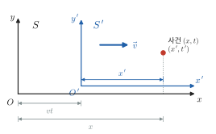

*그림 35.1* 기준틀 $S'$이 $S$에 대해 $+x$ 방향으로 속도 $\vec v$로 움직인다. $t = t' = 0$에 두 원점 $O$, $O'$이 일치했다면 시각 $t$에 $O'$은 $x = vt$에 있다. 한 사건을 두 기준틀이 각각 좌표 $(x, t)$, $(x', t')$으로 기록한다.

그런데 맥스웰 방정식은 진공 속 빛의 속력을 상수 $c$로 정한다. 갈릴레이 변환이 맞다면 빛의 속력은 기준틀마다 달라야 하고, 맥스웰 방정식이 성립하는 특별한 기준틀(19세기 물리학자들이 생각한 "에테르"의 정지틀)이 있어야 한다. 1887년 마이컬슨과 몰리는 33장의 간섭계로 지구의 운동 방향에 따른 광속의 차이를 찾으려 했지만 아무 차이도 발견하지 못했다.

### 아인슈타인의 두 가설 (1905)
1. **상대성 원리(principle of relativity)**: 모든 관성 기준틀에서 물리 법칙은 같은 모양을 가진다. 특별한 관성틀은 없다.
2. **광속 불변(constancy of the speed of light)**: 진공 속 빛의 속력은 광원이나 관찰자의 운동과 무관하게 모든 관성틀에서 $c$이다.

두 번째 가설은 첫 번째 가설을 맥스웰 방정식에 적용한 결과로 볼 수도 있다. 이 두 가설을 받아들이면 갈릴레이 변환의 $t' = t$, 즉 "절대 시간"을 버려야 한다. 2019년 SI 재정의 이전부터 이미 1983년에 미터는 $c = 299\,792\,458\ \text{m/s}$를 정의값으로 고정해 정의되었다(부록 A). 광속 불변이 측정 체계의 토대에 들어 있다.

### 사건과 기준틀
상대론에서는 **사건**(event)을 기본 단위로 쓴다. 사건은 특정한 장소와 시각에 일어나는 일(예: 섬광, 입자의 붕괴)이며, 기준틀마다 좌표 $(t, x, y, z)$가 주어진다. 한 기준틀에서는 공간 곳곳에 서로 맞춰 둔(동기화한) 시계와 자가 있다고 상상하고, 사건의 시각은 **그 사건이 일어난 자리의 시계**로 읽는다. 빛이 관찰자의 눈에 도달하는 시간 지연은 따로 보정한 뒤의 시각이다.

---

## 35.2 동시성의 상대성

일정한 속도로 달리는 기차 칸의 정중앙에서 섬광이 터진다. 기차 안의 관찰자($S'$)에게는 빛이 앞뒤 벽까지 같은 거리를 같은 속력 $c$로 가므로 두 벽에 **동시에** 도착한다.

지면의 관찰자($S$)에게도 빛의 속력은 앞뒤 모두 $c$이다(두 번째 가설). 그런데 빛이 가는 동안 뒷벽은 빛을 향해 다가오고 앞벽은 빛에서 멀어진다. 따라서 $S$에서는 빛이 **뒷벽에 먼저** 도착한다(그림 35.2).

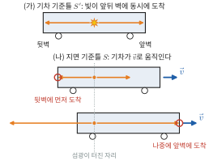

*그림 35.2* (가) 기차 기준틀 $S'$에서는 칸 정중앙의 섬광이 앞뒤 벽에 동시에 도착한다. (나) 지면 기준틀 $S$에서는 빛이 앞뒤로 같은 속력 $c$로 퍼지는 동안 기차가 움직이므로, 다가오는 뒷벽에 먼저(위), 멀어지는 앞벽에 나중에(아래) 도착한다. 그림은 $v = 0.4c$로 그렸다.

이처럼 한 기준틀에서 서로 다른 장소에서 동시에 일어난 두 사건은, 그 기준틀에 대해 움직이는 기준틀에서는 동시가 아니다. 이것이 **동시성의 상대성**(relativity of simultaneity)이다. 어느 쪽이 "맞는지" 묻는 것은 의미가 없다. 두 관찰자 모두 같은 물리 법칙으로 올바르게 측정했다. 35.5절에서 그 크기가 $\Delta t' = -\gamma v\Delta x/c^2$임을 보인다. 같은 장소에서 동시에 일어난 사건($\Delta x = 0$)은 모든 기준틀에서 동시다.

> **💡 개념 확인: 시간 팽창과 길이 수축의 뿌리**
> 시간 팽창과 길이 수축은 독립된 신기한 현상이 아니라 동시성의 상대성에서 나온다. 움직이는 막대의 길이를 재려면 양 끝의 위치를 **동시에** 표시해야 하는데, "동시"가 기준틀마다 다르므로 길이도 달라진다. 시험에서 "움직이는 시계가 느리다"와 "움직이는 막대가 짧다"만 기억하고 문제를 풀다 막히면, 대개 이 동시성의 문제를 놓친 것이다. 그럴 때는 35.5절의 로런츠 변환으로 사건 좌표를 직접 계산하는 것이 가장 확실하다.

---

## 35.3 시간 팽창

### 빛 시계
거울 두 장을 거리 $D$만큼 떨어뜨려 마주 보게 하고, 그 사이를 빛이 왕복하게 한 **빛 시계**(light clock)를 생각한다. 시계와 함께 움직이는 기준틀 $S'$에서 빛이 한 번 왕복하는 시간은
$$
\Delta t_0 = \frac{2D}{c}
$$
이다. 시계가 거울면과 나란한 방향으로 속력 $v$로 움직이는 것을 보는 기준틀 $S$에서는, 빛이 대각선을 따라 지그재그로 움직인다(그림 35.3). 왕복 시간을 $\Delta t$라 하면 빛이 편도로 가는 동안 시계는 $v\Delta t/2$만큼 움직이고, 빛의 경로는 피타고라스 정리에서
$$
\left(\frac{c\Delta t}{2}\right)^2 = D^2 + \left(\frac{v\Delta t}{2}\right)^2
$$
이다. 거울 사이 거리 $D$는 운동 방향에 수직이므로 두 기준틀에서 같다(35.5절에서 확인한다). 풀면
$$
\boxed{\Delta t = \frac{\Delta t_0}{\sqrt{1 - v^2/c^2}} = \gamma\Delta t_0, \qquad \gamma \equiv \frac{1}{\sqrt{1 - \beta^2}},\quad \beta = \frac{v}{c}}
$$
이다. $\gamma$를 **로런츠 인자**(Lorentz factor)라 한다. $\gamma \ge 1$이므로 $S$에서 잰 시간이 더 길다. 빛 시계가 아닌 어떤 시계(원자시계, 심장 박동, 입자의 붕괴)라도 상대성 원리에 따라 같은 비율로 느려져야 한다. 그렇지 않으면 움직이는 기준틀 안에서 두 시계를 비교해 자신의 운동을 알아낼 수 있기 때문이다.

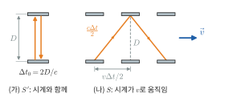

*그림 35.3* (가) 시계와 함께 움직이는 $S'$에서는 빛이 거리 $D$를 수직으로 왕복한다. (나) 시계가 속력 $v$로 움직이는 $S$에서는 빛이 빗변 $c\Delta t/2$를 따라가고, 그동안 시계는 $v\Delta t/2$만큼 옮겨 간다. 그림은 $v = 0.6c$($\gamma = 1.25$)로 그렸다.

### 고유 시간
두 사건이 **같은 장소**에서 일어나는 기준틀에서 잰 시간 간격을 **고유 시간(proper time)** $\Delta t_0$라 한다(위에서 빛이 아래 거울을 떠나고 돌아오는 두 사건은 $S'$에서 같은 장소). 고유 시간은 가능한 모든 관성틀에서 잰 시간 간격 중 가장 짧다. 문제를 풀 때는 먼저 "어느 기준틀에서 두 사건이 같은 자리인가"를 찾아야 한다.

$v \ll c$이면 1장의 근사로 $\gamma \approx 1 + \frac{1}{2}\beta^2$이다(그림 35.4). 시속 $900\ \text{km}$인 여객기($v = 250\ \text{m/s}$)라도 $\gamma - 1 \approx 3.5\times10^{-13}$에 불과하지만, 1971년에는 원자시계를 여객기에 싣고 지구를 동쪽과 서쪽으로 각각 돈 실험에서, 지상 시계와의 차이가 수십–수백 ns 수준으로 측정되어(중력 효과 포함) 상대론의 예측과 맞았다.

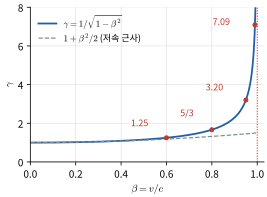

*그림 35.4* 로런츠 인자 $\gamma = 1/\sqrt{1 - \beta^2}$. $\beta \lesssim 0.3$에서는 1에 매우 가깝고 저속 근사 $1 + \beta^2/2$(점선)와 거의 같지만, $\beta \to 1$에서 무한히 커진다. 빨간 점은 본문과 연습문제 1에 나오는 $\beta = 0.6,\ 0.8,\ 0.95,\ 0.99$의 값이다.

### 예제 35.1 대기 중의 뮤온
우주선(cosmic ray)이 대기 상층의 원자핵과 충돌해 만든 뮤온(muon)은 정지 상태에서 평균 수명이 $\tau_0 = 2.197\ \mu\text{s}$이다. 속력 $0.998c$인 뮤온이 (가) 상대론이 없다면 평균 수명 동안 갈 수 있는 거리와 (나) 실제로 평균 수명 동안 지면 기준으로 가는 거리를 구하라.

**풀이**
(가) $d = v\tau_0 = (0.998)(2.998\times10^8)(2.197\times10^{-6}) = 657\ \text{m}$.
(나) $\gamma = 1/\sqrt{1 - 0.998^2} = 15.8$이고, 뮤온의 수명은 뮤온과 함께 움직이는 기준틀에서의 고유 시간이므로 지면에서는 $\gamma\tau_0 = 34.8\ \mu\text{s}$이다. $d = v\gamma\tau_0 = 10.4\ \text{km}$.
상층 대기에서 만들어진 뮤온이 많이 지면까지 도달하는 것은 시간 팽창의 직접적인 증거다. 가속기에서는 원형 궤도를 도는 뮤온의 수명이 $\gamma$배로 늘어나는 것이 정밀하게 확인되었다.

> **💡 개념 확인: 쌍둥이 역설**
> 쌍둥이 중 한 명이 빠른 우주선을 타고 먼 별에 갔다 돌아온다. 지구의 형제가 보기에는 여행자의 시계가 느리므로 여행자가 더 젊다. 그런데 여행자가 보기에는 지구가 움직였으니 지구의 형제가 더 젊어야 하지 않을까? 두 사람은 대칭이 아니다. 지구의 형제는 줄곧 한 관성틀에 있지만, 여행자는 별에서 방향을 바꾸며 **관성틀을 갈아탄다**. 갈아타는 순간 여행자의 "지구에서 지금 동시인 사건"이 크게 바뀐다(동시성의 상대성). 결과는 분명하다. 시공간에서 두 사건(출발, 귀환) 사이를 잇는 경로를 따라 잰 고유 시간 $\int\sqrt{1 - v^2/c^2}\,dt$는 관성 운동(직선)일 때 **가장 길다**. 따라서 여행자가 더 젊다. 이는 ★ 박스의 불변 간격으로 계산하면 명확해진다. 그림 35.5는 연습문제 2의 수치($0.6c$, 지구 시계로 10년)로 그린 시공간 도형이다.
>
> 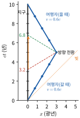
>
> *그림 35.5* 가로축은 지구에서 잰 거리, 세로축은 지구 시계의 시각 $ct$이다. 지구의 형제는 수직선(검정, 1년마다 눈금), 여행자는 꺾인 선(파랑, 여행자의 고유 시간 1년마다 점)을 따라간다. 여행자의 시계는 모두 8년, 지구 시계는 10년이 간다. 점선은 방향 전환 직전(빨강)과 직후(초록) 여행자에게 '지금'인 사건들을 잇는 동시선으로, 갈아타는 순간 여행자가 보는 지구의 '지금'이 3.2년에서 6.8년으로 건너뛴다.

---

## 35.4 길이 수축

### 유도
막대와 함께 정지한 기준틀에서 잰 길이를 **고유 길이(proper length)** $L_0$라 한다. 막대가 길이 방향으로 속력 $v$로 움직이는 기준틀 $S$에서 길이 $L$을 재 보자. $S$에 고정된 한 점 $P$를 막대의 앞끝과 뒤끝이 차례로 지나는 두 사건은 $S$에서 **같은 장소**이므로, 그 시간 간격 $\Delta t_0$는 고유 시간이고 $L = v\Delta t_0$이다. 막대의 기준틀에서는 점 $P$가 속력 $v$로 길이 $L_0$를 지나가므로 $L_0 = v\Delta t$이고, 이 $\Delta t$는 팽창된 시간 $\gamma\Delta t_0$이다. 따라서
$$
\boxed{L = \frac{L_0}{\gamma} = L_0\sqrt{1 - v^2/c^2}}
$$
이다. 운동 방향으로만 줄고, 운동에 수직인 방향의 길이는 변하지 않는다.

### 예제 35.2 우주선의 길이
고유 길이 $100\ \text{m}$인 우주선이 지구에 대해 $0.80c$로 날아간다. (가) 지구에서 잰 우주선의 길이는? (나) 우주선이 지구 궤도의 한 관측 위성 옆을 지나가는 데 걸리는 시간을 위성 기준과 우주선 기준으로 각각 구하라.

**풀이**
(가) $\gamma = 1/\sqrt{1 - 0.64} = 5/3$이므로 $L = 100/(5/3) = 60\ \text{m}$.
(나) 위성 기준: 길이 $60\ \text{m}$인 물체가 $0.80c$로 지나가므로 $\Delta t = 60/(0.80\times2.998\times10^8) = 250\ \text{ns}$. 이 두 사건(앞끝 통과, 뒤끝 통과)은 위성 위치에서 일어나므로 이것이 고유 시간이다.
우주선 기준: 위성이 $0.80c$로 길이 $100\ \text{m}$를 지나가므로 $\Delta t' = 100/(0.80c) = 417\ \text{ns} = \gamma\times250\ \text{ns}$. 두 결과가 시간 팽창과 일관됨을 확인할 수 있다(그림 35.6).

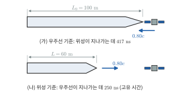

*그림 35.6* 예제 35.2. (가) 우주선 기준틀에서 우주선은 고유 길이 $L_0 = 100\ \text{m}$이고 위성이 $0.80c$로 지나간다. (나) 위성 기준틀에서 우주선은 $L = 60\ \text{m}$로 수축해 $0.80c$로 지나간다. 앞끝과 뒤끝이 위성을 지나는 두 사건은 위성 자리에서 일어나므로 (나)의 $250\ \text{ns}$가 고유 시간이다.

예제 35.1의 뮤온을 뮤온의 기준틀에서 보면, 뮤온의 수명은 $2.2\ \mu\text{s}$ 그대로이지만 대기층이 $\gamma$배 얇아져 다가온다(연습문제 8). 같은 현상을 지면은 시간 팽창으로, 뮤온은 길이 수축으로 설명한다.

---

## 35.5 로런츠 변환

### 유도
$S'$이 $S$에 대해 $+x$ 방향으로 속도 $v$로 움직이고, $t = t' = 0$일 때 두 원점이 일치한다고 하자. 공간이 균일하므로 변환은 선형이어야 한다. $S'$의 원점($x' = 0$)은 $S$에서 $x = vt$이므로
$$
x' = \gamma(x - vt)
$$
꼴로 쓸 수 있다($\gamma$는 아직 모르는 상수). 상대성 원리에 따라 $S$에서 본 $S'$와 $S'$에서 본 $S$는 속도의 부호만 다르므로 역변환은 $x = \gamma(x' + vt')$이다. 이제 $t = 0$에 원점을 떠난 빛 펄스를 생각한다. 두 번째 가설에서 $x = ct$, $x' = ct'$이므로
$$
ct' = \gamma(c - v)t, \qquad ct = \gamma(c + v)t'
$$
이고, 두 식을 곱하면 $c^2tt' = \gamma^2(c^2 - v^2)tt'$, 즉 $\gamma = 1/\sqrt{1 - v^2/c^2}$이다. 역변환 식에 $x'$을 대입해 $t'$에 대해 풀면 $t' = \gamma(t - vx/c^2)$를 얻는다(연습문제 14). 정리하면 **로런츠 변환**(Lorentz transformation)은
$$
\boxed{x' = \gamma(x - vt), \quad y' = y, \quad z' = z, \quad t' = \gamma\left(t - \frac{vx}{c^2}\right)}
$$
이고, 역변환은 $v \to -v$로 바꾸면 된다. 운동에 수직인 좌표가 변하지 않는 것은 대칭성으로 보일 수 있다(두 기준틀의 막대를 수직으로 스쳐 지나게 하면 어느 쪽이 짧은지 모순 없이 정할 수 없다). $v \ll c$이면 $\gamma \to 1$, $vx/c^2 \to 0$이 되어 갈릴레이 변환으로 돌아간다.

두 사건의 간격에 대해서는
$$
\Delta x' = \gamma(\Delta x - v\Delta t), \qquad \Delta t' = \gamma\left(\Delta t - \frac{v\Delta x}{c^2}\right)
$$
이다. 이 두 식에서 앞 절의 결과가 모두 나온다.
- **시간 팽창**: $S'$의 한 자리에 있는 시계의 두 사건($\Delta x' = 0$)을 역변환하면 $\Delta t = \gamma\Delta t'$.
- **길이 수축**: $S'$에 정지한 막대의 양 끝을 $S$에서 동시에($\Delta t = 0$) 재면 $\Delta x' = \gamma\Delta x$, 즉 $\Delta x = L_0/\gamma$.
- **동시성의 상대성**: $\Delta t = 0$, $\Delta x \ne 0$이면 $\Delta t' = -\gamma v\Delta x/c^2 \ne 0$.

### 예제 35.3 동시에 친 두 번개
지면 기준틀 $S$에서 $x = 0$과 $x = 3.0\ \text{km}$에 번개가 동시에 쳤다. $+x$ 방향으로 $0.60c$로 나는 로켓($S'$)에서 두 번개 사이의 시간 간격과 거리는?

**풀이**
$\gamma = 1/\sqrt{1 - 0.36} = 1.25$. $\Delta t = 0$, $\Delta x = 3000\ \text{m}$이므로
$$
\Delta t' = -\frac{\gamma v\Delta x}{c^2} = -\frac{(1.25)(0.60)(3000\ \text{m})}{2.998\times10^8\ \text{m/s}} = -7.5\ \mu\text{s}, \qquad \Delta x' = \gamma\Delta x = 3.75\ \text{km}
$$
$\Delta t' < 0$이므로 로켓에서는 앞쪽($x = 3.0\ \text{km}$)의 번개가 $7.5\ \mu\text{s}$ **먼저** 친다(그림 35.7). 거리가 $\gamma$배로 **길어진** 것에 주의하라. 두 번개 자리 사이의 거리는 $S$에서 정지한 고유 길이가 아니라, $S$에서 동시인 두 사건 사이의 간격이므로 길이 수축 공식을 그대로 쓰면 안 된다. 로런츠 변환으로 계산하면 이런 함정에 빠지지 않는다.

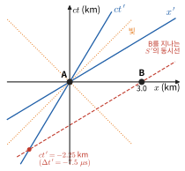

*그림 35.7* 예제 35.3의 시공간 도형(민코프스키 도형). $S$에서 두 번개 A, B는 $x$축 위에 있어 동시이다. $0.60c$로 나는 로켓($S'$)의 $ct'$축은 로켓 원점의 세계선 $x = 0.6\,ct$이고, $x'$축($ct' = 0$)은 $ct = 0.6x$이다. $S'$에서 동시인 사건들은 $x'$축에 평행한 선 위에 있으므로, B를 지나는 동시선(빨간 점선)이 $ct'$축과 만나는 점에서 B의 시각 $ct' = -2.25\ \text{km}$를 읽는다. B가 A보다 먼저다. 점선은 빛의 세계선이다.

### 속도 덧셈
$S'$에서 물체가 $x'$ 방향으로 속도 $u'$으로 움직이면 $S$에서의 속도 $u$는 무엇인가? 역변환 $x = \gamma(x' + vt')$, $t = \gamma(t' + vx'/c^2)$의 미분을 나누면
$$
u = \frac{dx}{dt} = \frac{\gamma(dx' + v\,dt')}{\gamma(dt' + v\,dx'/c^2)} \quad\Rightarrow\quad \boxed{u = \frac{u' + v}{1 + u'v/c^2}}
$$
이다. $u' = c$이면 $u = (c + v)/(1 + v/c) = c$로, 광속 불변이 자동으로 성립한다. 속력이 $c$보다 작은 두 속도를 아무리 더해도 $c$를 넘지 않는다.

### 예제 35.4 우주선에서 쏜 탐사선
지구에 대해 $0.80c$로 나는 우주선이 진행 방향으로 탐사선을 우주선에 대해 $0.60c$로 쏘았다. 지구에서 본 탐사선의 속력은? 탐사선 대신 빛을 앞으로 쏘면?

**풀이**
$$
u = \frac{0.60c + 0.80c}{1 + (0.60)(0.80)} = \frac{1.40c}{1.48} = 0.946c
$$
갈릴레이 덧셈의 $1.40c$가 아니다. 빛을 쏘면 $u = (c + 0.80c)/(1 + 0.80) = c$이다.

### 상대론적 도플러 효과
광원이 관찰자에게서 속력 $v$로 멀어진다. 광원의 기준틀에서 빛의 주기를 $T_0$라 하면, 관찰자 기준틀에서 광원의 시계는 느리므로 두 파면을 내보내는 시간 간격은 $\gamma T_0$이다. 그동안 광원은 $v\gamma T_0$만큼 더 멀어지므로 두 파면이 관찰자에 도착하는 간격은 $T = \gamma T_0(1 + \beta)$이다. 따라서
$$
f = f_0\sqrt{\frac{1 - \beta}{1 + \beta}} \quad(\text{멀어질 때}), \qquad f = f_0\sqrt{\frac{1 + \beta}{1 - \beta}} \quad(\text{다가올 때})
$$
이다. 17장의 소리의 도플러 효과와 달리, 결과가 광원과 관찰자의 **상대 속도**에만 의존한다. 빛에는 매질이 없기 때문이다. 멀어지는 광원의 스펙트럼선이 긴 파장으로 옮겨 가는 것을 **적색 이동**(redshift)이라 하며, 은하의 후퇴 속도를 재는 데 쓴다(우주 팽창에 의한 적색 이동은 엄밀히는 일반상대론으로 다루지만, 가까운 은하에서는 이 식으로 근사할 수 있다).

> **★ 심화: 4차원 벡터와 불변 간격**
> **시공간과 불변 간격.** 사건을 4차원 좌표 $x^\mu = (ct, x, y, z)$로 쓴다. 두 사건 사이의
> $$
> (\Delta s)^2 = (c\Delta t)^2 - (\Delta x)^2 - (\Delta y)^2 - (\Delta z)^2
> $$
> 를 **불변 간격**(invariant interval)이라 한다. 로런츠 변환을 대입하면 $(c\Delta t')^2 - (\Delta x')^2 = \gamma^2[(c\Delta t - \beta\Delta x)^2 - (\Delta x - \beta c\Delta t)^2] = \gamma^2(1 - \beta^2)[(c\Delta t)^2 - (\Delta x)^2]$이므로 모든 관성틀에서 같은 값이다. 3차원 회전이 거리 $\Delta x^2 + \Delta y^2 + \Delta z^2$를 보존하듯, 로런츠 변환은 이 간격을 보존하는 "시공간의 회전"이다.
> - $(\Delta s)^2 > 0$(**시간꼴**, timelike): 두 사건이 같은 장소에서 일어나는 기준틀이 있고, 그 틀에서의 시간이 고유 시간 $\Delta\tau = \Delta s/c$이다. 인과적으로 연결될 수 있으며 순서가 모든 기준틀에서 같다.
> - $(\Delta s)^2 < 0$(**공간꼴**, spacelike): 두 사건이 동시인 기준틀이 있고, 순서가 기준틀에 따라 뒤바뀔 수 있다. 빛보다 빠른 신호가 없으므로 인과적으로 연결될 수 없다.
> - $(\Delta s)^2 = 0$(**빛꼴**, lightlike): 빛으로 연결된다.
>
> 원점에서 나가는 빛의 세계선 $x = \pm ct$가 이루는 **빛원뿔**(light cone)이 이 세 영역을 가른다(그림 35.8). 한 사건을 여러 기준틀에서 본 좌표는 모두 같은 쌍곡선 $(ct)^2 - x^2 = (\Delta s)^2$ 위에 놓인다.
>
> 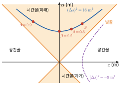
>
> *그림 35.8* 빛원뿔(주황 선)이 시간꼴 영역(색칠)과 공간꼴 영역을 나눈다. 파란 쌍곡선은 🐍 실습의 간격 $(c\Delta t, \Delta x) = (5, 3)\ \text{m}$를 기준틀 $S$와 $\beta = 0.3,\ 0.6,\ 0.9$인 기준틀에서 본 점들로, 모두 $(\Delta s)^2 = 16\ \text{m}^2$이다. 두 사건이 같은 장소인 $\beta = 0.6$ 틀에서 $c\Delta t' = 4\ \text{m}$로 가장 짧다(고유 시간). 보라 점선은 공간꼴 간격이 일정한 쌍곡선이다.
>
> **쾌속도.** $\beta = \tanh\phi$로 **쾌속도(rapidity)** $\phi$를 정의하면 $\gamma = \cosh\phi$, $\gamma\beta = \sinh\phi$이고, 로런츠 변환은
> $$
> \begin{pmatrix} ct' \\ x' \end{pmatrix} = \begin{pmatrix} \cosh\phi & -\sinh\phi \\ -\sinh\phi & \cosh\phi \end{pmatrix}\begin{pmatrix} ct \\ x \end{pmatrix}
> $$
> 로 쌍곡선 회전이 된다. 같은 방향의 두 변환을 이어 하면 쾌속도가 그냥 더해진다($\phi = \phi_1 + \phi_2$). $\tanh$의 덧셈 정리가 바로 속도 덧셈 공식이다.
>
> **4차원 운동량.** 입자의 고유 시간 $d\tau = dt/\gamma$로 위치 4차원 벡터를 미분한 **4차원 속도** $U^\mu = dx^\mu/d\tau = \gamma(c, \vec{v})$에 질량을 곱하면 **4차원 운동량**
> $$
> P^\mu = mU^\mu = \left(\frac{E}{c}, \vec{p}\right) = (\gamma mc, \gamma m\vec{v})
> $$
> 를 얻는다. 이 벡터의 "길이"도 불변이다: $P^\mu P_\mu = (E/c)^2 - |\vec{p}|^2 = (mc)^2$. 이것이 35.6절의 $E^2 = (pc)^2 + (mc^2)^2$이다. 여러 입자로 이루어진 계에서는 4차원 운동량의 합이 보존되고, 그 합의 길이 $\sqrt{(\sum E)^2 - (\sum\vec{p}c)^2}/c^2$가 **불변 질량**이다. 문제를 풀 때 계산하기 쉬운 기준틀(예: 질량중심틀)에서 불변량을 구하고 다른 기준틀의 값과 같다고 놓는 것이 상대론 충돌 문제의 표준 전략이다(연습문제 15, 16).

> **🐍 파이썬 실습: 로런츠 변환 행렬로 확인하기**
> 로런츠 변환을 $2\times2$ 행렬로 만들고, 불변 간격이 보존되는지와 두 변환의 합성이 속도 덧셈 공식과 같은지 확인한다.
> ```python
> import numpy as np
>
> def boost(beta):                      # x 방향 로런츠 변환 행렬, (ct, x) 성분
>     g = 1/np.sqrt(1 - beta**2)
>     return np.array([[g, -g*beta], [-g*beta, g]])
>
> eta = np.diag([1.0, -1.0])            # 민코프스키 계량 diag(1, -1)
> X = np.array([5.0, 3.0])              # 사건 간격 (c*dt, dx), 단위는 m
>
> for beta in [0.3, 0.9, 0.999]:
>     Xp = boost(beta) @ X
>     print(f"beta={beta}: s^2 = {X @ eta @ X:.4f} -> {Xp @ eta @ Xp:.4f}, ct' = {Xp[0]:.3f}")
>
> L = boost(0.6) @ boost(0.8)           # 두 번 연속 변환
> beta_tot = -L[0, 1]/L[0, 0]           # 합성된 변환의 속력
> print(f"0.8c (+) 0.6c = {beta_tot:.4f}c, 공식 {(0.8+0.6)/(1+0.8*0.6):.4f}c")
> print(f"rapidity: {np.arctanh(0.8)+np.arctanh(0.6):.4f} = {np.arctanh(beta_tot):.4f}")
> ```
> 출력에서 세 경우 모두 `s^2 = 16.0000 -> 16.0000`이고, $ct'$은 `4.298`, `5.277`, `44.800`으로 기준틀마다 다르다. 이 간격은 시간꼴($s^2 > 0$)이므로 $ct'$이 고유 시간에 해당하는 $\sqrt{16} = 4$보다 작아지는 기준틀은 없다. 합성 결과는 `0.9459c`로 예제 35.4와 같고, 쾌속도는 $\ln3 + \ln2 = \ln6 = 1.7918$로 그냥 더해진다.

---

## 35.6 상대론적 운동량과 에너지

### 상대론적 운동량
뉴턴의 운동량 $m\vec{v}$를 그대로 쓰면, 한 기준틀에서 보존되는 운동량이 다른 기준틀에서는 보존되지 않는다. 예를 들어 같은 공 두 개가 거의 스치듯 충돌하는데, 공 A는 $S$에서, 공 B는 $S'$에서 각각 $y$ 방향으로만 작은 속력 $u_0$로 움직인다고 하자. 대칭성에 따라 충돌 후 A는 $S$에서, B는 $S'$에서 $y$ 속도의 부호만 바뀐다. 그런데 $S$에서 보면 B의 $y$ 방향 속력은 $u_0/\gamma$이다($y$ 방향 거리는 같고 B의 시계가 느리므로). 그러면 $S$에서 $m\vec{v}$의 $y$ 성분 변화는 A가 $2mu_0$, B가 $-2mu_0/\gamma$로 서로 상쇄되지 않는다. 운동량을
$$
\boxed{\vec{p} = \gamma m\vec{v} = \frac{m\vec{v}}{\sqrt{1 - v^2/c^2}}}
$$
로 정의하면 B의 $\gamma$(속력이 거의 $v$이므로 $\approx\gamma$)가 $1/\gamma$를 상쇄해 보존 법칙이 모든 기준틀에서 성립한다. 여기서 $m$은 기준틀에 무관한 입자의 질량이다. 뉴턴 제2법칙은 $\vec{F} = d\vec{p}/dt$의 꼴로 유지된다.

> **💡 개념 확인: "상대론적 질량"은 쓰지 않는다**
> 예전 책에서는 $\gamma m$을 "움직이는 질량"이라 부르며 "빠르면 질량이 늘어난다"고 설명하기도 했다. 현대 물리학에서는 질량 $m$을 기준틀에 무관한 불변량(★ 박스의 불변 질량)으로만 쓰고, $\gamma$는 운동량과 에너지의 식에 붙여 둔다. "질량이 늘어서 가속이 어렵다"는 설명은 힘의 방향에 따라 맞지 않는 경우가 있어(운동 방향과 수직인 힘과 나란한 힘에 대한 응답이 다르다) 오해를 낳기 쉽다.

### 운동에너지의 유도
정지한 입자에 $x$ 방향 힘 $F$를 가해 속력 $v$까지 가속할 때 한 일이 운동에너지다. $F = dp/dt$와 $dx = v\,dt$를 쓰면
$$
K = \int F\,dx = \int\frac{dp}{dt}v\,dt = \int_0^{v} v\,dp
$$
이다. 부분적분 $\int v\,dp = pv - \int p\,dv$와 $p = \gamma mv$를 쓰면
$$
K = \gamma mv^2 - \int_0^{v}\frac{mv'}{\sqrt{1 - v'^2/c^2}}\,dv' = \gamma mv^2 + mc^2\sqrt{1 - \frac{v^2}{c^2}} - mc^2
$$
이고, 앞의 두 항을 $\gamma m(v^2 + c^2/\gamma^2) = \gamma m(v^2 + c^2 - v^2) = \gamma mc^2$로 묶으면
$$
\boxed{K = (\gamma - 1)mc^2}
$$
이다. $v \to c$이면 $\gamma \to \infty$이므로 질량 있는 입자를 광속까지 가속하려면 무한한 에너지가 필요하다. $v \ll c$이면 $\gamma - 1 \approx \frac12\beta^2$이어서 $K \approx \frac12mv^2$로 돌아간다(1장 예제 1.6). 그림 35.9는 운동량과 운동에너지를 뉴턴 역학의 값과 비교한 것이다.

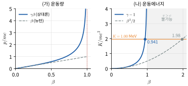

*그림 35.9* (가) 운동량 $p = \gamma mv$와 뉴턴의 $mv$. (나) 운동에너지 $K = (\gamma - 1)mc^2$와 뉴턴의 $\frac12mv^2$. $\beta \to 1$에서 상대론적 값은 무한히 커진다. 가로선은 예제 35.5의 $1.00\ \text{MeV}$ 전자로, 상대론은 $\beta = 0.941$을 주지만 뉴턴 역학은 불가능한 $\beta = 1.98$을 준다.

### 정지 에너지와 총에너지
$K = \gamma mc^2 - mc^2$에서 속력에 무관한 항 $mc^2$를 **정지 에너지(rest energy)**, $E = \gamma mc^2$를 **총에너지**(total energy)라 한다.
$$
E = \gamma mc^2 = K + mc^2
$$
정지 에너지는 질량 자체가 에너지의 한 형태임을 뜻한다. 핵반응이나 입자 붕괴에서 계의 질량이 줄면 그만큼 운동에너지나 복사 에너지가 나온다. 이때 계의 질량 변화는 $\Delta m = \Delta E/c^2$이다.

### 에너지–운동량 관계
$E = \gamma mc^2$와 $p = \gamma mv$에서 $\gamma$를 소거하면
$$
E^2 - (pc)^2 = \gamma^2m^2c^4(1 - \beta^2) = (mc^2)^2 \quad\Rightarrow\quad \boxed{E^2 = (pc)^2 + (mc^2)^2}
$$
이다. 또 $\vec{p}c^2/E = \vec{v}$가 성립한다. 질량이 0인 입자(광자)는 $E = pc$이고 $v = c$이다. 이 관계는 빗변이 $E$, 두 변이 $pc$와 $mc^2$인 직각삼각형으로 기억하면 편하다(그림 35.10). 36장에서 광자의 에너지 $E = hf$와 운동량 $p = h/\lambda$가 이 관계를 만족함을 본다.

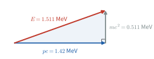

*그림 35.10* $E^2 = (pc)^2 + (mc^2)^2$을 나타내는 직각삼각형. $mc^2$은 기준틀에 무관하고, $pc/E = \beta$, $E/mc^2 = \gamma$이다. 예제 35.5의 전자 값으로 축척을 맞추어 그렸다.

입자물리에서는 에너지를 전자볼트로, 운동량을 $\text{eV}/c$로, 질량을 $\text{eV}/c^2$으로 쓰면 계산이 편하다. 전자의 정지 에너지는 $0.511\ \text{MeV}$, 양성자는 $938.3\ \text{MeV}$이다(부록 A).

### 예제 35.5 1 MV로 가속한 전자
정지한 전자를 전위차 $1.00\ \text{MV}$로 가속했다. 운동에너지, $\gamma$, 속력, 운동량을 구하고 뉴턴 역학의 결과와 비교하라.

**풀이**
$K = eV = 1.00\ \text{MeV}$. $\gamma = 1 + K/mc^2 = 1 + 1.00/0.511 = 2.96$.
$\beta = \sqrt{1 - 1/\gamma^2} = 0.941$, 즉 $v = 0.941c$.
$E = K + mc^2 = 1.511\ \text{MeV}$이므로 $pc = \sqrt{E^2 - (mc^2)^2} = \sqrt{1.511^2 - 0.511^2}\ \text{MeV} = 1.42\ \text{MeV}$, $p = 1.42\ \text{MeV}/c$.
뉴턴 역학으로 $\frac12mv^2 = K$를 풀면 $v/c = \sqrt{2K/mc^2} = 1.98$로 광속보다 빠른, 틀린 결과가 나온다. 운동에너지가 정지 에너지와 비슷하거나 크면 반드시 상대론을 써야 한다.

### 예제 35.6 정지한 파이온의 붕괴
정지한 양전하 파이온($m_\pi c^2 = 139.57\ \text{MeV}$)이 뮤온($m_\mu c^2 = 105.66\ \text{MeV}$)과 중성미자(질량은 무시)로 붕괴한다: $\pi^+ \to \mu^+ + \nu_\mu$. 뮤온의 운동량과 운동에너지를 구하라.

**풀이**
운동량 보존에서 두 입자는 크기가 같은 운동량 $p$로 반대 방향으로 나간다(그림 35.11). 에너지 보존에서
$$
m_\pi c^2 = \sqrt{(pc)^2 + (m_\mu c^2)^2} + pc
$$
이다. $pc$를 이항하고 제곱하면 $(m_\pi c^2 - pc)^2 = (pc)^2 + (m_\mu c^2)^2$, 즉
$$
pc = \frac{(m_\pi c^2)^2 - (m_\mu c^2)^2}{2m_\pi c^2} = \frac{139.57^2 - 105.66^2}{2(139.57)}\ \text{MeV} = 29.79\ \text{MeV}
$$
이다. 뮤온의 총에너지는 $E_\mu = m_\pi c^2 - pc = 109.78\ \text{MeV}$이고 운동에너지는 $K_\mu = 4.12\ \text{MeV}$이다. 정지한 입자의 2체 붕괴에서는 보존 법칙만으로 두 입자의 에너지가 하나로 정해지므로, 뮤온은 언제나 같은 에너지로 나온다. 3체 붕괴라면 에너지가 연속 분포를 이룬다(40장의 베타 붕괴).

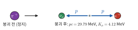

*그림 35.11* 정지한 $\pi^+$가 $\mu^+$와 $\nu_\mu$로 붕괴한다. 처음 운동량이 0이므로 두 입자는 크기 $pc = 29.79\ \text{MeV}$인 운동량으로 정반대 방향으로 나간다.

### 예제 35.7 질량 결손과 결합 에너지
양성자와 중성자가 결합해 중수소핵(듀테론)을 이룬다. 정지 에너지는 양성자 $938.272\ \text{MeV}$, 중성자 $939.565\ \text{MeV}$, 듀테론 $1875.613\ \text{MeV}$이다. 결합 에너지와, 그것이 구성 입자 질량의 몇 %인지 구하라.

**풀이**
$$
B = (m_p + m_n - m_d)c^2 = (938.272 + 939.565 - 1875.613)\ \text{MeV} = 2.224\ \text{MeV}
$$
이는 구성 입자 정지 에너지 합의 $2.224/1877.837 = 0.12\%$이다. 듀테론을 양성자와 중성자로 떼어 내려면 적어도 $2.224\ \text{MeV}$(예: 그 이상의 에너지를 가진 감마선)가 필요하다. 결합된 계의 질량은 구성 입자 질량의 합보다 작다. 화학 결합(수 eV)에서도 원리는 같지만 질량 변화가 $10^{-10}$ 정도로 너무 작아 무시한다. 핵반응은 이 비율이 $10^{-3}$ 정도여서 막대한 에너지를 낸다(40장).

> **🔗 전공 연결: PET 영상과 $E = mc^2$ (약학·수의학)**
> 양전자 방출 단층촬영(PET)은 상대론적 에너지–질량 관계를 그대로 쓰는 의료 영상이다. 양전자를 내는 방사성 동위원소(예: 플루오린-18)를 붙인 약물, 즉 **방사성 의약품**을 몸에 투여하면 약물이 모이는 곳에서 양전자가 나온다. 양전자는 곧 주변의 전자와 만나 **쌍소멸**하고, 두 입자의 정지 에너지 $2m_ec^2$가 감마선 광자 두 개로 바뀐다. 거의 정지한 상태에서 소멸하므로 운동량 보존에 따라 두 광자는 **정반대 방향**으로 날아가고, 각 광자의 에너지는 $m_ec^2 = 511\ \text{keV}$이다. 몸을 둘러싼 검출기 고리에서 $511\ \text{keV}$ 광자 두 개가 **동시에** 검출되면 소멸 지점이 그 두 검출기를 잇는 선 위에 있다고 판단하고, 이런 선을 많이 모아 약물 분포의 3차원 영상을 재구성한다. 포도당 유사체 약물은 대사가 활발한 종양에 많이 모이므로 암 진단에 널리 쓰인다. 약학에서는 방사성 의약품의 합성과 체내 동태를, 수의학에서는 반려동물의 종양 진단과 수의 핵의학에서 이 원리를 다룬다. 동위원소는 26장에서 본 사이클로트론으로 만든다.

> **🔬 최신 연구 노트: GPS와 상대론 보정**
> GPS 위성은 고도 약 $20\,200\ \text{km}$의 궤도를 약 12시간 주기로 돌며, 정밀한 원자시계의 시각 신호를 보낸다. 수신기는 여러 위성의 신호가 도착하는 시간 차이로 자기 위치를 계산하므로, 시계 오차가 $1\ \text{ns}$만 되어도 거리 오차는 $c\times1\ \text{ns} \approx 30\ \text{cm}$가 된다. 위성 시계는 지상의 시계와 두 가지 이유로 다른 속도로 간다.
> - **특수상대론(속도 효과)**: 위성은 약 $3.9\ \text{km/s}$로 움직이므로 시계가 $\frac12v^2/c^2$의 비율만큼 느려진다. 하루에 약 $-7\ \mu\text{s}$.
> - **일반상대론(중력 효과)**: 중력 퍼텐셜이 높은(지구에서 먼) 곳의 시계는 더 빨리 간다. 비율은 퍼텐셜 차이 $GM(1/R - 1/r)/c^2$이고, 하루에 약 $+45\ \mu\text{s}$.
> 두 효과를 합치면 위성 시계는 하루에 **약 $+38\ \mu\text{s}$** 빨리 간다. 비율로는 $4.5\times10^{-10}$에 불과하지만, 보정하지 않으면 하루에 $38\ \mu\text{s}\times c \approx 11$–$12\ \text{km}$의 거리 오차가 쌓인다. 그래서 위성 시계는 발사 전에 진동수를 이 비율만큼 낮게 맞추어 궤도에서 지상 시계와 같은 빠르기로 가게 하고, 궤도 이심률 등에 따른 작은 주기적 보정은 수신기에서 계산한다. 상대론은 일상 기술 속에서 매일 검증되고 있다.

> **🐍 파이썬 실습: GPS 위성 시계의 상대론 보정 계산**
> 원궤도를 가정하고 두 효과를 직접 계산한다(지상 시계는 지구 자전에 의한 작은 효과를 무시하고 지표에 정지해 있다고 본다).
> ```python
> import numpy as np
>
> c  = 299792458.0          # m/s (정확)
> GM = 3.986004418e14       # 지구의 GM (m^3/s^2)
> R  = 6.371e6              # 지구 평균 반지름 (m)
> r  = R + 20.2e6           # GPS 위성 궤도 반지름 (m)
> day = 86400.0             # s
>
> v = np.sqrt(GM/r)                          # 원궤도 속력
> T = 2*np.pi*r/v
> kin  = -v**2/(2*c**2)                      # 특수상대론: 움직이는 시계가 느림
> grav = GM/c**2*(1/R - 1/r)                 # 일반상대론: 높은 곳의 시계가 빠름
> net = kin + grav
>
> print(f"궤도 속력 {v:.0f} m/s, 주기 {T/3600:.2f} h")
> print(f"속도 효과   {kin*day*1e6:+.1f} μs/일")
> print(f"중력 효과   {grav*day*1e6:+.1f} μs/일")
> print(f"합계        {net*day*1e6:+.1f} μs/일 (비율 {net:.2e})")
> print(f"보정하지 않으면 하루 거리 오차 ≈ {net*day*c/1e3:.0f} km")
> ```
> 출력은 `궤도 속력 3873 m/s, 주기 11.97 h`, `속도 효과 -7.2 μs/일`, `중력 효과 +45.7 μs/일`, `합계 +38.5 μs/일 (비율 4.46e-10)`, `하루 거리 오차 ≈ 12 km`이다. 본문의 어림값(약 $-7$, $+45$, $+38\ \mu\text{s/일}$)과 일치한다. `r`을 바꾸어 두 효과가 상쇄되는 고도를 찾아보라(연습문제 17).

---

## 핵심 정리

| 주제 | 핵심 식 | 비고 |
|---|---|---|
| 로런츠 인자 | $\gamma = 1/\sqrt{1 - \beta^2}$, $\beta = v/c$ | $v \ll c$: $\gamma \approx 1 + \beta^2/2$ |
| 시간 팽창 | $\Delta t = \gamma\Delta t_0$ | $\Delta t_0$: 같은 자리 두 사건(고유 시간) |
| 길이 수축 | $L = L_0/\gamma$ | $L_0$: 정지틀 길이(고유 길이), 운동 방향만 |
| 동시성 | $\Delta t' = -\gamma v\Delta x/c^2$ ($\Delta t = 0$일 때) | |
| 로런츠 변환 | $x' = \gamma(x - vt)$, $t' = \gamma(t - vx/c^2)$ | 역변환: $v \to -v$ |
| 속도 덧셈 | $u = (u' + v)/(1 + u'v/c^2)$ | $c \oplus v = c$ |
| 도플러 | $f = f_0\sqrt{(1 - \beta)/(1 + \beta)}$ (멀어짐) | 상대 속도만 의존 |
| 불변 간격 | $(\Delta s)^2 = (c\Delta t)^2 - \lvert\Delta\vec{r}\rvert^2$ | ★ 시간꼴/공간꼴/빛꼴 |
| 운동량 | $\vec{p} = \gamma m\vec{v}$ | |
| 에너지 | $E = \gamma mc^2 = K + mc^2$, $K = (\gamma - 1)mc^2$ | |
| 에너지–운동량 | $E^2 = (pc)^2 + (mc^2)^2$, $\vec{v} = \vec{p}c^2/E$ | 광자 $E = pc$ |
| 4차원 운동량 | $P^\mu = (E/c, \vec{p})$, $P^\mu P_\mu = (mc)^2$ | ★ 불변 질량 |
| GPS | 속도 $\approx -7$, 중력 $\approx +45$, 합 $\approx +38\ \mu\text{s/일}$ | 🔬 |

---

## 연습문제

**기본**
1. $\beta = 0.10,\ 0.60,\ 0.80,\ 0.99,\ 0.999$일 때 $\gamma$를 구하라.
2. 우주인이 지구에 대해 $0.60c$로 왕복 여행을 했다. 지구 시계로 10년이 걸렸다면 우주인은 몇 년 나이를 먹었는가? (가속 구간은 무시한다.)
3. 고유 길이 $1.0\ \text{m}$인 막대가 길이 방향으로 $0.60c$로 움직인다. 정지한 관찰자가 잰 길이는? 막대가 운동 방향에 수직으로 놓여 있다면?
4. 양전하 파이온의 고유 평균 수명은 $26.0\ \text{ns}$이다. $0.95c$로 움직이는 파이온의 실험실 수명과 평균 이동 거리를 구하라.
5. 지구에서 볼 때 두 우주선이 각각 $0.70c$로 서로를 향해 다가온다. 한 우주선에서 본 다른 우주선의 속력은?
6. 운동에너지 $1.00\ \text{GeV}$인 양성자의 $\gamma$, 속력, 운동량을 구하라($m_pc^2 = 938.3\ \text{MeV}$).
7. 질량 $1.0\ \text{g}$이 모두 에너지로 바뀐다면 몇 J인가?

**응용**

8. 예제 35.1의 뮤온($0.998c$)의 기준틀에서 지면 위 $10\ \text{km}$ 두께의 대기층은 얼마로 보이는가? 이 결과가 지면 기준의 시간 팽창 설명과 일관됨을 보여라.
9. 기준틀 $S$에서 사건 A는 $(x, t) = (0, 0)$, 사건 B는 $(600\ \text{m}, 1.00\ \mu\text{s})$이다. (가) $+x$ 방향으로 $0.80c$로 움직이는 $S'$에서 두 사건의 간격 $\Delta x'$, $\Delta t'$을 구하라. (나) 두 기준틀에서 불변 간격이 같음을 확인하라. (다) A가 B의 원인이 될 수 있는가?
10. 본문의 방법으로 다가오는 광원의 상대론적 도플러 식을 유도하라. 어떤 은하에서 오는 수소 Hα선(정지 파장 $656.3\ \text{nm}$)이 $721.9\ \text{nm}$로 관측되었다. 도플러 식을 쓸 때 은하의 후퇴 속력은?
11. 전자의 속력이 $0.99c$가 되려면 운동에너지가 얼마여야 하는가? 뉴턴 역학의 $\frac12mv^2$와 비교하라.
12. 태양은 매초 $3.828\times10^{26}\ \text{J}$의 에너지를 복사한다. 태양의 질량은 매초 얼마씩 줄어드는가?
13. 어떤 입자의 총에너지가 $10.0\ \text{GeV}$, 운동량이 $9.90\ \text{GeV}/c$이다. 질량과 속력을 구하라.

**도전**

14. (로런츠 변환과 쾌속도) (가) 본문의 유도를 완성해 $t' = \gamma(t - vx/c^2)$를 보여라. (나) ★ 박스의 쌍곡선 회전 꼴에서 두 변환의 합성이 쾌속도의 합이 됨을 보이고, $\tanh(\phi_1 + \phi_2)$의 덧셈 정리에서 속도 덧셈 공식을 유도하라. (다) $0.80c$와 $0.60c$의 쾌속도가 각각 $\ln3$, $\ln2$임을 보이고, 합성 속도를 쾌속도로 구하라.
15. (반양성자 생성 문턱) 그림 35.12(가)와 같이 정지한 양성자에 양성자를 쏘아 $p + p \to p + p + p + \bar{p}$ 반응으로 반양성자를 만든다. 불변 질량(★ 박스)을 써서 입사 양성자의 최소 운동에너지가 $6m_pc^2$임을 보이고 값을 GeV로 구하라. 같은 반응을 그림 35.12(나)처럼 두 양성자가 같은 에너지로 정면 충돌하는 충돌형 가속기에서 일으키면 각 양성자의 최소 운동에너지는 얼마인가? 충돌형 가속기가 유리한 이유를 설명하라.

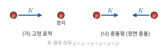

*그림 35.12* 연습문제 15. (가) 운동에너지 $K$인 양성자를 정지한 양성자에 쏘는 고정 표적 실험. (나) 같은 운동에너지 $K$의 두 양성자가 정면 충돌하는 충돌형 가속기.

16. (중성 파이온의 붕괴) 중성 파이온($m_{\pi^0}c^2 = 135.0\ \text{MeV}$)이 광자 두 개로 붕괴한다. (가) 그림 35.13과 같이 두 광자의 에너지를 $E_1, E_2$, 사이각을 $\theta$라 할 때 불변 질량에서 $m_{\pi^0}^2c^4 = 2E_1E_2(1 - \cos\theta)$임을 보여라. (나) 총에너지 $E = 1.00\ \text{GeV}$인 파이온에서 사이각의 최솟값이 $\sin(\theta_{\min}/2) = m_{\pi^0}c^2/E$로 주어짐을 보이고 값을 구하라. (힌트: $E_1 + E_2 = E$로 고정하고 $E_1E_2$를 최대화한다.)

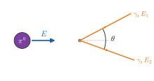

*그림 35.13* 연습문제 16. 총에너지 $E$인 $\pi^0$가 에너지 $E_1$, $E_2$인 두 광자로 붕괴하고, 두 광자의 진행 방향 사이각이 $\theta$이다.

17. (GPS 어림) (가) 🔬 박스의 두 효과가 원궤도에서 정확히 상쇄되는 궤도 반지름이 $r = \frac32R$임을 보이고, 그 고도를 구하라(지구 자전은 무시). (나) 고도가 이보다 낮은 국제우주정거장(고도 약 $400\ \text{km}$)의 시계는 지상보다 빨리 가는가, 느리게 가는가? (다) GPS 위성 시계의 하루 차이 $38\ \mu\text{s}$를 보정하지 않으면 하루에 거리 오차가 얼마나 쌓이는가?

---

## 연습문제 답과 힌트
1. $1.005$, $1.25$, $1.667$, $7.09$, $22.4$.
2. 우주인의 시간은 고유 시간이므로 $10/\gamma = 10\times0.80 = 8.0$년.
3. $1.0\times0.80 = 0.80\ \text{m}$. 수직으로 놓이면 $1.0\ \text{m}$ 그대로.
4. $\gamma = 3.20$, 실험실 수명 $83\ \text{ns}$, 평균 거리 $\gamma v\tau_0 = 24\ \text{m}$.
5. $u = 1.40c/(1 + 0.49) = 0.940c$.
6. $\gamma = 1 + 1000/938.3 = 2.07$, $\beta = 0.875$, $pc = \sqrt{1938.3^2 - 938.3^2}\ \text{MeV} = 1.70\ \text{GeV}$.
7. $E = mc^2 = 9.0\times10^{13}\ \text{J}$.
8. $10\ \text{km}/15.8 = 632\ \text{m}$. 뮤온 기준으로 대기층이 $632\ \text{m}/(0.998c) = 2.1\ \mu\text{s}$ 만에 지나가므로 고유 수명 $2.2\ \mu\text{s}$ 안에 지면에 닿을 수 있다. 지면 기준의 "$10.4\ \text{km}$를 갈 수 있다"와 같은 결론이다.
9. (가) $\gamma = 5/3$. $\Delta t' = \gamma(\Delta t - v\Delta x/c^2) = (5/3)(1.00 - 1.60)\ \mu\text{s} = -1.00\ \mu\text{s}$, $\Delta x' = \gamma(\Delta x - v\Delta t) = (5/3)(600 - 240)\ \text{m} = 600\ \text{m}$. (나) $(c\Delta t)^2 - \Delta x^2 = 299.8^2 - 600^2 = -2.70\times10^5\ \text{m}^2$로 두 기준틀에서 같다. (다) 간격이 공간꼴이고, $S'$에서는 B가 A보다 먼저 일어나므로 A가 B의 원인이 될 수 없다(빛도 $1\ \mu\text{s}$에 $300\ \text{m}$밖에 못 간다).
10. 다가올 때는 광원이 다음 파면을 내보낼 때까지 $v\gamma T_0$만큼 가까워지므로 $T = \gamma T_0(1 - \beta)$, $f = f_0\sqrt{(1 + \beta)/(1 - \beta)}$. 은하: $\lambda/\lambda_0 = 1.100 = \sqrt{(1 + \beta)/(1 - \beta)}$에서 $\beta = (1.100^2 - 1)/(1.100^2 + 1) = 0.095$, 약 $2.8\times10^4\ \text{km/s}$.
11. $\gamma = 7.09$, $K = 6.09\times0.511 = 3.11\ \text{MeV}$. 뉴턴 역학으로는 $0.250\ \text{MeV}$로, 12배 이상 작게 나온다.
12. $dm/dt = P/c^2 = 4.26\times10^9\ \text{kg/s}$, 매초 약 430만 톤. 태양 질량에 비하면 매우 작아서, 태양이 지금까지 이 비율로 잃은 질량은 전체의 극히 일부다.
13. $mc^2 = \sqrt{10.0^2 - 9.90^2} = 1.41\ \text{GeV}$, $\beta = pc/E = 0.990$.
14. (가) $x = \gamma(x' + vt')$에 $x' = \gamma(x - vt)$를 넣고 $1 - \gamma^2 = -\gamma^2\beta^2$를 쓴다. (나) $\begin{pmatrix}\cosh\phi_2 & -\sinh\phi_2\\ -\sinh\phi_2 & \cosh\phi_2\end{pmatrix}\begin{pmatrix}\cosh\phi_1 & -\sinh\phi_1\\ -\sinh\phi_1 & \cosh\phi_1\end{pmatrix}$을 곱해 쌍곡선 함수의 덧셈 정리를 쓰면 $\phi_1 + \phi_2$인 변환이 된다. $\tanh(\phi_1 + \phi_2) = \dfrac{\tanh\phi_1 + \tanh\phi_2}{1 + \tanh\phi_1\tanh\phi_2}$. (다) $\tanh^{-1}\beta = \frac12\ln\frac{1 + \beta}{1 - \beta}$이므로 $\frac12\ln9 = \ln3$, $\frac12\ln4 = \ln2$. 합 $\ln6$에서 $\beta = \tanh(\ln6) = (36 - 1)/(36 + 1) = 35/37 = 0.946$.
15. 실험실에서 불변량 $(E + m_pc^2)^2 - (pc)^2 = 2m_pc^2E + 2(m_pc^2)^2$. 문턱에서는 질량중심틀에서 생성 입자 4개가 모두 정지하므로 불변량 $= (4m_pc^2)^2$. 따라서 $E = 7m_pc^2$, $K = 6m_pc^2 = 5.63\ \text{GeV}$. 충돌형에서는 질량중심틀이 실험실이므로 각 양성자의 총에너지가 $2m_pc^2$, 즉 $K = m_pc^2 = 0.938\ \text{GeV}$면 된다. 고정 표적 실험에서는 입사 에너지의 상당 부분이 질량중심의 운동에너지로 남아 새 입자를 만드는 데 쓰이지 못한다.
16. (가) $P_{\pi}^\mu = P_1^\mu + P_2^\mu$의 제곱에서 광자는 $P_i\cdot P_i = 0$, $P_1\cdot P_2 = (E_1E_2/c^2)(1 - \cos\theta)$. (나) $E_1E_2$는 $E_1 = E_2 = E/2$에서 최대이고 이때 $\theta$가 최소: $m^2c^4 = \frac{E^2}{2}(1 - \cos\theta_{\min}) = E^2\sin^2(\theta_{\min}/2)$. $\sin(\theta_{\min}/2) = 0.135$, $\theta_{\min} = 15.5°$. 에너지가 클수록 두 광자가 거의 한 방향으로 나간다.
17. (가) $\frac{v^2}{2c^2} = \frac{GM}{2rc^2}$와 $\frac{GM}{c^2}\left(\frac1R - \frac1r\right)$를 같게 놓으면 $\frac{3}{2r} = \frac1R$, $r = 1.5R$. 고도 $0.5R \approx 3.2\times10^3\ \text{km}$. (나) $r < 1.5R$이므로 속도 효과가 이겨서 **느리게** 간다. (다) $38\times10^{-6}\ \text{s}\times3.0\times10^8\ \text{m/s} \approx 11\ \text{km}$.

---

## 영어 용어 정리
| 한글 | English |
|---|---|
| 특수 상대성 이론 | special theory of relativity |
| 상대성 원리 / 광속 불변 | principle of relativity / constancy of the speed of light |
| 관성 기준틀 | inertial reference frame |
| 갈릴레이 변환 / 로런츠 변환 | Galilean transformation / Lorentz transformation |
| 사건 / 동기화 | event / synchronization |
| 동시성의 상대성 | relativity of simultaneity |
| 시간 팽창 / 고유 시간 | time dilation / proper time |
| 길이 수축 / 고유 길이 | length contraction / proper length |
| 로런츠 인자 | Lorentz factor |
| 빛 시계 / 쌍둥이 역설 | light clock / twin paradox |
| 속도 덧셈 | velocity addition |
| 상대론적 도플러 효과 / 적색 이동 | relativistic Doppler effect / redshift |
| 시공간 / 불변 간격 | spacetime / invariant interval |
| 시간꼴 / 공간꼴 / 빛꼴 | timelike / spacelike / lightlike |
| 쾌속도 | rapidity |
| 4차원 벡터 / 4차원 운동량 | four-vector / four-momentum |
| 민코프스키 계량 | Minkowski metric |
| 상대론적 운동량 | relativistic momentum |
| 정지 에너지 / 총에너지 / 운동에너지 | rest energy / total energy / kinetic energy |
| 불변 질량 / 질량 결손 / 결합 에너지 | invariant mass / mass defect / binding energy |
| 문턱 에너지 | threshold energy |
| 쌍소멸 / 양전자 | pair annihilation / positron |
| 양전자 방출 단층촬영 | positron emission tomography (PET) |
| 방사성 의약품 | radiopharmaceutical |
