# 36장 광자와 물질파

> 대응 교재: Halliday 12판 38장 · Young&Freedman 15판 38, 39장
> 31~34장에서 빛은 맥스웰 방정식을 따르는 파동이었고, 간섭과 회절이 그 증거였다. 이 장에서는 그 그림이 깨지는 세 가지 실험(흑체 복사, 광전 효과, 콤프턴 산란)을 차례로 보고, 빛이 에너지 $hf$와 운동량 $h/\lambda$를 가진 **광자**로 행동한다는 결론에 이른다. 이어서 거꾸로 전자 같은 입자가 파동으로 행동한다는 드브로이의 가설, 하나씩 쌓여 간섭무늬를 만드는 입자, 그리고 불확정성 원리를 다룬다. 37장의 슈뢰딩거 방정식으로 들어가기 위한 실험적·개념적 준비 단계다.

## 학습 목표
- 레일리–진스 이론의 실패를 설명하고, 에너지 양자화 가정에서 플랑크 법칙과 빈·슈테판–볼츠만 법칙을 유도할 수 있다.
- 광전 효과의 실험 사실을 광자 가설로 설명하고, $K_{\max} = hf - \phi$를 계산에 쓸 수 있다.
- 상대론적 에너지·운동량 보존으로 콤프턴 공식 $\Delta\lambda = \dfrac{h}{mc}(1 - \cos\theta)$를 유도할 수 있다.
- 드브로이 파장 $\lambda = h/p$를 비상대론·상대론적 경우에 계산하고, 전자 회절 실험과 전자현미경의 분해능에 적용할 수 있다.
- 단일 입자 이중 슬릿 실험을 확률 해석으로 설명할 수 있다.
- 불확정성 원리 $\Delta x\,\Delta p_x \ge \hbar/2$를 써서 갇힌 입자의 최소 에너지와 원자의 크기를 어림할 수 있다.

## 고등학교 물리와 무엇이 다른가
고등학교에서는 "빛은 파동성과 입자성을 모두 가진다", "$E = hf$", "$\lambda = h/mv$"를 결론으로 배웠다. 대학에서는 이 결론을 **실험 데이터와 보존 법칙에서 직접 끌어낸다**. 플랑크 법칙은 기하급수의 합 한 번으로 유도되고, 콤프턴 공식은 35장의 상대론적 관계 $E^2 = (pc)^2 + (mc^2)^2$와 운동량 벡터의 보존에서 몇 줄로 나온다. 또 "이중성"을 막연한 비유로 두지 않고, **확률 진폭**이라는 하나의 틀로 정리한다. 입자는 언제나 한 점에서 검출되지만(입자성), 어디서 검출될 확률은 파동의 간섭으로 정해진다(파동성).

---

## 36.1 흑체 복사와 플랑크

### 열복사와 흑체
모든 물체는 온도에 따라 전자기파, 곧 **열복사**(thermal radiation)를 낸다. 들어오는 복사를 모두 흡수하는 이상적인 물체가 **흑체**(blackbody)이고, 그 스펙트럼은 물질과 무관하게 온도만으로 정해진다. 작은 구멍이 뚫린 빈 상자(**공동, cavity**)의 구멍은 들어간 빛을 거의 다 가두므로 흑체처럼 행동한다(그림 36.1).

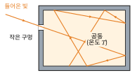

*그림 36.1* 작은 구멍으로 들어간 빛은 안쪽 벽에서 여러 번 반사되며 거의 다 흡수되어 다시 나오지 못한다. 그래서 구멍은 이상적인 흡수체, 곧 흑체처럼 행동하고, 구멍에서 나오는 복사는 벽의 온도 $T$만으로 정해진다.

실험으로 확립된 두 법칙이 있다.
- **슈테판–볼츠만 법칙(Stefan–Boltzmann law)**: 흑체 표면의 단위 넓이가 내는 전체 일률(복사 출력, radiant exitance)은
$$
M = \sigma T^4, \qquad \sigma = 5.670\times10^{-8}\ \text{W/(m}^2\text{·K}^4)
$$
- **빈 변위 법칙(Wien's displacement law)**: 스펙트럼이 최대가 되는 파장은 온도에 반비례한다.
$$
\lambda_{\max}T = b = 2.898\times10^{-3}\ \text{m·K}
$$

18장의 복사 열전달 $P = e\sigma AT^4$이 첫째 법칙이다. 이 절의 목표는 두 법칙을 하나의 이론에서 유도하는 것이다.

### 고전 이론: 레일리–진스 법칙과 자외선 파탄
공동 안의 복사는 벽 사이에 생기는 전자기 정상파의 모임이다. 진동수 $f$와 $f + df$ 사이에 있는 정상파 모드의 수를 단위 부피당 세면(아래 ★ 박스)
$$
n(f)\,df = \frac{8\pi f^2}{c^3}\,df
$$
이다. 고전 통계역학의 **에너지 등분배 정리**(19장)에 따르면 각 모드는 진동자처럼 평균 에너지 $k_BT$를 가진다. 따라서 단위 부피, 단위 진동수당 에너지(**스펙트럼 에너지 밀도**)는
$$
u(f) = \frac{8\pi f^2}{c^3}k_BT \qquad (\text{레일리–진스 법칙, Rayleigh–Jeans law})
$$
이다. 이 식은 낮은 진동수에서는 실험과 맞지만, $f$가 커지면 $f^2$으로 끝없이 커진다. 적분하면 전체 에너지가 무한대가 되는 이 모순이 **자외선 파탄**(ultraviolet catastrophe)이다.

> **★ 심화: 공동 속 모드의 수 세기**
> 한 변이 $L$인 정육면체 공동 속 전자기장 정상파는 각 방향으로 $\sin(n_x\pi x/L)$ 꼴이고 파수 벡터는 $\vec{k} = \dfrac{\pi}{L}(n_x, n_y, n_z)$, $n_i = 1, 2, 3, \dots$이다. $k$-공간에서 허용된 점 하나가 차지하는 부피는 $(\pi/L)^3$이다. 크기가 $k$와 $k + dk$ 사이인 점들은 반지름 $k$인 구 껍질 중 $n_i > 0$인 $1/8$ 부분에 있으므로, 그 수는
> $$dN = \frac{1}{8}\cdot\frac{4\pi k^2\,dk}{(\pi/L)^3}\times 2 = \frac{Vk^2\,dk}{\pi^2}$$
> 이다. 마지막의 2는 빛의 편광 방향이 두 개이기 때문이다(31장). $k = 2\pi f/c$를 대입하면 $dN/V = \dfrac{8\pi f^2}{c^3}df$를 얻는다. 39장에서 자유전자의 상태 수(편광 대신 스핀)를 셀 때 같은 셈법을 쓴다.

### 플랑크의 가정과 복사 법칙
1900년 플랑크(Planck)는 공동 벽의 진동자가 **진동수 $f$에 비례하는 에너지 덩어리의 정수배**만 가질 수 있다고 가정했다.
$$
E_n = nhf, \qquad n = 0, 1, 2, \dots
$$
비례 상수 $h$가 **플랑크 상수**(Planck constant)이고, 2019년 SI 재정의 이후 $h = 6.626\,070\,15\times10^{-34}\ \text{J·s}$로 정확히 정의되어 있다. 양자역학에서는 $\hbar = h/2\pi = 1.055\times10^{-34}\ \text{J·s}$도 자주 쓴다.

에너지가 $E_n$인 상태가 나타날 확률은 볼츠만 인자 $e^{-E_n/k_BT}$에 비례한다(20장). $\varepsilon = hf$, $\beta = 1/k_BT$로 두면 평균 에너지는
$$
\langle E\rangle = \frac{\sum_n n\varepsilon\,e^{-n\beta\varepsilon}}{\sum_n e^{-n\beta\varepsilon}}
$$
이다. 분모 $Z = \sum_{n=0}^{\infty}e^{-n\beta\varepsilon} = \dfrac{1}{1 - e^{-\beta\varepsilon}}$은 공비가 $e^{-\beta\varepsilon} < 1$인 기하급수다. 분자는 $-\dfrac{\partial Z}{\partial\beta}$이므로
$$
\langle E\rangle = -\frac{\partial\ln Z}{\partial\beta} = \frac{\partial}{\partial\beta}\ln(1 - e^{-\beta\varepsilon}) = \frac{\varepsilon e^{-\beta\varepsilon}}{1 - e^{-\beta\varepsilon}} = \frac{hf}{e^{hf/k_BT} - 1}
$$
이다. 이것을 $k_BT$ 대신 모드 수에 곱하면 **플랑크 복사 법칙**(Planck radiation law)을 얻는다.

$$
u(f) = \frac{8\pi hf^3}{c^3}\,\frac{1}{e^{hf/k_BT} - 1}
$$

두 극한을 확인하자.
- $hf \ll k_BT$이면 $\langle E\rangle \approx k_BT$로 레일리–진스 법칙이 된다. 덩어리가 열에너지보다 작으면 연속처럼 보인다.
- $hf \gg k_BT$이면 $\langle E\rangle \approx hf\,e^{-hf/k_BT} \to 0$이다. 높은 진동수 모드가 "얼어붙어" 자외선 파탄이 사라진다(그림 36.2).

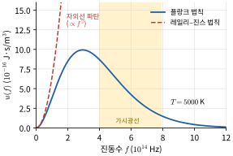

*그림 36.2* $T = 5000\ \text{K}$에서 계산한 스펙트럼 에너지 밀도 $u(f)$. 낮은 진동수에서는 두 법칙이 일치하지만, 레일리–진스 법칙(점선)은 $f^2$으로 끝없이 커지는 반면 플랑크 법칙은 $hf \approx 2.82\,k_BT$에서 최대가 된 뒤 지수적으로 줄어든다. 노란 띠는 가시광선 영역이다.

파장으로 바꾸려면 $u(\lambda)|d\lambda| = u(f)|df|$, $f = c/\lambda$, $|df| = (c/\lambda^2)|d\lambda|$를 쓴다.
$$
u(\lambda) = \frac{8\pi hc}{\lambda^5}\,\frac{1}{e^{hc/\lambda k_BT} - 1}
$$

### 빈 법칙과 슈테판–볼츠만 법칙의 유도
$x = hc/(\lambda k_BT)$로 두면 $u \propto x^5/(e^x - 1)$이다. 이를 $x$로 미분해 0으로 놓으면
$$
\frac{d}{dx}\frac{x^5}{e^x - 1} = 0 \quad\Rightarrow\quad x = 5(1 - e^{-x})
$$
이다. 이 초월방정식의 해는 $x = 4.965$이고(수치 풀이), 따라서
$$
\lambda_{\max}T = \frac{hc}{4.965\,k_B} = 2.898\times10^{-3}\ \text{m·K}
$$
로 빈 변위 법칙이 상수까지 맞게 나온다. 온도가 높을수록 곡선 전체가 커지고 최댓값이 짧은 파장 쪽으로 옮겨 간다(그림 36.3).

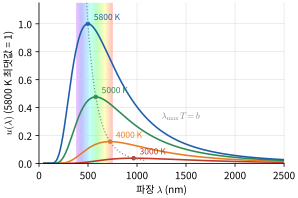

*그림 36.3* 플랑크 법칙 $u(\lambda)$를 $3000$, $4000$, $5000$, $5800\ \text{K}$에서 계산해 $5800\ \text{K}$ 곡선의 최댓값이 1이 되게 그렸다. 점선은 각 온도의 최댓값을 이은 선 $\lambda_{\max}T = b$이다. 곡선 아래 넓이(전체 에너지)는 $T^4$에 비례해 커진다. 색 띠는 가시광선 영역이다.

전체 에너지 밀도는 $u = \int_0^\infty u(f)\,df$이다. $x = hf/k_BT$로 치환하면
$$
u = \frac{8\pi (k_BT)^4}{h^3c^3}\int_0^\infty\frac{x^3}{e^x - 1}dx = \frac{8\pi^5(k_BT)^4}{15h^3c^3}
$$
이다(적분값 $\int_0^\infty x^3/(e^x - 1)\,dx = \pi^4/15$는 표준 결과다). 구멍의 단위 넓이로 나오는 일률은 등방적인 복사에 대해 $M = \dfrac{c}{4}u$이므로(19장에서 분자가 벽에 부딪히는 빈도를 셀 때와 같은 기하학)
$$
M = \frac{2\pi^5k_B^4}{15h^3c^2}T^4 = \sigma T^4
$$
이다. 상수들을 넣으면 $\sigma = 5.670\times10^{-8}\ \text{W/(m}^2\text{·K}^4)$이 정확히 나온다. 2019년 이후 $h$, $c$, $k_B$가 모두 정의값이므로 $\sigma$도 정의값이다(부록 A).

> **💡 개념 확인: 스펙트럼의 최댓값은 어떤 변수로 그리느냐에 따라 다르다**
> $u(f)$를 진동수에 대해 최대화하면 $x = 3(1 - e^{-x})$, 즉 $hf_{\max} = 2.821\,k_BT$이다. 그런데 $c/f_{\max}$는 $\lambda_{\max}$와 같지 않다(연습문제 14). 분포함수는 "단위 진동수당"과 "단위 파장당"이 다른 양이기 때문이다. 태양 스펙트럼의 최대가 "초록색 근처"라는 말은 파장 분포로 그렸을 때의 이야기다.

### 예제 36.1 별과 사람의 색온도
(가) 태양 스펙트럼이 파장 분포에서 약 $500\ \text{nm}$에서 최대가 된다. 흑체로 보면 태양 표면 온도는?
(나) 체온 $310\ \text{K}$인 사람 피부가 내는 열복사의 최대 파장은?

**풀이**
(가) $T = b/\lambda_{\max} = (2.898\times10^{-3})/(500\times10^{-9}) = 5.8\times10^3\ \text{K}$.
(나) $\lambda_{\max} = b/T = 2.898\times10^{-3}/310 = 9.35\times10^{-6}\ \text{m} = 9.3\ \mu\text{m}$로 원적외선이다. 열화상 카메라가 $8$–$14\ \mu\text{m}$ 대역을 쓰는 이유다.

> **🐍 파이썬 실습: 플랑크 곡선과 빈·슈테판–볼츠만 법칙 확인**
> 플랑크 법칙을 여러 온도에서 그리고, 최댓값 위치와 전체 적분이 빈 법칙·슈테판–볼츠만 법칙과 맞는지 수치로 확인한다. 분광 복사휘도 $B_\lambda = \dfrac{c}{4\pi}u(\lambda)$를 쓰면 복사 출력은 $M = \pi\int B_\lambda\,d\lambda$이다.
> ```python
> import numpy as np
> import matplotlib.pyplot as plt
> from scipy.integrate import quad
>
> h, c, kB = 6.62607015e-34, 299792458.0, 1.380649e-23
>
> def B(lam, T):        # 분광 복사휘도 B_λ (W·sr⁻¹·m⁻³)
>     return 2*h*c**2/lam**5 / np.expm1(h*c/(lam*kB*T))
>
> lam = np.linspace(50e-9, 3000e-9, 20000)
> for T in [3000, 4000, 5000, 5800]:
>     Bl = B(lam, T)
>     lam_max = lam[np.argmax(Bl)]
>     print(f"T={T} K: 최댓값 파장 {lam_max*1e9:6.1f} nm, λmax·T = {lam_max*T*1e3:.4f} mm·K")
>     plt.plot(lam*1e9, Bl, label=f"{T} K")
>
> # 전체 복사 출력 M = π∫B dλ 와 σT⁴ 비교 (T = 5800 K)
> T = 5800
> M, _ = quad(lambda l: np.pi*B(l, T), 1e-8, 1e-3, limit=200)
> print(f"수치 적분 M = {M:.4e} W/m², σT⁴ = {5.670374419e-8*T**4:.4e} W/m²")
> plt.xlabel("wavelength (nm)"); plt.ylabel("B (W sr^-1 m^-3)"); plt.legend(); plt.show()
> ```
> 실행하면 네 온도 모두 $\lambda_{\max}T = 2.8976$–$2.8978\ \text{mm·K}$(격자 간격 때문에 마지막 자리가 흔들린다)이고, $5800\ \text{K}$에서 최대 파장은 $499.6\ \text{nm}$이다. 수치 적분 $M = 6.4169\times10^7\ \text{W/m}^2$은 $\sigma T^4$과 유효숫자 5자리까지 일치한다.

---

## 36.2 광전 효과

### 실험 사실
금속 표면에 빛을 비추면 전자가 튀어나온다. 이를 **광전 효과(photoelectric effect)**, 튀어나온 전자를 **광전자**(photoelectron)라 한다. 진공관 속에 금속판(음극)과 수집판(양극)을 두고(그림 36.4), 수집판의 전위를 음극보다 낮추면 광전자가 되밀려 전류가 줄어든다. 전류가 0이 되는 전압의 크기가 **저지 전압(stopping potential)** $V_0$이고, 가장 빠른 광전자의 운동에너지는
$$
K_{\max} = eV_0
$$
이다. 실험에서 확인된 사실은 다음과 같다.
1. **문턱 진동수**: 진동수가 $f_0$보다 낮으면 빛이 아무리 세도 전자가 나오지 않는다.
2. $K_{\max}$는 세기와 무관하고 진동수에만 의존한다. 세기는 광전자의 **수**만 바꾼다(그림 36.5).
3. $K_{\max}$는 진동수의 일차함수이고, 기울기는 금속에 상관없이 같다.
4. 아주 약한 빛에서도 전자가 지연 없이 바로 나온다.

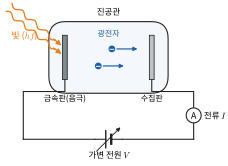

*그림 36.4* 광전 효과 실험 장치. 빛이 진공관 속 금속판(음극)에 닿으면 광전자가 튀어나와 수집판으로 간다. 가변 전원으로 수집판의 전위를 음극보다 낮추면 광전자가 되밀려 전류계 A의 전류 $I$가 줄어든다.

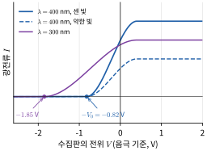

*그림 36.5* 광전류–전압 곡선의 개략도(예제 36.3의 금속, $\phi = 2.28\ \text{eV}$). 같은 파장($400\ \text{nm}$)에서 빛의 세기를 줄이면 포화 전류만 줄고 저지 전압 $V_0 = 0.82\ \text{V}$는 그대로다. 파장이 짧은 $300\ \text{nm}$ 빛에서는 저지 전압이 $1.85\ \text{V}$로 커진다.

고전 파동 이론으로는 센 빛이면 어떤 진동수에서도 전자가 나와야 하고(1과 모순), 더 빨라야 하며(2와 모순), 약한 빛이면 에너지를 모으는 데 시간이 걸려야 한다(4와 모순).

### 아인슈타인의 광자 가설
1905년 아인슈타인(Einstein)은 빛 자체가 에너지 덩어리 **광자**(photon)로 이루어져 있다고 제안했다.
$$
E = hf = \frac{hc}{\lambda}
$$
광자 하나는 전자 하나에게 에너지를 통째로 준다. 전자가 금속을 빠져나오려면 최소한 **일함수(work function)** $\phi$만큼의 에너지가 필요하므로
$$
K_{\max} = hf - \phi
$$
이다. 네 사실이 모두 설명된다. $hf < \phi$이면 전자가 나올 수 없고(문턱 진동수 $f_0 = \phi/h$), 세기는 광자 수만 바꾸며, 기울기 $dK_{\max}/df = h$는 금속과 무관하고(그림 36.6), 광자 하나가 흡수되는 순간 전자가 나온다. 밀리컨(Millikan)의 정밀 실험(1916)이 이 직선 관계를 확인했고, 기울기에서 얻은 $h$는 흑체 복사의 값과 일치했다.

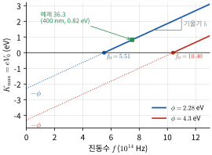

*그림 36.6* $K_{\max} = hf - \phi$의 그래프. 일함수가 $2.28\ \text{eV}$(예제 36.3)와 $4.3\ \text{eV}$(연습문제 3)인 두 금속의 직선은 기울기 $h$가 같고, 가로축 절편이 문턱 진동수 $f_0 = \phi/h$($10^{14}\ \text{Hz}$ 단위), 세로축 절편(점선 연장)이 $-\phi$이다. $f < f_0$에서는 전자가 나오지 않는다.

광자 에너지 계산에는 다음 조합이 편리하다.
$$
hc = 1239.84\ \text{eV·nm} \approx 1240\ \text{eV·nm}
$$
예를 들어 $500\ \text{nm}$ 광자는 $1240/500 = 2.48\ \text{eV}$이다.

### 예제 36.2 레이저 포인터의 광자 수
출력 $1.0\ \text{mW}$, 파장 $650\ \text{nm}$인 빨간 레이저 포인터는 1초에 광자를 몇 개 내는가?

**풀이** 광자 하나의 에너지는 $E = 1239.84/650 = 1.91\ \text{eV} = 3.06\times10^{-19}\ \text{J}$이다. 광자 수율은
$$
\frac{P}{E} = \frac{1.0\times10^{-3}\ \text{W}}{3.06\times10^{-19}\ \text{J}} = 3.3\times10^{15}\ \text{s}^{-1}
$$
이다. 광자 수가 이렇게 많아 일상의 빛은 연속적으로 보인다.

### 예제 36.3 광전 효과의 수치
일함수가 $2.28\ \text{eV}$인 금속(나트륨에 가까운 값)에 파장 $400\ \text{nm}$인 빛을 비춘다. (가) 광전자의 최대 운동에너지와 저지 전압, (나) 최대 속력, (다) 문턱 파장을 구하라.

**풀이**
(가) $hf = 1239.84/400 = 3.10\ \text{eV}$, $K_{\max} = 3.10 - 2.28 = 0.82\ \text{eV}$. 저지 전압 $V_0 = K_{\max}/e = 0.82\ \text{V}$.
(나) $v_{\max} = \sqrt{2K_{\max}/m_e} = \sqrt{2(0.820\times1.602\times10^{-19})/(9.109\times10^{-31})} = 5.4\times10^5\ \text{m/s}$. 광속의 0.2% 정도이므로 비상대론 계산이 충분하다.
(다) $\lambda_0 = hc/\phi = 1239.84/2.28 = 544\ \text{nm}$. 이보다 긴 파장(노랑·빨강)은 아무리 세게 비춰도 전자를 떼어 내지 못한다.

> **💡 개념 확인: 광자가 "입자"라는 말의 범위**
> 광자는 정지 질량이 0이고, 35장의 $E^2 = (pc)^2 + (mc^2)^2$에서 $m = 0$이므로 $E = pc$, 곧 **운동량** $p = E/c = h/\lambda$를 가진다. 그러나 광자를 "작은 공"으로 상상하면 안 된다. 광자가 어디서 검출될지는 여전히 맥스웰 방정식을 따르는 파동의 세기 분포로 정해진다(36.5절). "입자"는 **에너지와 운동량이 덩어리로 주고받아진다**는 뜻이다.

---

## 36.3 콤프턴 산란

### 실험
1923년 콤프턴(Compton)은 파장이 $\lambda$인 X선을 흑연 표적에 쪼이고, 각 $\theta$ 방향으로 산란된 X선의 파장을 측정했다. 산란된 X선에는 원래 파장 성분 외에 **더 긴 파장** $\lambda'$인 성분이 있었고, 그 차이 $\Delta\lambda = \lambda' - \lambda$는 산란각이 클수록 컸으며 표적 물질과 입사 파장에 무관했다. 고전 이론에서는 진동하는 전자가 같은 진동수로 빛을 다시 내므로 파장이 바뀔 이유가 없다.

### 유도: 광자–전자 탄성 충돌
X선 광자가 정지한 자유전자와 당구공처럼 충돌한다고 보자. 처음 광자의 운동량 크기는 $p = h/\lambda$, 나중 광자는 $p' = h/\lambda'$이고 $\theta$ 방향으로 간다(그림 36.7). 전자의 나중 운동량을 $\vec{p}_e$, 에너지를 $E_e$라 하자. 전자가 빠르게 튀어나갈 수 있으므로 상대론적 관계를 쓴다.

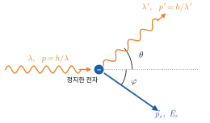

*그림 36.7* 파장 $\lambda$인 광자가 정지한 자유전자와 충돌해 각 $\theta$ 방향으로 파장 $\lambda'$인 광자로 산란되고, 전자는 입사 방향의 반대쪽으로 각 $\varphi$만큼 기울어진 방향으로 운동량 $\vec p_e$를 받아 튀어나간다.

**운동량 보존** $\vec{p} = \vec{p}\,' + \vec{p}_e$에서 $\vec{p}_e = \vec{p} - \vec{p}\,'$이므로
$$
p_e^2 = p^2 + p'^2 - 2pp'\cos\theta
$$

**에너지 보존** $pc + mc^2 = p'c + E_e$에서 $E_e = (p - p')c + mc^2$이다. 이를 제곱해 $E_e^2 = (p_ec)^2 + (mc^2)^2$에 넣으면
$$
(p - p')^2c^2 + 2(p - p')mc^3 + m^2c^4 = (p^2 + p'^2 - 2pp'\cos\theta)c^2 + m^2c^4
$$
양변에서 같은 항을 지우면 $-2pp' + 2(p - p')mc = -2pp'\cos\theta$, 곧
$$
(p - p')mc = pp'(1 - \cos\theta) \quad\Rightarrow\quad \frac{1}{p'} - \frac{1}{p} = \frac{1 - \cos\theta}{mc}
$$
양변에 $h$를 곱하면 **콤프턴 공식**이다.
$$
\boxed{\lambda' - \lambda = \frac{h}{m_ec}(1 - \cos\theta)}
$$
$\lambda_C = h/(m_ec) = 2.426\times10^{-12}\ \text{m} = 2.426\ \text{pm}$을 전자의 **콤프턴 파장**(Compton wavelength)이라 한다. 파장 변화는 최대 $2\lambda_C = 4.85\ \text{pm}$($\theta = 180°$)이다.

원래 파장 성분은 단단히 묶인 안쪽 전자와의 산란에서 나온다. 이때는 원자 전체가 반동하므로 $m_e$ 자리에 원자 질량이 들어가 $\Delta\lambda \approx 0$이다.

> **💡 개념 확인: 가시광선으로는 콤프턴 효과를 보기 어려운 이유**
> $\Delta\lambda \le 4.85\ \text{pm}$은 입사 파장과 무관하다. X선($\lambda \sim 0.1\ \text{nm}$)에서는 수 %의 변화지만, 가시광선($500\ \text{nm}$)에서는 $\Delta\lambda/\lambda \sim 10^{-5}$에 불과하다. 또 가시광선 광자의 에너지(수 eV)는 금속 속 전자의 결합 에너지와 비슷해서 "정지한 자유전자"라는 가정 자체가 성립하지 않는다.

### 예제 36.4 콤프턴 산란의 수치
파장 $71.1\ \text{pm}$인 X선(몰리브데넘 특성 X선, 38.5절)이 자유전자에 의해 $\theta = 90°$로 산란되었다. 산란 X선의 파장, 전자의 운동에너지, 전자가 튀어나가는 방향을 구하라.

**풀이** $\lambda' = 71.1 + 2.426(1 - 0) = 73.5\ \text{pm}$.
전자의 운동에너지는 광자가 잃은 에너지다.
$$
K_e = hc\left(\frac{1}{\lambda} - \frac{1}{\lambda'}\right) = 1239.84\ \text{eV·nm}\left(\frac{1}{0.0711} - \frac{1}{0.07353}\right)\text{nm}^{-1} = 575\ \text{eV}
$$
입사 광자 에너지($17.4\ \text{keV}$)의 3% 정도다. 입사 방향을 $+x$, 산란 광자를 $+y$로 두면 $\vec{p}_e = (h/\lambda)\hat{i} - (h/\lambda')\hat{j}$이므로, 전자는 $x$축 아래로 $\tan^{-1}(\lambda/\lambda') = \tan^{-1}(71.1/73.5) = 44.0°$ 방향으로 튀어나간다(그림 36.8).

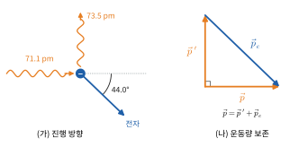

*그림 36.8* 예제 36.4. (가) 입사 X선($71.1\ \text{pm}$)이 $90°$로 산란되어($73.5\ \text{pm}$) 위로 가고, 전자는 입사 방향에서 아래로 $44.0°$ 기운 방향으로 나간다. (나) 운동량 보존 $\vec p = \vec p\,' + \vec p_e$를 벡터 삼각형으로 나타냈다. $\lvert\vec p\rvert$가 $\lvert\vec p\,'\rvert$보다 조금 크다.

> **🔗 전공 연결: X선 영상의 산란선 (수의영상의학)**
> 진단용 X선이 조직을 지날 때의 주요 상호작용은 **광전 흡수**와 **콤프턴 산란**이다. 광전 흡수는 원자번호가 큰 물질(뼈의 칼슘, 조영제의 아이오딘·바륨)에서 훨씬 강해 영상의 대비를 만든다. 콤프턴 산란은 X선을 엉뚱한 방향으로 보내 영상을 뿌옇게 하고, 검사실 안 사람에게 닿는 **산란선**의 주원인이 된다. 그래서 대형견의 복부처럼 두꺼운 부위는 검출기 앞에 납 띠를 촘촘히 세운 **산란선 제거 격자**(grid)를 두고 찍으며, 동물을 붙잡는 보조자는 납 앞치마를 입고 빔에서 떨어져 선다(40장 방사선 방호).

---

## 36.4 드브로이 파

### 드브로이 가설
빛이 파동이면서 운동량 $p = h/\lambda$를 가진다면, 거꾸로 운동량이 $p$인 입자는 파장
$$
\lambda = \frac{h}{p}, \qquad f = \frac{E}{h}
$$
인 파동을 가지지 않을까? 1924년 드브로이(de Broglie)가 제안한 이 파동을 **물질파(matter wave)** 또는 드브로이 파라 한다. 파수 $k = 2\pi/\lambda$와 각진동수 $\omega = 2\pi f$로 쓰면
$$
p = \hbar k, \qquad E = \hbar\omega
$$
라는 깔끔한 꼴이 된다. 이 두 관계는 빛과 물질에 모두 성립하며, 37장 슈뢰딩거 방정식의 출발점이다.

### 전자의 드브로이 파장
정지 상태에서 전위차 $V$로 가속한 전자는 $K = eV$, $p = \sqrt{2m_eeV}$(비상대론)이므로
$$
\lambda = \frac{h}{\sqrt{2m_eeV}} = \frac{1.226\ \text{nm}}{\sqrt{V/\text{volt}}}
$$
이다. $V = 100\ \text{V}$이면 $\lambda = 0.123\ \text{nm}$로 결정 속 원자 간격과 비슷하다. 그래서 34장의 X선 회절처럼 결정이 전자에 대해서도 회절격자 역할을 한다.

### 예제 36.5 데이비슨–거머 실험과 야구공
(가) 1927년 데이비슨(Davisson)과 거머(Germer)는 $54\ \text{eV}$ 전자를 니켈 결정 표면에 수직으로 쏘아, 되튀어 나온 전자가 표면 법선에서 $50°$ 기운 방향으로 강하게 모이는 것을 발견했다. 표면 원자 열의 간격 $d = 0.215\ \text{nm}$를 반사 격자로 보면($d\sin\varphi = \lambda$, 그림 36.9), 이 결과는 드브로이 파장과 맞는가?
(나) 시속 약 $144\ \text{km}$($40\ \text{m/s}$)로 던진 $0.145\ \text{kg}$ 야구공의 드브로이 파장은?

**풀이**
(가) 드브로이 파장 $\lambda = 1.226/\sqrt{54} = 0.167\ \text{nm}$, 회절 조건 $d\sin50° = 0.165\ \text{nm}$로 약 1% 차이로 일치한다. 같은 해 톰슨(G. P. Thomson)도 금속박을 지난 전자의 회절 고리를 관찰했다.
(나) $\lambda = h/(mv) = 6.63\times10^{-34}/(0.145\times40) = 1.1\times10^{-34}\ \text{m}$. 원자핵보다 $10^{19}$배 작아 회절을 볼 방법이 없다.

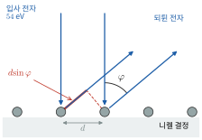

*그림 36.9* 표면에 수직으로 들어온 전자가 간격 $d$인 원자 열에서 되튄다. 법선과 $\varphi$를 이루는 방향으로 나가는 이웃한 두 파동의 경로차는 $d\sin\varphi$(빨간 굵은 선분)이고, 이것이 파장의 정수배일 때 보강 간섭이 일어난다.

### 상대론적 전자
전자현미경처럼 전압이 수십 kV 이상이면 전자의 운동에너지가 정지 에너지 $m_ec^2 = 511\ \text{keV}$에 비해 무시할 수 없다. 이때는 $E = K + mc^2$와 $E^2 = (pc)^2 + (mc^2)^2$에서
$$
pc = \sqrt{K^2 + 2Kmc^2}, \qquad \lambda = \frac{hc}{\sqrt{K^2 + 2Kmc^2}}
$$
를 쓴다. $K \ll mc^2$이면 $pc \approx \sqrt{2Kmc^2}$로 비상대론 식이 된다.

> **★ 심화: 물질파의 위상 속도와 군속도**
> 자유 입자의 물질파는 $\omega = E/\hbar$, $k = p/\hbar$이다. 상대론적으로 $E = \sqrt{(pc)^2 + (mc^2)^2}$이므로 **위상 속도**(phase velocity)는
> $$v_p = \frac{\omega}{k} = \frac{E}{p} = \frac{\gamma mc^2}{\gamma mv} = \frac{c^2}{v} > c$$
> 로 광속보다 빠르다. 그러나 위상 속도는 정보나 에너지를 나르지 않는다. 입자의 위치를 나타내는 것은 여러 파수의 파동을 겹친 **파동 묶음**(wave packet)이고, 그 봉우리는 **군속도**(group velocity)로 움직인다.
> $$v_g = \frac{d\omega}{dk} = \frac{dE}{dp} = \frac{pc^2}{E} = v$$
> ($E^2 = p^2c^2 + m^2c^4$를 미분하면 $2E\,dE = 2pc^2\,dp$.) 군속도가 정확히 입자의 속도와 같다는 점이 드브로이 가설의 자기모순 없음을 보여 준다. 비상대론 극한($\omega = \hbar k^2/2m$)에서는 $v_g = v$, $v_p = v/2$이다.

> **🔗 전공 연결: 전자현미경 (기계공학 재료분석 · 약학 · 수의병리)**
> 광학 현미경의 분해능은 대략 $200\ \text{nm}$로 제한된다(34장). 전자의 드브로이 파장은 이보다 수만 배 짧다.
> - **투과 전자현미경(TEM)**: 얇게 만든 시료에 $100$–$300\ \text{kV}$ 전자빔을 통과시키고 자기 렌즈(로런츠 힘, 26장)로 상을 맺는다. $200\ \text{kV}$에서 상대론적 파장은 $2.51\ \text{pm}$이다(비상대론 식은 $2.74\ \text{pm}$으로 9% 틀린다). 분해능은 렌즈 수차 때문에 파장보다 훨씬 나쁘지만, 수차 보정 장비는 원자 열을 볼 수 있다.
> - **주사 전자현미경(SEM)**: 가는 전자빔으로 표면을 훑으며 튀어나오는 2차 전자를 센다. 기계공학의 **파단면 분석**(fractography)에서는 SEM으로 금속 파단면의 피로 줄무늬나 연성 파괴의 딤플을 관찰해 부품이 어떻게 부서졌는지 판단한다(12장 응력).
> - **극저온 전자현미경(cryo-EM)**: 급속 냉동한 단백질 입자들의 TEM 영상을 평균해 3차원 구조를 재구성한다. 이 방법을 개발한 공로로 2017년 노벨 화학상이 수여되었다. 약학에서는 결정화가 어려운 막단백질 수용체의 구조를 얻어 신약 설계에 쓴다.
> - **수의병리**: 광학 현미경으로 볼 수 없는 바이러스의 형태를 TEM으로 확인한다.

---

## 36.5 이중 슬릿과 파동–입자 이중성

### 하나씩 쌓이는 간섭무늬
33장의 이중 슬릿 실험을 광자가 한 번에 하나씩만 지나도록 아주 약한 빛으로 하고, 광자 하나하나를 점으로 기록하면 다음과 같다.
- 광자는 언제나 스크린의 **한 점**에서 검출된다. 반쪽 광자는 없다.
- 처음 몇십 개의 점은 무작위로 흩어져 있어 아무 무늬도 보이지 않는다.
- 점이 수천, 수만 개 쌓이면 33장의 간섭무늬가 그대로 나타난다. 어두운 무늬 자리에는 점이 거의 찍히지 않는다(그림 36.10).

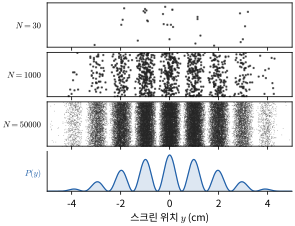

*그림 36.10* 광자가 하나씩 도착한 자리를 점으로 찍은 모의 실험(아래 🐍 실습과 같은 조건: $\lambda = 500\ \text{nm}$, $d = 50\ \mu\text{m}$, $a = 10\ \mu\text{m}$, $L = 1.0\ \text{m}$, 난수 씨앗 1). 세로 방향 위치는 보기 좋게 흩뜨린 것이다. $N = 30$에서는 무늬가 보이지 않지만 $N = 50\,000$에서는 맨 아래의 확률 분포 $P(y)$와 같은 무늬가 나타난다.

전자를 하나씩 보내도 똑같다.

### 확률 해석
이 결과를 일관되게 설명하는 표준적인 방법은 다음과 같다. 입자 하나하나에 **확률 진폭(probability amplitude)** $\psi$라는 파동이 따라다니고, 두 슬릿을 지나는 진폭이 더해진 뒤($\psi = \psi_1 + \psi_2$), 그 절댓값의 제곱이 검출 확률을 준다.
$$
P(y) \propto |\psi_1 + \psi_2|^2 = |\psi_1|^2 + |\psi_2|^2 + 2\,\text{Re}(\psi_1^*\psi_2)
$$
마지막 **간섭항**이 무늬를 만든다. 정확한 말은 "어느 슬릿을 지났는지 원리적으로 알 수 없는 한, 두 경로의 진폭이 더해진다"이다. 빛의 경우 $|\psi|^2$은 고전 전자기파의 세기 $I \propto E^2$에 비례하므로, 33장의 세기 공식이 그대로 광자의 도착 확률 분포가 된다.

### 경로 정보와 간섭의 소멸
어느 슬릿을 지났는지 알아내는 장치를 달면(예: 슬릿 뒤에서 전자에 빛을 산란시켜 위치를 확인) 간섭무늬가 사라지고 두 단일 슬릿 무늬의 합 $|\psi_1|^2 + |\psi_2|^2$만 남는다. 더 일반적으로, 경로 정보가 어딘가에 기록되는 순간 두 경로를 구별할 수 있게 되어 진폭을 더할 수 없다. **파동–입자 이중성**(wave–particle duality)은 "때로는 파동, 때로는 입자"가 아니라, 하나의 확률 진폭 이론이 실험 조건에 따라 두 측면을 드러내는 것이다.

> **🐍 파이썬 실습: 광자가 하나씩 쌓아 만드는 간섭무늬**
> 이중 슬릿의 세기 분포 $I(y) \propto \cos^2\!\left(\dfrac{\pi dy}{\lambda L}\right)\text{sinc}^2\!\left(\dfrac{\pi ay}{\lambda L}\right)$(33·34장)를 광자의 도착 확률로 보고, 광자를 하나씩 무작위로 떨어뜨린다.
> ```python
> import numpy as np
> import matplotlib.pyplot as plt
>
> rng = np.random.default_rng(1)
> lam, d, a, L = 500e-9, 50e-6, 10e-6, 1.0     # 파장, 슬릿 간격, 슬릿 폭, 스크린 거리 (m)
> y = np.linspace(-0.05, 0.05, 2001)            # 스크린 위치 (m)
> beta = np.pi*a*y/(lam*L); phi = np.pi*d*y/(lam*L)
> P = np.cos(phi)**2 * np.sinc(beta/np.pi)**2  # 상대 세기 = 광자 도착 확률 (비례)
> P /= P.sum()
>
> fig, ax = plt.subplots(3, 1, sharex=True)
> for k, N in enumerate([30, 1000, 50000]):
>     hits = rng.choice(y, size=N, p=P)        # 광자 N개가 하나씩 도착
>     counts, edges = np.histogram(hits, bins=200, range=(-0.05, 0.05))
>     ax[k].bar(edges[:-1]*100, counts, width=0.05); ax[k].set_ylabel(f"N={N}")
>     centre = np.abs(hits) < 0.0025                 # 중앙 밝은 무늬 (±2.5 mm)
>     dark = np.abs(np.abs(hits) - 0.005) < 0.0005    # 첫 어두운 무늬 근처 (y = ±5 mm)
>     print(f"N={N:6d}: 중앙 무늬 {centre.sum():6d}개, 첫 어두운 무늬 근처 {dark.sum():4d}개")
> ax[-1].set_xlabel("y (cm)"); plt.show()
> ```
> 무늬 간격은 $\lambda L/d = 10\ \text{mm}$이고 첫 어두운 무늬는 $y = \pm5\ \text{mm}$에 있다. 실행 결과(난수 씨앗 1): $N = 30$일 때는 중앙 근처에 7개가 찍힐 뿐 무늬를 알아볼 수 없고, $N = 50\,000$일 때는 중앙 무늬의 가운데 $\pm2.5\ \text{mm}$에 8972개가 모이는 반면 첫 어두운 무늬 $\pm0.5\ \text{mm}$ 안에는 34개뿐이다. 각 광자가 어디에 떨어질지는 예측할 수 없지만 분포는 정확히 예측된다. 연습문제 18에서 경로 정보가 있을 때의 분포와 비교해 보라.

> **🔬 최신 연구 노트: 단일 광자 실험과 양자 기술**
> 레이저를 약하게 줄인 빛에서도 광자 수는 무작위(푸아송 분포)로 요동해 가끔 두 광자가 함께 온다. 진정한 **단일 광자 상태**를 확인하는 실험은 빔 분할기(반투명 거울)를 쓴다. 광자 하나는 쪼개질 수 없으므로 빔 분할기 양쪽 출구의 검출기가 **동시에** 울리는 일이 없어야 한다. 1980년대 아스페(Aspect) 연구진은 원자에서 연달아 나오는 광자 쌍 가운데 하나를 "알림 신호"로 써서 다른 하나를 빔 분할기에 보냈고, 동시 검출이 고전적인 파동으로는 설명할 수 없을 만큼 드물다는 것을 보였다. 같은 단일 광자로 간섭계 실험을 하면 간섭무늬도 얻어진다. 전자에 대해서는 1989년 일본 히타치 연구진(도노무라 아키라 등)이 전자를 하나씩 보내 간섭무늬가 쌓이는 과정을 영상으로 기록했다.
> 아스페는 얽힌 광자 쌍으로 벨 부등식이 깨짐을 보인 공로로 클라우저(Clauser), 차일링거(Zeilinger)와 함께 **2022년 노벨 물리학상**을 받았다. 오늘날 단일 광자원과 단일 광자 검출기는 양자 암호 통신과 광자 기반 양자컴퓨터의 핵심 부품이다(2025 세계 양자 과학기술의 해, 특집 A).

---

## 36.6 불확정성 원리

### 파동 묶음과 푸리에 관계
입자의 위치를 좁은 영역에 국한하려면 여러 파장의 파동을 겹쳐 파동 묶음을 만들어야 한다. 17장의 맥놀이처럼 파수가 $\Delta k$만큼 퍼진 파동을 더하면 길이 $\sim 1/\Delta k$인 덩어리가 생긴다(그림 36.11). 이것은 모든 파동의 수학적 성질이며(★ 박스), $p = \hbar k$를 곱하면 **하이젠베르크의 불확정성 원리**(Heisenberg uncertainty principle)가 된다.
$$
\Delta x\,\Delta p_x \ge \frac{\hbar}{2}
$$
여기서 $\Delta x$, $\Delta p_x$는 같은 상태를 여러 번 준비해 측정했을 때 결과의 **표준편차**다. 장치의 오차가 아니라 위치와 운동량이 동시에 뾰족한 상태가 **존재하지 않는다**는 뜻이다. $\Delta x\,\Delta p_y$에는 제한이 없다.

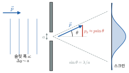

*그림 36.11* (가) 가우스 파동 묶음의 실수부 $\mathrm{Re}\,\psi$(파랑)와 포락선 $\pm\lvert\psi\rvert$(빨간 점선). (나) 이 묶음을 이루는 파수의 분포 $\lvert\phi(k)\rvert^2$. 위치의 폭 $\sigma_x$와 파수의 폭 $\sigma_k$는 $\sigma_x\sigma_k = 1/2$를 만족해, 한쪽을 좁히면 다른 쪽이 넓어진다(★ 박스).

### 단일 슬릿으로 보는 불확정성
폭 $a$인 슬릿을 지나는 입자를 생각하자. 슬릿을 지나는 순간 $y$ 위치의 불확정성은 $\Delta y \sim a$이다. 34장의 단일 슬릿 회절에서 중앙 극대의 반폭은 $\sin\theta = \lambda/a$이므로, 입자는 $p_y \sim p\sin\theta = p\lambda/a = h/a$ 정도의 가로 운동량을 얻는다. 따라서 $\Delta y\,\Delta p_y \sim h$이다(그림 36.12). 슬릿을 좁혀 위치를 정확히 하면 회절이 커져 운동량이 퍼진다. 파동 그림과 입자 그림이 불확정성 원리로 정확히 맞물린다.


*그림 36.12* 운동량 $\vec p$로 들어온 입자가 폭 $a$인 슬릿을 지나면 위치의 불확정성은 $\Delta y \sim a$이고, 회절 때문에 중앙 극대의 반폭 $\sin\theta = \lambda/a$ 안으로 퍼지므로 가로 운동량 $p_y \approx p\sin\theta \sim h/a$를 얻는다. 오른쪽은 스크린의 세기 분포이다.

> **★ 심화: 가우스 파동 묶음은 최소 불확정성 상태다**
> 파동 묶음 $\psi(x) = \dfrac{1}{\sqrt{2\pi}}\displaystyle\int\phi(k)e^{ikx}dk$를 생각하자. $\phi(k) \propto \exp\!\left[-\dfrac{(k - k_0)^2}{4\sigma_k^2}\right]$이면 $|\phi|^2$은 표준편차 $\sigma_k$인 정규분포다. 가우스 함수의 푸리에 변환은 다시 가우스 함수이므로(완전제곱 후 가우스 적분 $\int e^{-\alpha u^2}du = \sqrt{\pi/\alpha}$)
> $$\psi(x) \propto e^{ik_0x}\exp(-\sigma_k^2x^2)$$
> 이고, $|\psi|^2 \propto \exp(-2\sigma_k^2x^2)$의 표준편차는 $\sigma_x = 1/(2\sigma_k)$이다. 따라서 $\sigma_x\sigma_k = 1/2$, 곧 $\Delta x\,\Delta p = \hbar/2$로 **등호**가 성립한다. 다른 모양의 묶음은 모두 $\hbar/2$보다 큰 곱을 가진다. 이 부등식의 일반적 증명은 37장 ★에서 연산자 $[\hat{x}, \hat{p}] = i\hbar$와 코시–슈바르츠 부등식으로 한다. 37.5절의 양자 조화 진동자 바닥상태가 바로 이 가우스 상태다.

### 에너지–시간 불확정성
수명이 $\tau$인 들뜬 상태에서 나오는 빛은 길이가 유한한 파동 열차이므로 진동수 폭을 가진다. 이를
$$
\Delta E\,\Delta t \gtrsim \frac{\hbar}{2}
$$
로 쓴다. $\Delta t$는 위치처럼 측정되는 양이 아니라 "계가 눈에 띄게 변하는 데 걸리는 시간"이라는 점에서 위치–운동량 관계와 성격이 다르다. 들뜬 원자 상태의 수명이 $10\ \text{ns}$이면 에너지 폭은 $\Delta E \sim \hbar/(2\tau) = 3.3\times10^{-8}\ \text{eV}$로, 스펙트럼선의 **자연 선폭**(natural linewidth)이 된다. 반대로 수명이 매우 짧은 입자는 질량(정지 에너지)의 폭이 넓게 측정된다(40장).

### 예제 36.6 갇힌 입자의 최소 에너지
(가) 전자가 폭 $0.10\ \text{nm}$(원자 크기) 안에 갇혀 있다. $\Delta x = 0.10\ \text{nm}$로 두고 운동량 불확정성과 운동에너지의 최솟값을 어림하라.
(나) 양성자가 지름 $10\ \text{fm}$인 원자핵 안에 있다. $\Delta x = 5\ \text{fm}$로 두고 같은 계산을 하라.

**풀이** 평균 운동량이 0이라도 $\langle p^2\rangle = (\Delta p)^2$이므로 $K \gtrsim (\Delta p)^2/2m$이다.
(가) $\Delta p = \hbar/(2\Delta x) = 1.055\times10^{-34}/(2\times10^{-10}) = 5.3\times10^{-25}\ \text{kg·m/s}$. $K \approx (\Delta p)^2/2m_e = 1.5\times10^{-19}\ \text{J} = 0.95\ \text{eV}$. 원자의 에너지 규모가 eV인 이유다.
(나) $\Delta p\,c = \hbar c/(2\Delta x) = 197.3\ \text{MeV·fm}/10\ \text{fm} = 19.7\ \text{MeV}$. $K \approx (\Delta pc)^2/(2m_pc^2) = 19.7^2/(2\times938.3) = 0.21\ \text{MeV}$. 이것은 하한이고 실제 핵자의 운동에너지는 이보다 크지만, 핵 에너지 규모가 화학의 약 $10^6$배인 이유를 보여 준다. 여기서 $\hbar c = 197.3\ \text{MeV·fm} = 197.3\ \text{eV·nm}$은 외워 둘 만한 조합이다.

### 예제 36.7 불확정성 원리로 수소 원자의 크기 구하기
수소 원자에서 전자가 반지름 $r$ 정도 영역에 있다면 $p \sim \hbar/r$이다. 총에너지를
$$
E(r) = \frac{\hbar^2}{2m_er^2} - \frac{ke^2}{r}
$$
로 두고 최솟값을 구하라. ($k = 1/4\pi\varepsilon_0$)

**풀이** $dE/dr = -\dfrac{\hbar^2}{m_er^3} + \dfrac{ke^2}{r^2} = 0$에서
$$
r_0 = \frac{\hbar^2}{m_eke^2} = 5.29\times10^{-11}\ \text{m}, \qquad E(r_0) = -\frac{ke^2}{2r_0} = -\frac{m_ek^2e^4}{2\hbar^2} = -13.6\ \text{eV}
$$
이다. 운동에너지(갇힐수록 커짐)와 퍼텐셜 에너지(가까울수록 낮아짐)의 경쟁이 원자의 크기를 정한다(그림 36.13). 이 어림이 **보어 반지름** $a_0$와 바닥상태 에너지를 정확히 주는 것은 계수 선택이 운 좋게 맞은 결과지만, 불확정성 원리가 원자를 안정하게 만든다는 핵심은 정확하다(38장).

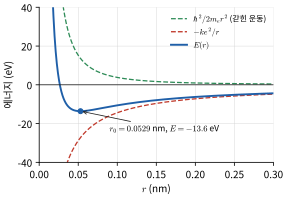

*그림 36.13* $E(r) = \hbar^2/2m_er^2 - ke^2/r$(파랑)과 두 항(점선). $r$이 작아지면 갇힌 운동의 에너지가 $1/r^2$로 급격히 커져 전자가 핵에 떨어지지 못하고, 최솟값은 $r_0 = 0.0529\ \text{nm}$에서 $-13.6\ \text{eV}$이다.

> **💡 개념 확인: 불확정성 원리에 대한 흔한 오해**
> 불확정성은 측정이 입자를 건드려서만 생기는 것이 아니라 상태 자체의 성질이다. 야구공에도 성립하지만 $\hbar$가 너무 작아 드러나지 않는다. 또 위치 하나만은 원리적으로 얼마든지 정확히 잴 수 있다. 제한은 **짝을 이루는** 두 양을 동시에 정할 때만 있다.

---

## 핵심 정리

| 주제 | 핵심 식 | 의미 |
|---|---|---|
| 플랑크 복사 법칙 | $u(f) = \dfrac{8\pi hf^3}{c^3}\dfrac{1}{e^{hf/k_BT} - 1}$ | 진동자 에너지 $nhf$로 양자화 |
| 빈 변위 법칙 | $\lambda_{\max}T = 2.898\times10^{-3}\ \text{m·K}$ | $x = 5(1 - e^{-x})$, $x = 4.965$ |
| 슈테판–볼츠만 | $M = \sigma T^4$, $\sigma = \dfrac{2\pi^5k_B^4}{15h^3c^2}$ | 전체 복사 출력 |
| 광자 | $E = hf = hc/\lambda$, $p = h/\lambda$ | $hc = 1239.84\ \text{eV·nm}$ |
| 광전 효과 | $K_{\max} = eV_0 = hf - \phi$ | 문턱 진동수 $f_0 = \phi/h$ |
| 콤프턴 산란 | $\lambda' - \lambda = \lambda_C(1 - \cos\theta)$ | $\lambda_C = h/m_ec = 2.426\ \text{pm}$ |
| 드브로이 파장 | $\lambda = h/p$, $p = \hbar k$, $E = \hbar\omega$ | 전자: $\lambda = 1.226\ \text{nm}/\sqrt{V}$ (비상대론) |
| 상대론적 운동량 | $pc = \sqrt{K^2 + 2Kmc^2}$ | 전자현미경 |
| 확률 해석 | $P \propto \lvert \psi_1 + \psi_2\rvert ^2$ | 간섭항이 무늬를 만듦 |
| 불확정성 원리 | $\Delta x\,\Delta p_x \ge \hbar/2$, $\Delta E\,\Delta t \gtrsim \hbar/2$ | 가우스 묶음에서 등호 |
| 유용한 조합 | $\hbar c = 197.3\ \text{eV·nm} = 197.3\ \text{MeV·fm}$ | 원자·핵 어림 |

---

## 연습문제

**기본**
1. 파장 $532\ \text{nm}$인 초록색 레이저 광자의 에너지를 eV와 J로, 운동량을 SI 단위로 구하라.
2. 표면 온도 $10\,000\ \text{K}$인 별과 우주 배경 복사($2.725\ \text{K}$)의 $\lambda_{\max}$를 각각 구하라. 각각 어느 파장 영역인가?
3. 일함수가 $4.3\ \text{eV}$인 금속의 문턱 파장을 구하라. 파장 $250\ \text{nm}$인 자외선을 비추면 광전자의 최대 운동에너지는?
4. 자유전자에 의한 콤프턴 산란에서 $\theta = 60°$와 $180°$일 때 파장 변화를 구하라.
5. $100\ \text{V}$로 가속한 전자의 드브로이 파장을 구하라.
6. 운동에너지가 같은 전자와 양성자(비상대론) 중 어느 쪽의 드브로이 파장이 몇 배 긴가?
7. 흑체의 절대온도를 2배로 하면 전체 복사 출력과 $\lambda_{\max}$는 각각 어떻게 변하는가?

**응용**

8. 광전 효과 실험에서 파장 $300\ \text{nm}$일 때 저지 전압이 $2.13\ \text{V}$, $400\ \text{nm}$일 때 $1.10\ \text{V}$였다. 이 데이터만으로 플랑크 상수와 일함수를 구하라.
9. 지구 궤도(태양에서 $1\ \text{au}$)에서 태양빛에 수직인 면이 받는 복사 세기(태양 상수)는 $1361\ \text{W/m}^2$이다. 태양 반지름 $6.96\times10^8\ \text{m}$를 써서 태양을 흑체로 볼 때의 표면 온도를 구하라.
10. 세슘-137이 내는 $662\ \text{keV}$ 감마선이 검출기 속 전자에 의해 $180°$로 콤프턴 산란되었다. 산란 광자의 에너지와 전자가 받은 운동에너지를 구하라. (감마선 스펙트럼에서 이 전자 에너지를 "콤프턴 끝(Compton edge)"이라 부른다.)
11. 그림 36.9의 데이비슨–거머 실험에서 전자 에너지가 $54\ \text{eV}$, 원자 열 간격이 $0.215\ \text{nm}$일 때 $d\sin\varphi = \lambda$로 예측되는 회절각을 구하고 측정값 $50°$와 비교하라.
12. 베타 붕괴에서 나오는 전자가 원래 원자핵(크기 $\sim10^{-14}\ \text{m}$) 안에 있었다고 가정하자. $\Delta x = 10^{-14}\ \text{m}$로 두고 전자의 최소 운동량과 (상대론적) 운동에너지를 어림하라. 베타 붕괴 전자의 에너지가 보통 수 MeV 이하라는 사실과 비교해 무엇을 결론지을 수 있는가?
13. 들뜬 상태의 수명이 $10\ \text{ns}$이다. $\Delta E\,\Delta t \approx \hbar/2$로 에너지 폭과 진동수 폭을 구하라.

**도전**

14. (가) 플랑크 법칙의 진동수 분포 $u(f)$가 최대가 되는 조건이 $x = 3(1 - e^{-x})$($x = hf/k_BT$)임을 보이고, 해 $x = 2.821$을 써서 $c/f_{\max}$와 $T$의 곱을 구하라. (나) 이것이 $\lambda_{\max}T$와 다른 이유를 설명하라.
15. 정지한 자유전자는 광자를 완전히 흡수할 수 없음(광전 효과에는 금속 격자 같은 제3의 물체가 필요함)을 에너지와 운동량 보존으로 증명하라.
16. 질량 $m$, 각진동수 $\omega$인 1차원 조화 진동자의 에너지 $E = \dfrac{p^2}{2m} + \dfrac{1}{2}m\omega^2x^2$에 대해, $\langle x\rangle = \langle p\rangle = 0$인 상태에서 $\langle E\rangle = \dfrac{(\Delta p)^2}{2m} + \dfrac{1}{2}m\omega^2(\Delta x)^2$이다. 불확정성 원리를 써서 $\langle E\rangle \ge \hbar\omega/2$임을 보여라. (37.5절의 정확한 결과와 같다.)
17. 상대론적 드브로이 파장 $\lambda = hc/\sqrt{K^2 + 2Kmc^2}$을 유도하고, $200\ \text{keV}$ 전자에 대해 비상대론 식이 몇 % 틀리는지 구하라. $K \ll mc^2$와 $K \gg mc^2$ 두 극한에서 $\lambda$가 각각 무엇에 가까워지는지도 보여라.
18. (파이썬) 36.5절 코드에서 어느 슬릿을 지났는지 알 수 있는 경우의 분포는 두 슬릿 각각의 회절 세기의 합이다. 이때 $P(y) \propto \text{sinc}^2(\beta/\pi)$가 됨을 설명하고, 코드를 고쳐 $N = 50\,000$일 때 첫 어두운 무늬 근처($y = 5 \pm 0.5\ \text{mm}$)의 광자 수가 어떻게 달라지는지 확인하라.

## 연습문제 답과 힌트
1. $E = 1239.84/532 = 2.33\ \text{eV} = 3.73\times10^{-19}\ \text{J}$, $p = h/\lambda = 1.25\times10^{-27}\ \text{kg·m/s}$.
2. 별: $290\ \text{nm}$(자외선). 배경 복사: $1.06\ \text{mm}$(마이크로파). 40.6절에서 다시 다룬다.
3. $\lambda_0 = 1239.84/4.3 = 288\ \text{nm}$. $K_{\max} = 4.96 - 4.3 = 0.66\ \text{eV}$.
4. $60°$: $\lambda_C(1 - 0.5) = 1.21\ \text{pm}$. $180°$: $2\lambda_C = 4.85\ \text{pm}$.
5. $0.123\ \text{nm}$.
6. $\lambda = h/\sqrt{2mK}$이므로 전자의 파장이 $\sqrt{m_p/m_e} = 42.9$배 길다.
7. 출력은 $2^4 = 16$배, $\lambda_{\max}$는 절반.
8. $e(V_1 - V_2) = hc(1/\lambda_1 - 1/\lambda_2)$에서 $h = \dfrac{(1.03\ \text{V})e}{c(1/300 - 1/400)\ \text{nm}^{-1}} = 6.61\times10^{-34}\ \text{J·s}$. $\phi = hc/\lambda_1 - eV_1 \approx 1.99\ \text{eV}$(약 $2.0\ \text{eV}$). 유효숫자 3자리 데이터라 $h$가 정의값과 0.3% 다르다.
9. 태양 전체 출력 $4\pi R^2\sigma T^4 = 4\pi d^2 S$에서 $T = \left(\dfrac{Sd^2}{\sigma R^2}\right)^{1/4} = 5.77\times10^3\ \text{K}$.
10. $E' = \dfrac{E}{1 + (E/m_ec^2)(1 - \cos\theta)} = \dfrac{662}{1 + 2(662/511.0)} = 184\ \text{keV}$. 전자 $K = 662 - 184 = 478\ \text{keV}$. 힌트: 콤프턴 공식을 $1/E' - 1/E = (1 - \cos\theta)/(m_ec^2)$로 바꿔 쓰면 편하다.
11. $\sin\varphi = 0.1669/0.215 = 0.776$, $\varphi = 50.9°$. 측정값과 2% 이내로 맞는다.
12. $\Delta p\,c \ge \hbar c/(2\Delta x) = 197.3\ \text{MeV·fm}/(20\ \text{fm}) = 9.9\ \text{MeV}$. $K = \sqrt{(pc)^2 + (0.511)^2} - 0.511 \approx 9.4\ \text{MeV}$. 관측되는 베타 전자 에너지보다 훨씬 크고 이를 붙잡을 인력도 없으므로, 전자는 핵의 구성원이 아니라 붕괴 순간에 **생성**된다(40장).
13. $\Delta E = \hbar/(2\tau) = 3.3\times10^{-8}\ \text{eV}$, $\Delta f = \Delta E/h = 1/(4\pi\tau) = 8.0\ \text{MHz}$. (교재에 따라 $\Delta E \approx \hbar/\tau$를 써서 $\Delta f = 1/(2\pi\tau) = 16\ \text{MHz}$로 쓰기도 한다. 어림의 계수 차이다.)
14. (가) $u \propto x^3/(e^x - 1)$을 미분하면 $3x^2(e^x - 1) - x^3e^x = 0$, 곧 $x = 3(1 - e^{-x})$. $c/f_{\max}\cdot T = hc/(2.821k_B) = 5.10\times10^{-3}\ \text{m·K}$로, $\lambda_{\max}T = 2.90\times10^{-3}\ \text{m·K}$의 약 1.76배다. (나) $u(\lambda)$와 $u(f)$는 $u(\lambda) = u(f)\,c/\lambda^2$로 변환 인자 $c/\lambda^2$만큼 다르므로, 최댓값 위치가 같을 이유가 없다.
15. 전자 정지 좌표에서 광자 에너지 $pc$, 운동량 $p$를 흡수하면 $pc + mc^2 = E'$, $p = p'$이다. $E'^2 = p'^2c^2 + m^2c^4$에 넣으면 $(pc + mc^2)^2 = p^2c^2 + m^2c^4$, 곧 $2pmc^3 = 0$이므로 $p = 0$이다. 모순. 금속 격자가 운동량 일부를 받아 가야 흡수가 가능하다.
16. $\Delta p \ge \hbar/(2\Delta x)$를 넣으면 $\langle E\rangle \ge \dfrac{\hbar^2}{8m(\Delta x)^2} + \dfrac{1}{2}m\omega^2(\Delta x)^2$. 산술–기하 평균 부등식(또는 $(\Delta x)^2$로 미분)으로 최솟값은 $(\Delta x)^2 = \hbar/(2m\omega)$일 때 $\hbar\omega/2$.
17. $E = K + mc^2$를 $E^2 = (pc)^2 + (mc^2)^2$에 넣는다. $200\ \text{keV}$: 상대론 $2.508\ \text{pm}$, 비상대론 $2.742\ \text{pm}$으로 9.3% 크게 나온다. $K \ll mc^2$: $\lambda \to h/\sqrt{2mK}$. $K \gg mc^2$: $\lambda \to hc/K$로 같은 에너지 광자의 파장과 같아진다.
18. 경로를 알면 간섭항이 사라지고, $L \gg d$이면 두 단일 슬릿 무늬가 거의 겹쳐 $P \propto \text{sinc}^2$이다. 코드에서 `np.cos(phi)**2`를 지우면 된다. 난수 씨앗 1로 실행하면 첫 어두운 무늬 근처에 2155개가 찍혀(간섭이 있을 때는 34개) 줄무늬가 사라지고 넓은 단일 봉우리만 남는다.

## 영어 용어 정리
| 한글 | English |
|---|---|
| 열복사 / 흑체 / 공동 복사 | thermal radiation / blackbody / cavity radiation |
| 슈테판–볼츠만 법칙 | Stefan–Boltzmann law |
| 빈 변위 법칙 | Wien's displacement law |
| 레일리–진스 법칙 / 자외선 파탄 | Rayleigh–Jeans law / ultraviolet catastrophe |
| 플랑크 상수 / 환산 플랑크 상수 | Planck constant / reduced Planck constant |
| 에너지 양자화 | energy quantization |
| 광자 | photon |
| 광전 효과 / 광전자 | photoelectric effect / photoelectron |
| 일함수 / 문턱 진동수 | work function / threshold frequency |
| 저지 전압 | stopping potential |
| 콤프턴 산란 / 콤프턴 파장 | Compton scattering / Compton wavelength |
| 물질파 / 드브로이 파장 | matter wave / de Broglie wavelength |
| 전자 회절 | electron diffraction |
| 위상 속도 / 군속도 | phase velocity / group velocity |
| 파동 묶음 | wave packet |
| 투과 / 주사 전자현미경 | transmission / scanning electron microscope (TEM / SEM) |
| 파동–입자 이중성 | wave–particle duality |
| 확률 진폭 | probability amplitude |
| 불확정성 원리 | uncertainty principle |
| 자연 선폭 | natural linewidth |
| 산란선 제거 격자 | anti-scatter grid |
