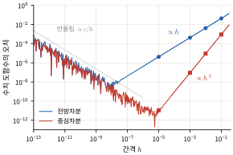
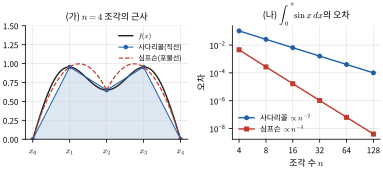
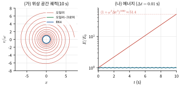
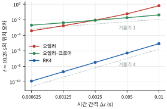
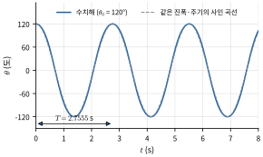
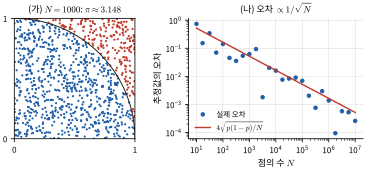
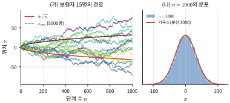
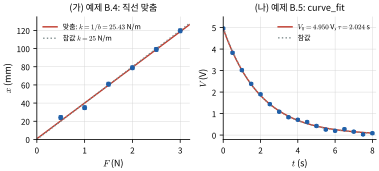
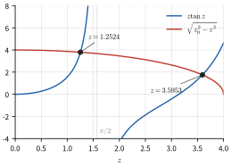
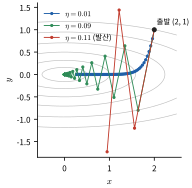

# 특집 B 파이썬 계산물리 입문

> 관련 장: 1장(오일러 방법), 2장(최소제곱), 13장(행성 궤도), 15장(진동), 19장(확산), 25장(RC 회로), 37장(상자 속 입자)
> 대학 실험과 전공 과목에서는 데이터 처리와 수치 해법이 일상이다. 이 특집은 본문 곳곳의 🐍 파이썬 실습을 하나의 체계로 묶는다. 모든 코드는 Python 3과 numpy, scipy, matplotlib로 실행해 결과를 확인했다. 난수를 쓰는 코드는 씨앗(seed)을 고정했으므로 같은 결과가 나와야 한다(라이브러리 버전에 따라 마지막 자리가 다를 수 있다).

## 학습 목표
- numpy 배열과 벡터화, 브로드캐스팅으로 반복문 없이 물리량을 계산할 수 있다.
- 유한차분 미분과 사다리꼴·심프슨 적분의 오차 차수를 테일러 전개로 설명하고, 실제로 확인할 수 있다.
- 오일러, 오일러–크로머, RK4 방법을 직접 구현하고, 에너지 보존으로 정확도를 비교하며, `solve_ivp`를 쓸 수 있다.
- 몬테카를로 방법의 오차가 $1/\sqrt N$로 줄어드는 이유와, 무작위 행보가 확산($\sqrt t$)을 낳는 이유를 설명할 수 있다.
- 최소제곱 맞춤과 `curve_fit`으로 매개변수와 그 불확도를 구하고, 근 찾기와 최적화 함수를 쓸 수 있다.
- 경사하강법을 "퍼텐셜 에너지 내려가기"로 이해하고, 간단한 선형회귀를 numpy로 구현할 수 있다.

## 들어가며: 준비물
파이썬 3과 numpy, scipy, matplotlib만 있으면 된다(웹 브라우저의 노트북 환경도 된다). 코드를 파일(예: `test.py`)로 저장하고 터미널에서 `python3 test.py`로 실행한다. 그래프는 `plt.savefig("파일명.png")`로 저장하거나, 대화형 환경에서는 `plt.show()`로 띄운다.

수치 계산에서 가장 중요한 습관은 **답을 아는 문제로 먼저 검증하는 것**이다. 0장의 "차원·극한 검사"가 손 계산의 안전장치라면, "알려진 해와 비교"는 코드의 안전장치이다.

---

## B.1 파이썬과 numpy 기초

### 배열과 원소별 연산
numpy의 핵심은 **배열**(array)이다. 배열끼리의 사칙연산과 `np.sin` 같은 함수는 **원소별**(element-wise)로 적용된다. 그래서 수학 식을 거의 그대로 코드로 옮길 수 있다. 이렇게 반복문 없이 배열 전체에 연산을 거는 것을 **벡터화**(vectorization)라 한다. 벡터화한 코드는 짧고, 읽기 쉽고, 빠르다(반복이 컴파일된 C 코드 안에서 일어나기 때문이다).

**브로드캐스팅**(broadcasting)은 모양이 다른 배열을 자동으로 늘려 맞추는 규칙이다. 모양 (3, 1)과 (1, 4)인 배열을 연산하면 (3, 4) 배열이 된다. 여러 조건(발사각, 질량 등)과 여러 시각을 한 번에 계산할 때 편리하다.

```python
import numpy as np
import time, math

# 1) 배열 만들기와 원소별 연산
t = np.linspace(0, 2, 5)          # 0~2 s를 5등분한 점
x = 5*t - 0.5*9.8*t**2            # 반복문 없이 모든 t에서 계산
print("t =", t)
print("x =", x)

# 2) 반복문 대 벡터화: 0~1 사이 100만 개 점에서 sin(x)^2의 평균
N = 1_000_000
xs = np.random.default_rng(0).random(N)
t0 = time.perf_counter()
s = 0.0
for v in xs:
    s += math.sin(v)**2
t1 = time.perf_counter()
m = np.mean(np.sin(xs)**2)
t2 = time.perf_counter()
print(f"반복문: {s/N:.6f} ({t1-t0:.3f} s), 벡터화: {m:.6f} ({t2-t1:.4f} s)")

# 3) 브로드캐스팅: 발사각 3개 × 시각 4개의 높이를 한 번에
v0, g = 20.0, 9.8
theta = np.radians([30, 45, 60])[:, None]   # 모양 (3, 1)
tt = np.array([0.0, 0.5, 1.0, 1.5])[None, :] # 모양 (1, 4)
y = v0*np.sin(theta)*tt - 0.5*g*tt**2       # 모양 (3, 4)
print(np.round(y, 2))
```

**실행 결과** `x = [ 0. 1.275 0.1 -3.525 -9.6 ]`이다. 두 방법 모두 평균 0.272825를 준다(정확한 값 $\frac{1}{2} - \frac{\sin2}{4} = 0.27268$과 표본 오차 안에서 일치). 시간은 컴퓨터와 실행마다 크게 다르지만 벡터화 쪽이 빠르다. 한 번만 재면 잡음이 크므로 `timeit`으로 여러 번 재어 가장 짧은 시간을 비교하는 것이 공정하다. 이 책을 검증한 환경(Python 3.13)에서 이 예는 약 10배였고, `math.sin`처럼 무거운 함수 대신 제곱의 합 같은 단순 산술 반복이면 환경에 따라 수십 배 이상 차이가 난다. 3×4 배열의 행은 발사각, 열은 시각이며, 예를 들어 $60°$, $1.5\ \text{s}$에서 $14.96\ \text{m}$이다.

> **💡 개념 확인: 정수 나눗셈과 부동소수점**
> `7/2`는 3.5, `7//2`는 3이다. 또 `0.1 + 0.2 == 0.3`은 `False`이다. 실수는 2진 부동소수점으로 약 16자리까지만 저장되기 때문이다(기계 엡실론 $\epsilon \approx 2.2\times10^{-16}$). 실수 비교는 `np.isclose(a, b)`로 한다. 이 반올림 오차가 B.2절의 수치 미분을 제한한다.

**연습 B.1** 브로드캐스팅으로 발사각 $15°, 30°, 45°, 60°, 75°$에 대해 수평 도달 거리 $R = v_0^2\sin2\theta/g$와 최고 높이 $H = v_0^2\sin^2\theta/2g$를 한 줄씩 계산해 표로 출력하라($v_0 = 20\ \text{m/s}$). 어느 두 각도의 $R$이 같은가?

---

## B.2 수치 미분과 수치 적분

### 유한차분과 오차 차수
3장에서 속도를 $\Delta x/\Delta t$의 극한으로 정의했다. 컴퓨터에서는 극한을 취할 수 없으므로 작은 $h$로 근사한다. 테일러 전개(1.5절)

$$
f(x \pm h) = f(x) \pm hf'(x) + \frac{h^2}{2}f''(x) \pm \frac{h^3}{6}f'''(x) + \cdots
$$

에서 두 가지 근사를 얻는다.

$$
\text{전방차분: } \frac{f(x+h) - f(x)}{h} = f'(x) + \underbrace{\frac{h}{2}f''(x)}_{O(h)}, \qquad
\text{중심차분: } \frac{f(x+h) - f(x-h)}{2h} = f'(x) + \underbrace{\frac{h^2}{6}f'''(x)}_{O(h^2)}
$$

중심차분에서는 짝수 차 항이 상쇄되어 오차가 $h^2$에 비례한다. 이것을 **오차 차수**(order of accuracy)라 한다. $h$를 10배 줄이면 전방차분 오차는 10배, 중심차분 오차는 100배 줄어든다.

그런데 $h$를 한없이 줄이면 안 된다. $f(x+h) - f(x)$는 거의 같은 두 수의 차이이므로, 각 값에 붙은 반올림 오차 $\sim\epsilon|f|$가 $h$로 나뉘어 $\epsilon/h$만큼 커진다. 전체 오차는 $\frac{h}{2}|f''| + \frac{\epsilon|f|}{h}$이고, 이를 최소로 하는 $h$는 전방차분에서 $\sim\sqrt\epsilon \approx 10^{-8}$, 중심차분에서 $\sim\epsilon^{1/3} \approx 10^{-5}$이다.

```python
import numpy as np

f, df_exact, x0 = np.sin, np.cos(1.0), 1.0
print("   h        전방 오차     중심 오차")
for h in [1e-1, 1e-2, 1e-3, 1e-5, 1e-8, 1e-11]:
    fwd = (f(x0 + h) - f(x0)) / h
    cen = (f(x0 + h) - f(x0 - h)) / (2*h)
    print(f"{h:8.0e}   {abs(fwd - df_exact):.2e}     {abs(cen - df_exact):.2e}")
```

**실행 결과** ($f = \sin x$, $x = 1$에서 $f' = \cos1$과 비교) $h = 10^{-1}, 10^{-2}, 10^{-3}, 10^{-5}, 10^{-8}, 10^{-11}$에 대해 전방 오차는 $4.29\times10^{-2}$, $4.22\times10^{-3}$, $4.21\times10^{-4}$, $4.21\times10^{-6}$, $2.97\times10^{-9}$, $1.17\times10^{-6}$이고, 중심 오차는 $9.00\times10^{-4}$, $9.00\times10^{-6}$, $9.01\times10^{-8}$, $1.11\times10^{-11}$, $2.58\times10^{-9}$, $1.17\times10^{-6}$이다. 전방 오차는 $h$에 비례하고($\frac{h}{2}\sin1 = 0.042$, $h = 0.1$), 중심 오차는 $h^2$에 비례한다($\frac{h^2}{6}\cos1 = 9.0\times10^{-4}$). $h = 10^{-5}$에서 중심차분이 가장 정확하고, $h = 10^{-11}$에서는 두 방법 모두 반올림 오차 때문에 오히려 나빠진다. 잡음이 있는 실험 데이터는 미분하기 전에 맞춤(B.5절)이나 평활화를 먼저 고려한다. $h$를 더 촘촘히 바꾸며 같은 계산을 한 결과가 그림 B.1이다.



*그림 B.1* 위 코드의 계산을 $h = 10^{-13}$–$10^{-0.5}$로 넓힌 결과(점은 본문 표의 $h$ 값). 오른쪽에서는 절단 오차가 전방차분 $\propto h$, 중심차분 $\propto h^2$로 줄고, 왼쪽에서는 반올림 오차 $\sim\epsilon/h$(회색 점선)가 커져 들쭉날쭉해진다. 오차가 가장 작은 $h$는 전방차분에서 약 $10^{-8}$, 중심차분에서 약 $10^{-5}$이다.

### 사다리꼴 규칙과 심프슨 규칙
구간 $[a, b]$를 폭 $h = (b-a)/n$인 $n$개 조각으로 나누고 점 $x_i$에서의 값 $f_i$를 쓴다.

$$
\text{사다리꼴: } \int_a^b f\,dx \approx h\left[\tfrac{1}{2}f_0 + f_1 + \cdots + f_{n-1} + \tfrac{1}{2}f_n\right], \quad \text{오차 } O(h^2)
$$

$$
\text{심프슨: } \int_a^b f\,dx \approx \frac{h}{3}\left[f_0 + 4f_1 + 2f_2 + 4f_3 + \cdots + 4f_{n-1} + f_n\right], \quad \text{오차 } O(h^4)
$$

사다리꼴 규칙은 각 조각을 직선으로, 심프슨 규칙($n$ 짝수)은 두 조각씩 포물선으로 근사한다. 심프슨 규칙은 포물선으로 근사하는데도 3차 다항식까지 정확하게 적분하여(대칭성 때문에 3차 오차항이 상쇄) 오차가 $h^4$에 비례한다.

```python
import numpy as np
from scipy.integrate import quad

def trapezoid(f, a, b, n):
    x = np.linspace(a, b, n + 1)
    y = f(x)
    h = (b - a) / n
    return h * (y[0]/2 + y[1:-1].sum() + y[-1]/2)

def simpson(f, a, b, n):              # n은 짝수
    x = np.linspace(a, b, n + 1)
    y = f(x)
    h = (b - a) / n
    return h/3 * (y[0] + 4*y[1:-1:2].sum() + 2*y[2:-1:2].sum() + y[-1])

exact = 2.0                            # ∫_0^π sin x dx
print("  n    사다리꼴 오차   심프슨 오차")
for n in [4, 8, 16, 32]:
    eT = abs(trapezoid(np.sin, 0, np.pi, n) - exact)
    eS = abs(simpson(np.sin, 0, np.pi, n) - exact)
    print(f"{n:3d}    {eT:.3e}     {eS:.3e}")

val, err = quad(np.sin, 0, np.pi)
print(f"quad: {val:.15f}, 오차 추정 {err:.1e}")
```

**실행 결과** $n = 4, 8, 16, 32$에서 사다리꼴 오차는 $1.039\times10^{-1}$, $2.577\times10^{-2}$, $6.430\times10^{-3}$, $1.607\times10^{-3}$으로 $n$을 2배 할 때마다 약 4배($2^2$) 줄고, 심프슨 오차는 $4.560\times10^{-3}$, $2.692\times10^{-4}$, $1.659\times10^{-5}$, $1.033\times10^{-6}$으로 약 16배($2^4$) 준다. `scipy.integrate.quad`는 적응형 가우스 구적법으로 `2.000000000000000`과 오차 추정 $2.2\times10^{-14}$을 준다. 실무에서는 `quad`를 쓰되, 그 원리가 위 두 규칙의 연장이라는 점을 알아 두자(그림 B.2).



*그림 B.2* (가) 같은 $n = 4$개 조각으로 사다리꼴 규칙은 직선(파랑), 심프슨 규칙은 두 조각씩 포물선(빨간 점선)으로 함수를 근사한다(차이가 잘 보이도록 고른 예시 함수). (나) 위 코드로 구한 $\int_0^\pi\sin x\,dx$의 오차. 로그 눈금에서 기울기가 각각 $-2$, $-4$이다.

### 예제 B.1 큰 진폭 진자의 주기
진폭 $\theta_0$인 단진자의 정확한 주기는 에너지 보존에서

$$
T = 4\sqrt{\frac{L}{g}}\int_0^{\pi/2}\frac{du}{\sqrt{1 - k^2\sin^2u}}, \qquad k = \sin\frac{\theta_0}{2}
$$

이다(적분은 제1종 완전 타원 적분 $K(k)$). `quad`로 계산하라($L = 1\ \text{m}$).

```python
import numpy as np
from scipy.integrate import quad
from scipy.special import ellipk

g, L = 9.8, 1.0
T0 = 2*np.pi*np.sqrt(L/g)
for deg in [10, 60, 120, 170]:
    k = np.sin(np.radians(deg)/2)
    K, _ = quad(lambda u: 1/np.sqrt(1 - k**2*np.sin(u)**2), 0, np.pi/2)
    T = 4*np.sqrt(L/g)*K
    print(f"진폭 {deg:3d}°: T = {T:.4f} s, T/T0 = {T/T0:.4f}, "
          f"ellipk 검산 {4*np.sqrt(L/g)*ellipk(k**2):.4f}")
```

**풀이(실행 결과)** $T_0 = 2.007\ \text{s}$에 대해 $T/T_0$는 $10°$: 1.0019, $60°$: 1.0732, $120°$: 1.3729, $170°$: 2.4394이다. $120°$에서 $T = 2.7555\ \text{s}$로, 1장 연습문제 14의 답과 같다. scipy의 `ellipk(m)`은 인수로 $m = k^2$을 받는다는 데 주의하라(라이브러리 문서의 인수 정의를 확인하는 습관이 중요하다).

**연습 B.2** 사다리꼴 규칙으로 $\int_0^1 e^{-x^2}dx$를 $n = 10, 100, 1000$에 대해 계산하고 `quad`의 값과 비교하라. 오차가 $n^{-2}$로 줄어드는지 확인하라.

---

## B.3 미분방정식: 오일러에서 RK4까지

### 상태 벡터와 1계 연립방정식
뉴턴 방정식 $m\ddot x = F(x, \dot x, t)$는 상태 $y = (x, v)$에 대한 1계 연립방정식

$$
\frac{dx}{dt} = v, \qquad \frac{dv}{dt} = \frac{F(x, v, t)}{m}
$$

로 바꿀 수 있다. 수치 해법은 모두 "현재 상태에서 $\Delta t$ 뒤의 상태를 어림하는 규칙"이다.

- **오일러 방법**: $x_{n+1} = x_n + v_n\Delta t$, $v_{n+1} = v_n + a_n\Delta t$. 한 단계 오차 $O(\Delta t^2)$, 전체 오차 $O(\Delta t)$인 1차 방법이다.
- **오일러–크로머 방법**: 속도를 먼저 갱신하고 **새 속도로** 위치를 갱신한다. 여전히 1차이지만 진동 문제에서 에너지가 한없이 늘지 않는다(1장 🐍).
- **4차 룽게–쿠타(RK4)**: 한 단계 안에서 기울기를 네 번 계산해 가중평균한다. $y' = f(t, y)$에 대해
$$
k_1 = f(t_n, y_n),\ k_2 = f(t_n + \tfrac{\Delta t}{2}, y_n + \tfrac{\Delta t}{2}k_1),\ k_3 = f(t_n + \tfrac{\Delta t}{2}, y_n + \tfrac{\Delta t}{2}k_2),\ k_4 = f(t_n + \Delta t, y_n + \Delta t\,k_3)
$$
$$
y_{n+1} = y_n + \frac{\Delta t}{6}(k_1 + 2k_2 + 2k_3 + k_4)
$$
전체 오차가 $O(\Delta t^4)$인 4차 방법이다. $\Delta t$를 반으로 줄이면 오차가 약 16배 준다(그림 B.4).

### 예제 B.2 세 방법의 에너지 보존 비교
주기 1 s인 조화 진동자 $\ddot x = -\omega^2x$($\omega = 2\pi$, $x_0 = 1$, $v_0 = 0$)를 $\Delta t = 0.01\ \text{s}$로 10 s 동안 풀고 에너지를 비교하라.

```python
import numpy as np

w = 2*np.pi                      # 주기 1 s인 조화 진동자 x'' = -w^2 x
def acc(x):
    return -w**2 * x

def energy(x, v):
    return 0.5*v**2 + 0.5*w**2*x**2   # 단위 질량당 에너지

def run(method, dt=0.01, T=10.0):
    x, v = 1.0, 0.0
    for _ in range(int(round(T/dt))):
        if method == "euler":
            x, v = x + v*dt, v + acc(x)*dt
        elif method == "cromer":
            v = v + acc(x)*dt
            x = x + v*dt
        elif method == "rk4":                # 상태 y = (x, v), y' = (v, a)
            k1x, k1v = v, acc(x)
            k2x, k2v = v + k1v*dt/2, acc(x + k1x*dt/2)
            k3x, k3v = v + k2v*dt/2, acc(x + k2x*dt/2)
            k4x, k4v = v + k3v*dt, acc(x + k3x*dt)
            x = x + dt/6*(k1x + 2*k2x + 2*k3x + k4x)
            v = v + dt/6*(k1v + 2*k2v + 2*k3v + k4v)
    return x, v

E0 = energy(1.0, 0.0)
for m in ["euler", "cromer", "rk4"]:
    x, v = run(m)
    print(f"{m:7s}: x(10 s) = {x:+.6f} (정확히 1), 에너지 상대오차 {energy(x, v)/E0 - 1:+.2e}")
```

**실행 결과**

| 방법 | $x(10\ \text{s})$ (정확한 값 1) | 에너지 상대오차 |
|---|---|---|
| 오일러 | $+7.146543$ | $+5.04\times10^{1}$ (51배로 증가) |
| 오일러–크로머 | $+0.999622$ | $-6.50\times10^{-4}$ |
| RK4 | $+1.000000$ | $-8.54\times10^{-7}$ |

오일러 방법의 에너지 폭주는 정확히 계산할 수 있다. 한 단계에서
$$
v_{n+1}^2 + \omega^2x_{n+1}^2 = (v_n - \omega^2x_n\Delta t)^2 + \omega^2(x_n + v_n\Delta t)^2 = (1 + \omega^2\Delta t^2)(v_n^2 + \omega^2x_n^2)
$$
이므로 에너지는 매 단계 $(1 + \omega^2\Delta t^2)$배가 된다. 1000단계 뒤에는 $(1 + 0.00395)^{1000} \approx 51.4$배로, 코드 결과와 일치한다. 오일러–크로머 방법의 에너지는 진동하지만(이 경우 최대 약 3%) 쌓이지 않는다. 표의 값이 작은 것은 $t = 10\ \text{s}$가 반환점 근처이기 때문이다. 세 방법의 궤적과 에너지를 그림 B.3에, 시간 간격에 따른 오차를 그림 B.4에 그렸다.



*그림 B.3* 예제 B.2의 코드로 계산한 궤적. (가) 위상 공간 $(x, v/\omega)$에서 정확한 해는 반지름 1인 원이다. 오일러 방법(빨강)은 바깥으로 도는 나선이 되고, 오일러–크로머(초록)와 RK4(파랑)는 원에 머문다. (나) 에너지 비 $E/E_0$(로그 눈금). 오일러 방법은 매 단계 $(1 + \omega^2\Delta t^2)$배씩 커지고, 오일러–크로머는 몇 % 안에서 진동만 한다.



*그림 B.4* 예제 B.2의 `run`으로 $t = 10.25\ \text{s}$($x$의 정확한 값 0)의 위치 오차를 $\Delta t$에 따라 구한 것(연습 B.3). RK4는 $\Delta t$를 반으로 줄일 때마다 오차가 16배 줄어 기울기 4, 오일러–크로머는 약 2배씩 줄어 기울기 1이다. 오일러 방법은 큰 $\Delta t$에서 오차가 매우 크고, $\Delta t$가 작아지면 약 4배씩 준다. 이 시각은 $x = 0$인 순간이라 진폭의 폭주는 드러나지 않고 위상 오차만 보이기 때문이다.

> **★ 심화: 심플렉틱 적분법**
> 오일러–크로머 방법이 에너지를 장기간 보존하는 이유는 이 방법이 위상 공간 $(x, p)$의 넓이를 보존하는 **심플렉틱(symplectic)** 변환이기 때문이다. 해밀턴 역학의 시간 변화도 위상 공간 넓이를 보존한다(리우빌 정리). 심플렉틱 방법은 정확한 에너지 대신 그와 아주 가까운 "수정된 에너지"를 매우 오랫동안 (거의) 보존하므로 오차가 쌓이지 않는다. 행성 궤도나 분자동역학처럼 오래 적분하는 문제에서는 2차 심플렉틱 방법인 **속도 베를레**(velocity Verlet)를 많이 쓴다. RK4는 정확하지만 심플렉틱이 아니어서 에너지가 조금씩 한쪽으로 표류한다(연습문제 7, 12).

### scipy의 solve_ivp
실무에서는 `scipy.integrate.solve_ivp`를 쓴다. 기본 방법 `RK45`는 4차와 5차 공식을 함께 계산해 오차를 추정하고 **시간 간격을 자동으로 조절**한다. `rtol`, `atol`로 허용 오차를 정하고, `events`로 특정 조건(예: 각도가 0이 되는 순간)을 정확히 잡는다.

### 예제 B.3 큰 진폭 진자를 solve_ivp로
$\ddot\theta = -(g/L)\sin\theta$를 $\theta_0 = 120°$에서 풀고, 각도가 아래에서 위로 0을 지나는 시각의 간격으로 주기를 구하라.

```python
import numpy as np
from scipy.integrate import solve_ivp
import matplotlib.pyplot as plt

g, L = 9.8, 1.0
def pendulum(t, y):                    # y = [theta, omega]
    th, om = y
    return [om, -g/L*np.sin(th)]

def cross_up(t, y):                    # theta가 음에서 양으로 0을 지나는 순간
    return y[0]
cross_up.direction = 1

th0 = np.radians(120)
t = np.linspace(0, 20, 2001)
sol = solve_ivp(pendulum, [0, 20], [th0, 0.0], t_eval=t,
                rtol=1e-10, atol=1e-12, events=cross_up)
tc = sol.t_events[0]
print("주기 T =", round(np.mean(np.diff(tc)), 4), "s")
E = 0.5*L**2*sol.y[1]**2 + g*L*(1 - np.cos(sol.y[0]))
print(f"에너지 상대 변화 최대: {np.max(np.abs(E/E[0] - 1)):.1e}")

plt.plot(sol.t, np.degrees(sol.y[0]))
plt.xlabel("t (s)"); plt.ylabel("theta (deg)")
plt.savefig("pendulum.png", dpi=100)
```

**풀이(실행 결과)** 주기 $T = 2.7555\ \text{s}$로 예제 B.1의 적분 결과와 소수 넷째 자리까지 일치한다. 에너지 상대 변화의 최댓값은 약 $10^{-9}$이다. 서로 다른 두 방법(적분과 미분방정식)이 같은 답을 주는 것이 가장 강력한 검증이다. 저장된 `pendulum.png`에서 꼭대기가 사인 곡선보다 넓적한 모양을 확인하라(그림 B.5).



*그림 B.5* 예제 B.3의 `solve_ivp` 해($\theta_0 = 120°$, 파랑)와 같은 진폭·같은 주기 $T = 2.7555\ \text{s}$의 사인 곡선(회색 점선). 진자는 반환점 근처에서 더 오래 머물러 꼭대기가 넓적하고, 0을 지날 때는 더 빠르다. 작은 진폭의 주기 $T_0 = 2.007\ \text{s}$보다 37% 길다.

**연습 B.3** 예제 B.2의 `run("rk4", dt, T=10.25)`로 $\Delta t = 0.01, 0.005, 0.0025$에서 위치 오차 $|x - \cos(2\pi\cdot10.25)| = |x|$를 구하고, $\Delta t$를 반으로 줄일 때 오차가 약 16배($2^4$) 줄어드는지 확인하라. ($x$가 최대인 $t = 10\ \text{s}$에서 재면 위상 오차는 2차로만 나타나고 진폭 오차($\propto\Delta t^5$)가 남아 약 32배라는 다른 비율이 나온다.)

---

## B.4 몬테카를로 방법

**몬테카를로 방법**(Monte Carlo method)은 난수 표본의 평균으로 값을 어림하는 방법의 총칭으로, 고차원 적분, 통계역학, 불확도 전파 등에 쓰인다.

### π 추정과 $1/\sqrt N$ 오차
한 변이 1인 정사각형에 무작위로 점을 찍으면, 사분원($x^2 + y^2 < 1$) 안에 들어갈 확률은 넓이 비 $p = \pi/4$이다. $N$개 중 들어간 비율 $\hat p$로 $\pi \approx 4\hat p$를 얻는다. 각 점은 확률 $p$의 베르누이 시행이므로 $\hat p$의 표준편차는 $\sqrt{p(1-p)/N}$이고, 따라서 **오차는 $1/\sqrt N$에 비례**한다. 이것은 2장에서 배운 "평균의 표준오차 $\sigma/\sqrt N$"과 같은 법칙이다.

```python
import numpy as np
rng = np.random.default_rng(seed=42)

for N in [10**2, 10**4, 10**6]:
    x, y = rng.random(N), rng.random(N)       # 정사각형 [0,1]^2 안의 무작위 점
    inside = (x**2 + y**2 < 1.0)              # 사분원 안에 들어간 점
    p = inside.mean()
    pi_est = 4*p
    sigma = 4*np.sqrt(p*(1 - p)/N)            # 이항분포로부터 표준오차
    print(f"N = {N:>7d}: pi ≈ {pi_est:.4f} ± {sigma:.4f}, 실제 오차 {abs(pi_est - np.pi):.4f}")
```

**실행 결과** $N = 10^2$: $3.3600 \pm 0.1466$, $N = 10^4$: $3.1468 \pm 0.0164$, $N = 10^6$: $3.1425 \pm 0.0016$. 표본을 100배 늘릴 때마다 오차 막대가 10배 줄고, 실제 오차(0.2184, 0.0052, 0.0009)도 대체로 그 안에 있다. 한 자리 더 정확해지려면 표본이 100배 필요한 것이 약점이지만, 이 수렴 속도가 **차원에 무관**한 것이 강점이다. 격자 위의 사다리꼴 규칙은 $d$차원에서 점 $N$개로 오차가 $N^{-2/d}$로 줄어들므로, 차원이 높으면 몬테카를로가 이긴다(그림 B.6).



*그림 B.6* (가) 정사각형 안의 무작위 점 1000개 중 사분원 안(파랑)에 든 비율의 4배가 $\pi$의 추정값이다(`seed=42`). (나) 점의 수 $N$을 바꿀 때 실제 오차(점)와 이항분포의 표준오차 $4\sqrt{p(1-p)/N}$(빨강). 오차는 들쭉날쭉하지만 평균적으로 $1/\sqrt N$을 따른다.

### 무작위 행보와 확산
매 단계 보폭 $a$로 왼쪽이나 오른쪽에 같은 확률로 움직이는 **무작위 행보**(random walk)를 생각하자. $n$단계 뒤 위치 $x_n = \sum_i s_i$($s_i = \pm a$)에서 서로 다른 단계는 독립이므로 $\langle s_is_j\rangle = 0$($i \ne j$)이고

$$
\langle x_n\rangle = 0, \qquad \langle x_n^2\rangle = \sum_{i,j}\langle s_is_j\rangle = na^2
$$

이다. 한 단계에 시간 $\tau$가 걸리면 $t = n\tau$이므로 $x_{\text{rms}} = a\sqrt{t/\tau} \propto \sqrt t$이다. 이것이 **확산**(diffusion)의 특징이다. 확산 계수 $D$로 쓰면 1차원에서 $\langle x^2\rangle = 2Dt$, $D = a^2/2\tau$이다. 등속 운동($x \propto t$)과 달리, 확산으로 2배 멀리 가려면 4배의 시간이 든다.

```python
import numpy as np
import matplotlib.pyplot as plt
rng = np.random.default_rng(seed=0)

walkers, steps = 5000, 1000
jumps = rng.choice([-1, 1], size=(walkers, steps))   # 매 단계 ±1 (보폭 1)
x = np.cumsum(jumps, axis=1)                         # 각 보행자의 위치 기록

for n in [10, 100, 1000]:
    xn = x[:, n - 1]
    print(f"n = {n:4d}: <x> = {xn.mean():+6.2f}, <x^2> = {np.mean(xn**2):7.1f}, "
          f"rms = {np.sqrt(np.mean(xn**2)):5.2f}, sqrt(n) = {np.sqrt(n):5.2f}")

plt.hist(x[:, -1], bins=40, density=True, label="n = 1000")
xx = np.linspace(-120, 120, 200)
plt.plot(xx, np.exp(-xx**2/2000)/np.sqrt(2000*np.pi), label="Gaussian")
plt.legend(); plt.xlabel("x"); plt.savefig("walk.png", dpi=100)
```

**실행 결과** 보행자 5000명에 대해 $n = 10, 100, 1000$에서 $\langle x^2\rangle = 10.0, 102.5, 995.8$, rms는 $3.17, 10.12, 31.56$으로 $\sqrt n = 3.16, 10.00, 31.62$와 잘 맞는다. $\langle x\rangle$은 0 근처($+0.04, -0.09, +0.58$)이다. 저장된 히스토그램은 분산 $n$인 가우스 분포와 겹친다(중심극한정리, 그림 B.7).



*그림 B.7* 위 코드(`seed=0`)의 결과. (가) 보행자 15명의 경로와, 5000명에서 구한 $x_{\text{rms}}$(검은 점선). $x_{\text{rms}}$는 $\sqrt n$(빨강)을 따라 늘어난다. (나) $n = 1000$에서 위치의 분포(막대)와 분산 1000인 가우스 분포.

> **🔗 전공 연결: 약물 확산과 열전도**
> 약물 분자가 조직이나 세포막을 지나 퍼지는 과정, 기계공학의 열전도, 수의학에서 국소 투여한 약물의 확산은 모두 분자 수준의 무작위 행보가 거시적으로 나타난 것이다(19장). 확산 거리가 $\sqrt{2Dt}$로 늘어나므로, 두께가 2배인 막을 통과하는 데는 약 4배의 시간이 걸린다. 약제학의 방출 제어 제형과 열전달의 비정상 열전도 해석이 이 관계에서 출발한다.

**연습 B.4** 2차원 무작위 행보(매 단계 상하좌우 중 하나로 1칸)를 시뮬레이션하여 $\langle r^2\rangle = \langle x^2 + y^2\rangle$이 단계 수 $n$과 같음을 확인하라.

---

## B.5 데이터 맞춤과 불확도

### 최소제곱법
측정값 $(x_i, y_i)$, $i = 1, \dots, N$에 직선 $y = a + bx$를 맞추자. 각 점의 불확도가 같으면 잔차 제곱합

$$
\chi^2(a, b) = \sum_i (y_i - a - bx_i)^2
$$

을 최소로 하는 $a$, $b$를 고른다(**최소제곱법**, least squares). $\partial\chi^2/\partial a = \partial\chi^2/\partial b = 0$을 풀면

$$
b = \frac{N\sum x_iy_i - \sum x_i\sum y_i}{\Delta}, \quad a = \frac{\sum x_i^2\sum y_i - \sum x_i\sum x_iy_i}{\Delta}, \quad \Delta = N\sum x_i^2 - \left(\sum x_i\right)^2
$$

이다. 측정 오차 $\sigma_y$를 잔차로 추정하면 $s = \sqrt{\sum r_i^2/(N - 2)}$($N - 2$는 매개변수 2개를 뺀 **자유도**)이고, 기울기의 불확도는 $\sigma_b = s\sqrt{N/\Delta}$이다(2장 2.5절).

### 예제 B.4 용수철 상수 구하기
추의 무게 $F$를 바꾸며 용수철이 늘어난 길이 $x$를 쟀다(모의 데이터: 참값 $k = 25\ \text{N/m}$, 길이 측정 오차 2 mm). $x = a + bF$로 맞추고 $k = 1/b$와 그 불확도를 구하라.

```python
import numpy as np
rng = np.random.default_rng(seed=3)

# 용수철에 추를 달아 늘어난 길이 측정: F = k x (참값 k = 25 N/m), 측정 오차 0.002 m
F = np.array([0.5, 1.0, 1.5, 2.0, 2.5, 3.0])          # N
x = F/25.0 + rng.normal(0, 0.002, F.size)             # m
# x = a + b F 꼴로 맞춤 (b = 1/k)
N = F.size
D = N*np.sum(F**2) - np.sum(F)**2
b = (N*np.sum(F*x) - np.sum(F)*np.sum(x)) / D
a = (np.sum(F**2)*np.sum(x) - np.sum(F)*np.sum(F*x)) / D
res = x - (a + b*F)
s = np.sqrt(np.sum(res**2)/(N - 2))                   # 잔차로 추정한 측정 오차
sb = s*np.sqrt(N/D)
print(f"기울기 b = {b:.5f} ± {sb:.5f} m/N,  절편 a = {a*1000:.2f} mm")
print(f"k = 1/b = {1/b:.2f} ± {sb/b**2:.2f} N/m")
print("polyfit 검산:", np.round(np.polyfit(F, x, 1), 5))
```

**풀이(실행 결과)** $b = 0.03932 \pm 0.00156\ \text{m/N}$, 절편 $a = 0.75\ \text{mm}$, 따라서 $k = 25.43 \pm 1.01\ \text{N/m}$이다. 참값 25 N/m가 1σ 안에 있다(그림 B.8 (가)). $\sigma_k = \sigma_b/b^2$는 불확도 전파이다(2장). `np.polyfit(F, x, 1)`도 `[0.03932 0.00075]`(높은 차수부터)를 준다.

### 비선형 맞춤: curve_fit
모형이 매개변수에 대해 선형이 아니면(예: $V_0e^{-t/\tau}$) `scipy.optimize.curve_fit`을 쓴다. 측정 불확도 `sigma`를 주고 `absolute_sigma=True`로 두면, 반환되는 공분산 행렬의 대각 성분 제곱근이 매개변수의 표준 불확도이다. 맞춤의 질은 **카이제곱**

$$
\chi^2 = \sum_i\left(\frac{y_i - f(x_i)}{\sigma_i}\right)^2
$$

을 자유도 $\nu = N - (\text{매개변수 수})$로 나눈 **환산 카이제곱** $\chi^2/\nu$로 판단한다. 1 근처면 적절하고, 훨씬 크면 모형이 틀렸거나 불확도를 과소평가한 것, 훨씬 작으면 과대평가한 것이다.

### 예제 B.5 RC 방전 곡선
축전기 방전 전압 $V(t) = V_0e^{-t/\tau}$(25장)의 모의 데이터(참값 $V_0 = 5.0\ \text{V}$, $\tau = RC = 2.0\ \text{s}$, 전압계 오차 0.05 V)에서 $V_0$, $\tau$와 불확도를 구하라.

```python
import numpy as np
from scipy.optimize import curve_fit
rng = np.random.default_rng(seed=5)

# RC 방전 모의 데이터: V = V0 exp(-t/tau), 참값 V0 = 5.0 V, tau = 2.0 s
t = np.linspace(0, 8, 17)
sig = 0.05                                    # 전압계 오차 (V)
V = 5.0*np.exp(-t/2.0) + rng.normal(0, sig, t.size)

def model(t, V0, tau):
    return V0*np.exp(-t/tau)

p, cov = curve_fit(model, t, V, p0=[4, 1], sigma=np.full(t.size, sig),
                   absolute_sigma=True)
perr = np.sqrt(np.diag(cov))
chi2 = np.sum(((V - model(t, *p))/sig)**2)
print(f"V0  = {p[0]:.3f} ± {perr[0]:.3f} V")
print(f"tau = {p[1]:.3f} ± {perr[1]:.3f} s")
print(f"카이제곱/자유도 = {chi2:.1f}/{t.size - 2} = {chi2/(t.size - 2):.2f}")
```

**풀이(실행 결과)** $V_0 = 4.950 \pm 0.040\ \text{V}$, $\tau = 2.024 \pm 0.026\ \text{s}$, $\chi^2/\nu = 14.6/15 = 0.97$이다. 두 매개변수 모두 참값과 1.3σ 이내로 맞고 환산 카이제곱도 1에 가깝다(그림 B.8 (나)). 초기 추정값 `p0`가 엉뚱하면 수렴하지 않을 수 있으므로 그래프를 보고 대략적인 값을 넣는다.



*그림 B.8* (가) 예제 B.4의 모의 데이터(오차 막대 2 mm)와 최소제곱 직선. (나) 예제 B.5의 방전 데이터(오차 막대 0.05 V)와 `curve_fit`으로 맞춘 곡선. 회색 점선은 데이터를 만들 때 쓴 참값이다.

> **💡 개념 확인: 로그를 취해 직선으로 맞추면 안 되나?**
> $\ln V = \ln V_0 - t/\tau$이므로 $\ln V$를 직선 맞춤해도 된다. 다만 로그를 취하면 각 점의 불확도가 $\sigma_{\ln V} = \sigma_V/V$로 바뀌어, 전압이 작은 뒷부분의 점들이 훨씬 큰 불확도를 갖게 된다. 같은 가중치로 맞추면 잡음이 큰 점을 지나치게 믿게 되므로, 가중치 $1/\sigma_i^2$를 넣거나 `curve_fit`으로 원래 모형을 맞추는 것이 좋다. $V$가 음수로 측정된 점은 로그를 취할 수조차 없다.

**연습 B.5** 예제 B.5에서 `sig`를 실제 오차보다 5배 크게(0.25 V) 주면 $\chi^2/\nu$와 매개변수 불확도가 어떻게 변하는지 확인하라. `absolute_sigma=False`로 두면 어떻게 되는가?

---

## B.6 근 찾기와 최적화

### 이분법과 brentq
$f(a)$와 $f(b)$의 부호가 다르면 연속함수 $f$는 $[a, b]$ 안에 근을 가진다(중간값 정리). **이분법**(bisection)은 구간을 반으로 나누어 부호가 바뀌는 쪽을 남긴다. $n$번 뒤 구간 폭은 $(b - a)/2^n$이므로 느리지만 **반드시 수렴**한다. 뉴턴 방법 $x_{n+1} = x_n - f(x_n)/f'(x_n)$은 근 근처에서 매우 빠르지만(맞는 자릿수가 매번 약 2배) 도함수가 필요하고 발산할 수 있다. `scipy.optimize.brentq`는 이분법의 안전성과 보간법의 속도를 결합한 방법으로, 부호가 다른 구간만 주면 된다.

### 예제 B.6 빈 변위 법칙과 유한 퍼텐셜 우물
(가) 흑체 복사의 플랑크 분포를 파장에 대해 최대로 하는 조건은 $x = hc/(\lambda k_BT)$에 대해 $x = 5(1 - e^{-x})$이다(36장). 이 근으로 빈 상수 $b = \lambda_{\max}T$를 구하라. (나) 반폭 $a$, 깊이 $V_0$인 유한 퍼텐셜 우물(37장)의 짝수 상태는 $z = a\sqrt{2mE}/\hbar$, $z_0 = a\sqrt{2mV_0}/\hbar$에 대해 $z\tan z = \sqrt{z_0^2 - z^2}$을 만족한다($E$는 우물 바닥에서 잰 에너지). $z_0 = 4$일 때 짝수 상태의 에너지를 구하라.

```python
import numpy as np
from scipy.optimize import brentq

# 1) 이분법 직접 구현: 빈 변위 법칙 x = 5(1 - e^{-x})의 0이 아닌 근
def bisect(f, a, b, tol=1e-12):
    fa = f(a)
    while b - a > tol:
        m = 0.5*(a + b)
        if fa*f(m) <= 0:
            b = m
        else:
            a, fa = m, f(m)
    return 0.5*(a + b)

f = lambda x: x - 5*(1 - np.exp(-x))
x_w = bisect(f, 1, 10)
h, c, kB = 6.62607015e-34, 299792458.0, 1.380649e-23
print(f"x = {x_w:.6f}, brentq 검산 {brentq(f, 1, 10):.6f}")
print(f"빈 상수 b = hc/(x kB) = {h*c/(x_w*kB):.4e} m·K")

# 2) 유한 퍼텐셜 우물의 짝수 상태: z tan z = sqrt(z0^2 - z^2)
z0 = 4.0                                   # 우물의 '세기' a*sqrt(2mV0)/hbar
g = lambda z: z*np.tan(z) - np.sqrt(z0**2 - z**2)
roots = []
for n in range(int(z0/np.pi) + 1):         # tan의 각 가지 [nπ, nπ+π/2) 안에서 찾기
    lo, hi = n*np.pi + 1e-9, min(n*np.pi + np.pi/2 - 1e-9, z0)
    if lo < hi and g(lo)*g(hi) < 0:
        roots.append(brentq(g, lo, hi))
print("짝수 상태 z:", np.round(roots, 4), " E/V0 = (z/z0)^2:",
      np.round((np.array(roots)/z0)**2, 4))
```

**풀이(실행 결과)** (가) $x = 4.965114$(이분법과 `brentq`가 일치), $b = hc/(xk_B) = 2.8978\times10^{-3}\ \text{m·K}$로 알려진 빈 상수와 같다. 플랑크 상수, 광속, 볼츠만 상수는 2019년 SI 재정의의 정의값을 썼다(2장). (나) 짝수 상태는 $z = 1.2524, 3.5953$의 두 개이고 $E/V_0 = (z/z_0)^2 = 0.0980, 0.8079$이다. $\tan z$가 발산하는 점에서도 부호가 바뀌므로, 각 가지를 나누어 찾았다. 근 찾기 전에 **함수를 그려 보는 것**이 가장 좋은 습관이다(그림 B.9).



*그림 B.9* $z_0 = 4$인 유한 우물의 짝수 상태 조건 $z\tan z = \sqrt{z_0^2 - z^2}$을 그래프로 푼 것. 두 곡선의 교점이 `brentq`로 찾은 근 $z = 1.2524$, $3.5953$이다. $z\tan z$는 $z = \pi/2$에서 발산하며 부호가 바뀌므로, 이 점을 피해 가지별로 구간을 잡아야 한다.

### 최적화
함수의 최솟값을 찾는 일은 $f'(x) = 0$의 근 찾기와 같다. 1변수는 `scipy.optimize.minimize_scalar`, 다변수는 `minimize`를 쓴다. 8장의 레너드–존스 퍼텐셜 $U(r) = 4\varepsilon[(\sigma/r)^{12} - (\sigma/r)^6]$의 최솟값을 찾아보자.

```python
import numpy as np
from scipy.optimize import minimize_scalar

eps, sigma = 1.0, 1.0                        # 레너드-존스 퍼텐셜 (무차원 단위)
U = lambda r: 4*eps*((sigma/r)**12 - (sigma/r)**6)
res = minimize_scalar(U, bounds=(0.9, 2.0), method="bounded")
print(f"최소 위치 r = {res.x:.5f} (이론 2^(1/6) = {2**(1/6):.5f}), U_min = {res.fun:.5f}")
```

**실행 결과** $r = 1.12246\sigma$(이론값 $2^{1/6}\sigma = 1.12246\sigma$), $U_{\min} = -1.00000\varepsilon$이다. 평형 거리와 결합 에너지가 정확히 나온다.

**연습 B.6** 공기 저항이 없을 때 높이 $h = 10\ \text{m}$인 절벽 위에서 $v_0 = 15\ \text{m/s}$로 던진 공의 수평 도달 거리를 발사각 $\theta$의 함수로 쓰고, `minimize_scalar`로 거리를 최대로 하는 각을 구하라(최대화는 $-R(\theta)$의 최소화이다). $45°$보다 큰가 작은가? 해석적 결과 $\tan\theta^* = v_0/\sqrt{v_0^2 + 2gh}$와 비교하라.

---

## B.7 머신러닝과 물리

### 경사하강법 = 퍼텐셜 에너지 내려가기
머신러닝의 학습은 대부분 **손실 함수(loss function)** $L(\vec w)$를 최소로 하는 매개변수 $\vec w$를 찾는 최적화이다. 가장 기본적인 방법인 **경사하강법**(gradient descent)은

$$
\vec w_{n+1} = \vec w_n - \eta\,\nabla L(\vec w_n)
$$

이다. $\eta$를 **학습률**(learning rate)이라 한다. 물리적으로 보면 $L$은 퍼텐셜 에너지 $U$이고, $-\nabla U$는 힘이다(1.8절, 8장). 점성이 아주 큰 유체 속에서 움직이는 물체는 관성을 무시할 수 있어 $\gamma\dot{\vec x} = -\nabla U$를 따르는데(**과감쇠** 운동, 6장 종단 속도와 같은 상황), 이를 오일러 방법으로 이산화하면 $\vec x_{n+1} = \vec x_n - (\Delta t/\gamma)\nabla U$, 곧 경사하강법이 된다. 공이 꿀 속에서 골짜기 바닥으로 천천히 굴러 내려가는 그림이다. 관성을 되살린 "모멘텀" 방법은 감쇠 진동자에 해당한다.

학습률이 너무 크면 어떻게 될까? $U = \frac{1}{2}kx^2$에서 $x_{n+1} = (1 - \eta k)x_n$이므로 $|1 - \eta k| < 1$, 곧 $\eta < 2/k$여야 수렴한다. 방향마다 곡률("용수철 상수")이 다르면 **가장 가파른 방향**이 $\eta$의 상한을, 가장 완만한 방향이 수렴 속도를 정한다.

```python
import numpy as np

# 2차원 '퍼텐셜' U(x, y) = x^2 + 10 y^2 를 경사하강법으로 내려가기
def grad(p):
    x, y = p
    return np.array([2*x, 20*y])

for eta in [0.01, 0.09, 0.11]:
    p = np.array([2.0, 1.0])
    for _ in range(100):
        p = p - eta*grad(p)                  # 가장 가파른 내리막으로 한 걸음
    print(f"eta = {eta:4.2f}: 100걸음 뒤 위치 = ({p[0]:+.3e}, {p[1]:+.3e})")
```

**실행 결과** 곡률은 $x$ 방향 $k_x = 2$, $y$ 방향 $k_y = 20$이므로 수렴 조건은 $\eta < 2/20 = 0.1$이다.
- $\eta = 0.01$: $(2.652\times10^{-1}, 2.037\times10^{-10})$. 가파른 $y$ 방향은 금방 바닥에 닿지만 완만한 $x$ 방향은 아직 멀었다(매 걸음 $0.98$배).
- $\eta = 0.09$: $(4.813\times10^{-9}, 2.037\times10^{-10})$. 두 방향 모두 수렴한다. $y$는 $1 - 0.09\times20 = -0.8$배씩 부호를 바꾸며 진동하듯 다가간다.
- $\eta = 0.11$: $y = 8.282\times10^{7}$으로 발산한다($|1 - 2.2| = 1.2 > 1$).

세 학습률의 경로를 그림 B.10에 그렸다.



*그림 B.10* $U = x^2 + 10y^2$의 등고선 위에서 $(2, 1)$부터 출발한 경사하강법의 경로. $\eta = 0.01$(파랑)은 가파른 $y$ 방향으로 먼저 내려온 뒤 완만한 $x$ 방향으로 천천히 간다. $\eta = 0.09$(초록)는 $y$ 방향으로 부호를 바꾸며 진동하듯 수렴하고, $\eta = 0.11$(빨강, 처음 3걸음)은 $y$ 방향 진동이 매번 1.2배로 커져 발산한다.

### 예제 B.7 numpy로 만드는 선형회귀
금속 저항의 온도 의존성 $R = R_0(1 + \alpha T)$를 측정한 모의 데이터(참값 $R_0 = 100\ \Omega$, $\alpha = 0.0039\ /°\text{C}$, 잡음 $0.5\ \Omega$)에 모형 $R \approx wT_s + b$를 경사하강법으로 맞추고, 최소제곱 해(`np.linalg.lstsq`)와 비교하라. 손실은 평균제곱오차 $L = \frac{1}{N}\sum(wT_{s,i} + b - R_i)^2$이고, $T_s$는 표준화한 온도이다.

```python
import numpy as np
rng = np.random.default_rng(seed=11)

# 모의 데이터: 저항의 온도 의존 R = R0 (1 + alpha T), 참값 R0 = 100 Ω, alpha = 0.0039 /°C
T = rng.uniform(0, 100, 50)                       # °C
R = 100*(1 + 0.0039*T) + rng.normal(0, 0.5, T.size)

Ts = (T - T.mean())/T.std()                       # 입력 표준화 (경사하강 안정화)
w, b, eta = 0.0, 0.0, 0.1                         # 모형 R ≈ w*Ts + b
for step in range(500):
    err = (w*Ts + b) - R
    loss = np.mean(err**2)                        # 손실 = 평균제곱오차
    w -= eta * 2*np.mean(err*Ts)                  # dL/dw
    b -= eta * 2*np.mean(err)                     # dL/db
slope = w/T.std(); icpt = b - slope*T.mean()      # 원래 변수로 되돌리기
print(f"경사하강: R0 = {icpt:.2f} Ω, alpha = {slope/icpt:.5f} /°C, 손실 = {loss:.3f}")

A = np.column_stack([np.ones_like(T), T])         # 정규방정식(최소제곱) 해와 비교
coef, *_ = np.linalg.lstsq(A, R, rcond=None)
print(f"최소제곱: R0 = {coef[0]:.2f} Ω, alpha = {coef[1]/coef[0]:.5f} /°C")
```

**풀이(실행 결과)** 경사하강법: $R_0 = 100.10\ \Omega$, $\alpha = 0.00389\ /°\text{C}$, 손실 0.228. 최소제곱: $R_0 = 100.10\ \Omega$, $\alpha = 0.00389\ /°\text{C}$로 일치한다. 손실 0.228은 잡음의 분산($0.5^2 = 0.25$)과 비슷하다. 모형이 잡지 못하는 부분이 잡음뿐이라는 뜻이다. 입력을 표준화한 이유는 위의 2차원 예와 같다. $T$를 그대로 쓰면 두 방향의 곡률이 크게 달라져, 발산하지 않는 $\eta$로는 완만한 방향이 거의 움직이지 않는다. 신경망은 이런 선형 모형 사이에 비선형 함수를 겹겹이 끼운 것으로, 매개변수가 매우 많아 경사하강법(과 그 변형)으로 학습한다.

> **🔬 최신 연구 노트: 2024 노벨 물리학상과 인공신경망**
> 2024년 노벨 물리학상은 홉필드(John J. Hopfield)와 힌턴(Geoffrey E. Hinton)이 인공신경망으로 기계학습을 가능하게 한 기초적 발견과 발명으로 받았다. 홉필드 네트워크는 자성체의 스핀계처럼 정의한 에너지 함수의 골짜기에 기억을 저장하고, 힌턴의 볼츠만 머신은 20장의 볼츠만 분포를 학습에 이용한다.

**연습 B.7** 예제 B.7에서 입력을 표준화하지 않고 `Ts = T`로 바꾸면 어떤 학습률에서 발산하는가? 발산하지 않는 학습률로 500걸음 뒤의 결과를 최소제곱 해와 비교하라.

---

## 미니 프로젝트

먼저 해석해가 있는 극한에서 코드를 검증한 뒤 본 문제로 넘어가라.

1. **큰 진폭 진자 (15장)**: `solve_ivp`로 진폭 $5°$~$175°$의 주기를 구해 $T/T_0$를 그리고 예제 B.1과 비교하라. 감쇠와 구동 $F\cos\omega_dt$를 넣어 공명 곡선을 그리고, 구동이 강할 때 운동이 불규칙해지는(혼돈) 영역을 찾아보라. *검증*: 작은 진폭에서 $T \to 2\pi\sqrt{L/g}$.
2. **행성 궤도 (13장)**: $\vec a = -GM\vec r/r^3$을 천문단위·연 단위($GM = 4\pi^2\ \text{AU}^3/\text{yr}^2$)로 풀어라. 오일러, 오일러–크로머(또는 속도 베를레), RK4로 100년을 적분해 에너지와 각운동량 보존을 비교하고, 타원 궤도로 케플러 제3법칙을 확인하라. *검증*: $r = 1\ \text{AU}$, $v = 2\pi\ \text{AU/yr}$이면 주기 1년의 원궤도.
3. **RC 회로 (25장)**: $R\,dq/dt + q/C = \mathcal{E}(t)$를 사각파 입력으로 풀고, 사각파 주기가 $RC$보다 아주 길 때와 짧을 때를 비교하라. 모의 방전 데이터로 $\tau$를 맞추어라(B.5절). *검증*: 일정한 $\mathcal{E}$에서 $q = C\mathcal{E}(1 - e^{-t/RC})$.
4. **전기력선 (21장)**: 점전하 여러 개의 전기장을 브로드캐스팅으로 격자 위에서 계산해 `plt.streamplot`으로 전기력선을, `plt.contour`로 등전위선(23장)을 그려라. *검증*: 두 선이 어디서나 수직인지, 쌍극자장이 먼 곳에서 $1/r^3$로 줄어드는지 확인한다.
5. **상자 속 입자 (37장)**: $-\frac{\hbar^2}{2m}\psi'' + V\psi = E\psi$를 중심차분으로 이산화하면 삼중대각 행렬의 고윳값 문제가 된다. `np.linalg.eigh`로 무한 우물의 $E_n \propto n^2$을 확인하고, 유한 우물·조화 퍼텐셜·이중 우물로 바꾸어 보라. *검증*: 유한 우물의 짝수 상태가 예제 B.6과 일치하는지, 조화 퍼텐셜의 준위가 등간격인지 본다(특집 A의 트랜스몬 계산도 같은 방법이다).

---

## 핵심 정리

| 주제 | 핵심 내용 | 도구 |
|---|---|---|
| 벡터화 | 반복문 대신 배열 연산, 브로드캐스팅 | `np.linspace`, `[:, None]` |
| 수치 미분 | 전방 $O(h)$, 중심 $O(h^2)$; $h$가 너무 작으면 반올림 오차 | — |
| 수치 적분 | 사다리꼴 $O(h^2)$, 심프슨 $O(h^4)$ | `quad` |
| 미분방정식 | 오일러(에너지 폭주), 오일러–크로머(장기 안정), RK4($O(\Delta t^4)$) | `solve_ivp`, `events` |
| 몬테카를로 | 오차 $\propto 1/\sqrt N$, 차원에 무관 | `default_rng(seed)` |
| 무작위 행보 | $\langle x^2\rangle = na^2 = 2Dt$, $x_{\text{rms}} \propto \sqrt t$ | `cumsum` |
| 최소제곱 | $\chi^2$ 최소화, 불확도는 공분산 대각 성분의 제곱근, $\chi^2/\nu \approx 1$ | `polyfit`, `curve_fit` |
| 근 찾기 | 이분법(확실), 뉴턴(빠름), brentq(둘의 장점) | `brentq`, `minimize_scalar` |
| 경사하강법 | $\vec w \leftarrow \vec w - \eta\nabla L$ = 과감쇠 운동, $\eta < 2/k_{\max}$ | — |

---

## 연습문제

**기본**
1. `np.arange(0, 1, 0.1)`과 `np.linspace(0, 1, 11)`의 차이를 설명하라. 마지막 원소와 원소 개수는 각각 얼마인가?
2. 중심차분으로 $f(x) = e^x$의 $x = 0$에서의 도함수를 $h = 0.1$로 계산하고, 오차가 $h^2/6$과 비슷한지 확인하라.
3. 사다리꼴 규칙이 1차 함수를, 심프슨 규칙이 3차 함수를 정확히 적분함을 $\int_0^1 x^3\,dx$로 확인하라($n = 2$).
4. 오일러 방법으로 $dN/dt = -N$, $N(0) = 1$을 $\Delta t = 0.1$로 $t = 1$까지 풀면 $N(1)$은? 정확한 값 $e^{-1}$과 비교하라. (힌트: $N_n = (1 - \Delta t)^n$.)
5. 몬테카를로로 π를 소수 넷째 자리까지(오차 $10^{-4}$) 얻으려면 대략 몇 개의 점이 필요한가?
6. 이분법으로 구간 $[0, 1]$에서 근을 $10^{-9}$ 정밀도로 찾으려면 몇 번 반복해야 하는가?

**응용**

7. 예제 B.2의 RK4에서 $\Delta t = 0.04, 0.02, 0.01$일 때 10 s 뒤 에너지 상대오차를 구하고, $\Delta t$의 몇 제곱에 비례하는지 확인하라. 4차 방법인데 왜 그런 차수가 나오는가? (힌트: 조화 진동자에서 RK4 한 단계는 복소 진폭에 $R(z) = 1 + z + z^2/2 + z^3/6 + z^4/24$, $z = i\omega\Delta t$를 곱한다.)
8. 무작위 행보에서 매 단계 오른쪽으로 갈 확률이 $p = 0.6$이면 $\langle x_n\rangle$과 분산 $\langle x_n^2\rangle - \langle x_n\rangle^2$은 얼마인가? 시뮬레이션으로 확인하라.
9. 자유낙하 실험에서 낙하 거리 $d$와 시간 $t$를 쟀다. $d = \frac{1}{2}gt^2$에서 $g$를 구하려면 무엇을 무엇에 대해 직선 맞춤해야 하는가? 모의 데이터를 만들어 `curve_fit`과 비교하라.
10. 뉴턴 방법으로 $\sqrt2$를 구하는 반복식을 $f(x) = x^2 - 2$에서 유도하고, $x_0 = 1$에서 시작해 맞는 자릿수가 매번 약 2배가 됨을 확인하라.
11. 경사하강법이 $U = \frac{1}{2}(k_1x^2 + k_2y^2)$에서 가장 빨리 수렴하는 $\eta$를 구하라($k_1 < k_2$). (힌트: 두 방향의 감소 인자 $|1 - \eta k_1|$, $|1 - \eta k_2|$ 중 큰 것을 최소화한다.)

**도전**

12. 속도 베를레 방법 $x_{n+1} = x_n + v_n\Delta t + \frac{1}{2}a_n\Delta t^2$, $v_{n+1} = v_n + \frac{1}{2}(a_n + a_{n+1})\Delta t$를 구현하여 예제 B.2와 같은 조건에서 RK4와 비교하라. $t = 1000\ \text{s}$까지 적분하면 두 방법의 에너지 오차는 어떻게 행동하는가?
13. 미니 프로젝트 5를 수행하라. 무한 우물(폭 1, $\hbar = m = 1$)을 격자점 $N = 500$개로 이산화했을 때 바닥상태 에너지의 상대 오차를 구하고, 격자 간격의 몇 제곱에 비례하는지 확인하라.

## 연습문제 답과 힌트
1. `arange`는 끝점을 포함하지 않고 간격을 지정한다(원소 10개, 마지막 0.9). `linspace`는 끝점을 포함하고 개수를 지정한다(11개, 마지막 1.0). 부동소수점 간격에서는 `arange`의 개수가 예상과 달라질 수 있으므로 `linspace`가 안전하다.
2. $(e^{0.1} - e^{-0.1})/0.2 = 1.001668$. 오차 $1.67\times10^{-3} \approx h^2/6$.
3. 사다리꼴($n = 2$): $0.5[0 + 2(0.125) + 1]/2 = 0.3125$, 심프슨: $\frac{0.5}{3}[0 + 4(0.125) + 1] = 0.25$ (정확한 값).
4. $0.9^{10} = 0.3487$, 정확한 값 $0.3679$. 상대 오차 약 5%.
5. $\sigma \approx 4\sqrt{p(1-p)/N} = 1.64/\sqrt N$이므로 $N \approx 3\times10^8$ 정도.
6. $2^{-n} < 10^{-9}$에서 $n \ge 30$.
7. $-8.68\times10^{-4}$, $-2.73\times10^{-5}$, $-8.54\times10^{-7}$로 비가 약 32, 곧 $\Delta t^5$에 비례한다. $|R|^2 = 1 - (\omega\Delta t)^6/72 + \cdots$이므로 한 단계의 에너지 오차가 $\Delta t^6$이고, 단계 수 $T/\Delta t$를 곱하면 $-T\omega^6\Delta t^5/72$($\Delta t = 0.01$에서 $-8.55\times10^{-7}$)이다. 위상 오차는 $\Delta t^4$로 줄어든다(연습 B.3).
8. 한 단계 평균 $2p - 1 = 0.2$, 분산 $1 - 0.2^2 = 0.96$이므로 $\langle x_n\rangle = 0.2n$, 분산 $0.96n$. 평균은 $t$에 비례(표류), 퍼짐은 $\sqrt t$에 비례한다.
9. $d$를 $t^2$에 대해 맞추면 기울기가 $g/2$이다. 원점을 지나야 하므로 절편이 0에 가까운지 확인하는 것도 검사가 된다.
10. $x_{n+1} = \frac{1}{2}(x_n + 2/x_n)$. $1 \to 1.5 \to 1.41667 \to 1.4142157 \to 1.41421356237$이고, 오차는 $0.41, 0.086, 2.5\times10^{-3}, 2.1\times10^{-6}, 1.6\times10^{-12}$으로 매번 대략 제곱이 된다(2차 수렴).
11. $1 - \eta k_1 = -(1 - \eta k_2)$에서 $\eta^* = 2/(k_1 + k_2)$. 이때 감소 인자는 $(k_2 - k_1)/(k_2 + k_1)$로, 곡률 비 $k_2/k_1$이 클수록 느리다(입력 표준화가 필요한 이유).
12. 힌트: 베를레는 2차 방법이므로 짧은 시간에는 RK4보다 오차가 크지만, 에너지 오차가 진동만 하고 쌓이지 않는다. RK4의 에너지 오차는 작지만 시간에 비례해 한쪽으로 표류한다(★ 심화 박스). $\Delta t = 0.01$이면 $t = 1000\ \text{s}$에서도 RK4의 표류(약 $-8.5\times10^{-5}$)가 베를레의 진동 폭(약 $(\omega\Delta t)^2/4 \approx 1\times10^{-3}$)보다 작다. 두 방법의 크기가 역전되려면 약 $10^4\ \text{s}$ 넘게 적분해야 하며, 베를레는 한 단계에 힘을 한 번만 계산하므로 같은 계산량이면 $\Delta t$를 4배 작게 잡을 수 있다.
13. 힌트: 격자 간격 $\Delta x = 1/(N + 1)$, 행렬은 대각 $1/\Delta x^2$, 비대각 $-1/(2\Delta x^2)$. 정확한 값 $E_1 = \pi^2/2$와 비교하면 상대 오차는 $\Delta x^2$에 비례하고($\approx \pi^2\Delta x^2/12$), $N = 500$에서 약 $3\times10^{-6}$이다.

## 영어 용어 정리
| 한글 | English |
|---|---|
| 벡터화 / 브로드캐스팅 | vectorization / broadcasting |
| 부동소수점 / 반올림 오차 | floating point / round-off error |
| 유한차분 (전방·중심) | finite difference (forward, central) |
| 오차 차수 | order of accuracy |
| 사다리꼴 규칙 / 심프슨 규칙 | trapezoidal rule / Simpson's rule |
| 오일러 방법 / 오일러–크로머 방법 | Euler method / Euler–Cromer method |
| 룽게–쿠타 방법 | Runge–Kutta method |
| 심플렉틱 적분법 / 속도 베를레 | symplectic integrator / velocity Verlet |
| 몬테카를로 방법 | Monte Carlo method |
| 무작위 행보 / 확산 계수 | random walk / diffusion coefficient |
| 최소제곱법 / 잔차 | least squares / residual |
| 자유도 / 환산 카이제곱 | degrees of freedom / reduced chi-square |
| 공분산 행렬 | covariance matrix |
| 이분법 / 뉴턴 방법 | bisection / Newton's method |
| 근 찾기 / 최적화 | root finding / optimization |
| 손실 함수 / 학습률 | loss function / learning rate |
| 경사하강법 | gradient descent |
| 선형회귀 | linear regression |
| 인공신경망 | artificial neural network |
